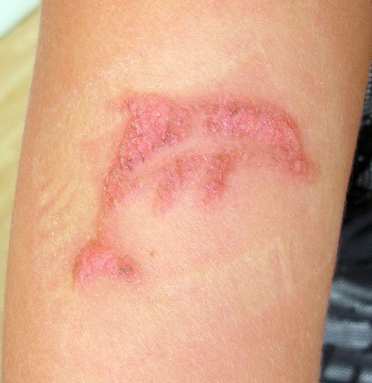
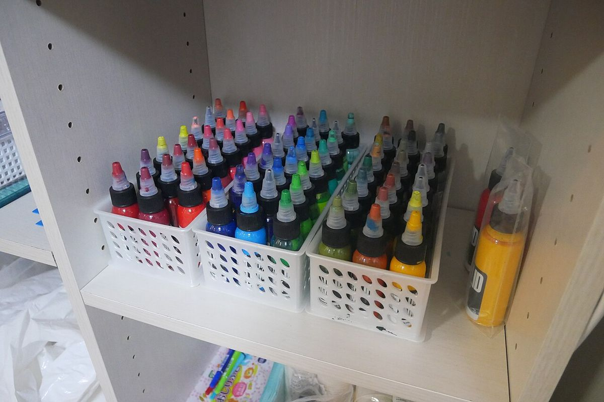
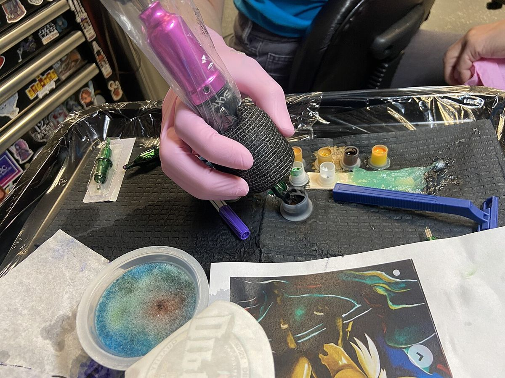

# Аллергия на тату: как проявляется и когда идти к врачу

**Коротко:** аллергия на краску для тату обычно выглядит как красная бугристая зудящая сыпь, шелушение и отёк в тех местах, где ввели пигмент. Она может появиться через неделю после сеанса, а может через месяцы или годы. Чаще реакции дают красные пигменты, но другие цвета тоже способны вызвать аллергию. Покраснение и шелушение в первые недели не всегда аллергия, а жар, гной, выделения и температура похожи на инфекцию. При любой подозрительной реакции нужен врач, а не самолечение.

> Это не медицинский совет. Мы пересказываем рекомендации врачей и официальных организаций. Поставить диагноз и назначить лечение может только врач, дерматолог или аллерголог.

*Дерматит от временной тату чёрной хной. Это не татуировка иглой, но фото показывает, как может выглядеть острая кожная реакция на краситель.* Фото: Gzzz, [Wikimedia Commons](https://commons.wikimedia.org/wiki/File:Dermititis_black_henna.JPG), лицензия [CC BY-SA 4.0](https://creativecommons.org/licenses/by-sa/4.0).

## Что такое аллергия на тату

Чернила для тату - смесь пигментов и других компонентов. [FDA](https://www.fda.gov/consumers/consumer-updates/think-you-ink-tattoo-safety) пишет, что получала сообщения об аллергических реакциях на краски, а сыпь на коже около тату может означать такую реакцию. Из-за того, что краска остаётся в коже навсегда, реакция тоже может держаться.

[Mayo Clinic](https://www.mayoclinic.org/healthy-lifestyle/adult-health/in-depth/tattoos-and-piercings/art-20045067) уточняет: аллергическая реакция проявляется зудящей сыпью в месте тату, она бывает даже через годы после сеанса, а красные чернила дают её чаще других. Новозеландский справочник по кожным болезням [DermNet](https://dermnetnz.org/topics/tattoo-associated-skin-reactions) отмечает, что чаще всего это аллергический контактный дерматит и фотоаллергический дерматит. Реакция выглядит как воспалённая красная сыпь, иногда с шелушением.

## Как выглядит аллергия: признаки

- красная сыпь или бугорки в зоне тату, часто зудящие;
- шелушение и сухость кожи в месте пигмента;
- отёк, ощущение жжения;
- реакция только на один цвет рисунка (например, только красные или жёлтые элементы);
- реакция при выходе на солнце: DermNet пишет, что жёлтые пигменты на основе сульфида кадмия особенно склонны вызывать реакцию на солнечный свет, а [AAD](https://www.aad.org/public/everyday-care/skin-care-basics/tattoos/caring-for-tattooed-skin) предупреждает, что УФ-свет солярия и ламп у некоторых людей взаимодействует с краской и вызывает болезненную реакцию кожи.

Ассоциация по астме и аллергии США [AAFA](https://community.aafa.org/db/ask-the-allergist/record/can-you-be-allergic-to-tattoo-ink) отмечает, что реакция может возникнуть в течение недели после сеанса или через месяцы и годы, и что реакцию способен вызвать любой цвет, включая белый. Для белой краски AAFA добавляет, что лосьоны, химические солнцезащитные средства и солнце могут усилить реакцию.

## Аллергия, нормальное заживление или инфекция: сравнение

| Признак | Аллергия на краску | Нормальное заживление | Возможная инфекция |
|---|---|---|---|
| Что видно | Красная бугристая сыпь, шелушение, часто зуд | Покраснение, шелушение, корочки, лёгкий зуд (Cleveland Clinic) | Горячая кожа, запах или выделения, красные полосы, расширяющееся покраснение |
| Когда появляется | От первых дней до месяцев и лет | В течение первых недель, затем проходит | Чаще в период заживления |
| Где | Там, где пигмент, иногда один цвет | По всей свежей тату | Может выходить за границы тату |
| Температура | Обычно нет | Нет | Возможна лихорадка, озноб, потливость (FDA) |
| Что делать | К дерматологу или аллергологу | Уход по инструкции мастера | К врачу срочно |

Таблица помогает сориентироваться, но не заменяет осмотр. Признаки могут частично совпадать, поэтому при сомнениях идите к врачу. Подробнее о том, что считается нормальным заживлением: [Шелушение тату по дням](/tattoo-spravochnik/sheluschenie-tatu-po-dnyam/) и [Тату чешется: что делать](/tattoo-spravochnik/tatu-cheshetsya-chto-delat/).

*Цветные краски для тату. В составе красок бывают разные пигменты, и состав не всегда известен потребителю.* Фото: Nesnad, [Wikimedia Commons](https://commons.wikimedia.org/wiki/File:Variouscolorsoftattooink-injapan-2018-10-5.jpg), лицензия [CC BY 4.0](https://creativecommons.org/licenses/by/4.0).

## Какие цвета чаще дают реакцию

DermNet пишет, что чаще всего аллергию вызывают красные пигменты, особенно с сульфидом ртути, а реакции на чёрные, синие, фиолетовые и зелёные краски встречаются заметно реже. Mayo Clinic тоже отмечает, что красные чернила чаще вызывают аллергию. С другой стороны, AAFA напоминает, что реакцию может дать любой цвет, поэтому нельзя считать, что черный точно безопасен.

Состав краски обычно не виден по готовой работе. FDA отмечает, что не одобрило ни одного пигмента для введения в кожу и что некоторые красители в чернилах применяются в тонерах и автомобильных красках. Если вы склонны к аллергиям, обсудите это с врачом до сеанса.

Есть и отдалённые последствия. FDA предупреждает: если в краске тату есть п-фенилендиамин (PPD), возможна аллергия и на другие продукты, например на краску для волос. На фото вверху временный рисунок хной, не татуировка иглой, он показан только как пример острой реакции кожи.

## Что делать, если подозреваете аллергию

1. Не расчёсывайте и не срывайте корочки. Не наносите на кожу случайные мази и кремы. Мы не называем конкретные средства: назначение делает врач.
2. Запишитесь к дерматологу или аллергологу. Если есть высокая температура, озноб, быстро растущая краснота, гной, обращайтесь срочно.
3. Сообщите мастеру. FDA рекомендует сказать об этом тату-мастеру, чтобы он мог определить краску и больше её не использовать, и узнать марку, цвет и номер партии краски или разбавителя.
4. Сохраните фото кожи: по датам и без фильтров. Это поможет врачу понять, как развивалась реакция.
5. Если считаете, что салон нарушил санитарные правила, можно обратиться в Роспотребнадзор. Это отдельный от медицинской помощи шаг.

AAFA отмечает, что в некоторых случаях лечение может потребовать лазерного удаления тату. Это решение врача, не самостоятельное. О лазере: [Лазерное удаление тату](/tattoo-spravochnik/lazernoe-udalenie-tatu/).

## Как снизить риск перед следующим сеансом

- Расскажите врачу и мастеру о прошлых реакциях и об аллергиях на краски, металлы, латекс.
- Спросите мастера, какие краски он использует, и попросите показать упаковку и срок годности. Это поможет определить виновника, если реакция всё же возникнет.
- Если раньше была реакция, спросите врача, как безопасно планировать новую работу.
- Выбирайте проверенного мастера, который соблюдает санитарные правила: об этом [Как выбрать тату-мастера](/tattoo-spravochnik/kak-vybrat-tatu-mastera/).
- Защищайте тату от солнца: [Тату и солнце](/tattoo-spravochnik/tatu-i-solnce/).

*Краска в отдельном колпачке на рабочем столе мастера. Иллюстративное фото процесса, не показывает реакцию.* Фото: Myotus (работа тату-мастера Jenna Haas), [Wikimedia Commons](https://commons.wikimedia.org/wiki/File:16-dipping_in_to_the_ink_well-rinse_cup_with_sponge_in_foreground.jpg), лицензия [CC BY-SA 4.0](https://creativecommons.org/licenses/by-sa/4.0).

## Когда идти к врачу

Идите к врачу, если сыпь и зуд держатся, усиливаются или появляются спустя недели, месяцы и годы после тату. Идите срочно, если есть лихорадка, озноб, гной или неприятный запах, красные полосы от тату в сторону тела, нарастающая боль и расширяющееся покраснение. Это признаки, которые [Cleveland Clinic](https://health.clevelandclinic.org/tattoo-aftercare) называет поводом для визита к врачу. При отёке вокруг глаз или затруднённом дыхании вызывайте скорую по номеру 103 или 112. Про воспаление: [Тату воспалилась: что делать](/tattoo-spravochnik/tatu-vospalilas-chto-delat/).

## Частые вопросы

### Может ли быть аллергия на тату через несколько лет?

Да. Mayo Clinic и FDA пишут, что реакция на краску может возникнуть как сразу, так и спустя годы. Если тату вдруг начала чесаться, краснеть или шелушиться без причины, покажитесь дерматологу.

### На какую краску чаще всего аллергия?

Чаще всего реакции описывают на красные пигменты, особенно содержащие соединения ртути, по данным DermNet и Mayo Clinic. Но AAFA подчёркивает, что реакцию может вызвать любой цвет, включая белый.

### Как отличить аллергию от обычного заживления?

При нормальном заживлении в первые недели бывают покраснение, шелушение, корочки и зуд, и это постепенно проходит. Аллергия чаще выглядит как стойкая красная бугристая сыпь именно там, где краска, и может появиться позже. Точно различит только врач, поэтому не откладывайте визит.

### Что делать, если после тату зуд и сыпь?

Не расчёсывайте, не срывайте корочки и не наносите случайные мази. Свяжитесь с мастером и запишитесь к врачу. Если есть температура, озноб, гной или быстро растущее покраснение, обращайтесь срочно.

### Проходит ли аллергия на тату сама?

Не всегда. FDA пишет, что из-за постоянства краски реакция может сохраняться. Healthline отмечает, что иногда симптомы длятся несколько дней или недель, но предсказать это нельзя. Поэтому лечение подбирает врач.

### Можно ли делать новые тату, если была аллергия?

Обсудите это с врачом до сеанса и расскажите мастеру о прошлой реакции. Решение зависит от того, на что именно была реакция. Мы не даём универсального ответа.

---

## Записаться в ТатуНаХоду

Если у вас были реакции на краску, расскажите о них мастеру до сеанса. Напишите нам в Telegram, мы ответим на вопросы по подготовке.

👉 [Записаться в Telegram](https://t.me/tatunahody)

Telegram-канал ТатуНаХоду: [t.me/tattoo_na_hodu](https://t.me/tattoo_na_hodu)

## Источники изображений

- `dermatit-ot-chernoy-hny.jpg` - файл Dermititis black henna.JPG, автор: Gzzz, источник: [Wikimedia Commons](https://commons.wikimedia.org/wiki/File:Dermititis_black_henna.JPG), лицензия: [CC BY-SA 4.0](https://creativecommons.org/licenses/by-sa/4.0). Без изменений, кроме уменьшения размера.
- `polka-s-cvetnymi-kraskami-dlya-tatu.jpg` - файл Variouscolorsoftattooink-injapan-2018-10-5.jpg, автор: Nesnad, источник: [Wikimedia Commons](https://commons.wikimedia.org/wiki/File:Variouscolorsoftattooink-injapan-2018-10-5.jpg), лицензия: [CC BY 4.0](https://creativecommons.org/licenses/by/4.0). Без изменений, кроме уменьшения размера.
- `kraska-v-kolpachke-i-mashinka.jpg` - файл 16-dipping in to the ink well-rinse cup with sponge in foreground.jpg, автор: Myotus (работа тату-мастера Jenna Haas), источник: [Wikimedia Commons](https://commons.wikimedia.org/wiki/File:16-dipping_in_to_the_ink_well-rinse_cup_with_sponge_in_foreground.jpg), лицензия: [CC BY-SA 4.0](https://creativecommons.org/licenses/by-sa/4.0). Без изменений, кроме уменьшения размера.

## Источники фактов

- [FDA: Think Before You Ink, Tattoo Safety](https://www.fda.gov/consumers/consumer-updates/think-you-ink-tattoo-safety)
- [Mayo Clinic: Tattoos, understand risks and precautions](https://www.mayoclinic.org/healthy-lifestyle/adult-health/in-depth/tattoos-and-piercings/art-20045067)
- [Cleveland Clinic: Tattoo Aftercare](https://health.clevelandclinic.org/tattoo-aftercare)
- [AAD: Caring for tattooed skin](https://www.aad.org/public/everyday-care/skin-care-basics/tattoos/caring-for-tattooed-skin)
- [DermNet: Tattoo-associated skin reactions](https://dermnetnz.org/topics/tattoo-associated-skin-reactions)
- [AAFA: Can you be allergic to tattoo ink?](https://community.aafa.org/db/ask-the-allergist/record/can-you-be-allergic-to-tattoo-ink)
- [Healthline: Tattoo allergy](https://www.healthline.com/health/tattoo-allergy)
