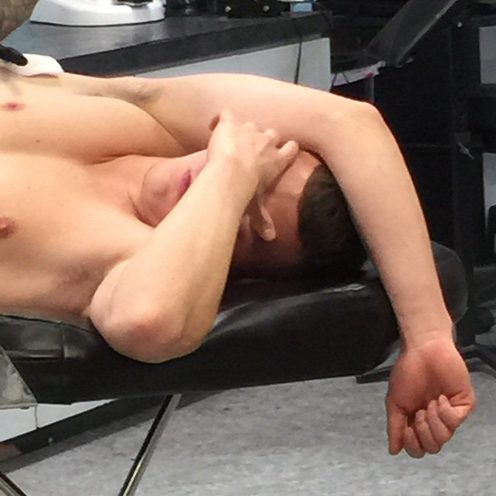
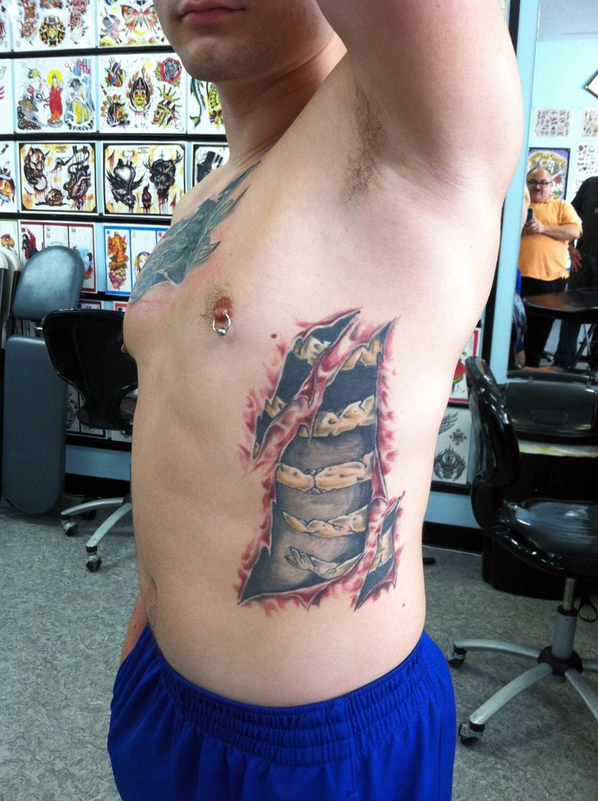
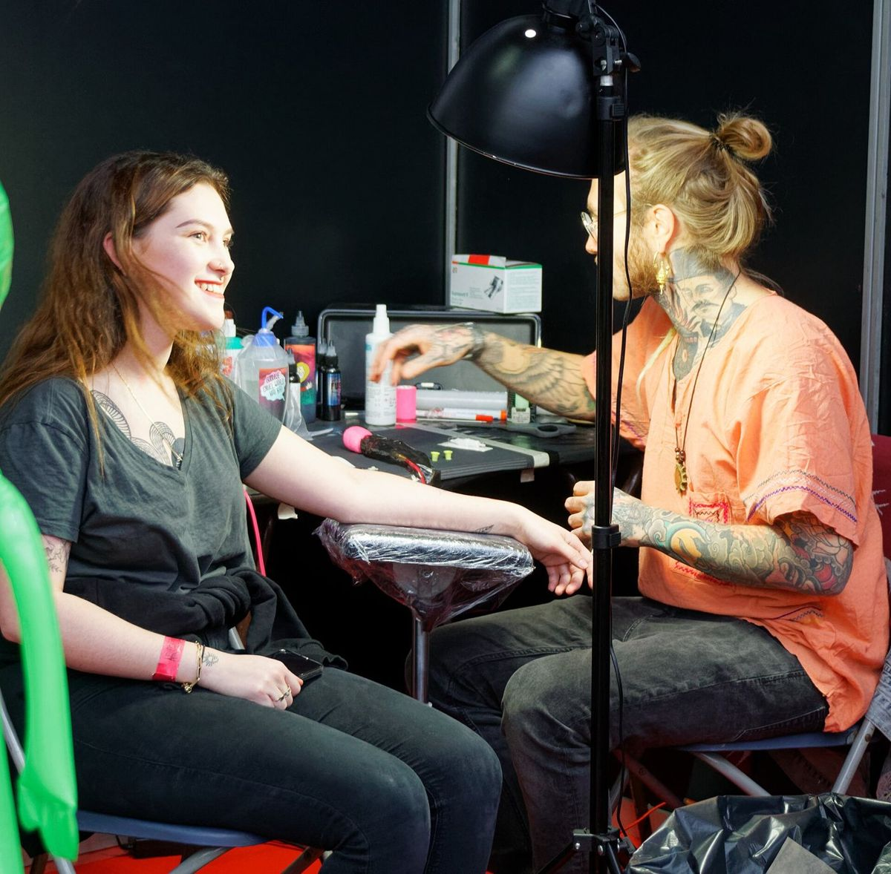
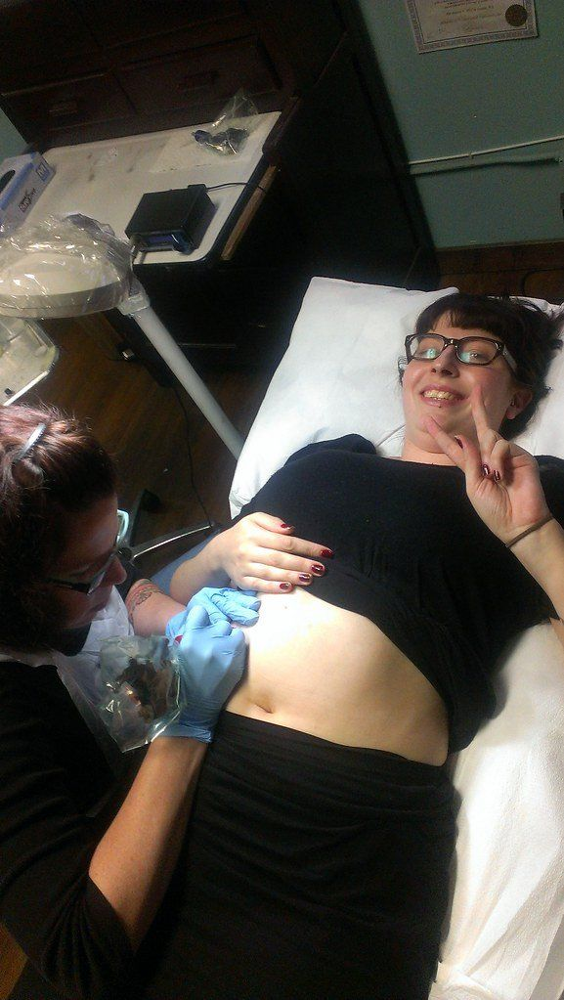
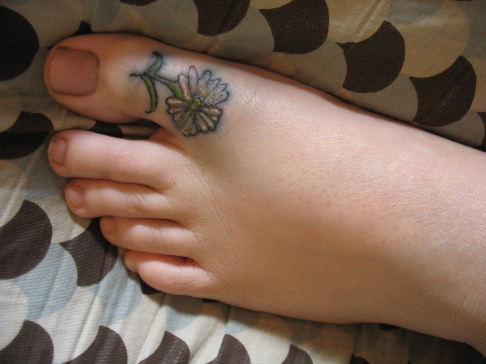

# Больно ли делать тату: карта боли по зонам тела

**Коротко:** да, тату — это неприятно, но для большинства людей вполне терпимо. Обычно меньше болят места с плотной кожей и мягкими тканями — внешняя сторона плеча и бедра, предплечье, икра, верх спины. Больнее там, где кожа тонкая, кость близко или много нервных окончаний — рёбра, грудина, позвоночник, стопы, кисти, подмышки, локти и колени. Но разница между людьми часто больше, чем между зонами: на ощущения сильно влияют длительность сеанса, усталость, стресс и сон.

> Это не медицинский совет. Если у вас есть хронические заболевания, вы принимаете лекарства или планируете обезболивание, обсудите это с врачом.

*Честно: на некоторых зонах бывает очень неприятно. Попросить перерыв — нормально.* Фото: Tobyotter, [Flickr](https://www.flickr.com/photos/78428166@N00/16192435894), лицензия [CC BY 2.0](https://creativecommons.org/licenses/by/2.0/).

## На что похожа боль

Чаще всего ощущения описывают как царапание горячей иглой, сильное пощипывание или «как будто кошка царапает по одному месту». На контуре боль обычно острее, на закраске и тенях — более тупая, «жгучая», особенно когда мастер проходит по одному участку несколько раз. Над костью многие чувствуют вибрацию, которая отдаёт глубже.

Важная деталь: боль в процессе меняется. Первые минуты часто самые неприятные, потом тело немного привыкает. А через несколько часов кожа становится чувствительнее, и терпеть сложнее.

## Карта боли по зонам

Сразу честно: «точных» карт боли с баллами от 1 до 10 не существует. Таблицы в интернете переписывают друг у друга, и научных данных под конкретными цифрами нет. В исследовании 2020 года (Witkoś и Hartman-Petrycka, International Journal of Environmental Research and Public Health), где опросили более тысячи человек в Польше, зона тела (в исследовании их делили крупно: руки, ноги, корпус, шея) не оказалась значимым фактором силы боли. Сильнее влияли длительность сеанса, кровоточивость и уровень стресса. Поэтому мы делим зоны на три группы по опыту мастеров и по понятной причине: толщина кожи, близость кости, подвижность и количество нервов.

| Зона | Ориентировочно | Почему |
|---|---|---|
| Внешняя сторона плеча | Терпимо | Плотная кожа, мышцы, кость не близко |
| Внешняя сторона предплечья | Терпимо | Хорошая «подушка» из тканей |
| Внешняя и передняя сторона бедра | Терпимо | Много мягких тканей |
| Икра | Терпимо | Мышца под кожей |
| Верх спины, лопатки (кроме выступающих костей) | Терпимо | Плотная кожа |
| Внутренняя сторона плеча и предплечья | Средне | Кожа тоньше и чувствительнее |
| Запястье | Средне | Тонкая кожа, близко сухожилия и кость |
| Живот, бока | Средне, у многих выше | Мягкая кожа, тянется, зависит от телосложения |
| Грудь | Средне, у многих выше | Ближе к грудине — больнее |
| Шея (задняя сторона) | Средне | Отдаёт вибрация |
| Рёбра | Больно | Тонкая кожа над костью, двигается при дыхании |
| Грудина | Больно | Кость прямо под кожей |
| Позвоночник | Больно | Вибрация по костям |
| Подмышка | Больно | Очень чувствительная кожа |
| Локоть, сгиб локтя, колено, подколенная ямка | Больно | Тонкая кожа, кость или постоянное движение |
| Кисти и пальцы | Больно | Кость, много нервов, тату ещё и хуже держится |
| Стопа и лодыжка | Больно | Кость, тонкая кожа, трение обувью при заживлении |
| Голова, лицо, передняя часть шеи | Больно | Тонкая кожа, много нервов |
| Пах, внутренняя сторона бедра | Больно | Тонкая, чувствительная кожа |

*Рёбра — одна из самых болезненных зон: тонкая кожа над костью, которая двигается при каждом вдохе.* Фото: Tony Alter from Newport News, USA, [Wikimedia Commons](https://commons.wikimedia.org/wiki/File:Torn_Flesh-Broken_Ribs_Tattoo_%2814714721996%29.jpg), лицензия [CC BY 2.0](https://creativecommons.org/licenses/by/2.0).

Если это ваша первая татуировка и вы боитесь боли, мы обычно советуем начать с зон из первой группы — плечо, предплечье, бедро, икра. Там проще оценить свои ощущения и спокойно пройти первый сеанс.

*Плечо и предплечье — одни из самых комфортных зон для первой тату.* Фото: Miguel Discart from Bruxelles, Belgique, [Wikimedia Commons](https://commons.wikimedia.org/wiki/File:Getting_tattooed.jpg), лицензия [CC BY-SA 2.0](https://creativecommons.org/licenses/by-sa/2.0).

## От чего ещё зависит боль

### Длительность и размер

Чем дольше сеанс, тем тяжелее. Короткие сеансы по полтора-два часа обычно переносятся гораздо легче, чем один марафон на целый день. Большие работы разбивают на несколько сеансов не только из-за кожи, но и ради вашего комфорта.

### Техника и стиль

Тонкий контур, плотная заливка чёрным и мягкие тени ощущаются по-разному. Многократные проходы по одному месту обычно болезненнее. Хороший мастер работает аккуратно и не травмирует кожу больше, чем нужно.

### Ваше состояние

Боль сильнее, когда вы:

- не выспались или голодны;
- нервничаете и ждёте худшего;
- простужены или устали;
- накануне пили алкоголь.

В том же исследовании 2020 года боль была сильнее у тех, у кого сеанс длился дольше и кто сильнее нервничал.

## Как пережить сеанс легче

*Настрой многое решает: спокойствие и отвлечение помогают перенести сеанс легче.* Фото: danoxster, [Flickr](https://www.flickr.com/photos/41132143@N00/11240514825), лицензия [CC BY-SA 2.0](https://creativecommons.org/licenses/by-sa/2.0/).

1. **Выспитесь и поешьте** за 1–2 часа до сеанса. Возьмите воду и что-нибудь сладкое.
2. **Не пейте алкоголь** накануне и в день сеанса.
3. **Не принимайте лекарства «для смелости» и разжижающие кровь средства** без согласования с врачом. Если вы регулярно принимаете препараты, скажите об этом мастеру заранее.
4. **Дышите ровно.** Задержка дыхания усиливает напряжение, а на рёбрах ещё и мешает мастеру.
5. **Просите перерыв**, когда нужно. Это нормально, мастер не обидится.
6. **Отвлекайтесь**: наушники, сериал, разговор.
7. **Обезболивающие кремы** обсуждайте с мастером до сеанса. Они подходят не всем и не для всех случаев, а некоторые могут влиять на кожу и работу.
8. **Выбирайте реалистичный формат**: если боитесь, лучше два коротких сеанса, чем один длинный.

## Когда идти к врачу

Сама по себе боль во время сеанса и пара дней болезненности после — норма. Но к врачу стоит обратиться, если:

- через 2–3 дня боль не стихает, а нарастает;
- тату горячее, сильно отекает, есть гной или неприятный запах;
- поднялась температура;
- появилась сыпь, сильный зуд или волдыри.

*Лёгкий отёк после тату на стопе в первые дни встречается часто. Если отёк и боль нарастают — это повод показаться врачу.* Фото: nikoretro, [Flickr](https://www.flickr.com/photos/22768390@N00/4850397387), лицензия [CC BY-SA 2.0](https://creativecommons.org/licenses/by-sa/2.0/).

Людям с нарушениями свёртываемости крови, сахарным диабетом, кожными заболеваниями, а также во время беременности решение о тату лучше заранее обсудить с врачом.

## Частые вопросы

### Где делать первую тату, чтобы было не больно?

Совсем без боли не бывает, но легче всего обычно переносятся внешняя сторона плеча и предплечья, бедро и икра.

### Правда ли, что женщины терпят боль лучше?

Однозначного ответа нет. В польском исследовании 2020 года, посвящённом именно этому вопросу, разницы в силе боли во время сеанса между женщинами и мужчинами не нашли. Сразу после сеанса женщины в среднем оценивали боль чуть выше. Но разброс между отдельными людьми большой, так что ориентируйтесь на себя, а не на пол.

### Больнее ли второй раз?

Не обязательно. Многие на втором сеансе спокойнее, потому что знают, чего ждать. Но если кожа ещё не восстановилась после предыдущей работы на том же месте, будет чувствительнее.

### Сколько болит тату после сеанса?

Обычно 1–3 дня ощущается как ссадина или солнечный ожог, потом болезненность уходит и начинаются зуд и шелушение — что при этом нормально, мы разобрали в статье [«Шелушение тату по дням»](/tattoo-spravochnik/sheluschenie-tatu-po-dnyam/). Если боль нарастает, это повод показаться врачу.

### Можно ли выпить обезболивающее перед сеансом?

Не принимайте ничего самостоятельно «на всякий случай»: некоторые препараты влияют на кровоточивость. Если нужно обезболивание, посоветуйтесь с врачом и предупредите мастера.

---

## Записаться в ТатуНаХоду

Боитесь, что будет больно? В «ТатуНаХоду» (Москва) подскажем зону и размер для первой работы, разобьём большую тату на комфортные сеансы и будем делать перерывы, когда нужно.

👉 [Записаться в Telegram](https://t.me/tatunahody)

Работы мастеров и новости студии — в нашем Telegram-канале: [t.me/tattoo_na_hodu](https://t.me/tattoo_na_hodu)

## Источники изображений

- `muzhchina-zakryvaet-lico-vo-vremya-tatu.jpg` — «A Little Pain», автор: Tobyotter, источник: [Flickr](https://www.flickr.com/photos/78428166@N00/16192435894), лицензия: [CC BY 2.0](https://creativecommons.org/licenses/by/2.0/). Без изменений, кроме уменьшения размера.
- `svezhaya-tatu-na-rebrah.jpg` — «Torn Flesh-Broken Ribs Tattoo (14714721996).jpg», автор: Tony Alter from Newport News, USA, источник: [Wikimedia Commons](https://commons.wikimedia.org/wiki/File:Torn_Flesh-Broken_Ribs_Tattoo_%2814714721996%29.jpg), лицензия: [CC BY 2.0](https://creativecommons.org/licenses/by/2.0). Без изменений, кроме уменьшения размера.
- `devushka-ulybaetsya-vo-vremya-tatu-na-ruke.jpg` — «Getting tattooed.jpg», автор: Miguel Discart from Bruxelles, Belgique, источник: [Wikimedia Commons](https://commons.wikimedia.org/wiki/File:Getting_tattooed.jpg), лицензия: [CC BY-SA 2.0](https://creativecommons.org/licenses/by-sa/2.0). Без изменений, кроме уменьшения размера.
- `devushka-vo-vremya-tatu-na-zhivote.jpg` — «Anna gets tattooed», автор: danoxster, источник: [Flickr](https://www.flickr.com/photos/41132143@N00/11240514825), лицензия: [CC BY-SA 2.0](https://creativecommons.org/licenses/by-sa/2.0/). Без изменений, кроме уменьшения размера.
- `otek-stopy-posle-tatu-na-palce.jpg` — «Slightly swolen foot post toe tattoo», автор: nikoretro, источник: [Flickr](https://www.flickr.com/photos/22768390@N00/4850397387), лицензия: [CC BY-SA 2.0](https://creativecommons.org/licenses/by-sa/2.0/). Без изменений, кроме уменьшения размера.
