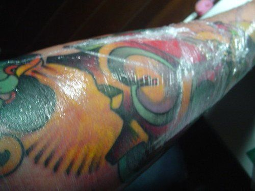
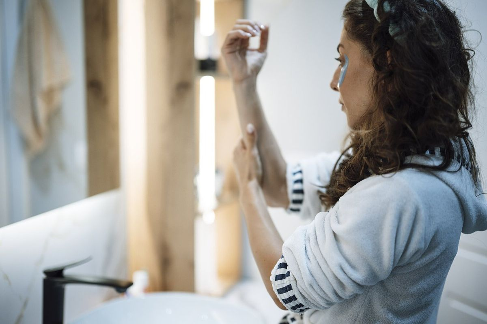
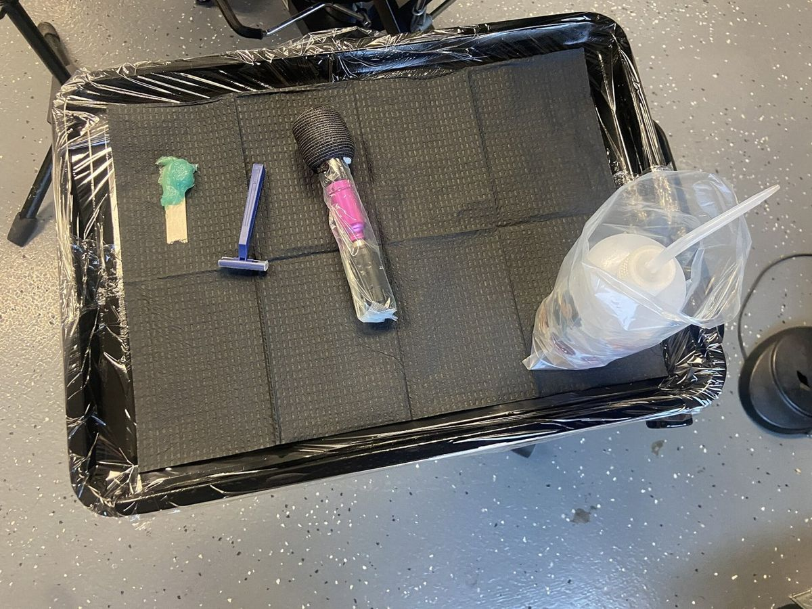
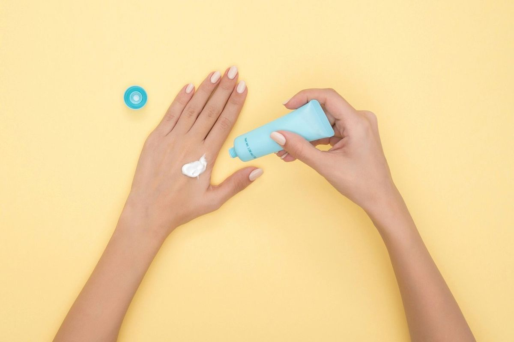
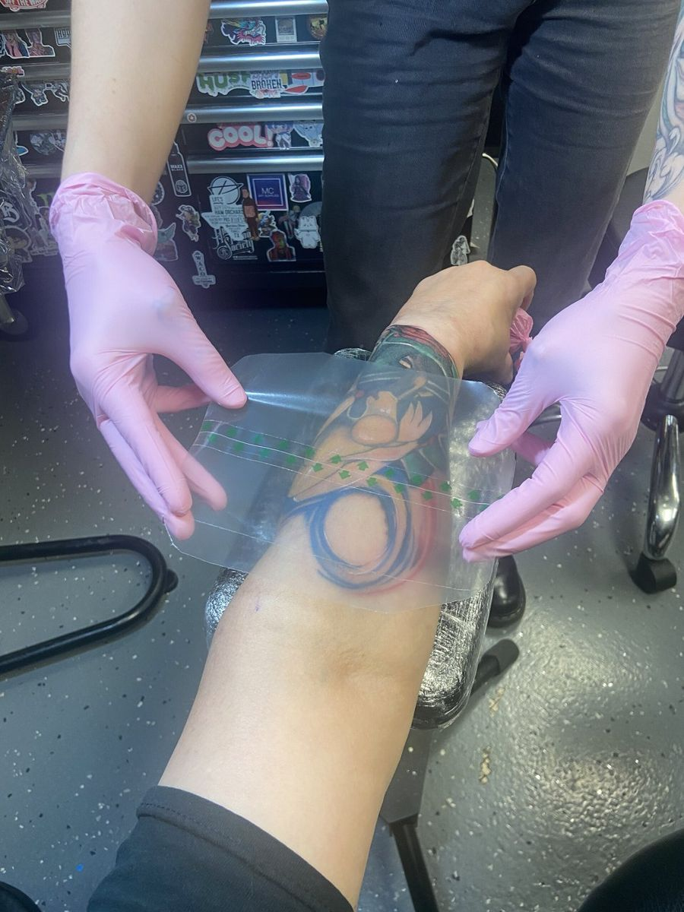

# Чем мазать тату после снятия плёнки: сравнение средств

**Коротко:** после снятия плёнки тату нужно мягко промыть, промокнуть и нанести **очень тонкий слой** простого средства без отдушек, спирта и красителей. В первые дни подходит лёгкая заживляющая мазь или крем, когда кожа перестала мокнуть и начала сохнуть, удобнее перейти на лёгкий увлажняющий крем или лосьон. Главное — не количество и не бренд, а тонкий слой, чистые руки и отсутствие раздражающих добавок. Если мастер дал свою инструкцию, ориентируйтесь в первую очередь на неё.

> Это не медицинский совет. Мы описываем общие принципы ухода и опыт студии. При аллергии, кожных заболеваниях или признаках воспаления посоветуйтесь с врачом.

*Свежая работа под плёнкой. После её снятия начинается домашний уход — промывание и тонкий слой средства.* Фото: ftrc, [Flickr](https://www.flickr.com/photos/81035303@N00/92625137), лицензия [CC BY-SA 2.0](https://creativecommons.org/licenses/by-sa/2.0/).

## Сначала — промывание

Средство наносят только на чистую сухую кожу. Порядок такой:

1. Вымойте руки с мылом.
2. Снимите плёнку так, как сказал мастер. Плотную заживляющую плёнку легче снимать под тёплой водой, оттягивая её вдоль кожи, а не вверх.
3. Промойте тату тёплой (не горячей) водой с мягким мылом без отдушек. Пальцами, без мочалки.
4. Промокните чистым одноразовым бумажным полотенцем. Не трите и не пользуйтесь общим банным полотенцем.
5. Дайте коже подсохнуть несколько минут.
6. Нанесите средство тонким слоем.

## Какие бывают средства

В аптеках и тату-магазинах продаётся много всего, но почти любое средство относится к одному из нескольких типов. Важнее понимать тип и состав, чем гнаться за конкретной маркой.

| Тип средства | Как работает | Когда уместно | На что обратить внимание |
|---|---|---|---|
| Плотная мазь на вазелиновой (петролатумной) основе | Создаёт плёнку, удерживает влагу | Иногда в первые 1–3 дня, тонким слоем, если так рекомендует мастер | Толстый слой «душит» кожу, может забивать поры и мешать заживлению. Чистый вазелин толстым слоем обычно не советуют |
| Крем или мазь с декспантенолом (пантенолом) | Увлажняет, пантенол часто используют в средствах для заживления кожи | Первая–вторая неделя | Выбирайте без отдушек. Тонкий слой, по необходимости |
| Лёгкий увлажняющий крем или лосьон без отдушек | Снимает сухость и стянутость | Этап шелушения и до конца заживления | Без отдушек, спирта, красителей, кислот и скраб-частиц |
| Специальные кремы «для тату» | Обычно это тот же увлажняющий крем или бальзам | Если нравится текстура | Читайте состав: надпись «для тату» сама по себе не гарантирует, что он лучше простого крема |
| Натуральные масла и бальзамы (кокосовое масло, масло ши и т.п.) | Смягчают | Скорее после заживления | Состав нестабилен, возможна аллергия. На свежую тату — только если советует мастер |
| Антибиотиковые мази | Действуют против бактерий | Только по назначению врача | Не нужны «для профилактики»; при подозрении на инфекцию идите к врачу, а не лечитесь сами |
| Спиртовые растворы, перекись, зелёнка и т.п. | Сушат, раздражают | Не для ухода за тату | Повреждают заживающую кожу |

*Лёгкий крем без отдушек — основной вариант на этапе шелушения. Иллюстративное фото, без тату.* Фото: Shixart1985, [Wikimedia Commons](https://commons.wikimedia.org/wiki/File:Woman_applying_cream_on_her_arm_in_a_bathroom.jpg), лицензия [CC BY 2.0](https://creativecommons.org/licenses/by/2.0).

### Почему без отдушек

Свежая тату — это повреждённая кожа, и на неё чаще бывает реакция. В медицинской литературе описан случай, когда ароматизированный лосьон на заживающей тату вызвал аллергический контактный дерматит, после которого рисунок преждевременно поблёк, а текстура кожи изменилась ([Pona и соавт., Dermatology Online Journal, 2020](https://pmc.ncbi.nlm.nih.gov/articles/PMC10205046/)). Это единичное наблюдение, а не статистика, но авторы делают из него тот же вывод: на время заживления отдушек лучше избегать. Поэтому мы советуем на время заживления убрать всё с ароматизаторами, даже если раньше кожа на них не реагировала.

### А вазелин можно?

Здесь мнения расходятся. Одни специалисты допускают мази на петролатумной основе в первые дни, другие — например, [Американская академия дерматологии](https://www.aad.org/public/everyday-care/skin-care-basics/tattoos/caring-for-tattooed-skin) — советуют при сухости кожи с тату лосьон или крем на водной основе и предупреждают, что средства на основе петролатума, например вазелин, могут способствовать выцветанию краски. Мы придерживаемся осторожного варианта: если используете жирную мазь, то только в первые дни и тончайшим слоем, а дальше лучше лёгкий крем.

*Подготовка рабочего места мастера: мазь, бритва, машинка и мыло. Каким средством ухаживать дома, мастер подскажет после сеанса.* Фото: Myotus, [Wikimedia Commons](https://commons.wikimedia.org/wiki/File:04-tray_with_left_to_right,_ointment,_razor,_tattoo_machine_and_soap.jpg), лицензия [CC BY-SA 4.0](https://creativecommons.org/licenses/by-sa/4.0).

## Как понять, что вы мажете правильно

- После нанесения тату слегка блестит, а не покрыта белым или жирным слоем.
- Излишки вы промокнули салфеткой.
- Кожа не размокает и не становится белёсой.
- Мажете по необходимости: когда кожа стянута и сухая, обычно это несколько раз в день. Не нужно «обновлять слой» каждый час.

*Средства нужно совсем немного: тонкий слой без белых разводов. Иллюстративное фото, без тату.* Фото: Moose Photos (Pexels), [Wikimedia Commons](https://commons.wikimedia.org/wiki/File:Woman_applying_cream_to_hand.jpg), лицензия [CC0](http://creativecommons.org/publicdomain/zero/1.0/deed.en).

Признаки, что средства слишком много: тату постоянно влажное, появляются мелкие прыщики, корочки размокают и становятся белыми. В этом случае уменьшите слой и частоту.

## Схема ухода по этапам

### Первые 1–3 дня

Если на тату заживляющая плёнка «вторая кожа», мазать ничего не нужно, пока её не сняли. Если мастер использовал обычную плёнку и вы её уже сняли — промывание 1–2 раза в день и очень тонкий слой средства, которое рекомендовал мастер. Лёгкая болезненность в эти дни обычна — подробнее о том, как ощущается тату во время и после сеанса, в статье [«Больно ли делать тату»](/tattoo-spravochnik/bolno-li-delat-tatu-karta-boli/).

*Заживляющая плёнка «вторая кожа»: пока она на месте, мазать ничего не нужно.* Фото: Myotus, [Wikimedia Commons](https://commons.wikimedia.org/wiki/File:23A-applying_transparent_dressing_to_protect_tattoo_during_early_stages_of_healing_process.jpg), лицензия [CC BY-SA 4.0](https://creativecommons.org/licenses/by-sa/4.0).

### Примерно 4–14 день

Начинается сухость и шелушение — что при этом нормально, а что нет, мы подробно разобрали в статье [«Шелушение тату по дням»](/tattoo-spravochnik/sheluschenie-tatu-po-dnyam/). Это время для лёгкого увлажняющего крема без отдушек. Мажьте, когда кожа стянута или чешется.

### После второй недели

Крупные чешуйки сходят, кожа ещё может быть сухой и блестящей. Продолжайте увлажнять, пока она не станет обычной на ощупь. После полного заживления — солнцезащитный крем при выходе на солнце.

## Частые ошибки

1. **Толстый слой «чтобы лучше зажило».** Наоборот, мешает коже дышать и может замедлить заживление.
2. **Смена средств каждый день.** Сложнее понять, на что реакция, если она появится.
3. **Мазь без промывания.** Средство поверх сукровицы и грязи — плохая идея.
4. **Мазать грязными руками или пальцем из общей банки.** Лучше тюбик или чистый шпатель.
5. **Антибиотики «на всякий случай».** Без показаний не нужны и сами могут вызвать раздражение.

## Когда идти к врачу

- Через несколько минут или часов после нового средства появились краснота, сильный зуд, сыпь, отёк — смойте средство и, если не проходит, обратитесь к врачу.
- Краснота и боль нарастают, кожа горячая, есть гной или неприятный запах.
- Поднялась температура.
- Тату мокнет на второй неделе и не подсыхает.

При признаках инфекции не пытайтесь лечить её сами кремами из интернета — это задача врача.

## Частые вопросы

### Можно ли вообще ничего не мазать?

Некоторые так и делают, особенно с небольшими тату под заживляющей плёнкой. Но при сильной сухости кожа может трескаться, а это повышает риск корок и потери пигмента. Тонкий слой увлажняющего средства обычно делает заживление комфортнее.

### Сколько раз в день мазать?

По необходимости: когда кожа сухая и стянутая. Обычно это несколько раз в день. Ориентир — тату слегка блестит, но не жирное и не мокрое.

### Подойдёт ли детский крем?

Если в составе нет отдушек и он лёгкий — может подойти. Многие детские кремы ароматизированы, поэтому читайте состав.

### Чем мазать тату после заживления?

Обычным увлажняющим кремом по необходимости и солнцезащитным кремом с высоким SPF на солнце. Это помогает рисунку дольше оставаться ярким.

### Можно ли мазать тату средством с пантенолом?

Да, это один из самых распространённых вариантов для заживления кожи. Выбирайте форму без отдушек и наносите тонко.

---

## Записаться в ТатуНаХоду

В «ТатуНаХоду» (Москва) мы подробно рассказываем об уходе после сеанса и не бросаем клиента, пока тату заживает. Есть вопросы по заживлению или хотите новую работу — пишите.

👉 [Записаться в Telegram](https://t.me/tatunahody)

Работы мастеров и новости студии — в нашем Telegram-канале: [t.me/tattoo_na_hodu](https://t.me/tattoo_na_hodu)

## Источники изображений

- `svezhaya-cvetnaya-tatu-pod-plenkoy.jpg` — «new arm», автор: ftrc, источник: [Flickr](https://www.flickr.com/photos/81035303@N00/92625137), лицензия: [CC BY-SA 2.0](https://creativecommons.org/licenses/by-sa/2.0/). Без изменений, кроме уменьшения размера.
- `nanesenie-krema-na-ruku.jpg` — «Woman applying cream on her arm in a bathroom.jpg», автор: Shixart1985, источник: [Wikimedia Commons](https://commons.wikimedia.org/wiki/File:Woman_applying_cream_on_her_arm_in_a_bathroom.jpg), лицензия: [CC BY 2.0](https://creativecommons.org/licenses/by/2.0). Без изменений, кроме уменьшения размера.
- `podnos-tatu-mastera-maz-britva-mashinka.jpg` — «04-tray with left to right, ointment, razor, tattoo machine and soap.jpg», автор: Myotus, источник: [Wikimedia Commons](https://commons.wikimedia.org/wiki/File:04-tray_with_left_to_right,_ointment,_razor,_tattoo_machine_and_soap.jpg), лицензия: [CC BY-SA 4.0](https://creativecommons.org/licenses/by-sa/4.0). Без изменений, кроме уменьшения размера.
- `tonkiy-sloy-krema-iz-tyubika.jpg` — «Woman applying cream to hand.jpg», автор: Moose Photos ([Pexels](https://www.pexels.com/@moose-photos-170195/)), источник: [Wikimedia Commons](https://commons.wikimedia.org/wiki/File:Woman_applying_cream_to_hand.jpg), лицензия: [CC0](http://creativecommons.org/publicdomain/zero/1.0/deed.en). Без изменений, кроме уменьшения размера.
- `zazhivlyayushchaya-plenka-vtoraya-kozha-na-tatu.jpg` — «23A-applying transparent dressing to protect tattoo during early stages of healing process.jpg», автор: Myotus, источник: [Wikimedia Commons](https://commons.wikimedia.org/wiki/File:23A-applying_transparent_dressing_to_protect_tattoo_during_early_stages_of_healing_process.jpg), лицензия: [CC BY-SA 4.0](https://creativecommons.org/licenses/by-sa/4.0). Без изменений, кроме уменьшения размера.
