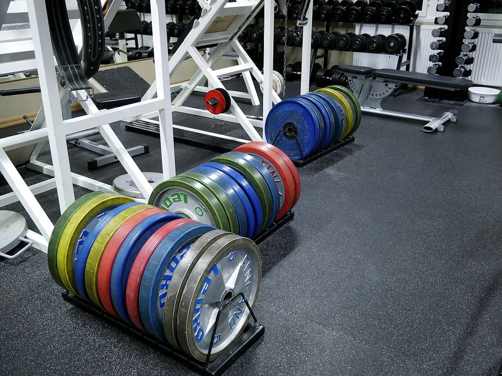
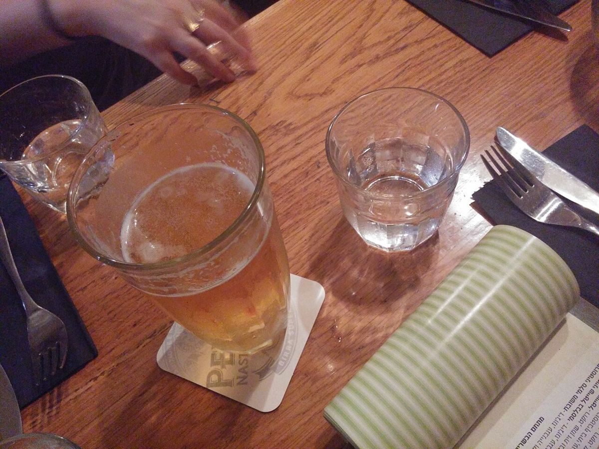
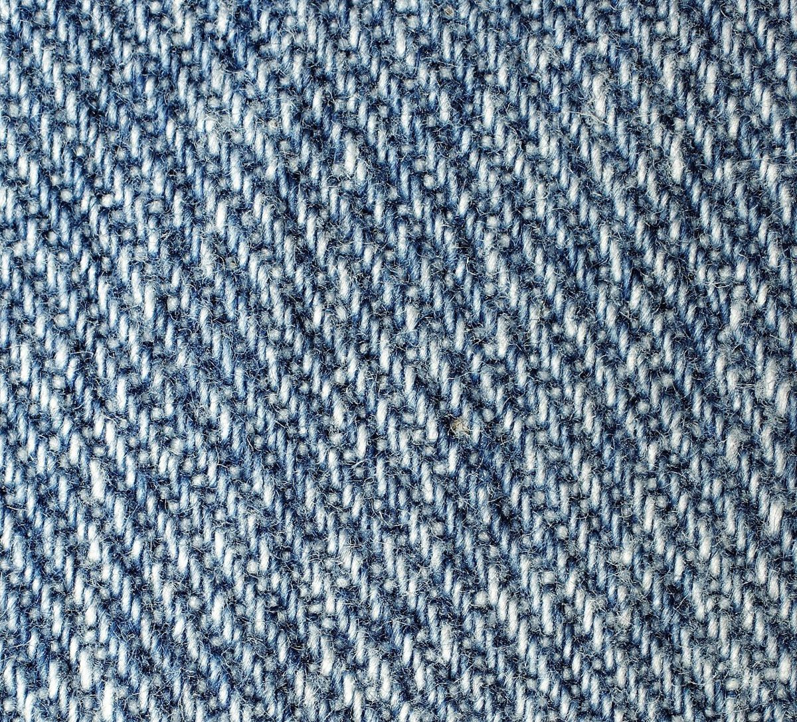
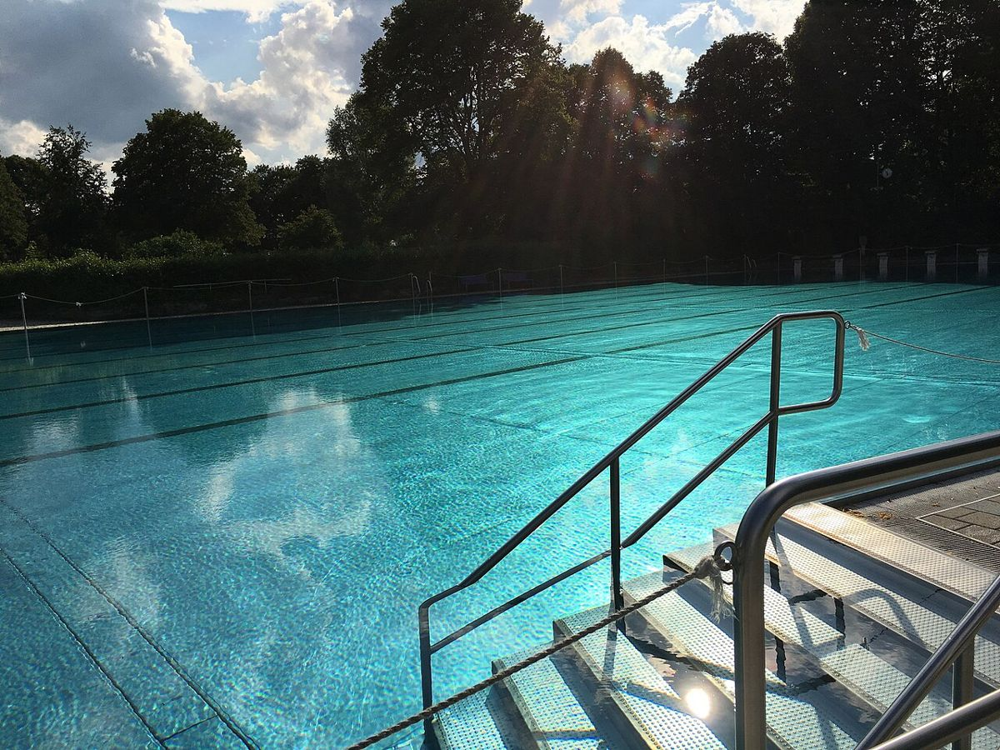

# Что нельзя делать после тату: спорт, алкоголь, одежда и вода

**Коротко:** пока тату заживает, её берегут как свежую рану. Mayo Clinic и Cleveland Clinic прямо просят не мочить тату в ванне, бассейне и открытой воде, беречь от солнца и не носить одежду, которая липнет к коже или натирает её. Врач раневого центра Ohio State University Wexner Medical Center советует в первые дни избегать сильного пота и не ходить в зал из-за микробов на общем оборудовании; лёгкую нагрузку он не запрещает. Отдельного запрета на алкоголь после сеанса в этих памятках нет: Mayo Clinic отдельно предупреждает не делать тату, если вы уже выпили. Срок возврата к спорту и привычной одежде универсально не зафиксирован - ориентир даёт мастер по вашей зоне и размеру, а при признаках воспаления нужен врач.

> Это не медицинский совет. Мы описываем общие принципы и ссылаемся на официальные источники. Инструкция вашего мастера важнее любой общей схемы. Если вас что-то беспокоит, особенно при аллергии, заболеваниях кожи или признаках воспаления, обратитесь к врачу.

*Тренажёрный зал: общее оборудование и сильный пот - две причины повременить с тренировкой, пока тату заживает. Иллюстративное фото, без тату.* Фото: Santeri Viinamäki, [Wikimedia Commons](https://commons.wikimedia.org/wiki/File:Weight_plates_in_gym_20180112.jpg), лицензия [CC BY-SA 4.0](https://creativecommons.org/licenses/by-sa/4.0).

## Почему ограничения вообще нужны

Свежая тату - это множество мелких проколов кожи с пигментом внутри. Пока верхний слой не закрылся, в рану проще попасть грязи, а трение, замачивание и жёсткий пот мешают коже спокойно затянуть поверхность. Именно об этом пишут Mayo Clinic, Cleveland Clinic и врач Ohio State: уход нужен не ради каприза студии, а чтобы снизить риск инфекции, рубца и смазанного рисунка.

Готового числа дней на все случаи жизни в этих источниках нет. Сроки заживления зависят от размера и зоны - об этом отдельно в статье [Сколько заживает тату](/tattoo-spravochnik/skolko-zazhivaet-tatu/). Ниже - что именно обычно нельзя и на каком основании, без выдуманных единых дедлайнов.

## Что обычно нельзя, пока тату заживает

| Что планируете | Пока кожа заживает | На чём основано |
|---|---|---|
| Ванна, бассейн, море, река, джакузи | Нельзя | Mayo Clinic: не плавать в бассейнах, джакузи, реках, озёрах и других водоёмах, пока тату заживает. Cleveland Clinic: не погружать область в воду |
| Тесная одежда, ремни, резинки, облегающее бельё на зоне тату | Нельзя | Cleveland Clinic: носить свободную дышащую одежду и до полного заживления не носить тесную. Mayo Clinic: не носить то, что может прилипнуть к тату |
| Сильный пот и зал с общим оборудованием в первые дни | Лучше отложить | Ohio State Wexner Medical Center: в первые дни не допускать обильного пота; зал как среду с микробами лучше не посещать. Лёгкая нагрузка этим источником не запрещена |
| Прямое солнце и солярий | Нельзя | Mayo Clinic и Cleveland Clinic: беречь заживающую тату от солнца. Про солярий и уже зажившую тату - в статье [Тату и солнце](/tattoo-spravochnik/tatu-i-solnce/) |
| Ковырять корочки и сдирать шелушение | Нельзя | Cleveland Clinic: не ковырять и не сдирать корочки и чешуйки |
| Скраб и жёсткое отшелушивание зоны | Нельзя, пока не заживёт | Cleveland Clinic: не отшелушивать область, пока тату полностью не заживёт |
| Алкоголь до сеанса | Нельзя приходить на сеанс после алкоголя | Mayo Clinic: не делать тату, если вы пили алкоголь или употребляли наркотики |
| Алкоголь после сеанса | В памятках Mayo и Cleveland отдельного запрета нет | Следуйте инструкции мастера. Если принимаете лекарства или у вас есть заболевания, спросите врача. Мы не выводим из этого медицинское правило про разжижение крови |

## Спорт, зал и пот

Самый частый вопрос - когда можно вернуться в зал. Жёсткой даты вроде через 7 или 14 дней в официальных источниках, на которые мы опираемся, нет.

Врач раневого центра Ohio State University Wexner Medical Center Ричард Шлангер пишет так: в первые дни лучше не допускать сильного пота, потому что соль и бактерии с кожи могут попасть в рану; лёгкая нагрузка допустима; вот зал как место, известное микробами, он советует обойти, пока рана открытая, и упоминает риск стафилококковой инфекции, включая MRSA.

Практический вывод из этого, а не универсальный срок:

- В день сеанса и ближайшие дни лучше не устраивать тяжёлую тренировку, бег до сильного пота, кроссфит и всё, что сильно растягивает или трёт зону тату.
- Если мастер разрешил лёгкую нагрузку, выбирайте то, что не давит на свежую работу одеждой, ремнём, лямками рюкзака, скамьёй или тренажёром.
- Общее оборудование, коврики и скамьи - отдельный риск для открытой кожи. Это не значит, что каждый поход в зал заканчивается инфекцией, но именно поэтому врач Ohio State просит зал временно убрать из расписания.
- Когда верхний слой затянется, мастер обычно разрешает нагрузку постепенно. Если после тренировки кожа краснеет сильнее, зудит, мокнет или плёнка отклеилась, сделайте паузу и посмотрите на зону.

Пока ходите, носите свободную одежду, как советует Cleveland Clinic, и промойте тату так, как вам расписал мастер, если всё же вспотели.

## Алкоголь до и после сеанса

*Алкоголь до сеанса Mayo Clinic просит исключить. После сеанса в её памятке и в памятке Cleveland Clinic отдельного запрета нет - смотрите инструкцию мастера. Иллюстративное фото, без тату.* Фото: Chenspec, [Wikimedia Commons](https://commons.wikimedia.org/wiki/File:A_glass_of_beer_on_a_wooden_table_%282%29.jpg), лицензия [CC BY-SA 4.0](https://creativecommons.org/licenses/by-sa/4.0).

Здесь важно не смешать два разных момента.

До сеанса правило звучит прямо. Mayo Clinic пишет: не делайте тату, если вы пили алкоголь или употребляли наркотики. На сеанс приходите трезвым: так вы осознанно соглашаетесь на процедуру, а мастеру проще работать с предсказуемой кожей и самочувствием.

После сеанса в памятках Mayo Clinic и Cleveland Clinic, которые мы разбираем в этой статье, отдельного пункта про алкоголь нет. Там на первом месте чистота, одежда, солнце и вода. Поэтому мы не утверждаем, что бокал пива после сеанса сам по себе срывает заживление, и не приписываем источникам фразы про разжижение крови: в этих памятках такого нет.

Если ваш мастер попросил ограничить алкоголь в первые дни - следуйте его инструкции: он смотрит на объём работы и на то, чем закрыта тату. Если вы принимаете лекарства, у вас есть заболевания печени, кожи или вы пьёте регулярно, решение лучше обсудить с врачом, а не искать универсальный запрет в статье.

## Одежда, ремни и постель

*Плотный деним легко натирает свежую тату на поясе, бёдрах и руках. Иллюстративное фото ткани, без тату.* Фото: Thegreenj, [Wikimedia Commons](https://commons.wikimedia.org/wiki/File:Jeansfabric_%28cropped%29.jpg), лицензия [CC BY-SA 3.0](https://creativecommons.org/licenses/by-sa/3.0).

Cleveland Clinic советует свободную дышащую одежду, чтобы зона проветривалась и её не натирало, и отдельно просит до полного заживления не носить тесную одежду. Mayo Clinic формулирует короче: не носите то, что может прилипнуть к тату. Правительство Западной Австралии в памятке Get the Facts добавляет: не носите тесную одежду поверх тату и одежду, выстиранную в жёстких моющих средствах.

На практике это чаще всего:

- ремень и пояс джинсов на тату по линии талии;
- узкий рукав, манжета и часы на предплечье или запястье;
- лямки лифа, спортивного топа и рюкзака на груди, плечах и лопатках;
- плотные носки, кеды и голенища, если тату на стопе или щиколотке;
- синтетика, которая липнет к влажной коже и не даёт ей высохнуть.

Постель тоже может прилипнуть к свежей работе, особенно если вы спите на этой стороне. Чистая простыня и свободная футболка или хотя бы не прижиматься зоной к подушке в первые ночи - простой способ не содрать корочку во сне. Это уже практический совет, не цитата из памятки: если мастер дал другую схему под плёнку, важнее его слова.

Когда можно вернуться к привычным узким вещам, в источниках снова нет общей даты. Ориентир - когда кожа зажила и одежда больше не липнет и не натирает. Если после часа в узких джинсах зона покраснела и саднит, эту пару пока уберите.

## Вода, баня и солнце

*Бассейн, море и ванна - это погружение, его Mayo Clinic и Cleveland Clinic просят исключить, пока тату заживает. Иллюстративное фото, без тату.* Фото: Pittigrilli, [Wikimedia Commons](https://commons.wikimedia.org/wiki/File:Large_50_m_public_swimming_pool_%27Westbad%27_in_Munich_without_people_n.2.jpg), лицензия [CC BY-SA 4.0](https://creativecommons.org/licenses/by-sa/4.0).

Коротко, без повторения целой статьи: душ тёплой водой обычно можно, ванну, бассейн, море, реку и джакузи - нельзя, пока тату заживает. Как мыть зону и когда считать её зажившей, разобрано в статье [Можно ли мочить тату](/tattoo-spravochnik/mozhno-li-mochit-tatu/).

Баня и сауна в Mayo Clinic и Cleveland Clinic отдельно не названы, но жар, пар и долгое пребывание в тепле ближе к замачиванию, чем к короткому душу. Пока кожа шелушится и краснеет, в парную лучше не ходить - это наш осторожный вывод, уточните у мастера.

Солнце на заживающую тату Mayo Clinic и Cleveland Clinic просят не пускать. Солнцезащитный крем Cleveland Clinic не советует наносить на незажившую работу: пока кожа открытая, её закрывают одеждой или держат в тени. Когда тату заживёт, защита от солнца всё равно нужна, чтобы рисунок меньше выцветал - это уже тема статьи про солнце.

## Чего ещё не делать

Кроме спорта, одежды и воды, в официальных памятках повторяются несколько простых нельзя:

- Не ковыряйте корочки и не сдирайте плёнку кожи. Cleveland Clinic подчёркивает, что корочки должны отойти сами: иначе выше риск раздражения и инфекции.
- Не трите тату мочалкой, полотенцем и скрабом. Мойте пальцами, промакивайте чистой бумажной салфеткой.
- Не давайте другим трогать свежую работу. Памятка Get the Facts просит касаться новой тату только чистыми руками и не давать трогать её другим, пока она не заживёт.
- Не ищите схему ускоренного заживления в домашних скрабах, спирте и перекиси. Это не ускоряет процесс и легко пережигает кожу. Чем мазать после снятия плёнки, мастер говорит на сеансе; готовые названия мазей в этой статье мы не даём.

Если на тату стоит заживляющая плёнка, часть этих правил выглядит иначе: её не сдирают раньше срока без причины и не мажут поверх. Как носить и снимать такую плёнку, написано в статье [Заживляющая плёнка на тату](/tattoo-spravochnik/zazhivlyayushchaya-plenka-na-tatu/).

## Когда идти к врачу

Ограничения в уходе не заменяют осмотр, если заживление идёт плохо. Обратитесь к врачу, лучше к дерматологу, если:

- краснота расползается за пределы тату, кожа горячая, появился нарастающий отёк;
- из раны идёт гной, есть желтые или зелёные корки с запахом;
- поднялась температура, знобит, вы чувствуете себя всё хуже;
- зуд, жжение или сыпь усиливаются, а не стихают, особенно если это похоже на аллергию;
- через дни и недели зона не успокаивается, а становится болезненнее.

Что считать нормой в первые дни и что уже воспалением, подробно разобрано в статье [Тату воспалилась: что делать](/tattoo-spravochnik/tatu-vospalilas-chto-delat/). К мастеру тоже напишите: ему нужно знать, если после сеанса что-то пошло не так, но лечение инфекции назначает врач, не студия.

## Частые вопросы

### Можно ли идти в зал на следующий день после тату?

В официальных источниках нет разрешения выходить на привычную тренировку уже на следующий день. Врач Ohio State отдельно просит в первые дни не допускать сильного пота и советует не ходить в зал из-за микробов. Если работа маленькая и не попадает под одежду и скамью, мастер иногда разрешает очень лёгкую нагрузку - это уже его решение по вашей зоне, а не общее правило статьи.

### Можно ли пить алкоголь после тату?

Mayo Clinic прямо просит не делать тату, если вы уже выпили. Про алкоголь после сеанса в памятках Mayo Clinic и Cleveland Clinic отдельного запрета нет. Если мастер попросил паузу в первые дни, слушайте его. Мы не ставим в статье собственный медицинский запрет и не называем срок в часах или днях: для этого нет опоры в указанных источниках.

### Когда можно надеть узкие джинсы или спортивный топ?

Когда одежда перестанет липнуть и натирать, а кожа заживёт. Cleveland Clinic просит не носить тесную одежду до полного заживления. Для тату на поясе, груди и плечах это часто дольше, чем хочется: ремень и лямки мешают даже маленькой работе. Примерка на час и осмотр кожи после неё полезнее любой общей даты.

### Можно ли спать на стороне, где свежая тату?

Прямого запрета в разбираемых памятках нет, но Mayo Clinic просит не носить то, что прилипает к тату, и эта логика относится и к постели. В первые ночи лучше не прижиматься свежей работой к подушке и простыне, особенно если нет заживляющей плёнки. Спросите мастера, как лучше спать с вашей зоной.

### Через сколько можно в бассейн или в море?

Не раньше, чем тату заживёт. Mayo Clinic просит не плавать в бассейнах, реках, озёрах и других водоёмах, пока идёт заживление. Сколько это займёт именно у вас, зависит от размера и зоны, подробнее - в статьях про воду и про сроки заживления.

### Можно ли загорать, если тату уже не мокнет, но ещё шелушится?

Нет, пока кожа не зажила. Mayo Clinic и Cleveland Clinic просят беречь заживающую тату от солнца. То, что вы уже принимаете душ, само по себе не значит, что можно загорать.

## Записаться в ТатуНаХоду

Если вы планируете сеанс и хотите заранее разобрать уход, спорт, одежду и сроки, напишите нам в Telegram.

👉 [Записаться в Telegram](https://t.me/tatunahody)

Работы мастеров и новости студии - в нашем Telegram-канале: [t.me/tattoo_na_hodu](https://t.me/tattoo_na_hodu)

## Источники изображений

- `blyudo-vesov-v-zale.jpg` - Weight plates in gym 20180112.jpg, автор: Santeri Viinamäki, источник: [Wikimedia Commons](https://commons.wikimedia.org/wiki/File:Weight_plates_in_gym_20180112.jpg), лицензия: [CC BY-SA 4.0](https://creativecommons.org/licenses/by-sa/4.0). Без изменений, кроме уменьшения размера.
- `stakan-piva-na-stole.jpg` - A glass of beer on a wooden table (2).jpg, автор: Chenspec, источник: [Wikimedia Commons](https://commons.wikimedia.org/wiki/File:A_glass_of_beer_on_a_wooden_table_%282%29.jpg), лицензия: [CC BY-SA 4.0](https://creativecommons.org/licenses/by-sa/4.0). Без изменений, кроме уменьшения размера.
- `tkan-dzhinsa.jpg` - Jeansfabric (cropped).jpg, автор: Thegreenj, источник: [Wikimedia Commons](https://commons.wikimedia.org/wiki/File:Jeansfabric_%28cropped%29.jpg), лицензия: [CC BY-SA 3.0](https://creativecommons.org/licenses/by-sa/3.0). Без изменений, кроме уменьшения размера. На Commons файл уже опубликован как кадрированная версия.
- `basseyn-bez-lyudey.jpg` - Large 50 m public swimming pool 'Westbad' in Munich without people n.2.jpg, автор: Pittigrilli, источник: [Wikimedia Commons](https://commons.wikimedia.org/wiki/File:Large_50_m_public_swimming_pool_%27Westbad%27_in_Munich_without_people_n.2.jpg), лицензия: [CC BY-SA 4.0](https://creativecommons.org/licenses/by-sa/4.0). Без изменений, кроме уменьшения размера.

## Источники фактов

- Mayo Clinic: [Tattoos: Understand risks and precautions](https://www.mayoclinic.org/healthy-lifestyle/adult-health/in-depth/tattoos-and-piercings/art-20045067) (уход, одежда, солнце, запрет плавания, не делать тату в состоянии алкогольного опьянения).
- Cleveland Clinic: [Tattoo Aftercare: Instructions and Healing Tips](https://health.clevelandclinic.org/tattoo-aftercare) (свободная одежда, запрет тесной одежды до заживления, запрет погружения в воду, солнце, корочки, отшелушивание).
- Ohio State University Wexner Medical Center: [How to care for a new tattoo](https://wexnermedical.osu.edu/our-stories/how-to-care-for-a-new-tattoo) (пот в первые дни, лёгкая нагрузка, зал как среда с микробами; автор материала - врач раневого центра Richard Schlanger, MD).
- Правительство Западной Австралии, Get the Facts: [Taking care of a new tattoo](https://www.getthefacts.health.wa.gov.au/blood-safe/body-art/care-of-new-tattoo) (тесная одежда, не ковырять, не давать трогать другим до заживления).
