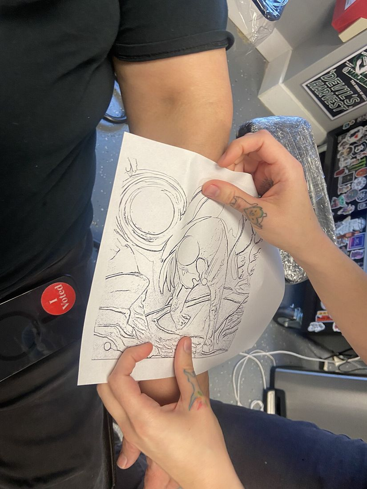
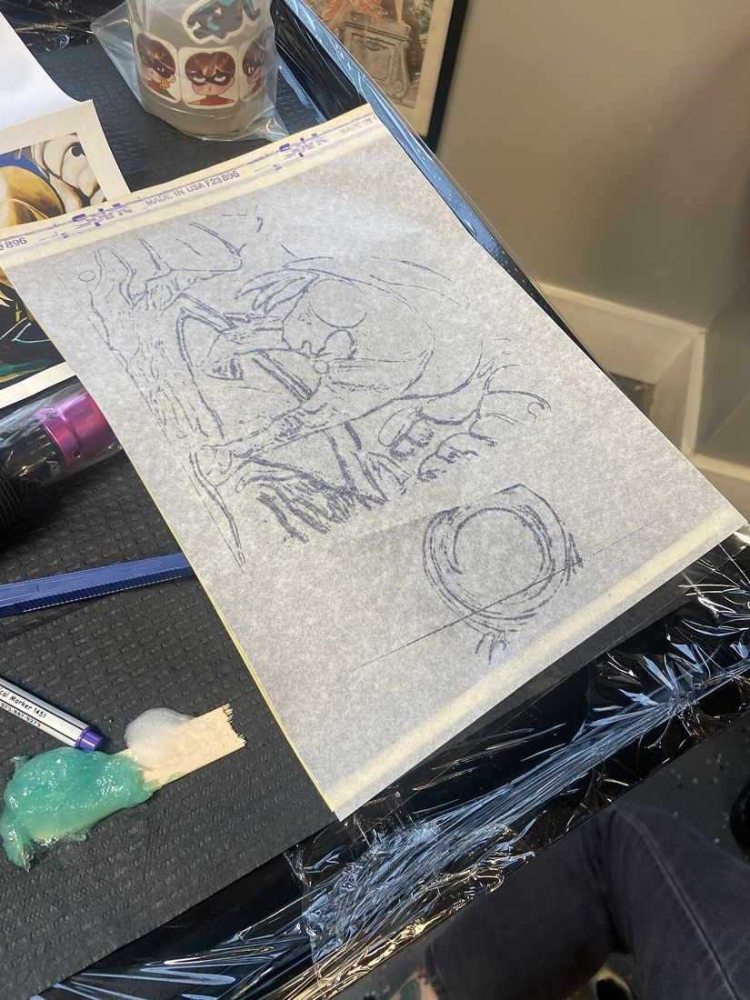
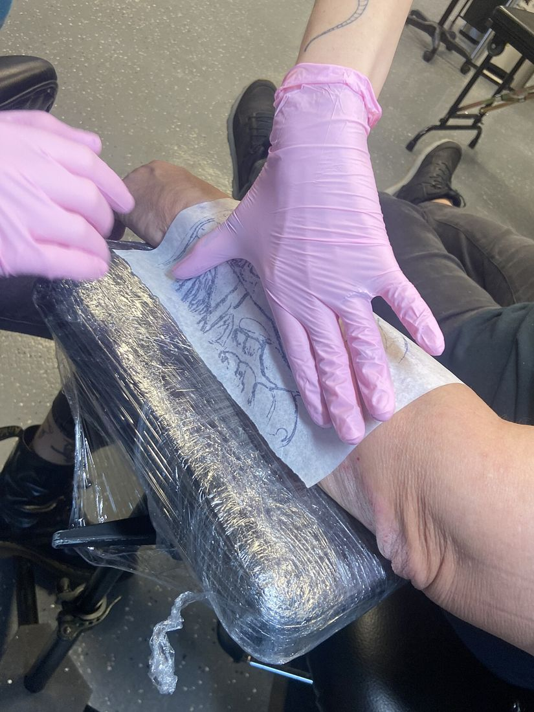
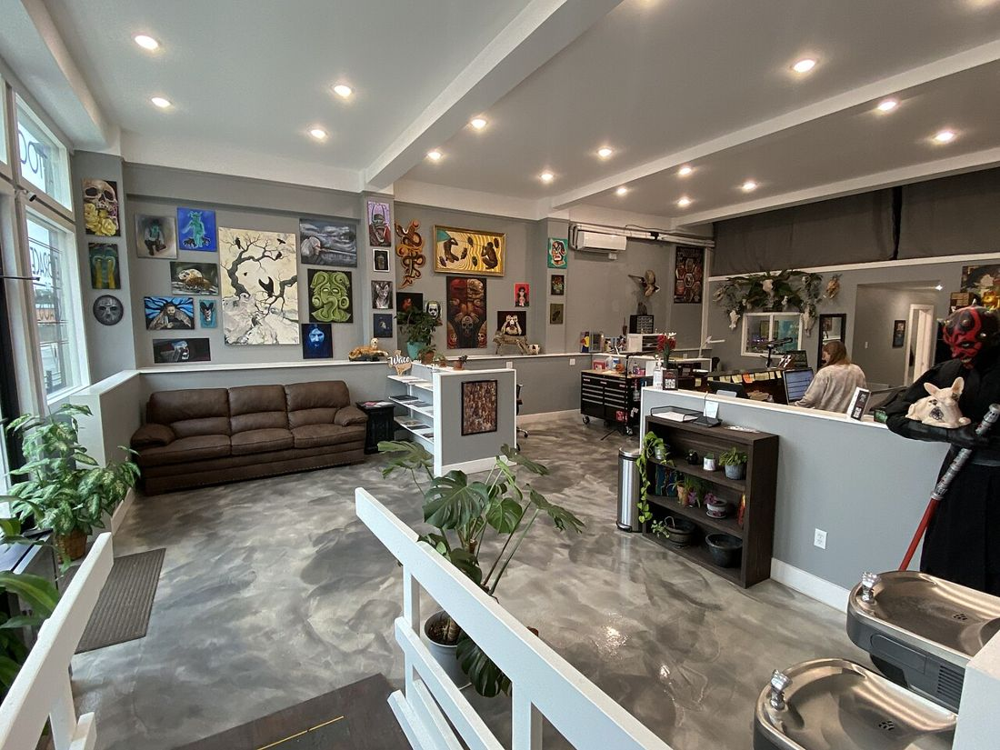

# Как подготовиться к сеансу тату: чек-лист до сеанса и в день записи

**Коротко:** для хорошего сеанса нужны три вещи: выспаться, поесть и прийти трезвым. В дни перед сеансом не обгорайте и не раздражайте кожу, накануне и в день сеанса не пейте алкоголь, поешьте за пару часов до начала, оденьтесь так, чтобы мастер легко добрался до нужного места. Все вопросы по эскизу, размеру и расположению решите заранее, чтобы в кресле не торопиться. Если вы принимаете лекарства или у вас есть заболевание кожи, предупредите мастера и врача заранее.

> Это не медицинский совет. Мы собрали рекомендации врачей и общедоступных источников плюс общие практические советы. Решения о лекарствах и здоровье принимайте вместе с врачом.

*Размер и положение эскиза удобнее обсуждать до начала работы. Иллюстративное фото.* Фото: Myotus, [Wikimedia Commons](https://commons.wikimedia.org/wiki/File:05-checking_and_sizing_the_artwork_to_the_skin_area.jpg), лицензия [CC BY-SA 4.0](https://creativecommons.org/licenses/by-sa/4.0).

## Чек-лист по срокам

| Когда | Что сделать | Зачем |
|---|---|---|
| За недели | Определиться с идеей, местом и мастером. Не принимать решение под чьим-то давлением | Mayo Clinic: если вы не уверены или боитесь, что пожалеете, лучше подождать |
| За недели | Если вы принимаете лекарства, влияющие на кожу или свёртываемость крови, обсудить сеанс с врачом | Решать, можно ли и когда делать тату, должен врач |
| Заранее | Прививка от гепатита B, если вы не привиты (схему прививок назначает врач) | Mayo Clinic рекомендует вакцинироваться от гепатита B до тату |
| За несколько дней | Не обгорать, не ходить в солярий, не раздражать кожу в месте тату | Обгоревшая и раздражённая кожа плохо подходит для работы, мастер может перенести сеанс |
| Накануне | Не пить алкоголь, выспаться | Алкоголь обезвоживает и может усилить кровотечение (Oklahoma State Department of Health) |
| Утром и в день сеанса | Нормально поесть, взять воду, надеть удобную одежду | Усталость и низкий сахар в крови усиливают чувствительность к боли (Oklahoma State Department of Health) |
| В день сеанса | Не пить алкоголь и не употреблять наркотики | Mayo Clinic: в таком состоянии тату делать нельзя |

## Подготовка шаг за шагом

### Идея, эскиз, размер

Заранее определитесь, что вы хотите, и покажите референсы. Обсудите размер, расположение и стиль. Спросите, как рисунок будет выглядеть на вашем теле, ведь плоский эскиз и объёмная рука или нога выглядят по-разному. Mayo Clinic напоминает: продумайте место, чтобы при необходимости тату можно было скрыть под одеждой, и помните, что набор веса, в том числе при беременности, может изменить вид тату.

*Перед тату рисунок переводят на трафарет, который затем переносят на кожу.* Фото: Myotus, [Wikimedia Commons](https://commons.wikimedia.org/wiki/File:06-artwork_transferred_on_to_stencil_paper.jpg), лицензия [CC BY-SA 4.0](https://creativecommons.org/licenses/by-sa/4.0).

### Здоровье и лекарства

Если вы принимаете лекарства, у вас есть хронические заболевания, склонность к аллергиям, рубцам или келоидам, или вы беременны, расскажите об этом мастеру заранее и поговорите с врачом. American Academy of Dermatology отдельно советует, если у вас склонность к рубцам или келоиды, пересмотреть решение о тату. Что именно можно принимать перед сеансом, решает врач, а мастер не вправе давать такие советы. Подробнее о боли и обезболивающих: [Больно ли делать тату](/tattoo-spravochnik/bolno-li-delat-tatu-karta-boli/).

Если вы только выбираете место, American Academy of Dermatology советует выбирать участок кожи без родинок, потому что тату затрудняет раннее распознавание рака кожи.

### Кожа

В дни перед сеансом не обгорайте, не используйте скрабы и пилинги на месте тату, не расчёсывайте и не травмируйте кожу. Если на коже есть воспаление, раздражение, сыпь или солнечный ожог, лучше написать мастеру и перенести сеанс.

### Накануне

Выспитесь. Не пейте алкоголь: Oklahoma State Department of Health отмечает, что алкоголь перед тату вызывает обезвоживание и может усилить кровотечение, что ухудшает качество работы. Mayo Clinic советует вообще не делать тату после алкоголя или наркотиков.

### В день сеанса

- **Поешьте** за час-два до начала. Oklahoma State Department of Health советует прийти выспавшимся и сытым, потому что усталость и низкий уровень сахара усиливают чувствительность к боли.
- **Возьмите воду и что-нибудь сладкое** на перерывы.
- **Оденьтесь удобно.** Свободная одежда, которая не мешает мастеру добраться до места тату и которую не жалко испачкать. Если тату на бедре, шорты или юбка, на плече футболка без рукавов, на спине рубашка с застёжкой спереди или лёгкий топ.
- **Не планируйте тяжёлую тренировку прямо перед сеансом.** Усталость и самочувствие влияют на то, как вы переносите боль.
- **Приходите вовремя.** Не торопитесь и не планируйте сеанс впритык с делами.
- **Возьмите документ и способ оплаты.** Что именно понадобится, уточните у мастера заранее.

### В кресле

Oklahoma State Department of Health описывает, чего ожидать: на коже будет немного крови, по объёму примерно как при ссадине. Боль индивидуальна, большинство людей оценивает её как терпимую, а лучше всего расслабиться и не напрягаться. Если вам стало плохо или закружилась голова, скажите мастеру сразу, ничего страшного в перерыве нет. Если нужно сменить позу, сходить в туалет или просто пошевелиться, предупредите мастера заранее, чтобы он остановил машинку.

*Эскиз переносят на кожу, и именно тут можно попросить сдвинуть, увеличить или уменьшить рисунок.* Фото: Myotus, [Wikimedia Commons](https://commons.wikimedia.org/wiki/File:08-transfering_stencil_to_skin.jpg), лицензия [CC BY-SA 4.0](https://creativecommons.org/licenses/by-sa/4.0).

## Что спросить у мастера до сеанса

- Как будет проходить сеанс и сколько он займёт.
- Какие расходники и иглы используются и как они вскрываются.
- Что делать после сеанса и как ухаживать за тату. Даёт ли мастер письменную инструкцию.
- Можно ли связаться с мастером после сеанса, если что-то беспокоит.

Подробный список вопросов о безопасности есть в статье [Как выбрать тату-мастера](/tattoo-spravochnik/kak-vybrat-tatu-mastera/). Как проходит выездной сеанс и что подготовить дома: [Выездной тату-мастер в Москве и области](/tattoo-spravochnik/vyezdnoy-tatu-master-moskva-mo/).

*Если есть возможность, посмотрите на студию до записи: чистота и порядок видны сразу. Иллюстративное фото студии в США.* Фото: Myotus, [Wikimedia Commons](https://commons.wikimedia.org/wiki/File:Tattoo_studio_entry_in_Waco,_Texas.jpg), лицензия [CC BY-SA 4.0](https://creativecommons.org/licenses/by-sa/4.0).

## После сеанса

Перед уходом уточните, как закрыта тату и что делать дальше. Как ухаживать: [Чем мазать тату после снятия плёнки](/tattoo-spravochnik/chem-mazat-tatu-posle-snyatiya-plenki/), что нормально при заживлении: [Шелушение тату по дням](/tattoo-spravochnik/sheluschenie-tatu-po-dnyam/). Про воду: [Можно ли мочить тату](/tattoo-spravochnik/mozhno-li-mochit-tatu/), про солнце: [Тату и солнце](/tattoo-spravochnik/tatu-i-solnce/).

## Когда идти к врачу

Обратитесь к врачу, если после сеанса краснота и боль нарастают, кожа горячая, появились гной, неприятный запах, высокая температура, озноб, или если на тату появилась сыпь или зуд. Mayo Clinic и FDA отмечают, что аллергия на чернила и инфекции возможны и спустя время.

## Частые вопросы

### Что есть перед тату?

Нормальный приём пищи за час-два до сеанса. Не нужно переедать: сидеть придётся долго, и тяжёлая еда может вызвать дискомфорт. Возьмите с собой воду и что-нибудь сладкое.

### Можно ли пить кофе перед тату?

Официальных рекомендаций на этот счёт мы не нашли, поэтому спросите своего мастера. Если не уверены, ограничьтесь водой.

### Можно ли пить обезболивающее перед тату?

Не принимайте лекарства на всякий случай: некоторые препараты влияют на кровоточивость. Если нужно обезболивание, обсудите это с врачом и предупредите мастера.

### Нужно ли брить место тату?

Не обязательно делать это дома. Чаще кожу бреет мастер одноразовой бритвой перед сеансом, если это нужно. Если вы хотите побриться сами, делайте это аккуратно, чтобы не раздражать кожу, и лучше заранее спросите мастера.

### Что надеть на сеанс?

Свободную удобную одежду, которая даёт доступ к нужному месту и которую не жалко испачкать. Не надевайте тугую одежду, которая будет давить на свежую тату после сеанса.

### Можно ли делать тату при простуде или плохом самочувствии?

Лучше перенести и написать мастеру заранее. Усталость и плохое самочувствие усиливают чувствительность к боли (Oklahoma State Department of Health), а при серьёзных симптомах нужен врач.

---

## Записаться в ТатуНаХоду

Хотите обсудить идею, подготовку или записаться на сеанс? Напишите в Telegram.

👉 [Записаться в Telegram](https://t.me/tatunahody)

Telegram-канал ТатуНаХоду: [t.me/tattoo_na_hodu](https://t.me/tattoo_na_hodu)

## Источники изображений

- `proverka-razmera-eskiza-na-kozhe.jpg` - файл 05-checking and sizing the artwork to the skin area.jpg, автор: Myotus, источник: [Wikimedia Commons](https://commons.wikimedia.org/wiki/File:05-checking_and_sizing_the_artwork_to_the_skin_area.jpg), лицензия: [CC BY-SA 4.0](https://creativecommons.org/licenses/by-sa/4.0). Без изменений, кроме уменьшения размера.
- `eskiz-na-trafaretnoy-bumage.jpg` - файл 06-artwork transferred on to stencil paper.jpg, автор: Myotus, источник: [Wikimedia Commons](https://commons.wikimedia.org/wiki/File:06-artwork_transferred_on_to_stencil_paper.jpg), лицензия: [CC BY-SA 4.0](https://creativecommons.org/licenses/by-sa/4.0). Без изменений, кроме уменьшения размера.
- `perenos-trafareta-na-kozhu.jpg` - файл 08-transfering stencil to skin.jpg, автор: Myotus, источник: [Wikimedia Commons](https://commons.wikimedia.org/wiki/File:08-transfering_stencil_to_skin.jpg), лицензия: [CC BY-SA 4.0](https://creativecommons.org/licenses/by-sa/4.0). Без изменений, кроме уменьшения размера.
- `vhod-v-studiyu.jpg` - файл Tattoo studio entry in Waco, Texas.jpg, автор: Myotus, источник: [Wikimedia Commons](https://commons.wikimedia.org/wiki/File:Tattoo_studio_entry_in_Waco,_Texas.jpg), лицензия: [CC BY-SA 4.0](https://creativecommons.org/licenses/by-sa/4.0). Без изменений, кроме уменьшения размера.
