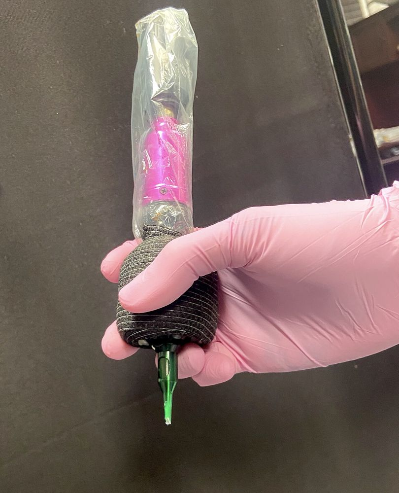
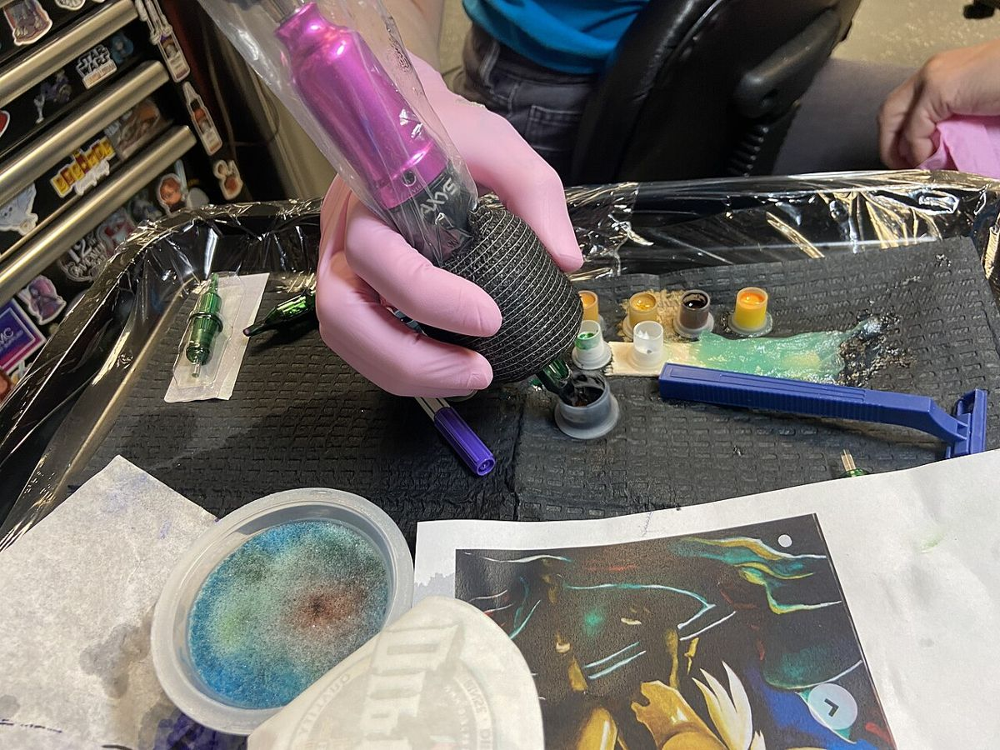
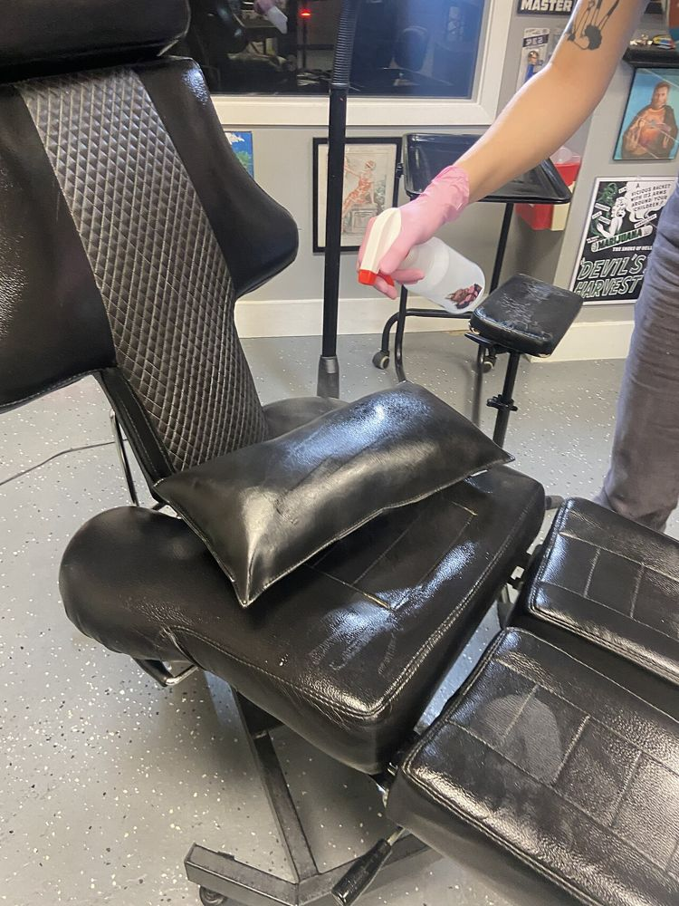
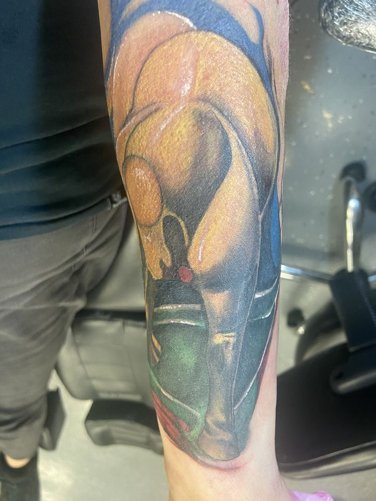

# Как выбрать тату-мастера: на что смотреть и что спросить до записи

**Коротко:** смотрите на четыре вещи. Первое: портфолио в нужном вам стиле, желательно с зажившими работами, а не только со свежими. Второе: безопасность, то есть одноразовые иглы в запечатанной упаковке, свежие перчатки, чистая рабочая поверхность под плёнкой и краска в отдельных колпачках. Третье: открытая информация об исполнителе и документы. Четвёртое: то, как мастер разговаривает с вами, объясняет ли уход и честно ли говорит о том, что получится, а что нет. Цена и расстояние идут после этих четырёх пунктов: тату делают на всю жизнь, а нестерильные условия могут привести к инфекции или аллергии.

> Это не медицинский совет. Мы собрали общие рекомендации из официальных источников. Если вы сомневаетесь в безопасности процедуры или уже заметили признаки воспаления, обратитесь к врачу.

*Машинка в одноразовом защитном чехле: так выглядит нормальная гигиена на рабочем месте.* Фото: Myotus, [Wikimedia Commons](https://commons.wikimedia.org/wiki/File:00A-Axys_Valhalia_pen_rotary_style_tattoo_machine,_wrapped_for_sanitary_practice.jpg), лицензия [CC BY-SA 4.0](https://creativecommons.org/licenses/by-sa/4.0).

## Шаг 1. Портфолио

Портфолио показывает, что мастер умеет, но не всё, что в нём видно, подходит именно вам.

- **Стиль.** У каждого мастера есть то, что получается лучше всего: тонкая графика, реализм, орнаменты, цветные работы. Выбирайте того, чей стиль близок к вашей идее, а не универсала на всё.
- **Зажившие работы.** Свежая тату блестит, а цвет и линии выглядят ярче, чем будут. Результат становится понятен после заживления, поэтому попросите показать работы через месяц и позже.
- **Линии и заливки.** Смотрите, ровные ли линии, нет ли пропусков и пятен в заливках, не расплылись ли мелкие детали. Если вы выбираете мелкий рисунок, ищите именно мелкие работы.
- **Ваши условия.** Если вам нужно перекрытие, ищите перекрытия до и после, а не только красивые готовые работы. Подробнее: [Перекрытие старой тату](/tattoo-spravochnik/perekrytie-staroy-tatu-cover-up/).
- **Это его работы.** Попросите показать видео процесса или оригиналы фото. Картинки в интернете можно взять у кого угодно, и лишний вопрос вас ничем не обидит.

## Шаг 2. Безопасность: что проверить своими глазами

Тату повреждает кожу, поэтому гигиена важнее красоты рисунка. По [Mayo Clinic](https://www.mayoclinic.org/healthy-lifestyle/adult-health/in-depth/tattoos-and-piercings/art-20045067) и [FDA](https://www.fda.gov/cosmetics/cosmetic-products/tattoos-permanent-makeup-fact-sheet), риски нестерильной работы это кожные инфекции и болезни, передающиеся через кровь (в том числе гепатит B и C), а заражённые чернила тоже вызывали инфекции. Российский Роспотребнадзор в [разъяснениях для потребителей](https://zpp.rospotrebnadzor.ru/news/federal/509384) тоже перечисляет, на что смотреть клиенту.

| Что проверить | Как должно быть | Откуда |
|---|---|---|
| Перчатки | Мастер моет руки и надевает новую пару одноразовых перчаток перед работой | Mayo Clinic, Роспотребнадзор |
| Иглы и картриджи | Достаются из запечатанной упаковки, при вас, перед началом | Mayo Clinic, Роспотребнадзор |
| Краска | Разливается в новые одноразовые колпачки на каждого клиента | Mayo Clinic, Роспотребнадзор |
| Поверхности | Поверхности и оборудование обработаны антисептиком перед каждым клиентом, на практике их часто закрывают плёнкой или чехлами | Mayo Clinic, Роспотребнадзор |
| Многоразовые инструменты | Стерилизуются в автоклаве, а то, что нельзя, дезинфицируется | Mayo Clinic |
| Помещение | Чисто, есть раковина с водой, есть антисептик | Роспотребнадзор |
| Пигменты | Сертифицированные, с понятной маркировкой | Роспотребнадзор |

Роспотребнадзор также указывает, что у работников, оказывающих услуги татуажа и перманентного макияжа, должна быть медицинская справка, а Mayo Clinic советует заранее привиться от гепатита B. Всё это можно спокойно спросить у мастера до записи.

*Поднос накрыт плёнкой, краска налита в отдельные колпачки, игла-картридж лежит в упаковке, машинка в чехле.* Фото: Myotus, [Wikimedia Commons](https://commons.wikimedia.org/wiki/File:16-dipping_in_to_the_ink_well-rinse_cup_with_sponge_in_foreground.jpg), лицензия [CC BY-SA 4.0](https://creativecommons.org/licenses/by-sa/4.0).

## Шаг 3. Кто исполнитель и какие у него документы

Роспотребнадзор [в материале о безопасном татуаже (перманентном макияже)](https://zpp.rospotrebnadzor.ru/news/federal/574683) напоминает, что перед услугой нужно проверить официальную информацию об исполнителе: название юридического лица или ФИО предпринимателя, адрес и лицензию на медицинскую деятельность. Отсутствие этих данных лишает клиента возможности защитить свои права, если здоровью причинён вред. В [материале того же ведомства для тату-салонов](https://zpp.rospotrebnadzor.ru/news/federal/509384) сказано, что нанесение татуировки связано с повреждением кожи и относится к деятельности, для которой нужна лицензия.

Лицензию можно проверить в [Едином реестре лицензий на сайте Росздравнадзора](https://roszdravnadzor.gov.ru/services/licenses): найдите организацию или предпринимателя по ИНН или названию. Это занимает пару минут.

## Шаг 4. Консультация: что спросить

Хороший мастер не спешит и не давит. Вот вопросы, на которые стоит получить ответ до внесения предоплаты.

1. Как именно вы подготовите рабочее место и инструменты? (Ответ должен совпадать с таблицей выше.)
2. Как мой рисунок будет выглядеть через год и можно ли его упростить, чтобы он хорошо старел? Мелкие детали и тонкие линии со временем могут расплыться, об этом честный мастер скажет сам.
3. Сколько сеансов потребуется и почему?
4. Как ухаживать за тату после сеанса? Мастер должен дать понятную инструкцию. Если её нет, посмотрите [Чем мазать тату после снятия плёнки](/tattoo-spravochnik/chem-mazat-tatu-posle-snyatiya-plenki/) и [Шелушение тату по дням](/tattoo-spravochnik/sheluschenie-tatu-po-dnyam/).
5. Что будет, если результат окажется не таким, как договаривались, или после заживления понадобится коррекция? Условия лучше услышать заранее.
6. Что делать, если появится покраснение, зуд или признаки воспаления, и можно ли написать вам?
7. Сколько стоит работа, как считается цена и что будет с предоплатой, если сеанс придётся перенести.

Хорошие признаки: мастер задаёт вопросы про здоровье (аллергии, заболевания кожи, лекарства), предлагает перенести сеанс, если вы больны, и отказывается работать с нетрезвым клиентом. Mayo Clinic прямо советует не делать тату в состоянии алкогольного и наркотического опьянения.

*Обработка кресла перед следующим клиентом. Поверхности, которых касается кожа, обрабатывают каждый раз, а не по мере загрязнения.* Фото: Myotus, [Wikimedia Commons](https://commons.wikimedia.org/wiki/File:24A-cleaning_work_space_with_Madacide,_a_powerful_hospital_germicidal_solution.jpg), лицензия [CC BY-SA 4.0](https://creativecommons.org/licenses/by-sa/4.0).

## Тревожные признаки

- Нет понятной информации об исполнителе: ни имени, ни адреса, ни документов.
- Упаковку с иглами или перчатки вскрыли заранее или отказываются показать упаковку.
- Краска из общей бутылки, колпачки и расходники повторного использования.
- Работа без перчаток или в перчатках, которыми уже трогали телефон, сумку и всё остальное.
- Рабочая поверхность не закрыта и не обработана, в комнате грязно, нет воды для мытья рук.
- Мастер не рассказывает про уход или говорит, что за тату вообще ничего не нужно.
- Давление: скидка действует только сегодня, внесите предоплату прямо сейчас, не думайте.
- Обещания, что не будет больно или что тату заживёт за два дня. О том, как ощущается боль и сколько длится заживление, смотрите [Больно ли делать тату: карта боли по зонам тела](/tattoo-spravochnik/bolno-li-delat-tatu-karta-boli/).
- Мастер не умеет или не хочет показывать зажившие работы.

## Если мастер работает на дому или выезжает

Роспотребнадзор [настоятельно рекомендует](https://zpp.rospotrebnadzor.ru/news/federal/574683) не обращаться к мастерам, работающим на дому или в помещениях, не соответствующих санитарным нормам, потому что это создаёт прямую угрозу здоровью. Это не значит, что любой выезд небезопасен, но проверок нужно больше, а не меньше. Мы разобрали их отдельно: [Выездной тату-мастер](/tattoo-spravochnik/vyezdnoy-tatu-master-moskva-mo/).

*Свежая работа сразу после сеанса: кожа блестит, цвет кажется ярче. Оценивать результат стоит по зажившим фото.* Фото: Myotus, [Wikimedia Commons](https://commons.wikimedia.org/wiki/File:22-finished_tattoo.jpg), лицензия [CC BY-SA 4.0](https://creativecommons.org/licenses/by-sa/4.0).

## Когда идти к врачу

Если после тату краснота и боль нарастают, кожа горячая, появился гной или температура, нужен врач, а не интернет-советы. Это же касается аллергии на пигмент: Mayo Clinic и FDA отмечают, что она может проявиться и через годы. Подробнее о том, что нормально при заживлении, а что нет, в статье [Шелушение тату по дням](/tattoo-spravochnik/sheluschenie-tatu-po-dnyam/).

## Частые вопросы

### Как понять, что работы в портфолио сделал сам мастер?

Попросите видео процесса, фото на разных этапах или посмотрите живые работы на консультации. Хороший мастер спокойно покажет, как он работает, а портфолио без видео и без зажившего результата повод насторожиться.

### Нужно ли читать отзывы?

Да, но не только оценки. Ищите в них конкретику: говорят ли о чистоте и подготовке, о том, как заживала тату, помог ли мастер при вопросах и как поступил, если что-то пошло не так. Отзывы можно подделать, поэтому сравнивайте их с портфолио и тем, что видите сами.

### Значит ли высокая цена, что мастер лучше?

Не обязательно. Цена зависит от размера, сложности, сроков и опыта, но сама по себе качество не гарантирует. Если цена намного ниже, чем у других за такой же объём работы, спросите, за счёт чего, и проверьте безопасность особенно внимательно.

### Что сказать мастеру о здоровье?

Сообщите об аллергиях, заболеваниях кожи, хронических болезнях, беременности или кормлении и о лекарствах, которые принимаете. Если вы больны или плохо себя чувствуете, лучше перенести сеанс.

### Можно ли сделать тату у знакомого или набивочным набором из интернета?

Mayo Clinic советует не позволять тату тому, кто не обучен, и не пользоваться наборами для самостоятельных татуировок. Проблема не в знакомстве, а в отсутствии подготовки и стерильных условий.

### Что делать, если результат не понравился?

Сначала напишите мастеру и спросите про коррекцию: иногда пигмент ложится неровно, и это исправляется после заживления. Если дело в самом рисунке, возможны [перекрытие](/tattoo-spravochnik/perekrytie-staroy-tatu-cover-up/) или лазерное осветление. Условия коррекции лучше обсудить заранее.

---

## Записаться в ТатуНаХоду

Хотите обсудить идею и задать вопросы до записи? Напишите в Telegram.

👉 [Записаться в Telegram](https://t.me/tatunahody)

Telegram-канал ТатуНаХоду: [t.me/tattoo_na_hodu](https://t.me/tattoo_na_hodu)

## Источники изображений

- `barernaya-plenka-na-tatu-mashinke.jpg` - файл 00A-Axys Valhalia pen rotary style tattoo machine, wrapped for sanitary practice.jpg, автор: Myotus, источник: [Wikimedia Commons](https://commons.wikimedia.org/wiki/File:00A-Axys_Valhalia_pen_rotary_style_tattoo_machine,_wrapped_for_sanitary_practice.jpg), лицензия: [CC BY-SA 4.0](https://creativecommons.org/licenses/by-sa/4.0). Без изменений, кроме уменьшения размера.
- `rabochiy-stol-pod-plenkoy-kraska-v-kolpachkah.jpg` - файл 16-dipping in to the ink well-rinse cup with sponge in foreground.jpg, автор: Myotus, источник: [Wikimedia Commons](https://commons.wikimedia.org/wiki/File:16-dipping_in_to_the_ink_well-rinse_cup_with_sponge_in_foreground.jpg), лицензия: [CC BY-SA 4.0](https://creativecommons.org/licenses/by-sa/4.0). Без изменений, кроме уменьшения размера.
- `dezinfekciya-kresla-posle-seansa.jpg` - файл 24A-cleaning work space with Madacide, a powerful hospital germicidal solution.jpg, автор: Myotus, источник: [Wikimedia Commons](https://commons.wikimedia.org/wiki/File:24A-cleaning_work_space_with_Madacide,_a_powerful_hospital_germicidal_solution.jpg), лицензия: [CC BY-SA 4.0](https://creativecommons.org/licenses/by-sa/4.0). Без изменений, кроме уменьшения размера.
- `gotovaya-cvetnaya-rabota-na-predplechye.jpg` - файл 22-finished tattoo.jpg, автор: Myotus, источник: [Wikimedia Commons](https://commons.wikimedia.org/wiki/File:22-finished_tattoo.jpg), лицензия: [CC BY-SA 4.0](https://creativecommons.org/licenses/by-sa/4.0). Без изменений, кроме уменьшения размера.
