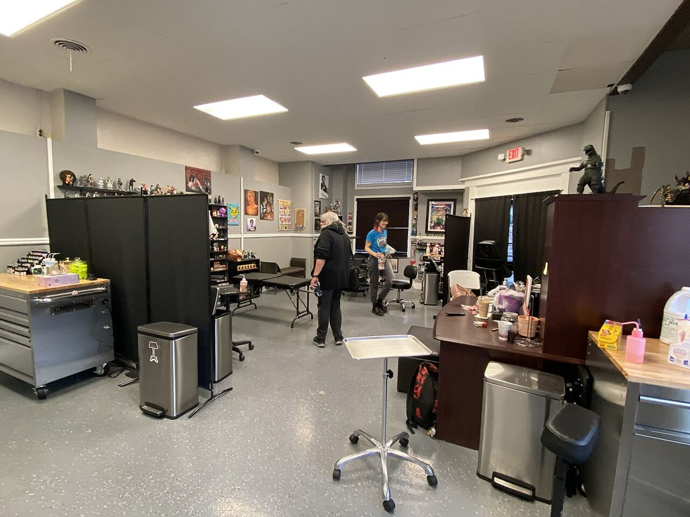
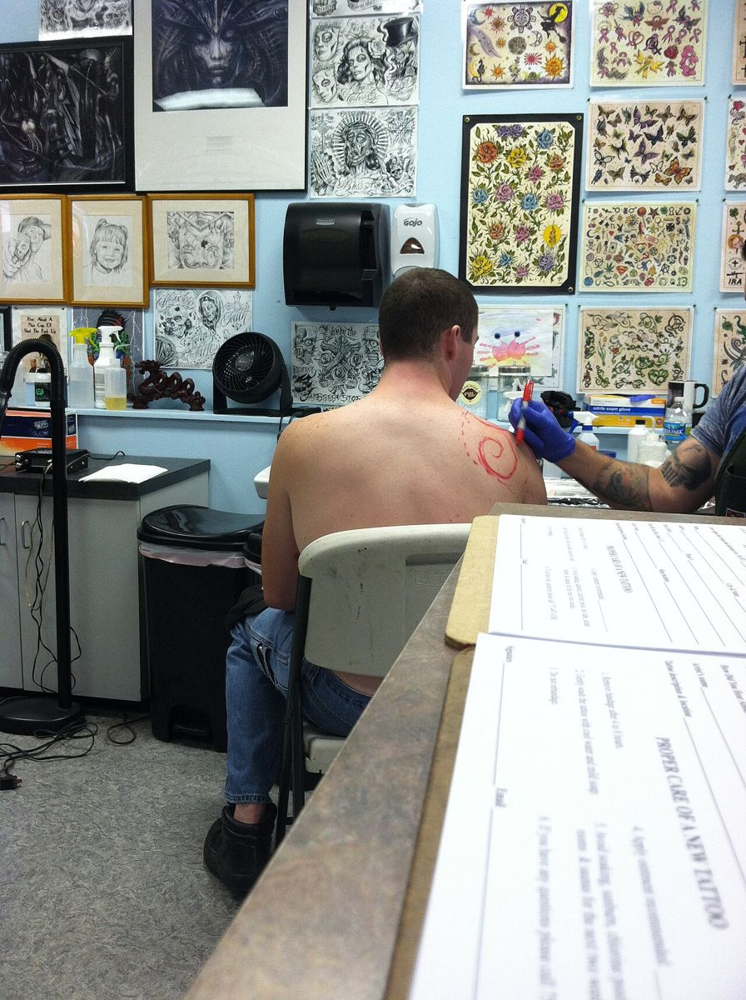
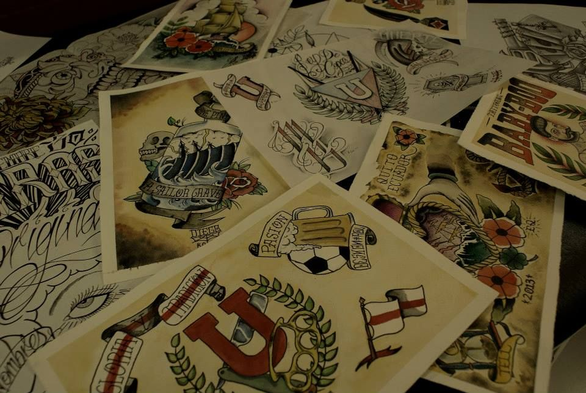
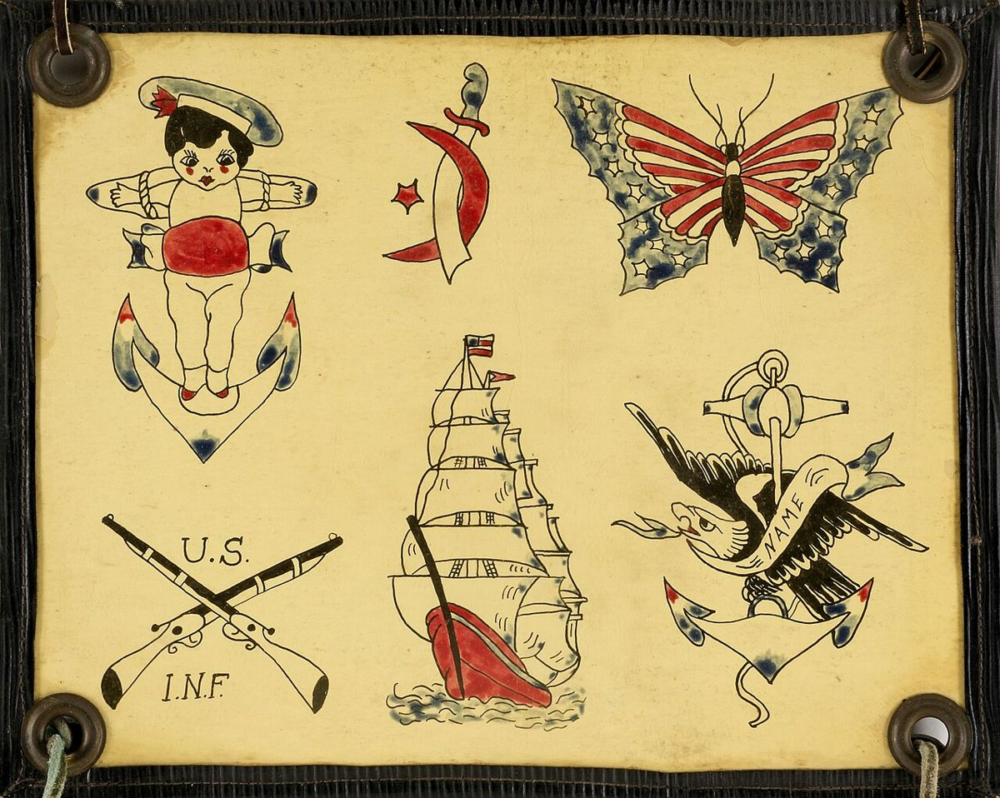

# Как записаться на тату в Москве: что подготовить и спросить у мастера

**Коротко:** чтобы записаться на тату, мастеру нужны идея или референс, желаемый размер, место на теле и фото этой зоны. По ним мастер оценит объём работы, предложит эскиз, назовёт стоимость и дату. Сумму без эскиза никто честно не назовёт, поэтому в этой статье цен нет. До сеанса уточните предоплату, правила переноса, как устроена коррекция и как мастер соблюдает стерильность. Напишите в Telegram и прикрепите референс и фото зоны: так запись пройдёт быстрее.

> Это не медицинский совет. Здесь рассказано, как подготовиться к записи, и пересказаны рекомендации врачей и Роспотребнадзора. Если у вас есть заболевания или вы принимаете лекарства, обсудите тату с врачом.

*Студия с несколькими рабочими местами. Иллюстративное фото зарубежной студии, не ТатуНаХоду.* Фото: Myotus, [Wikimedia Commons](https://commons.wikimedia.org/wiki/File:Jenna_Haas-tattoo_studio.jpg), лицензия [CC BY-SA 4.0](https://creativecommons.org/licenses/by-sa/4.0).

## Шаги записи на тату

| Шаг | Что делаете вы | Что делает мастер | Что уточнить |
|---|---|---|---|
| 1. Идея | Собираете референсы, думаете о стиле, размере, месте | Пока ничего | Не нужен ли вам cover-up или коррекция старой работы |
| 2. Заявка | Пишете в Telegram, прикладываете референс и фото зоны | Оценивает идею и объём | Когда мастер ответит, нужна ли личная консультация |
| 3. Эскиз | Смотрите эскиз, говорите, что поменять | Рисует или подбирает вариант, меняет детали | Сколько правок входит, как согласуется финальный вариант |
| 4. Дата и условия | Выбираете день, обсуждаете предоплату и перенос | Называет стоимость и время сеанса | Размер предоплаты, правила переноса и отмены |
| 5. Подготовка | Спите, едите, не пьёте алкоголь, одеваетесь удобно | Ничего | Что взять с собой, во что одеться |
| 6. Сеанс | Проверяете рабочее место, задаёте вопросы | Работает по гигиене, объясняет уход | Инструкция по уходу в письменном виде |
| 7. Уход и коррекция | Ухаживаете по инструкции, показываетесь мастеру | Смотрит зажившую работу | Условия коррекции и сроки |

Размер предоплаты, правила переноса, цену и срок коррекции мы не называем: у каждого мастера свои условия. Узнайте их до записи, а не в день сеанса.

## Что прислать мастеру при записи

1. Референсы: 3-5 примеров рисунков, которые вам нравятся. Если нет готового, опишите идею словами.
2. Место: на какой части тела хотите тату. Лучше фото этой зоны при хорошем освещении.
3. Размер: желаемая высота и ширина, можно примерить на коже бумажной вырезкой.
4. Цвет: чёрно-серая работа или цветная.
5. Старые работы: если нужно перекрыть или скорректировать, пришлите фото. Об этом: [Перекрытие старой тату](/tattoo-spravochnik/perekrytie-staroy-tatu-cover-up/).
6. Здоровье: хронические болезни, лекарства, аллергии, беременность. Подробнее: [Когда нельзя делать тату](/tattoo-spravochnik/kogda-nelzya-delat-tatu/).
7. Удобные дни и время и район, из которого вам удобно добираться, либо запрос на выезд.

Если сомневаетесь в месте, сначала прочитайте [Первая тату: как выбрать место](/tattoo-spravochnik/pervaya-tatu-kak-vybrat-mesto/) и [Карту боли](/tattoo-spravochnik/bolno-li-delat-tatu-karta-boli/).

*Мастер рисует эскиз прямо на коже. Иллюстративное фото консультации, клиент снят со спины.* Фото: Tony Alter from Newport News, USA, [Wikimedia Commons](https://commons.wikimedia.org/wiki/File:Designing_A_Tattoo_%2810636266534%29.jpg), лицензия [CC BY 2.0](https://creativecommons.org/licenses/by/2.0).

## Консультация и эскиз: как проходит

На консультации мастер смотрит на зону, оценивает размер и стиль и предлагает, как рисунок будет смотреться на теле. Эскиз бывает готовый из подборки или нарисованный под вас. Часто используют листы с готовыми рисунками, так называемые флэши, их выбирают сразу или адаптируют.

Не торопитесь утвердить эскиз. Спросите, что можно изменить после согласования, и как мастер работает с расположением рисунка на изгибах тела. Если в зоне рисунка есть родинки, скажите об этом: [Тату на родинке](/tattoo-spravochnik/tatu-na-rodinke/).

Сколько будет стоить работа, мастер называет по эскизу, а не по описанию. Из чего складывается цена: [Сколько стоит тату](/tattoo-spravochnik/skolko-stoit-tatu/).

*Флэш-листы с готовыми рисунками. Рисунки: Patricio El EQ Chavez и Diego Kolsik Rivera. Иллюстративное фото.* Фото: Baby Boo Tattoo Shop, [Wikimedia Commons](https://commons.wikimedia.org/wiki/File:Original_Flash_Art.jpg), лицензия [CC BY-SA 3.0](https://creativecommons.org/licenses/by-sa/3.0).

## Что уточнить до сеанса: чек-лист вопросов

- Как мастер называет стоимость: за эскиз, за час или иначе. У разных мастеров по-разному, правильного универсального способа нет.
- Нужна ли предоплата и что с ней происходит при переносе или отмене.
- Сколько длится сеанс и нужен ли перерыв. Если работа большая, спросите, сколько сеансов.
- Что входит в коррекцию и в какой срок мастер смотрит зажившую тату: [Коррекция тату](/tattoo-spravochnik/korrekciya-tatu/).
- Какие инструкции по уходу даёт мастер. Если они отличаются от общих, ориентируйтесь на инструкцию мастера: [Заживляющая плёнка на тату](/tattoo-spravochnik/zazhivlyayushchaya-plenka-na-tatu/) и [Чем мазать тату после снятия плёнки](/tattoo-spravochnik/chem-mazat-tatu-posle-snyatiya-plenki/).
- Где пройдёт сеанс: в студии или у вас дома с выездом мастера. Об условиях выезда: [Выездной тату-мастер в Москве и области](/tattoo-spravochnik/vyezdnoy-tatu-master-moskva-mo/).

## Как проверить безопасность до записи и в день сеанса

Тату повреждает кожу, поэтому безопасность важнее красоты рисунка. По [Mayo Clinic](https://www.mayoclinic.org/healthy-lifestyle/adult-health/in-depth/tattoos-and-piercings/art-20045067), мастер должен мыть руки и надевать новую пару одноразовых перчаток, доставать иглы и трубки из запечатанной упаковки, использовать новые одноразовые колпачки для краски и стерилизовать многоразовое оборудование в автоклаве. Всё, что нельзя стерилизовать, нужно тщательно дезинфицировать после каждого клиента.

Управление Роспотребнадзора по Рязанской области в [памятке для посетителей тату-салонов](https://www.62.rospotrebnadzor.ru/content/na-chto-obratit-vnimanie-pri-poseshchenii-tatu-salona) советует обращать внимание на наличие лицензии для услуг, связанных с повреждением кожных покровов, на то, что мастера проходят медосмотр и вакцинированы против гепатита B, а стерильная упаковка вскрывается в присутствии клиента. Псковское управление добавляет, что у мастера должна быть санитарная книжка, а краска и инструменты проверены по сроку годности: [материал Роспотребнадзора](https://60.rospotrebnadzor.ru/content/%D1%87%D0%B5%D0%BC-%D0%BC%D0%BE%D0%B3%D1%83%D1%82-%D0%B1%D1%8B%D1%82%D1%8C-%D0%BE%D0%BF%D0%B0%D1%81%D0%BD%D1%8B-%D1%82%D0%B0%D1%82%D1%83%D0%B8%D1%80%D0%BE%D0%B2%D0%BA%D0%B8-%D1%80%D0%B0%D1%81%D1%81%D0%BA%D0%B0%D0%B7%D0%B0%D0%BB-%D1%80%D0%BE%D1%81%D0%BF%D0%BE%D1%82%D1%80%D0%B5%D0%B1%D0%BD%D0%B0%D0%B4%D0%B7%D0%BE%D1%80). Общий разбор: [Как выбрать тату-мастера](/tattoo-spravochnik/kak-vybrat-tatu-mastera/).

*Старинный лист флэш-рисунков из музейной коллекции. Иллюстративное фото того, что такое флэш.* Фото: Smithsonian American Art Museum, [Wikimedia Commons](https://commons.wikimedia.org/wiki/File:Tattoo_Flash_SAAM-1998.84.50A_1.jpg), лицензия [CC0](https://creativecommons.org/publicdomain/zero/1.0/).

## Как подготовиться к сеансу

За день и в день сеанса выспитесь, поешьте, не пейте алкоголь и оденьтесь так, чтобы зона была доступна и ничего не давило. Mayo Clinic прямо советует не делать тату после алкоголя и наркотиков. Подробный список: [Как подготовиться к сеансу тату](/tattoo-spravochnik/kak-podgotovitsya-k-seansu-tatu/). Если волнуетесь, что будет больно, посмотрите [Карту боли](/tattoo-spravochnik/bolno-li-delat-tatu-karta-boli/).

После сеанса соблюдайте инструкцию мастера. Основные правила мы собрали в статьях [Можно ли мочить тату](/tattoo-spravochnik/mozhno-li-mochit-tatu/) и [Тату и солнце](/tattoo-spravochnik/tatu-i-solnce/), а о сроках заживления: [Сколько заживает тату](/tattoo-spravochnik/skolko-zazhivaet-tatu/).

## Когда идти к врачу

Если в зоне тату есть воспаление или сыпь, обострилось кожное или хроническое заболевание, вы ждёте ребёнка или принимаете лекарства, сначала обсудите тату с врачом. После сеанса идите к врачу при температуре, гное, запахе, красных полосах и нарастающей боли: [Тату воспалилась: что делать](/tattoo-spravochnik/tatu-vospalilas-chto-delat/).

## Частые вопросы

### Как записаться на тату в Москве?

Напишите мастеру или в студию, приложите референс, желаемый размер, место на теле и фото этой зоны. Мастер оценит работу, предложит эскиз, назовёт стоимость и подберёт дату. Записаться в ТатуНаХоду можно через Telegram.

### Нужна ли предоплата за тату?

Это решает мастер или студия: у разных исполнителей разные правила. Спросите, нужна ли предоплата, в каком размере и что будет, если вы перенесёте или отмените сеанс. Мы не называем суммы и условия.

### Сколько будет стоить тату по описанию?

Точную сумму без эскиза называть нельзя. Мастеру нужны референс, размер и фото зоны. Что влияет на цену, разобрано в статье [Сколько стоит тату](/tattoo-spravochnik/skolko-stoit-tatu/).

### Нужна ли консультация перед тату?

Чаще да: мастеру нужно увидеть зону и обсудить эскиз. Форма разная: личная встреча или переписка с фото. Уточните при записи.

### Что взять с собой на сеанс?

Воду, что-нибудь перекусить и удобную одежду, которая открывает зону тату. Точный список, в том числе документы, уточните у мастера: у разных студий он может отличаться.

### Можно ли записаться на выезд?

В Москве и области можно записаться на выездной сеанс. Условия выезда и как проверить рабочее место мастера у вас дома разобраны в статье [Выездной тату-мастер в Москве и области](/tattoo-spravochnik/vyezdnoy-tatu-master-moskva-mo/).

---

## Записаться в ТатуНаХоду

Хотите записаться? Напишите нам в Telegram, прикрепите референс, размер и фото зоны. Мастер оценит идею и ответит, как проходит запись.

👉 [Записаться в Telegram](https://t.me/tatunahody)

Telegram-канал ТатуНаХоду: [t.me/tattoo_na_hodu](https://t.me/tattoo_na_hodu)

## Источники изображений

- `prostornaya-studiya-s-rabochimi-mestami.jpg` - файл Jenna Haas-tattoo studio.jpg, автор: Myotus, источник: [Wikimedia Commons](https://commons.wikimedia.org/wiki/File:Jenna_Haas-tattoo_studio.jpg), лицензия: [CC BY-SA 4.0](https://creativecommons.org/licenses/by-sa/4.0). Без изменений, кроме уменьшения размера.
- `eskiz-risuetsya-na-kozhe.jpg` - файл Designing A Tattoo (10636266534).jpg, автор: Tony Alter from Newport News, USA, источник: [Wikimedia Commons](https://commons.wikimedia.org/wiki/File:Designing_A_Tattoo_%2810636266534%29.jpg), лицензия: [CC BY 2.0](https://creativecommons.org/licenses/by/2.0). Без изменений, кроме уменьшения размера.
- `listy-flesh-eskizov.jpg` - файл Original Flash Art.jpg, автор: Baby Boo Tattoo Shop (рисунки Patricio El EQ Chavez и Diego Kolsik Rivera), источник: [Wikimedia Commons](https://commons.wikimedia.org/wiki/File:Original_Flash_Art.jpg), лицензия: [CC BY-SA 3.0](https://creativecommons.org/licenses/by-sa/3.0). Без изменений.
- `starinnyy-list-flesh.jpg` - файл Tattoo Flash SAAM-1998.84.50A 1.jpg, автор: Smithsonian American Art Museum, источник: [Wikimedia Commons](https://commons.wikimedia.org/wiki/File:Tattoo_Flash_SAAM-1998.84.50A_1.jpg), лицензия: [CC0](https://creativecommons.org/publicdomain/zero/1.0/). Без изменений, кроме уменьшения размера.

## Источники фактов

- [Mayo Clinic: Tattoos, understand risks and precautions](https://www.mayoclinic.org/healthy-lifestyle/adult-health/in-depth/tattoos-and-piercings/art-20045067)
- [Роспотребнадзор, управление по Рязанской области: на что обратить внимание при посещении тату-салона](https://www.62.rospotrebnadzor.ru/content/na-chto-obratit-vnimanie-pri-poseshchenii-tatu-salona)
- [Роспотребнадзор, управление по Псковской области: чем могут быть опасны татуировки](https://60.rospotrebnadzor.ru/content/%D1%87%D0%B5%D0%BC-%D0%BC%D0%BE%D0%B3%D1%83%D1%82-%D0%B1%D1%8B%D1%82%D1%8C-%D0%BE%D0%BF%D0%B0%D1%81%D0%BD%D1%8B-%D1%82%D0%B0%D1%82%D1%83%D0%B8%D1%80%D0%BE%D0%B2%D0%BA%D0%B8-%D1%80%D0%B0%D1%81%D1%81%D0%BA%D0%B0%D0%B7%D0%B0%D0%BB-%D1%80%D0%BE%D1%81%D0%BF%D0%BE%D1%82%D1%80%D0%B5%D0%B1%D0%BD%D0%B0%D0%B4%D0%B7%D0%BE%D1%80)
