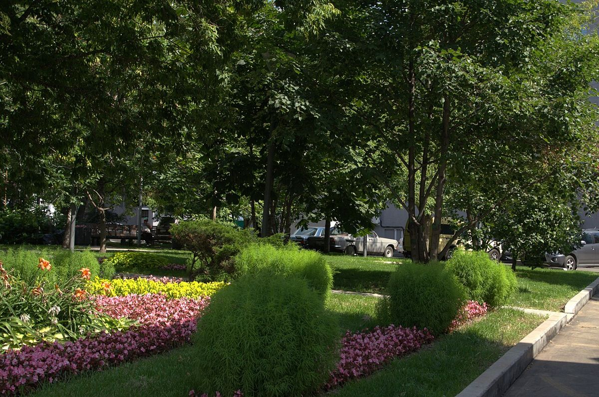
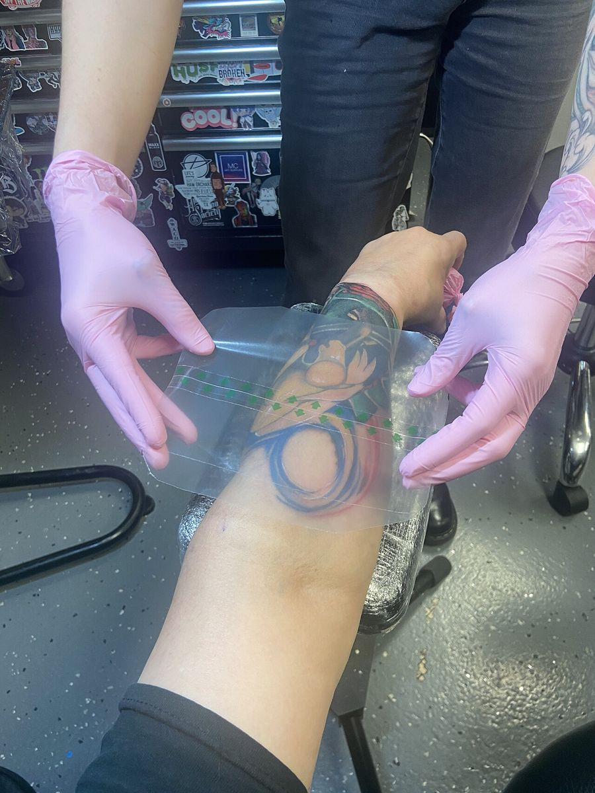

# Когда лучше делать тату: летом, зимой или в межсезонье

**Коротко:** идеального месяца для тату нет. Ни Mayo Clinic, ни Cleveland Clinic, ни AAD в проверенных нами материалах не называют лучший сезон. Они описывают условия заживления: пока тату заживает, её нужно беречь от солнца, не погружать в воду и не натирать одеждой. Поэтому выбирайте не сезон, а период, когда у вас в ближайшие недели нет пляжа, бассейна, тяжёлых тренировок и тесной одежды на нужном месте. Летом заживление сложнее из-за солнца и воды, зимой из-за тёплых вещей, межсезонье обычно проще, но не всегда.

> Это не медицинский совет. Мы пересказываем общедоступные рекомендации врачей и делимся практическими выводами. Сроки заживления индивидуальны, а инструкция вашего мастера важнее общих правил.

*Зима в Москве. Иллюстративное фото времени года, не про тату.* Фото: Sergey A., [Wikimedia Commons](https://commons.wikimedia.org/wiki/File:20241115_Moscow_snow.jpg), лицензия [CC BY 4.0](https://creativecommons.org/licenses/by/4.0).

## Что на самом деле определяет, когда делать тату

Любой сезон не меняет главного: свежая тату - это рана, которой нужно время. [Cleveland Clinic](https://health.clevelandclinic.org/tattoo-aftercare) описывает уход так: мягко мыть дважды в день, увлажнять, не срывать корочки, носить свободную дышащую одежду, избегать солнца, тугой одежды, отшелушивания и погружения в воду, пока тату не заживёт. [Mayo Clinic](https://www.mayoclinic.org/healthy-lifestyle/adult-health/in-depth/tattoos-and-piercings/art-20045067) добавляет: не ходите в бассейны, джакузи, реки и озёра, пока тату заживает, и не надевайте то, что прилипает к коже.

Значит, сезон важен только как набор бытовых условий. Спросите себя, что вы будете делать ближайшие несколько недель. Сколько занимает заживление, разобрано в статье [Сколько заживает тату](/tattoo-spravochnik/skolko-zazhivaet-tatu/): источники называют разные ориентиры, а точный срок зависит от размера и места.

## Сравнение сезонов

| Сезон | Что помогает | Что мешает | На что обратить внимание |
|---|---|---|---|
| Лето | Лёгкая свободная одежда не натирает тату | Солнце, пляж, водоёмы, бассейны, пот | Закрывать тату от солнца, не купаться до заживления, не планировать сеанс перед отпуском на море |
| Осень | Меньше солнца, обычно нет пляжного сезона | Сырость, смена одежды, простуды | Следить за самочувствием: болеть перед сеансом не стоит, подробнее в статье про [противопоказания](/tattoo-spravochnik/kogda-nelzya-delat-tatu/) |
| Зима | Тату под одеждой не видит солнца | Шерсть, тугие рукава и джинсы натирают, тёплые вещи вызывают потение, сухая кожа | Свободная хлопковая одежда в зоне тату, не стягивать место |
| Весна | Обычно умеренная погода | Первое солнце после зимы, поездки на майские праздники | Закрывать тату от солнца, не планировать купание |

Строки про потение, сухую кожу и бытовые риски - это наш практический вывод из рекомендаций источников, а не медицинская норма. У каждого они выражены по-разному.

## Лето: когда это нормально и когда лучше подождать

Лето не запрещено, но требует дисциплины. AAD [пишет](https://www.aad.org/public/everyday-care/skin-care-basics/tattoos/caring-for-tattooed-skin), что ультрафиолет может выцветить краску, и советует защищать тату от солнца. После заживления AAD рекомендует широкополосный водостойкий солнцезащитный крем с SPF 30 и выше, нанесённый за 15 минут до выхода и обновляемый не реже раза в два часа. Cleveland Clinic при этом предупреждает: пока тату заживает, не наносить крем с SPF на свежую татуировку, а закрывать её одеждой.

Если вы всё равно хотите тату летом, закройте её одеждой и не загорайте. Главная ловушка лета - сеанс перед отпуском: пляж и вода сразу после сеанса разрушают результат. Подробнее о солнце: [Тату и солнце](/tattoo-spravochnik/tatu-i-solnce/) и о воде: [Можно ли мочить тату](/tattoo-spravochnik/mozhno-li-mochit-tatu/).

*Лето в Москве. Иллюстративное фото времени года, не про тату.* Фото: Rakoon, [Wikimedia Commons](https://commons.wikimedia.org/wiki/File:0035_31st_of_July_2016_in_Moscow.jpg), лицензия [CC0](https://creativecommons.org/publicdomain/zero/1.0/).

## Зима: плюсы и неудобства

Зимой тату чаще скрыта одеждой, а значит, от солнца защищена. Это плюс. Но и здесь есть неудобства: тёплые вещи плотно прилегают к коже, и Cleveland Clinic советует избегать тесной одежды, пока тату заживает. Если место тату под рукавом, поясом или резинкой, выбирайте свободные вещи из мягких тканей.

Не забудьте про спорт. Если зимой вы ходите в зал, часть нагрузок придётся ограничить на время заживления: см. [Спорт после тату](/tattoo-spravochnik/sport-posle-tatu/).

## Межсезонье: почему многие выбирают его

В межсезонье меньше солнца и обычно нет пляжных планов. Это удобно, если у вас нет поездок на море и бассейна. Но универсальным преимуществом это назвать нельзя: простуды, сырость и смена одежды тоже создают неудобства. Перед сеансом проверьте самочувствие: больным лучше перенести запись.

*Осень в московском сквере. Иллюстративное фото времени года, не про тату.* Фото: mos.ru, [Wikimedia Commons](https://commons.wikimedia.org/wiki/File:Botanic_Garden_2013-08-28.jpg), лицензия [CC BY 4.0](https://creativecommons.org/licenses/by/4.0).

## Как выбрать дату: чек-лист

1. Нет ли в ближайшие недели поездок на море, походов в бассейн и баню. Если есть, сеанс лучше планировать после, а не перед ними.
2. Нет ли тяжёлых тренировок или смены обстановки. Зал и бег увеличивают потение и трение.
3. Подходит ли одежда: свободная, мягкая, не трёт зону тату.
4. Не болеете ли вы и нет ли обострений: [Когда нельзя делать тату](/tattoo-spravochnik/kogda-nelzya-delat-tatu/).
5. Не планируете ли вы лазерную процедуру или сильное солнце на этом участке.
6. Есть ли время записаться на коррекцию и показать тату мастеру после заживления: [Коррекция тату](/tattoo-spravochnik/korrekciya-tatu/).

*Заживляющая защитная плёнка на свежей тату. Иллюстративное фото процесса. Как носить такую плёнку, зависит от инструкции мастера.* Фото: Myotus (работа тату-мастера Jenna Haas), [Wikimedia Commons](https://commons.wikimedia.org/wiki/File:23A-applying_transparent_dressing_to_protect_tattoo_during_early_stages_of_healing_process.jpg), лицензия [CC BY-SA 4.0](https://creativecommons.org/licenses/by-sa/4.0).

## Если вы в Москве или области

Выбор даты упирается в график мастера и ваш. В Москве и области можно записаться не только в студию, но и вызвать мастера на выезд, об этом отдельная статья: [Выездной тату-мастер в Москве и области](/tattoo-spravochnik/vyezdnoy-tatu-master-moskva-mo/). Чем раньше вы напишете, тем проще подобрать дату под ваш график и сезон. Как проходит запись, смотрите в статье [Как записаться на тату в Москве](/tattoo-spravochnik/kak-zapisatsya-na-tatu-v-moskve/).

## Когда идти к врачу

В любой сезон одинаково: нарастающая боль, горячая на ощупь кожа, запах или выделения, красные полосы от тату, температура и расширяющееся покраснение - повод идти к врачу. См. [Тату воспалилась: что делать](/tattoo-spravochnik/tatu-vospalilas-chto-delat/). Зуд и шелушение в первые недели обычно нормальны: [Шелушение тату по дням](/tattoo-spravochnik/sheluschenie-tatu-po-dnyam/).

## Частые вопросы

### В какое время года лучше делать тату?

Единого лучшего сезона нет. Проверенные нами медицинские источники не называют предпочтительный месяц, а описывают условия заживления: защита от солнца, воды и трения. Выбирайте период, когда в ближайшие недели вы сможете их выполнять.

### Можно ли делать тату летом?

Можно, но нужна осторожность. УФ-лучи могут выцветить краску, а водоёмы и бассейны на время заживления запрещены. Закрывайте тату одеждой, не загорайте и не планируйте сеанс перед поездкой на море.

### Можно ли делать тату зимой?

Можно. Зимой тату чаще скрыта одеждой, но тёплые тугие вещи могут натирать. Выбирайте свободную одежду в зоне тату и следите, чтобы место не потело и не стягивалось.

### Можно ли делать тату перед отпуском?

Лучше нет. Пляж, море и бассейн нельзя до заживления, а солнце ухудшает результат. Планируйте сеанс после отпуска или с запасом по времени, ориентируясь на статью про сроки заживления.

### Можно ли делать тату на загоревшую кожу?

Если на коже солнечный ожог, покраснение или шелушение, лучше подождать, пока она успокоится: Роспотребнадзор советует не делать процедуру на воспалённой коже. Обычный загар обсудите с мастером.

### Влияет ли сезон на цену?

В статье цен нет и мы их не называем. Сколько стоит работа, мастер называет после эскиза и фото зоны: [Сколько стоит тату](/tattoo-spravochnik/skolko-stoit-tatu/).

---

## Записаться в ТатуНаХоду

Хотите выбрать дату под ваш график и сезон? Напишите нам в Telegram, расскажите про идею и планы на ближайшие недели.

👉 [Записаться в Telegram](https://t.me/tatunahody)

Telegram-канал ТатуНаХоду: [t.me/tattoo_na_hodu](https://t.me/tattoo_na_hodu)

## Источники изображений

- `zima-sneg-na-vetkah.jpg` - файл 20241115 Moscow snow.jpg, автор: Sergey A., источник: [Wikimedia Commons](https://commons.wikimedia.org/wiki/File:20241115_Moscow_snow.jpg), лицензия: [CC BY 4.0](https://creativecommons.org/licenses/by/4.0). Без изменений, кроме уменьшения размера.
- `leto-klumba-v-moskve.jpg` - файл 0035 31st of July 2016 in Moscow.jpg, автор: Rakoon, источник: [Wikimedia Commons](https://commons.wikimedia.org/wiki/File:0035_31st_of_July_2016_in_Moscow.jpg), лицензия: [CC0](https://creativecommons.org/publicdomain/zero/1.0/). Без изменений, кроме уменьшения размера.
- `osen-sad-u-metro-botanicheskiy-sad.jpg` - файл Botanic Garden 2013-08-28.jpg, автор: mos.ru, источник: [Wikimedia Commons](https://commons.wikimedia.org/wiki/File:Botanic_Garden_2013-08-28.jpg), лицензия: [CC BY 4.0](https://creativecommons.org/licenses/by/4.0). Без изменений, кроме уменьшения размера.
- `prozrachnaya-plenka-na-tatu.jpg` - файл 23A-applying transparent dressing to protect tattoo during early stages of healing process.jpg, автор: Myotus (работа тату-мастера Jenna Haas), источник: [Wikimedia Commons](https://commons.wikimedia.org/wiki/File:23A-applying_transparent_dressing_to_protect_tattoo_during_early_stages_of_healing_process.jpg), лицензия: [CC BY-SA 4.0](https://creativecommons.org/licenses/by-sa/4.0). Без изменений, кроме уменьшения размера.

## Источники фактов

- [Cleveland Clinic: Tattoo Aftercare](https://health.clevelandclinic.org/tattoo-aftercare)
- [Mayo Clinic: Tattoos, understand risks and precautions](https://www.mayoclinic.org/healthy-lifestyle/adult-health/in-depth/tattoos-and-piercings/art-20045067)
- [AAD: Caring for tattooed skin](https://www.aad.org/public/everyday-care/skin-care-basics/tattoos/caring-for-tattooed-skin)
- [Роспотребнадзор, управление по Псковской области: чем могут быть опасны татуировки](https://60.rospotrebnadzor.ru/content/%D1%87%D0%B5%D0%BC-%D0%BC%D0%BE%D0%B3%D1%83%D1%82-%D0%B1%D1%8B%D1%82%D1%8C-%D0%BE%D0%BF%D0%B0%D1%81%D0%BD%D1%8B-%D1%82%D0%B0%D1%82%D1%83%D0%B8%D1%80%D0%BE%D0%B2%D0%BA%D0%B8-%D1%80%D0%B0%D1%81%D1%81%D0%BA%D0%B0%D0%B7%D0%B0%D0%BB-%D1%80%D0%BE%D1%81%D0%BF%D0%BE%D1%82%D1%80%D0%B5%D0%B1%D0%BD%D0%B0%D0%B4%D0%B7%D0%BE%D1%80)
