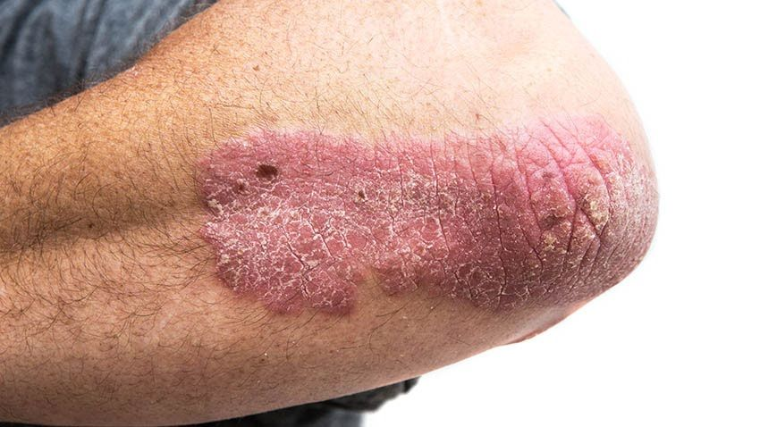
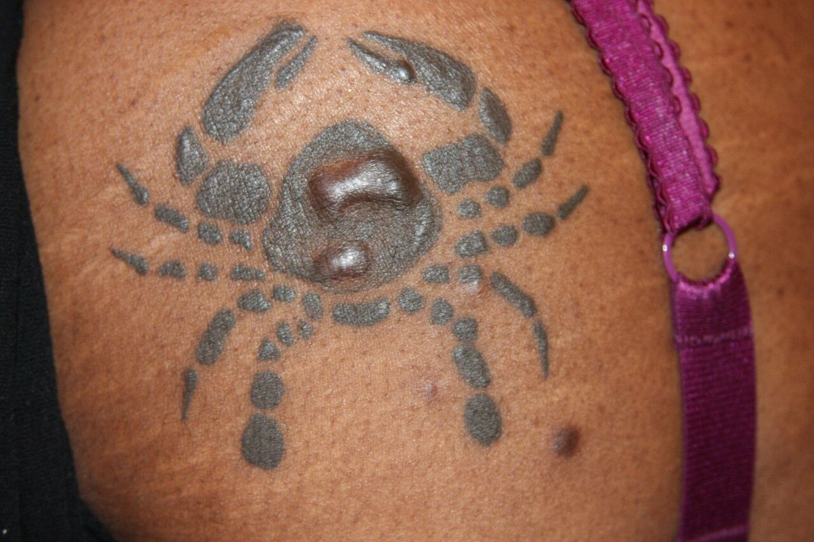
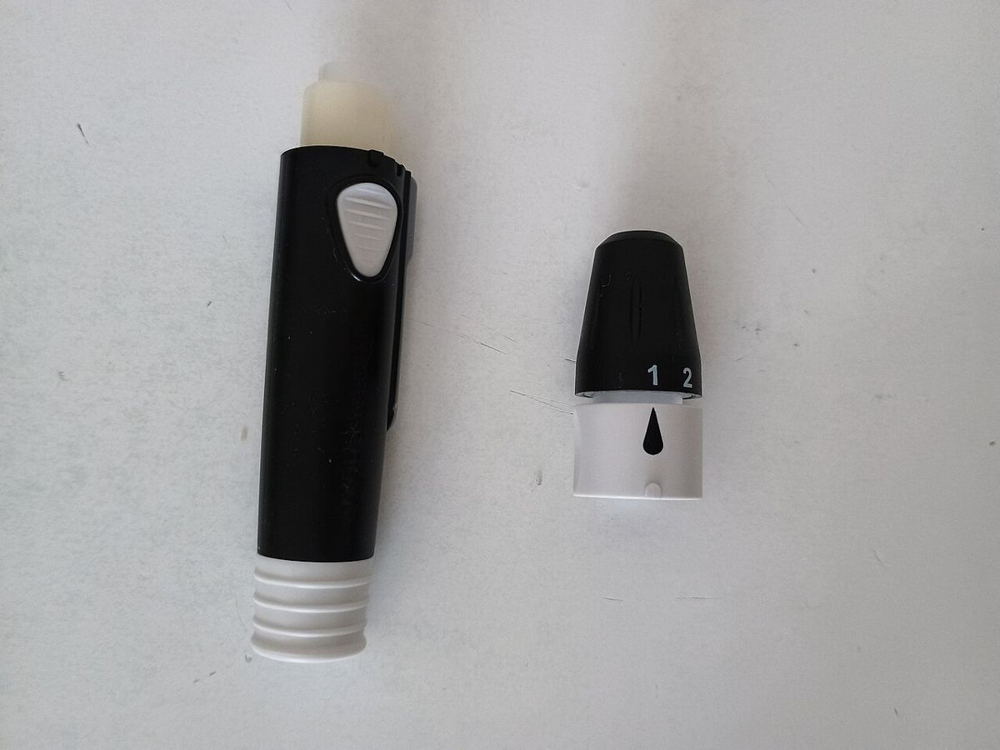

# Когда нельзя делать тату: противопоказания и случаи, когда лучше отложить

**Коротко:** единого официального списка противопоказаний к татуировке в проверенных нами источниках нет, но правила повторяются. Не стоит делать тату после алкоголя или наркотиков, на воспалённой коже, при высыпаниях, ожоге или обострении кожных и хронических болезней. Беременным и кормящим официальные ведомства советуют отложить сеанс. С диабетом, ослабленным иммунитетом, склонностью к келоидам и аллергиями вопрос решается заранее с врачом. Если вы сомневаетесь, сначала врач, потом мастер.

> Это не медицинский совет. Здесь пересказаны общедоступные рекомендации врачей и официальных ведомств. Диагноз и разрешение на тату даёт только врач, который знает вашу историю болезни.

*Псориаз на локте. Иллюстративное фото кожного заболевания, не тату. Кожа с активными высыпаниями - повод сначала обратиться к врачу.* Фото: Haley Otman, [Wikimedia Commons](https://commons.wikimedia.org/wiki/File:Psoriasis_on_elbow.jpg), лицензия [CC BY 3.0](https://creativecommons.org/licenses/by/3.0).

## Почему тату вообще имеет противопоказания

Татуировка - это множество проколов кожи. Mayo Clinic [прямо пишет](https://www.mayoclinic.org/healthy-lifestyle/adult-health/in-depth/tattoos-and-piercings/art-20045067), что при татуировке кожа повреждается, поэтому после неё могут развиться инфекции и другие проблемы со здоровьем. FDA в [материале для потребителей](https://www.fda.gov/consumers/consumer-updates/think-you-ink-tattoo-safety) называет такие риски: инфекции, аллергические реакции, гранулёмы, келоиды, осложнения при МРТ.

Поэтому вопрос звучит не так, можно ли вообще, а так: нет ли сейчас того, что мешает коже и организму справиться с этой раной. Одни состояния откладывают сеанс на время, другие требуют разговора с врачом.

## Когда лучше отложить или обсудить с врачом: сводная таблица

| Ситуация | Что говорят источники | Что делать |
|---|---|---|
| Алкоголь или наркотики в день сеанса | Mayo Clinic: не делайте тату, если вы пили алкоголь или употребляли наркотики | Перенести сеанс |
| Воспалённая кожа, сыпь, высыпания в зоне тату | Роспотребнадзор в памятке о татуировках советует не делать татуаж на воспалённой коже с высыпаниями. По логике то же относится к тату | Подождать, пока кожа успокоится, показаться врачу |
| Обострение кожного или хронического заболевания | Тот же источник: не делать в период болезней, в том числе дерматологических, и обострения хронических | Обсудить с лечащим врачом, перенести |
| Простуда, температура, плохое самочувствие | Отдельных официальных норм мы не нашли. Решение принимает мастер, он вправе перенести сеанс | Сказать мастеру честно, не приходить на сеанс больным |
| Беременность и грудное вскармливание | Шведское агентство по лекарственным средствам советует беременным и кормящим не делать тату: меняется иммунитет, есть риск инфекций | Отложить, обсудить с акушером-гинекологом |
| Сахарный диабет и другие состояния, влияющие на заживление | Министерство здравоохранения Новой Зеландии советует до тату обсудить с врачом состояния вроде диабета, которые могут повлиять на заживление | Сначала врач |
| Склонность к келоидам | FDA: если у вас есть склонность к келоидам, на тату может появиться такая же реакция | Спросить врача, сказать мастеру |
| Известная аллергия на краски или реакции на прошлые тату | Mayo и FDA: реакция на краску возможна сразу или через годы. Подробнее: [Аллергия на тату](/tattoo-spravochnik/allergiya-na-tatu/) | Врач-дерматолог или аллерголог |
| Родинки в зоне тату | AAD советует выбирать кожу без родинок. Подробнее: [Тату на родинке](/tattoo-spravochnik/tatu-na-rodinke/) | Мастер обходит родинку, при сомнениях - дерматолог |
| Не вакцинированы от гепатита B | Mayo Clinic советует вакцинироваться от гепатита B до татуировки, чтобы снизить риск | Спросить врача о вакцинации |

Строки про простуду и воспалённую кожу опираются на общий принцип: сеанс откладывают, когда у кожи и организма уже есть нагрузка. Это не расчёт сроков, а обычная осторожность.

## Что говорят официальные источники

### Mayo Clinic и FDA

Mayo Clinic перечисляет риски (аллергия, инфекции, гранулёмы, келоиды, болезни, передающиеся через кровь, реакция на МРТ) и советует не делать тату под воздействием алкоголя или наркотиков. FDA напоминает, что даже запечатанная краска может содержать бактерии, а стерильность по этикетке проверить нельзя. Подробнее о выборе мастера и проверке рабочего места: [Как выбрать тату-мастера](/tattoo-spravochnik/kak-vybrat-tatu-mastera/).

### Роспотребнадзор

В [памятке управления Роспотребнадзора по Псковской области](https://60.rospotrebnadzor.ru/content/%D1%87%D0%B5%D0%BC-%D0%BC%D0%BE%D0%B3%D1%83%D1%82-%D0%B1%D1%8B%D1%82%D1%8C-%D0%BE%D0%BF%D0%B0%D1%81%D0%BD%D1%8B-%D1%82%D0%B0%D1%82%D1%83%D0%B8%D1%80%D0%BE%D0%B2%D0%BA%D0%B8-%D1%80%D0%B0%D1%81%D1%81%D0%BA%D0%B0%D0%B7%D0%B0%D0%BB-%D1%80%D0%BE%D1%81%D0%BF%D0%BE%D1%82%D1%80%D0%B5%D0%B1%D0%BD%D0%B0%D0%B4%D0%B7%D0%BE%D1%80) сказано, что абсолютно безопасной нельзя считать ни одну татуировку, а риски включают инфекции, воспаление, реакции на краску и развитие кожных заболеваний. Там же советуют не делать процедуру на воспалённой коже с высыпаниями, в период болезней и обострения хронических заболеваний. Свежая тату также является временным противопоказанием для донорства крови, об этом: [Тату, МРТ и донорство крови](/tattoo-spravochnik/tatu-mrt-donorstvo-krovi/).

### Беременность и грудное вскармливание

Шведское агентство по лекарственным средствам [советует](https://www.lakemedelsverket.se/en/tattoo-inks/advice-on-tattooing) беременным и кормящим женщинам не делать тату: беременность меняет работу иммунной системы, а татуировка несёт риск инфекции. Отдельной российской нормы на эту тему в найденных нами официальных источниках нет, поэтому решение принимается вместе с акушером-гинекологом. Многие откладывают сеанс до окончания кормления, но решение остаётся за вашим врачом.

### Диабет и заживление

Health New Zealand [рекомендует](https://www.healthnz.govt.nz/health-topics/keeping-healthy/tattoos) обсудить с врачом состояния вроде диабета до тату, потому что они могут повлиять на способность кожи заживать. Новая тату - это поверхностная рана, и оценить, как ваше состояние повлияет на заживление, может только врач.

## Что сказать мастеру до начала сеанса

Мастеру нужно знать то, что влияет на кожу и кровотечение. Ответьте на эти вопросы честно, даже если кажется, что это неважно:

1. Есть ли хронические заболевания и принимаете ли вы лекарства, в том числе разжижающие кровь.
2. Есть ли аллергия на краску, латекс, антисептики, обезболивающие кремы.
3. Были ли реакции на прошлые тату или пирсинг, образовывались ли грубые рубцы.
4. Не беременны ли вы и не кормите ли грудью.
5. Нет ли в зоне тату родинок, высыпаний, ожога, свежей эпиляции или ссадин.
6. Не пили ли вы алкоголь накануне и не болеете ли сейчас.

Хороший мастер задаёт эти вопросы сам и не обижается, если вы переносите сеанс. Если же вас торопят и не интересуются здоровьем, это повод выбрать другого мастера. Общая подготовка к сеансу описана в статье [Как подготовиться к сеансу тату](/tattoo-spravochnik/kak-podgotovitsya-k-seansu-tatu/).

*Келоид на месте тату. Фото показывает, почему о склонности к грубым рубцам нужно предупреждать мастера и врача.* Фото: Htirgan, [Wikimedia Commons](https://commons.wikimedia.org/wiki/File:Tattoo_keloid.JPG), лицензия [CC BY-SA 3.0](https://creativecommons.org/licenses/by-sa/3.0).

## Если нельзя сейчас, это не навсегда

Большая часть причин для переноса временная: простуда, обострение, ожог, период кормления. После выздоровления кожа возвращается в обычное состояние, и тату можно планировать заново. Постоянные ограничения устанавливает врач, а не мастер и не форум.

Пока ждёте, подготовьте эскиз и сделайте фото зоны для мастера. Как выбрать место на теле и размер, разобрано в статье [Первая тату: как выбрать место](/tattoo-spravochnik/pervaya-tatu-kak-vybrat-mesto/). Если планируете спорт и бассейн, посмотрите [Спорт после тату](/tattoo-spravochnik/sport-posle-tatu/) и [Можно ли мочить тату](/tattoo-spravochnik/mozhno-li-mochit-tatu/).

*Прибор для измерения сахара крови. Иллюстративное фото: при диабете вопрос о тату решают заранее с врачом.* Фото: Roy Zuo, [Wikimedia Commons](https://commons.wikimedia.org/wiki/File:%2820250417%29_Blood_glucose_meter_02.jpg), лицензия [CC BY-SA 4.0](https://creativecommons.org/licenses/by-sa/4.0).

## Когда идти к врачу

Обратитесь к врачу до сеанса, если есть хроническое заболевание, вы принимаете лекарства, ждёте ребёнка, склонны к рубцам или ранее реагировали на краску. После сеанса к врачу идут при таких признаках, которые приводит [Cleveland Clinic](https://health.clevelandclinic.org/tattoo-aftercare): температура, горячая на ощупь кожа, запах или заметные выделения, боль, которая растёт, красные полосы от тату к центру тела или покраснение, которое расширяется. Подробный разбор: [Тату воспалилась: что делать](/tattoo-spravochnik/tatu-vospalilas-chto-delat/). При затруднённом дыхании и отёке лица вызывайте скорую по номеру 103 или 112.

## Частые вопросы

### Можно ли делать тату при простуде?

Лучше отложить. Отдельной нормы мы не нашли, но любая болезнь уже нагружает организм, а тату добавляет ещё и рану на коже. Мастер вправе перенести сеанс, и это нормально. Придите, когда самочувствие вернётся в норму.

### Можно ли делать тату при беременности?

Шведское агентство по лекарственным средствам советует беременным и кормящим не делать тату. Российского официального правила мы не нашли, поэтому вопрос лучше решать с врачом, который ведёт вашу беременность. Если врач не против, сроки обсуждайте с ним и с мастером.

### Можно ли делать тату при месячных?

Запрета в проверенных нами официальных источниках нет. Чувствительность и самочувствие у всех разные, поэтому ориентируйтесь на себя и спросите мастера, как он относится к таким дням. Если сильно болит и плохо себя чувствуете, лучше перенести сеанс.

### Можно ли делать тату с диабетом?

Это решает врач. Health New Zealand советует заранее обсудить диабет с медиком, потому что состояние может повлиять на заживление. Не соглашайтесь на сеанс без разговора с эндокринологом и скажите мастеру о диагнозе.

### Можно ли делать тату после алкоголя?

Нет. Mayo Clinic советует не делать тату, если вы пили алкоголь или употребляли наркотики. Подробнее о подготовке: [Как подготовиться к сеансу тату](/tattoo-spravochnik/kak-podgotovitsya-k-seansu-tatu/).

### С какого возраста можно делать тату?

Юридические нормы по возрасту мы в этой статье не проверяли и не берёмся называть возраст. Правила обычно задаёт студия и закон, поэтому спросите студию заранее. Подросткам лучше принимать такое решение вместе с родителями и врачом: тату почти постоянна и плохо убирается, об этом в статье [Лазерное удаление тату](/tattoo-spravochnik/lazernoe-udalenie-tatu/).

---

## Записаться в ТатуНаХоду

Если сомневаетесь, можно ли вам делать тату, сначала посоветуйтесь с врачом. Когда будете готовы, напишите нам в Telegram и расскажите про идею и зону.

👉 [Записаться в Telegram](https://t.me/tatunahody)

Telegram-канал ТатуНаХоду: [t.me/tattoo_na_hodu](https://t.me/tattoo_na_hodu)

## Источники изображений

- `psoriaz-na-lokte.jpg` - файл Psoriasis on elbow.jpg, автор: Haley Otman, источник: [Wikimedia Commons](https://commons.wikimedia.org/wiki/File:Psoriasis_on_elbow.jpg), лицензия: [CC BY 3.0](https://creativecommons.org/licenses/by/3.0). Без изменений, кроме уменьшения размера.
- `keloid-na-meste-tatu.jpg` - файл Tattoo keloid.JPG, автор: Htirgan, источник: [Wikimedia Commons](https://commons.wikimedia.org/wiki/File:Tattoo_keloid.JPG), лицензия: [CC BY-SA 3.0](https://creativecommons.org/licenses/by-sa/3.0). Без изменений, кроме уменьшения размера.
- `glyukometr-i-lancet.jpg` - файл (20250417) Blood glucose meter 02.jpg, автор: Roy Zuo, источник: [Wikimedia Commons](https://commons.wikimedia.org/wiki/File:%2820250417%29_Blood_glucose_meter_02.jpg), лицензия: [CC BY-SA 4.0](https://creativecommons.org/licenses/by-sa/4.0). Без изменений, кроме уменьшения размера.

## Источники фактов

- [Mayo Clinic: Tattoos, understand risks and precautions](https://www.mayoclinic.org/healthy-lifestyle/adult-health/in-depth/tattoos-and-piercings/art-20045067)
- [FDA: Think Before You Ink, Tattoo Safety](https://www.fda.gov/consumers/consumer-updates/think-you-ink-tattoo-safety)
- [FDA: Tattoos, Temporary Tattoos and Permanent Makeup](https://www.fda.gov/cosmetics/cosmetic-products/tattoos-permanent-makeup)
- [Cleveland Clinic: Tattoo Aftercare](https://health.clevelandclinic.org/tattoo-aftercare)
- [Роспотребнадзор, управление по Псковской области: чем могут быть опасны татуировки](https://60.rospotrebnadzor.ru/content/%D1%87%D0%B5%D0%BC-%D0%BC%D0%BE%D0%B3%D1%83%D1%82-%D0%B1%D1%8B%D1%82%D1%8C-%D0%BE%D0%BF%D0%B0%D1%81%D0%BD%D1%8B-%D1%82%D0%B0%D1%82%D1%83%D0%B8%D1%80%D0%BE%D0%B2%D0%BA%D0%B8-%D1%80%D0%B0%D1%81%D1%81%D0%BA%D0%B0%D0%B7%D0%B0%D0%BB-%D1%80%D0%BE%D1%81%D0%BF%D0%BE%D1%82%D1%80%D0%B5%D0%B1%D0%BD%D0%B0%D0%B4%D0%B7%D0%BE%D1%80)
- [Шведское агентство по лекарственным средствам: Advice on tattooing](https://www.lakemedelsverket.se/en/tattoo-inks/advice-on-tattooing)
- [Health New Zealand: Tattoos](https://www.healthnz.govt.nz/health-topics/keeping-healthy/tattoos)
