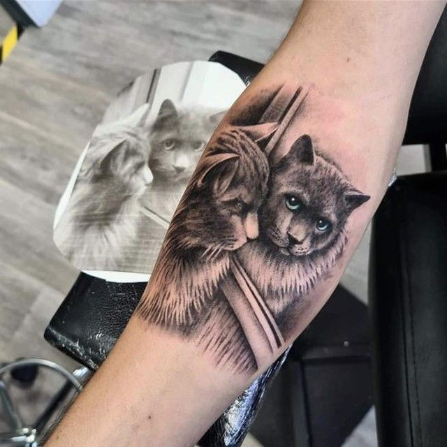
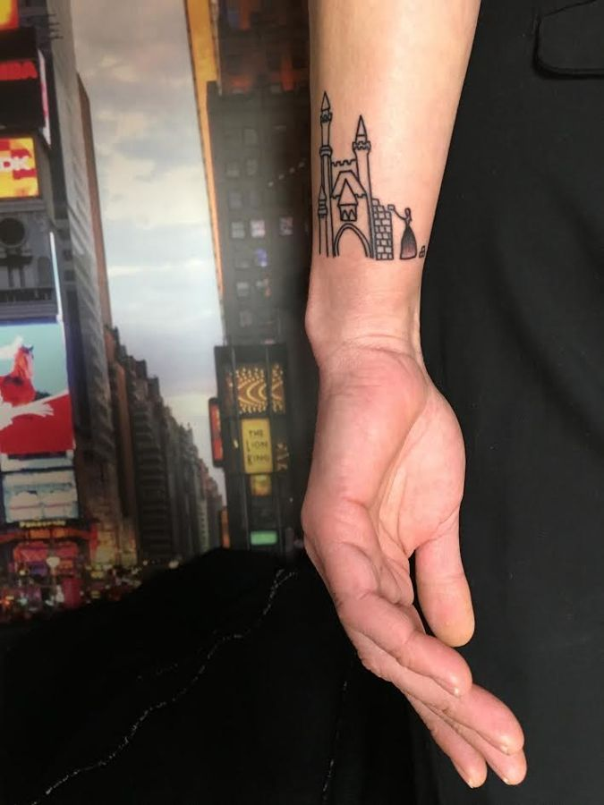
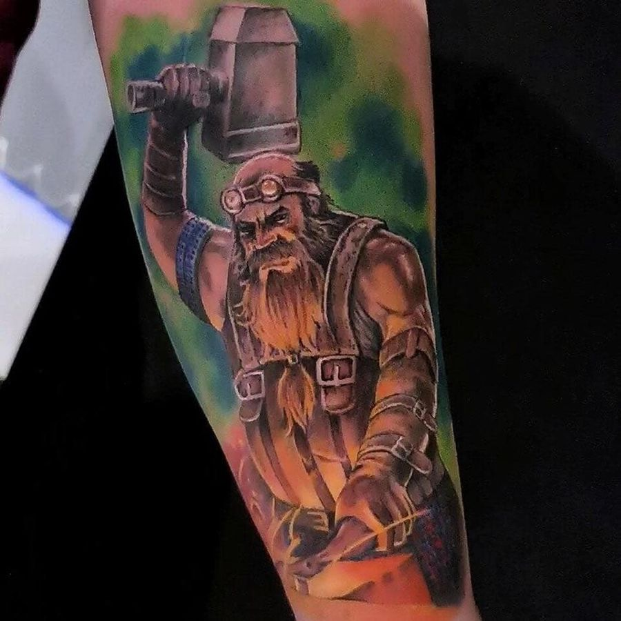
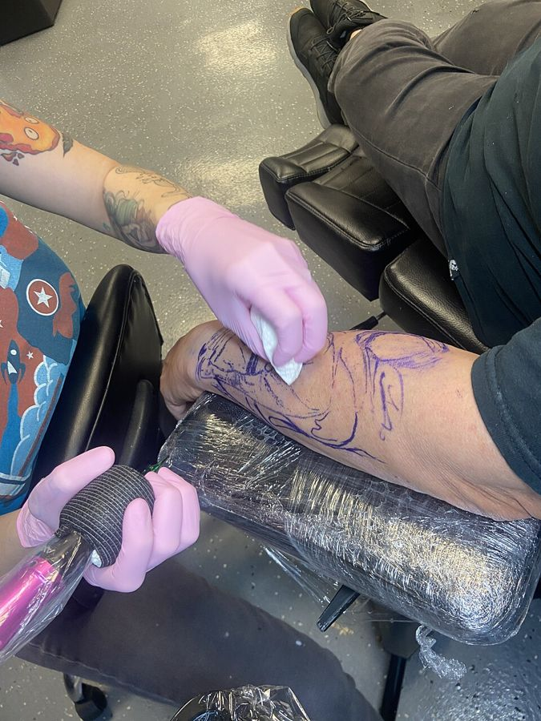

# Коррекция тату: когда она нужна и что обсудить с мастером до сеанса

**Коротко:** коррекция - это дополнительная работа мастера по уже зажившей татуировке: подправить неровно легший пигмент, закрыть пробелы, обновить линии или цвет, которые со временем потускнели. Оценивать результат и решать, нужна ли коррекция, стоит только после полного заживления: верхний слой кожи заживает около двух месяцев, а глубокие слои дольше, поэтому цвет и линии на свежей коже ещё меняются. Коррекция не убирает размытые контуры и не заменяет перекрытие или лазер. Она не делается по воспалённой коже или при реакции на краску: сначала врач. Условия коррекции (сроки, стоимость, входит ли она в первую работу) у каждого мастера свои, поэтому обсудите их до первого сеанса.

> Это не медицинский совет. Мы описываем общие принципы и открытые данные медицинских организаций. Что именно нужно вашей тату, решает мастер при осмотре, а при вопросах о состоянии кожи - врач, лучше дерматолог.

*Мягкие тени и градиенты после заживления - один из тех участков, где качество заливки видно лучше всего. Иллюстративное фото, не пример коррекции.* Фото: Josh Morley, [Wikimedia Commons](https://commons.wikimedia.org/wiki/File:Cat_Reflection_Forearm_Color_Tattoo.jpg), лицензия [CC BY-SA 2.0](https://creativecommons.org/licenses/by-sa/2.0).

## Что такое коррекция и чем она отличается от перекрытия и лазера

Мастера называют коррекцией работу поверх той же татуировки без изменения сюжета. Это не перекрытие (новый рисунок закрывает старый) и не удаление. Чтобы не путать, сравните варианты.

| Ситуация | Что обычно обсуждают | Комментарий |
|---|---|---|
| Мелкие пробелы, неравномерная заливка, местами светлее | Коррекция | Это решает мастер после осмотра зажившей работы |
| Рисунок со временем потускнел | Обновление (коррекция) | Выцветание тату описывают FDA, а ультрафиолет, по данным AAD, может выцвечивать некоторые чернила |
| Линии расплылись, контур размытый | Зависит от степени: иногда перекрытие или лазер | FDA: если пигмент введён слишком глубоко, он может расплыться за границы рисунка, и добавить краску сверху значит не убрать расплыв |
| Сюжет больше не нравится | Перекрытие | Подробнее: [Перекрытие старой тату](/tattoo-spravochnik/perekrytie-staroy-tatu-cover-up/) |
| Нужно убрать рисунок | Лазерное удаление у врача | FDA: удаление требует, как правило, нескольких процедур, а полностью без рубцов убрать тату иногда невозможно |

## Почему может понадобиться коррекция

Тату - результат работы мастера и особенностей вашей кожи, а также ухода и времени. Причины, по которым рисунок меняется, бывают разными.

- **Особенности заживления.** Часть пигмента выходит со шелушением, и на зажившей коже иногда видны светлые пятна или неровная заливка. Мастера в таком случае оценивают работу после заживления и решают, нужен ли второй проход. Это общая практика, а не медицинский факт.
- **Время.** FDA пишет, что татуировки иногда выцветают, а тело и стиль со временем меняются.
- **Солнце.** AAD предупреждает, что ультрафиолет может выцвечивать некоторые чернила, и советует защищать тату солнцезащитным средством с SPF 30 или выше. Там же сказано, что продукты на нефтяной основе, например вазелин, могут вызывать выцветание. Подробнее: [Тату и солнце](/tattoo-spravochnik/tatu-i-solnce/).
- **Повреждение корочек.** Сорванные корочки и расчёсы могут оставить светлые места. Как этого избежать: [Тату чешется: что делать](/tattoo-spravochnik/tatu-cheshetsya-chto-delat/).
- **Тонкие линии и мелкие детали.** По общей практике, именно они чаще всего требуют обновления, потому что каждая линия видна без прикрытия цветом.

*Тонкие линии и мелкие детали заметнее всего отражают качество заживления. Иллюстративное фото, не пример коррекции.* Фото: Saintfevrier, [Wikimedia Commons](https://commons.wikimedia.org/wiki/File:Castle_and_princess_forearm_tattoo.jpg), лицензия [CC BY-SA 4.0](https://creativecommons.org/licenses/by-sa/4.0).

## Когда можно оценивать, нужна ли коррекция

Не раньше, чем тату полностью заживёт. Cleveland Clinic объясняет, что верхний слой кожи заживает примерно за два месяца, а глубокие слои восстанавливаются ещё несколько месяцев, особенно у крупных работ. Mayo Clinic называет обычным сроком заживления поверхности около двух недель, но это внешнее заживление, а не окончательный вид рисунка.

Практичный ориентир: кожа перестала шелушиться и блестеть, выглядит как обычная, рисунок не меняется от недели к неделе. Тогда сфотографируйте тату при ровном дневном свете и покажите мастеру. Как меняется кожа по дням, описано в статье [Шелушение тату по дням](/tattoo-spravochnik/sheluschenie-tatu-po-dnyam/). Точный срок назначает мастер после осмотра: он зависит от размера, зоны и особенностей кожи.

*Насыщенный цвет оценивают на зажившей коже при хорошем свете. Иллюстративное фото, не пример коррекции.* Фото: Josh Morley, [Wikimedia Commons](https://commons.wikimedia.org/wiki/File:Forearm_tattoo_of_blacksmith_in_color.jpg), лицензия [CC BY-SA 2.0](https://creativecommons.org/licenses/by-sa/2.0).

## Как проходит коррекция

Обычно мастер осматривает зажившую работу, обсуждает с вами, что именно хочется исправить, и объясняет, возможно ли это. Если нужен только небольшой участок, исправляют его, а не всю тату. Дальше всё как на обычном сеансе: подготовка кожи, работа, пластырь или плёнка и рекомендации по уходу.

Важно помнить: коррекция - это снова проколы кожи, поэтому тату снова заживает как рана. Подготовьтесь так же, как к первому сеансу: [Как подготовиться к сеансу тату](/tattoo-spravochnik/kak-podgotovitsya-k-seansu-tatu/), а после сеанса следуйте рекомендациям мастера по уходу: [Чем мазать тату после снятия плёнки](/tattoo-spravochnik/chem-mazat-tatu-posle-snyatiya-plenki/). Ощущения могут отличаться от первого раза, как к ним готовиться, описано в статье [Больно ли делать тату](/tattoo-spravochnik/bolno-li-delat-tatu-karta-boli/).

## Когда коррекцию лучше отложить

Откажитесь от сеанса или перенесите его, если:

- кожа воспалена, красная, горячая, есть гной или температура - сначала врач;
- на тату зуд, отёк, бугорки или шелушение только в одном цвете: это может быть реакция на краску, по данным AAD, чаще на красную, и ей нужен осмотр дерматолога;
- кожа обгорела, загорела или повреждена;
- тату ещё не зажила полностью;
- вы плохо себя чувствуете.

## Что спросить у мастера заранее

Условия коррекции разные у разных мастеров и студий, поэтому лучше уточнить их до первого сеанса и сохранить ответ в переписке.

1. Входит ли коррекция в стоимость первой работы и в каких случаях она делается бесплатно или за отдельную плату?
2. В какой срок после заживления можно обратиться и как долго действует это условие?
3. Что считается поводом для коррекции, а что нет (например, расплывшиеся линии или самостоятельно сорванные корочки)?
4. Как мастер оценивает результат: по фото или при личном осмотре?
5. Сколько обычно занимает коррекция и нужно ли готовиться особо?
6. Что будет, если после коррекции нужно ещё одно обновление?

Если вы выбираете мастера, на что смотреть до записи, см. [Как выбрать тату-мастера](/tattoo-spravochnik/kak-vybrat-tatu-mastera/).

*Эскиз и расположение лучше обсудить до сеанса, в том числе и для коррекции. Иллюстративное фото, не пример коррекции.* Фото: Myotus (работа тату-мастера Jenna Haas), [Wikimedia Commons](https://commons.wikimedia.org/wiki/File:13-drying_wiping_to_keep_stencil_visible.jpg), лицензия [CC BY-SA 4.0](https://creativecommons.org/licenses/by-sa/4.0).

## Когда обращаться к врачу

Коррекция - косметическая процедура, но кожа остаётся кожей. Обратитесь к врачу, если:

- после сеанса краснота расползается, боль нарастает, кожа горячая, появились гной, запах, температура или озноб;
- зуд, отёк или бугорки появились на старой тату или в одном цвете;
- реакция держится дольше одной-двух недель: такой срок для обращения к дерматологу называет AAD.

Не ждите, что воспаление пройдёт само, если оно нарастает.

## Частые вопросы

### Через сколько после сеанса можно делать коррекцию?

Только после полного заживления. По Cleveland Clinic, верхний слой кожи заживает около двух месяцев, а более глубокие слои дольше. Конкретный срок назначает мастер после осмотра.

### Коррекция исправит размытые линии?

Не всегда. FDA отмечает, что слишком глубоко введённый пигмент может расплыться за границы рисунка. Добавить краски поверх размытия обычно значит не убрать его. В таких случаях мастер и врач обсуждают перекрытие или лазер. Это решение принимается после осмотра.

### Выцветание тату - это нормально?

Да, со временем татуировки иногда выцветают, пишет FDA. AAD отмечает, что ультрафиолет может выцвечивать некоторые чернила, поэтому зажившую тату советуют защищать от солнца.

### Можно ли делать коррекцию у другого мастера?

Технически можно, но условия и результат зависят от того, что видит мастер. Покажите оригинальный рисунок, расскажите, кто его делал и когда, и обсудите, возможно ли исправление. Не ждите, что условия первого мастера, например бесплатная коррекция, распространяются на другого.

### Больно ли делать коррекцию?

Ощущения зависят от зоны, размера участка и вашей чувствительности. Подробнее о том, где обычно больнее, см. статью [Больно ли делать тату](/tattoo-spravochnik/bolno-li-delat-tatu-karta-boli/).

### Сколько раз можно обновлять тату?

Универсального ответа нет. Каждая коррекция - снова травма кожи, поэтому частоту и объём работы обсуждайте с мастером, а при сомнениях о состоянии кожи - с врачом.

---

## Записаться в ТатуНаХоду

Если вы планируете новую работу или хотите заранее обсудить коррекцию, подготовку и уход, напишите нам в Telegram.

👉 [Записаться в Telegram](https://t.me/tatunahody)

Работы мастеров и новости студии - в нашем Telegram-канале: [t.me/tattoo_na_hodu](https://t.me/tattoo_na_hodu)

## Источники изображений

- `ten-chernoe-seroe.jpg` - Cat Reflection Forearm Color Tattoo.jpg, автор: Josh Morley ([Flickr](https://www.flickr.com/photos/183694898@N06/53524840655/)), источник: [Wikimedia Commons](https://commons.wikimedia.org/wiki/File:Cat_Reflection_Forearm_Color_Tattoo.jpg), лицензия: [CC BY-SA 2.0](https://creativecommons.org/licenses/by-sa/2.0). Без изменений, кроме уменьшения размера.
- `tonkie-linii.jpg` - Castle and princess forearm tattoo.jpg, автор: Saintfevrier, источник: [Wikimedia Commons](https://commons.wikimedia.org/wiki/File:Castle_and_princess_forearm_tattoo.jpg), лицензия: [CC BY-SA 4.0](https://creativecommons.org/licenses/by-sa/4.0). Без изменений, кроме уменьшения размера.
- `cvetnaya-tatu.jpg` - Forearm tattoo of blacksmith in color.jpg, автор: Josh Morley ([Flickr](https://www.flickr.com/photos/183694898@N06/53523509682/)), источник: [Wikimedia Commons](https://commons.wikimedia.org/wiki/File:Forearm_tattoo_of_blacksmith_in_color.jpg), лицензия: [CC BY-SA 2.0](https://creativecommons.org/licenses/by-sa/2.0). Без изменений, кроме уменьшения размера.
- `eskiz-na-kozhe.jpg` - 13-drying wiping to keep stencil visible.jpg, автор: Myotus (работа тату-мастера Jenna Haas), источник: [Wikimedia Commons](https://commons.wikimedia.org/wiki/File:13-drying_wiping_to_keep_stencil_visible.jpg), лицензия: [CC BY-SA 4.0](https://creativecommons.org/licenses/by-sa/4.0). Без изменений, кроме уменьшения размера.

## Источники фактов

- FDA: [Tattoos and Permanent Makeup: Fact Sheet](https://www.fda.gov/cosmetics/cosmetic-products/tattoos-permanent-makeup-fact-sheet) (выцветание, расплывание пигмента, удаление).
- Американская академия дерматологии (AAD): [Caring for tattooed skin](https://www.aad.org/public/everyday-care/skin-care-basics/tattoos/caring-for-tattooed-skin); [Tattoos: 7 unexpected skin reactions](https://www.aad.org/public/everyday-care/skin-care-basics/tattoos/tattoo-skin-reactions).
- Cleveland Clinic: [Tattoo Aftercare: Instructions and Healing Tips](https://health.clevelandclinic.org/tattoo-aftercare); [Tattoo Infection](https://my.clevelandclinic.org/health/diseases/23295-tattoo-infection).
- Mayo Clinic: [Tattoos and piercings: What to know before you get inked or pierced](https://www.mayoclinic.org/healthy-lifestyle/adult-health/in-depth/tattoos-and-piercings/art-20045067).
