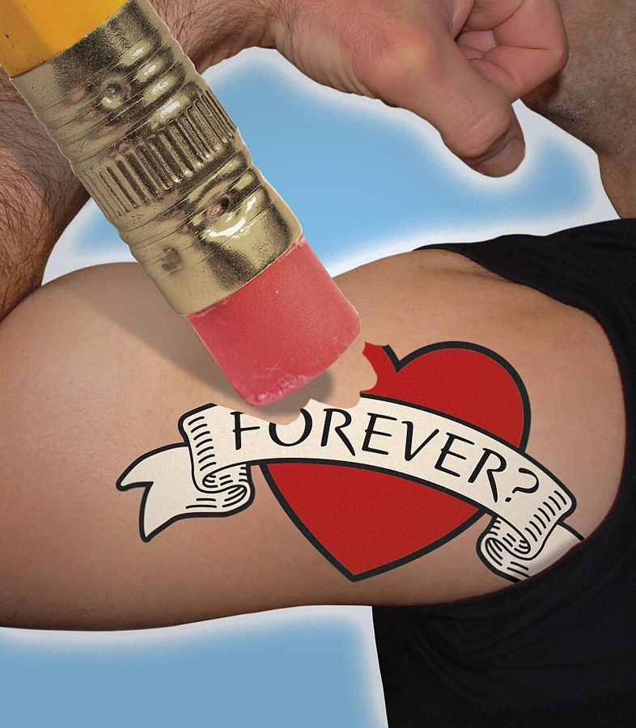
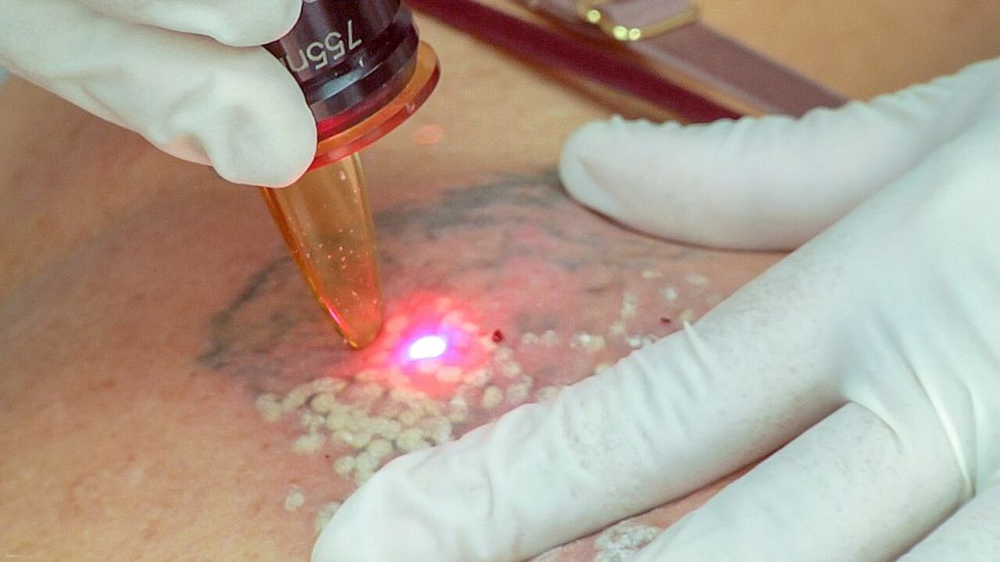
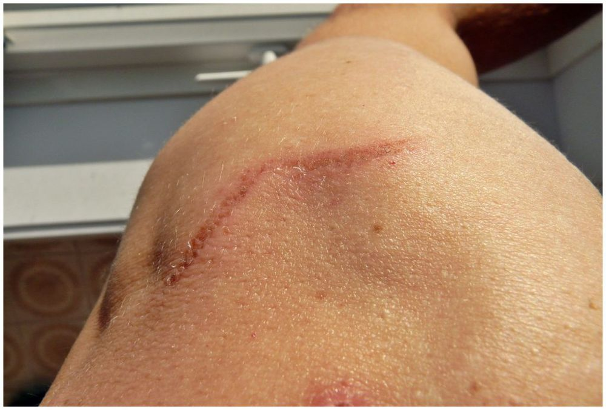

# Лазерное удаление тату: как это работает и что знать до процедуры

**Коротко:** лазер - самый распространённый способ убрать или осветлить тату. Свет разбивает краску на мелкие частицы, а выводит их сам организм, поэтому за один раз тату не исчезает. По данным FDA и Американской академии дерматологии (AAD), нужны несколько сеансов с перерывами в несколько недель, а полностью убрать рисунок удаётся не всегда. Хуже всего поддаются зелёный, красный и жёлтый цвета, а белая и телесная краска, как и перманентный макияж, иногда темнеют. Кремы, наборы для дома и соль не работают и могут оставить ожог или рубец. AAD советует делать процедуру у врача-дерматолога, потому что при недостатке медицинской подготовки чаще бывают рубцы и ожоги. После лазера нужно защищать кожу от солнца, по данным AAD, на протяжении трёх месяцев.

> Это не медицинский совет. Мы пересказываем рекомендации медицинских организаций. Подходит ли вам лазер и как он пройдёт именно у вас, решает врач после осмотра.

*Стереть тату как карандашом нельзя: это длительный процесс. Фотоиллюстрация FDA, не реальное тату.* Фото: FDA, Michael J. Ermarth, [Wikimedia Commons](https://commons.wikimedia.org/wiki/File:Tattoo_Removal_Not_So_Easy_%288413853175%29.jpg), общественное достояние.

## Как работает лазер

Краска при тату лежит не на поверхности, а в дерме, втором слое кожи. Клетки дермы стабильнее клеток верхнего слоя, поэтому краска в основном остаётся на месте на всю жизнь, объясняет FDA. Лазерный свет разбивает краску на мелкие частицы, и иммунная система выводит их со временем. AAD подчёркивает: краску убирает не лазер, а ваш организм, лазер лишь дробит её.

Мастер при создании тату наносит краску слоями, поэтому лазер не может безопасно разбить все слои за один сеанс. Между сеансами нужен перерыв: коже надо зажить, а организму вывести частицы. После каждого сеанса рисунок должен светлеть.

*Лазерное удаление тату с помощью Q-switch лазера. Лицо не показано.* Фото: Alice Pien, MD, [Wikimedia Commons](https://commons.wikimedia.org/wiki/File:Laser_Tatt0o_Removal_CU.jpg), лицензия [CC BY-SA 4.0](https://creativecommons.org/licenses/by-sa/4.0).

## Что влияет на результат

Число и длительность процедур зависят от размера тату и цветов. FDA прямо пишет, что полное удаление может занять много сеансов, а в некоторых случаях невозможно. На консультации врач, по данным AAD, учитывает:

- как давно сделана тату;
- как глубоко залегает краска;
- какие в ней цвета;
- где на теле она находится;
- ваше здоровье и принимаемые лекарства;
- был ли у вас когда-нибудь выпуклый рубец.

Разные цвета краски поглощают свет с разной длиной волны, поэтому многоцветная тату может потребовать нескольких лазеров. Один лазер, по данным AAD, не убирает все цвета.

| Что в тату | Как ведёт себя при лазере (по данным FDA) |
|---|---|
| Чёрный и тёмно-синий | Убираются легче всего |
| Зелёный, красный, жёлтый | Убираются сложнее всего |
| Белая и телесная краска, перманентный макияж | Могут темнеть (окисляться), потемневший пигмент лазером уже не убрать |
| Многоцветный рисунок | Могут понадобиться несколько лазеров |

Эти данные общие. Как поведёт себя именно ваша тату, скажет врач.

## Лазер и другие способы

| Способ | Что известно из источников |
|---|---|
| Лазер у врача | Самый распространённый метод. При работе обученного специалиста может быть безопасным и эффективным (FDA). AAD: лазеры в основном вытеснили другие методы |
| Дермабразия, абляционные лазеры, хирургическое иссечение | Не убирают пигмент, а травмируют кожу вокруг. Результат непредсказуем, выше риск рубцов (FDA) |
| Кремы, мази, наборы для удаления дома | FDA не одобряло такие средства и не знает доказательств их безопасности и эффективности. Они могут вызвать сыпь, ожог или рубец. AAD: доказательств, что они убирают тату, нет |
| Соль (салабразия) | AAD: снимают верхние слои кожи и втирают соль, это очень больно, возможны серьёзная инфекция и рубец |

## Кто должен делать процедуру

AAD рекомендует обращаться к дерматологу с сертификатом: врач может оценить здоровье кожи и понять, кому лазер можно, а кому нет. Если тату удаляет человек без медицинской подготовки, побочные эффекты случаются чаще: рубцы, изменение текстуры кожи, ожоги. Кроме того, у такого специалиста бывает один лазер, а он не убирает все цвета.

FDA отмечает, что лазеры для удаления тату одобрены для использования врачом или под его наблюдением. Требования в разных странах отличаются, поэтому в России спросите в клинике, какой врач проводит процедуру, какой у него опыт именно с тату и какое оборудование используется. Если вы сомневаетесь, обратитесь к дерматологу.

На консультации можно попросить показать фото результатов других пациентов до и после, так советует AAD.

*Рубец, который, по описанию автора файла на Commons, остался после лазерного удаления тату. Пример того, почему важно, кто делает процедуру. Иллюстративное фото.* Фото: Walker915, [Wikimedia Commons](https://commons.wikimedia.org/wiki/File:Scarring-From-Laser-Tattoo-Removal.jpg), лицензия [CC BY-SA 4.0](https://creativecommons.org/licenses/by-sa/4.0).

## Больно ли и как восстанавливается кожа

FDA сравнивает ощущения со щелчком тонкой резинки по коже. AAD пишет, что процедура может быть неприятной или болезненной, и врач может предложить обезболивающий крем или укол. Сразу после сеанса возможны покраснение, отёк и небольшие пузыри (AAD).

Среди возможных побочных эффектов FDA называет более светлую, чем вокруг, кожу, рубцы, инфекцию, точечные кровотечения, покраснение и болезненность. По данным AAD, светлые или тёмные пятна обычно исчезают в течение 6-12 месяцев, а у врача другие побочные эффекты редки.

Что вы можете сделать, чтобы результат был лучше и рисков меньше, говорит AAD:

1. Приходить на все сеансы: многие бросают лечение раньше, чем увидят нужный результат.
2. Следовать инструкции врача по уходу дома. Кожу нужно беречь и закрывать до заживления.
3. Защищать обработанную кожу от солнца в течение трёх месяцев, лучше всего одеждой, которая полностью не пропускает свет. Как защищать тату от солнца, подробнее в статье [Тату и солнце](/tattoo-spravochnik/tatu-i-solnce/).

## Родинки рядом с тату

Если рядом с тату есть родинки или пятна, AAD советует делать лазерное удаление только у дерматолога. Врач следит за кожей во время процедуры и может проверить родинки и пятна, которые стали видны после осветления тату. Если пятно нужно проверить с биопсией, следующие сеансы иногда приходится отложить.

## Когда идти к врачу

Обратитесь к врачу, который проводил процедуру, или к дерматологу, если после сеанса:

- покраснение, отёк или болезненность не проходят или усиливаются: FDA отмечает, что обычные побочные эффекты не должны длиться долго;
- краснота темнеет или расползается, боль нарастает, появились гной, открытые язвочки, температура или озноб: это признаки инфекции по описанию AAD;
- появились сильный отёк, крапивница, затруднённое дыхание, сердцебиение, головокружение: нужна срочная медицинская помощь.

Лазер не делают при беременности и грудном вскармливании. Для результата нужна здоровая иммунная система (AAD). Расскажите врачу обо всех болезнях и лекарствах заранее.

## Частые вопросы

### Сколько сеансов нужно, чтобы убрать тату?

Универсального числа нет. FDA пишет, что число и длительность процедур зависят от размера тату и цветов, а перерывы между ними составляют несколько недель. Полностью убрать рисунок удаётся не всегда. Конкретный план составляет врач после осмотра.

### Можно ли убрать тату кремом или солью дома?

Нет. FDA не знает доказательств, что кремы и наборы для домашнего удаления безопасны и эффективны, и предупреждает о сыпи, ожогах и рубцах. AAD отдельно предостерегает от соли: это очень больно, возможны инфекция и рубец.

### Почему некоторые цвета не убираются?

Разные краски поглощают свет по-разному. По данным FDA, зелёный, красный и жёлтый убираются сложнее всего, а тёмно-синий и чёрный проще. Белая и телесная краска и перманентный макияж могут потемнеть от лазера.

### Можно ли делать лазер у мастера тату или в салоне красоты?

AAD рекомендует врача-дерматолога: у специалистов без медицинской подготовки чаще встречаются рубцы, изменения текстуры кожи и ожоги, а один лазер не убирает все цвета. FDA пишет, что лазеры предназначены для врача или работы под его наблюдением.

### Можно ли перекрыть тату вместо удаления?

Это отдельный вариант, его обсуждают с мастером и при необходимости с врачом. Подробнее в статье [Перекрытие старой тату](/tattoo-spravochnik/perekrytie-staroy-tatu-cover-up/). Mayo Clinic советует обсудить удаление с дерматологом.

### Можно ли загорать после лазера?

Нет. AAD рекомендует защищать обработанную кожу от солнца в течение трёх месяцев и носить одежду, которая полностью не пропускает свет.

---

## Записаться в ТатуНаХоду

Если вы думаете не об удалении, а о новой работе, перекрытии или обсуждении эскиза, напишите нам в Telegram. По вопросам лазерного удаления обращайтесь к врачу-дерматологу.

👉 [Записаться в Telegram](https://t.me/tatunahody)

Работы мастеров и новости студии - в нашем Telegram-канале: [t.me/tattoo_na_hodu](https://t.me/tattoo_na_hodu)

## Источники изображений

- `foto-illyustraciya-fda.jpg` - Tattoo Removal Not So Easy (8413853175).jpg, автор: FDA, Michael J. Ermarth, источник: [Wikimedia Commons](https://commons.wikimedia.org/wiki/File:Tattoo_Removal_Not_So_Easy_%288413853175%29.jpg), общественное достояние. Без изменений, кроме уменьшения размера.
- `lazer-nad-tatu.jpg` - Laser Tatt0o Removal CU.jpg, автор: Alice Pien, MD, источник: [Wikimedia Commons](https://commons.wikimedia.org/wiki/File:Laser_Tatt0o_Removal_CU.jpg), лицензия: [CC BY-SA 4.0](https://creativecommons.org/licenses/by-sa/4.0). Без изменений, кроме уменьшения размера.
- `rubec-posle-lazera.jpg` - Scarring-From-Laser-Tattoo-Removal.jpg, автор: Walker915, источник: [Wikimedia Commons](https://commons.wikimedia.org/wiki/File:Scarring-From-Laser-Tattoo-Removal.jpg), лицензия: [CC BY-SA 4.0](https://creativecommons.org/licenses/by-sa/4.0). Без изменений, кроме уменьшения размера.

## Источники фактов

- Американская академия дерматологии (AAD): [Tattoo removal: Lasers outshine other methods](https://www.aad.org/public/cosmetic/hair-removal/laser-tattoo-removal); [Do tattoos cause skin cancer?](https://www.aad.org/public/diseases/skin-cancer/do-tattoos-cause-skin-cancer); [Tattoos: 7 unexpected skin reactions](https://www.aad.org/public/everyday-care/skin-care-basics/tattoos/tattoo-skin-reactions).
- FDA: [Tattoo Removal: Options and Results](https://www.fda.gov/consumers/consumer-updates/tattoo-removal-options-and-results).
- Mayo Clinic: [Tattoos: Understand risks and precautions](https://www.mayoclinic.org/healthy-lifestyle/adult-health/in-depth/tattoos-and-piercings/art-20045067).
