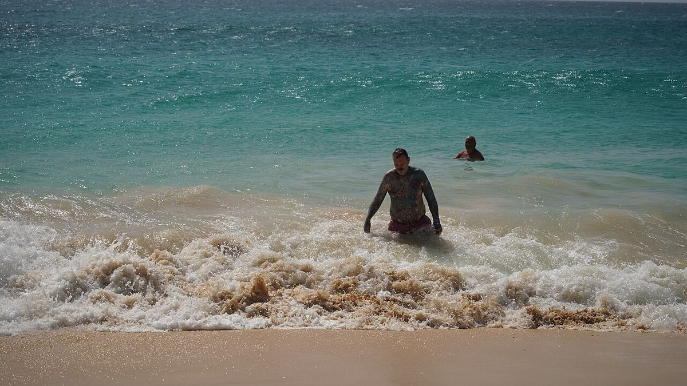
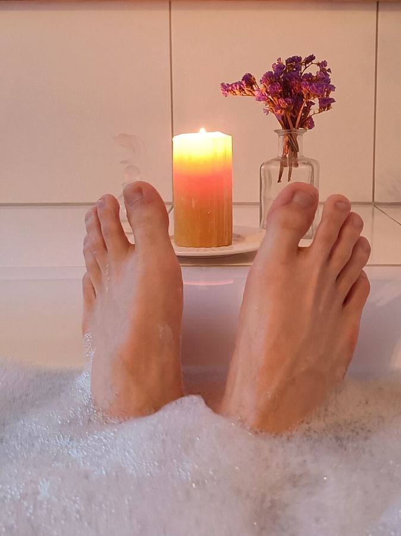
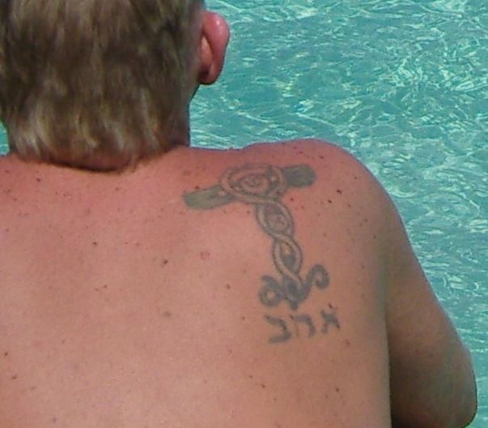
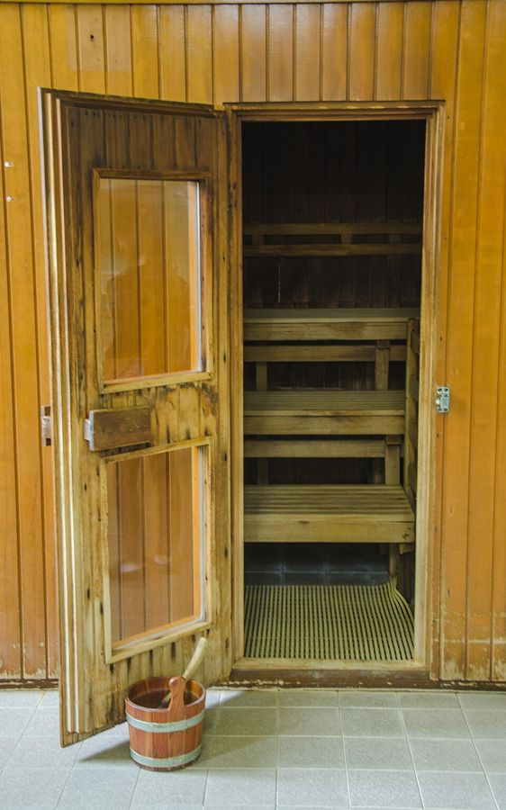

# Можно ли мочить тату: душ, ванна, баня, бассейн и море

**Коротко:** пока тату заживает, её нужно мыть, но не мочить надолго. Душ можно: тёплая вода, мягкое мыло, без прямой сильной струи, промокнуть без трения. Ванну, бассейн, джакузи, море, реки и озёра нужно исключить до заживления, так советуют Mayo Clinic и Cleveland Clinic. О бане и сауне официальные источники прямо не пишут, но жар, пар и долгое распаривание логично приравнять к замачиванию, поэтому лучше подождать. Если мастер дал свою инструкцию, ориентируйтесь на неё и ждите, пока она закончится.

> Это не медицинский совет. Мы пересказываем общедоступные рекомендации врачей. Если тату болит, краснеет или мокнет, обратитесь к врачу.

*Море и открытые водоёмы пока тату заживает лучше обходить. Иллюстративное фото, не показывает заживающую тату.* Фото: Miguel Discart, [Wikimedia Commons](https://commons.wikimedia.org/wiki/File:Man_with_tattoos_wading.jpg), лицензия [CC BY-SA 2.0](https://creativecommons.org/licenses/by-sa/2.0).

## Почему воду нужно ограничивать

Тату делают иглой, которая много раз прокалывает кожу, поэтому свежая работа это поверхностная рана. Mayo Clinic [пишет](https://www.mayoclinic.org/healthy-lifestyle/adult-health/in-depth/tattoos-and-piercings/art-20045067), что при татуировке кожа повреждается и после этого возможны инфекции. Поэтому врачи советуют держать тату чистой и не погружать её в воду: в бассейны, джакузи, реки, озёра и другие водоёмы.

## Что можно и нельзя по ситуациям

| Ситуация | Пока тату заживает | Что говорят источники |
|---|---|---|
| Душ | Можно | Тёплая, не горячая вода, мягкое мыло, не тереть, промокнуть чистой бумажной салфеткой. Прямую сильную струю на свежую тату лучше не направлять. Mayo Clinic, Cleveland Clinic |
| Ванна, полное погружение | Нельзя | Cleveland Clinic советует не погружать тату в воду, в том числе в ванне |
| Бассейн | Нельзя | Mayo Clinic: не плавать в бассейнах, пока тату заживает |
| Море, река, озеро | Нельзя | Mayo Clinic: не заходить в реки, озёра и другие водоёмы, пока тату заживает |
| Джакузи, хот-таб | Нельзя | Mayo Clinic и Cleveland Clinic |
| Баня, сауна, хаммам | Лучше подождать | Прямых указаний в этих источниках нет. Жар, пар и долгое пребывание в тепле это не мытьё, а распаривание, поэтому осторожнее приравнять к замачиванию. Спросите мастера |
| Мытьё рук и посуды, если тату на кисти | По обстоятельствам | Короткое мытьё рук мягким мылом входит в уход. Долгий контакт с водой и бытовой химией лучше свести к минимуму. Это наш практический вывод, уточните у мастера |
| Загар и солнце | Лучше избегать | Mayo Clinic: беречь тату от солнца, пока она заживает |

Когда тату полностью зажила, купаться и париться можно. А вот солнце остаётся важным и после заживления: American Academy of Dermatology советует после заживления защищать тату солнцезащитным кремом с SPF 30 и выше, а также не пользоваться солярием. Подробнее мы разобрали это в статье [Тату и солнце](/tattoo-spravochnik/tatu-i-solnce/).

*Ванна означает погружение, а это для свежей тату нежелательно. Иллюстративное фото, без тату.* Фото: Galus24, [Wikimedia Commons](https://commons.wikimedia.org/wiki/File:Bathtub_Bath_Feet_Relax.jpg), лицензия [CC BY 4.0](https://creativecommons.org/licenses/by/4.0).

## Как мыть тату, пока она заживает

Это коротко, подробности в статьях про [мази и кремы](/tattoo-spravochnik/chem-mazat-tatu-posle-snyatiya-plenki/) и [шелушение](/tattoo-spravochnik/sheluschenie-tatu-po-dnyam/).

1. Сначала вымойте руки.
2. Промойте тату тёплой, не горячей водой с мягким мылом без отдушек. Пальцами, без мочалки.
3. Промокните чистой бумажной салфеткой, не вытирайте и не трите.
4. Нанесите тонкий слой того средства, которое посоветовал мастер.

Cleveland Clinic рекомендует мыть тату дважды в день в первую неделю и продолжать мыть и увлажнять её в течение первого месяца. Mayo Clinic тоже советует мыть тату дважды в день.

## Когда считать, что тату зажила

Здесь источники отвечают по-разному, и это нормально. Mayo Clinic пишет, что большинство тату заживает примерно за две недели. Cleveland Clinic уточняет, что всё зависит от размера и места: крупные работы могут заживать несколько месяцев, а верхний слой кожи обычно восстанавливается около двух месяцев, тогда как нижним слоям нужно ещё несколько месяцев.

Проще всего ориентироваться на состояние кожи, а не на дни. Ориентиры, которые используют на практике:

- корочки и шелушение прошли полностью;
- поверхность гладкая, без мокнущих или болезненных мест;
- нет отёка и покраснения;
- мастер подтвердил, что можно купаться.

Если сомневаетесь, лучше сначала отправить мастеру фото и спросить.

*Полностью зажившая тату уже не мешает купаться. Иллюстративное фото.* Фото: Pittigrilli, [Wikimedia Commons](https://commons.wikimedia.org/wiki/File:Man_at_the_strand_with_tattoo.jpg), лицензия [CC BY-SA 4.0](https://creativecommons.org/licenses/by-sa/4.0).

## Баня и сауна отдельно

Баню часто путают с душем, но у неё другая нагрузка: жар, пар, долгое пребывание в тепле и влажности. В источниках, на которые мы опираемся, о бане нет ни разрешения, ни запрета. Поэтому разумный подход такой: пока тату не зажила полностью, в баню лучше не идти, а когда соберётесь, спросите мастера.

*Баня и сауна это пар и жар, а не просто мытьё. Иллюстративное фото.* Фото: Valentin R. from France, [Wikimedia Commons](https://commons.wikimedia.org/wiki/File:Le_vrai_sauna_des_bains_municipaux_%2849548940813%29.jpg), лицензия [CC0 1.0](https://creativecommons.org/publicdomain/zero/1.0/deed.ru).

## Что делать, если тату случайно намокла

Если вы упали в воду, попали под дождь или потратили в бассейне больше времени, чем рассчитывали, не паникуйте.

1. Выйдите из воды, мягко промойте тату чистой тёплой водой с мягким мылом.
2. Промокните чистой салфеткой.
3. Несколько дней понаблюдайте за кожей.
4. Напишите мастеру и расскажите, что произошло.

Если появились признаки инфекции, обратитесь к врачу. Cleveland Clinic называет такие признаки: температура, кожа горячая на ощупь, неприятный запах или заметные выделения, боль, которая нарастает вместо того, чтобы стихать, а также красные полосы от тату к центру тела или покраснение, которое расползается всё дальше.

## Когда идти к врачу

Кроме признаков выше, FDA отмечает: если область, похоже, не заживает, или рядом с тату появилась сыпь, покраснение или бугорки, особенно с повышенной температурой, свяжитесь с врачом и сообщите мастеру. Сильная лихорадка, озноб и потливость могут говорить о более серьёзной инфекции.

## Частые вопросы

### Можно ли принимать душ сразу после сеанса?

Зависит от того, как мастер закрыл тату и что он рекомендует. После сеанса мастер накладывает плёнку или повязку и объясняет, сколько её носить и можно ли с ней мыться. Cleveland Clinic пишет, что повязку нужно оставить на срок, который назвал мастер, и это может быть несколько часов и больше.

### Можно ли мыться с тату под плёнкой?

Решает мастер, потому что правила зависят от вида плёнки и условий заживления. Если мастер не сказал, спросите его до того, как идти в душ.

### Через сколько можно в бассейн или в море?

Пока тату заживает, в бассейн и открытую воду нельзя. Конкретный срок зависит от размера работы, зоны тела и вашей кожи, поэтому его называет мастер. Ориентиры из источников: поверхность заживает примерно за 2 недели и дольше, а полное восстановление может занять месяцы (Mayo Clinic, Cleveland Clinic).

### Можно ли в баню через 2 недели?

В источниках нет такого срока для бани. Если тату уже не шелушится, не болит и корочек нет, всё равно сначала спросите мастера. Лучше подождать, чем получить воспаление.

### Влияет ли место тату на то, можно ли мочить?

Принципы одинаковы для любой зоны: мыть мягко, не погружать в воду, не тереть. Детали для конкретного места, например кисти или стопы, подскажет мастер.

### Можно ли загорать, пока тату заживает?

Нет, по рекомендации Mayo Clinic и Cleveland Clinic: пока тату заживает, её нужно беречь от солнца. После заживления American Academy of Dermatology советует солнцезащитный крем SPF 30 и выше.

---

## Записаться в ТатуНаХоду

Хотите обсудить идею или задать вопрос по уходу? Напишите в Telegram.

👉 [Записаться в Telegram](https://t.me/tatunahody)

Telegram-канал ТатуНаХоду: [t.me/tattoo_na_hodu](https://t.me/tattoo_na_hodu)

## Источники изображений

- `more-vhod-v-vodu.jpg` - файл Man with tattoos wading.jpg, автор: Miguel Discart, источник: [Wikimedia Commons](https://commons.wikimedia.org/wiki/File:Man_with_tattoos_wading.jpg), лицензия: [CC BY-SA 2.0](https://creativecommons.org/licenses/by-sa/2.0). Без изменений, кроме уменьшения размера.
- `vanna-s-penoy.jpg` - файл Bathtub Bath Feet Relax.jpg, автор: Galus24, источник: [Wikimedia Commons](https://commons.wikimedia.org/wiki/File:Bathtub_Bath_Feet_Relax.jpg), лицензия: [CC BY 4.0](https://creativecommons.org/licenses/by/4.0). Без изменений, кроме уменьшения размера.
- `parnaya-s-derevyannoy-dveryu.jpg` - файл Le vrai sauna des bains municipaux (49548940813).jpg, автор: Valentin R. from France, источник: [Wikimedia Commons](https://commons.wikimedia.org/wiki/File:Le_vrai_sauna_des_bains_municipaux_%2849548940813%29.jpg), лицензия: [CC0 1.0](https://creativecommons.org/publicdomain/zero/1.0/deed.ru). Без изменений, кроме уменьшения размера.
- `zazhivshaya-tatu-na-lopatke-u-vody.jpg` - файл Man at the strand with tattoo.jpg, автор: Pittigrilli, источник: [Wikimedia Commons](https://commons.wikimedia.org/wiki/File:Man_at_the_strand_with_tattoo.jpg), лицензия: [CC BY-SA 4.0](https://creativecommons.org/licenses/by-sa/4.0). Без изменений, кроме уменьшения размера.
