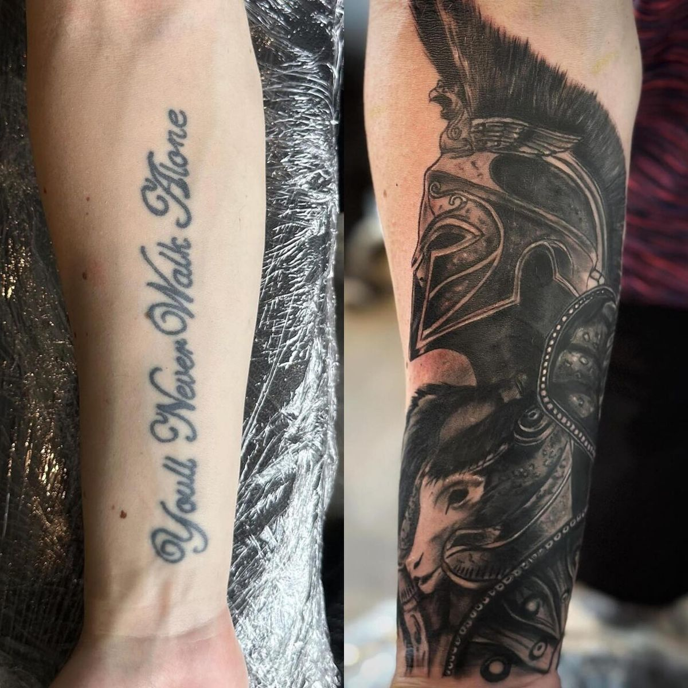
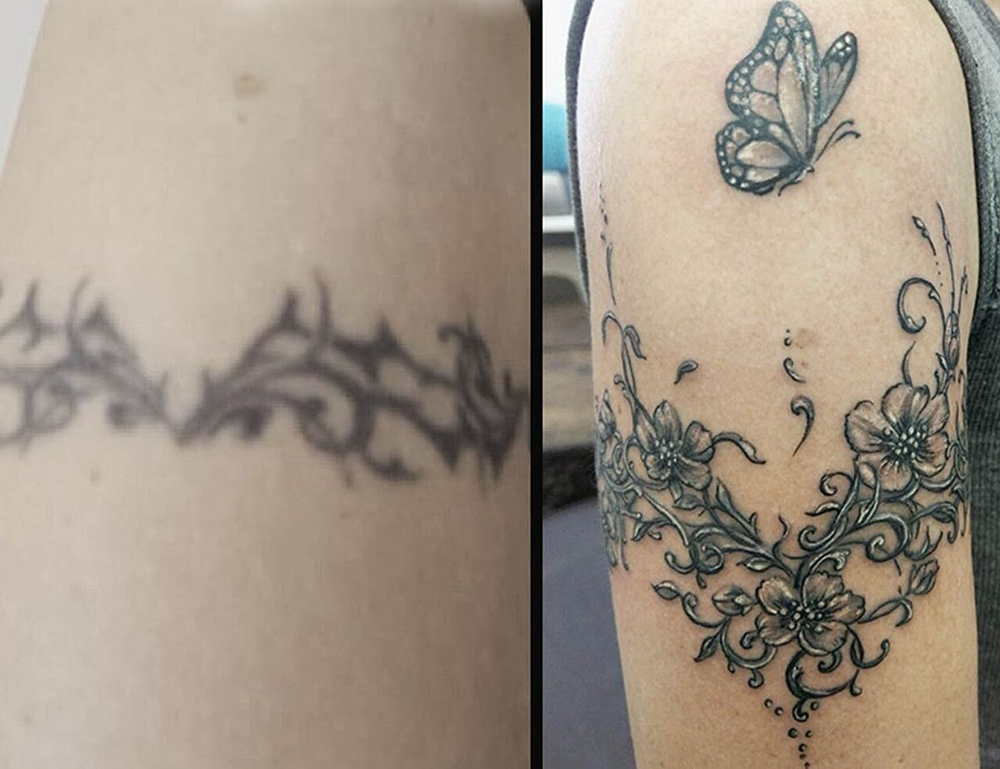
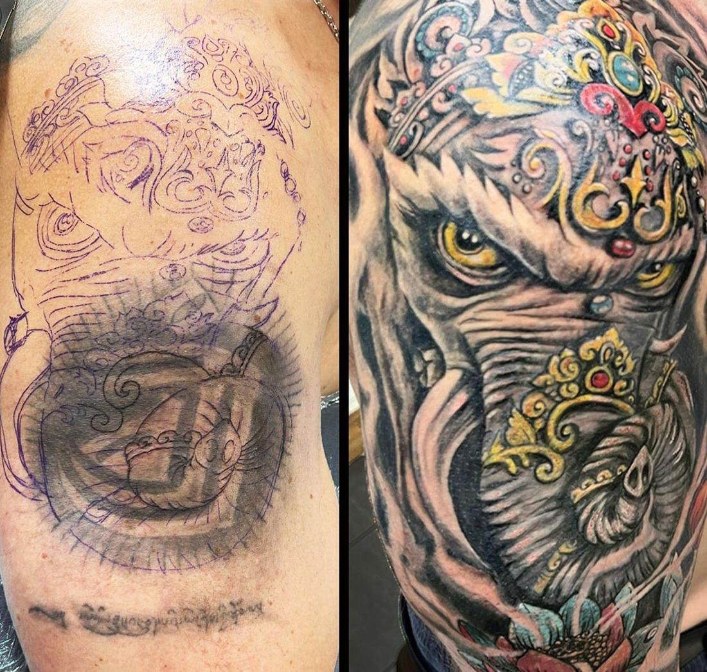
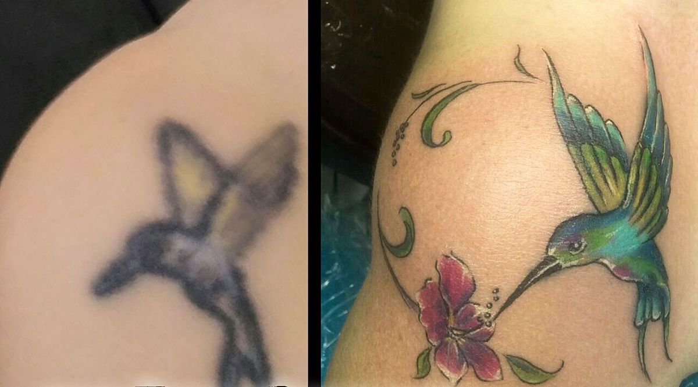

# Перекрытие старой тату (cover-up): что можно перекрыть и как это делают

**Коротко:** да, старую тату часто можно перекрыть новой, но не любую и не любым рисунком. Пигмент лежит в коже, а не на поверхности, поэтому светлым рисунком тёмный не закрыть. Новый рисунок обычно делают крупнее старого, темнее и плотнее по деталям, чтобы старые линии спрятались в тенях и фактуре. Выцветшие, неяркие работы и небольшие надписи перекрывают чаще всего. Плотные чёрные заливки и очень яркие цветные работы иногда сначала осветляют лазером. Окончательный ответ даёт мастер после осмотра: покажите ему старую тату до того, как выбирать эскиз.

> Это не медицинский совет. Мы описываем общие принципы и ссылаемся на источники. Если на старой тату появились зуд, отёк, бугры или меняется родинка, сначала обратитесь к врачу-дерматологу.

*Слева старая надпись, справа перекрытие: плотная чёрно-серая работа с глубокими тенями прячет и строчки, и сам контур надписи.* Фото: Liverpool Tattoos, [Wikimedia Commons](https://commons.wikimedia.org/wiki/File:Bellerophon_Forearm_Black_and_White_Cover_Up_Tattoo.jpg), лицензия [CC BY-SA 2.0](https://creativecommons.org/licenses/by-sa/2.0).

## Что такое перекрытие и чем оно отличается от коррекции и лазера

Перекрытие (cover-up) - это новая татуировка поверх старой, после которой старый рисунок перестаёт читаться. Его легко перепутать с соседними решениями, а они подходят в разных случаях.

| Что вы хотите | Что обычно подходит | Кто решает |
|---|---|---|
| Рисунок нравится, но выцвел или линии поплыли | Коррекция (обновление) того же рисунка | Мастер |
| Рисунок не нравится, но он не слишком тёмный и плотный | Перекрытие новым рисунком | Мастер |
| Рисунок тёмный, плотный или очень яркий, а новый хочется светлым и лёгким | Лазерное осветление, потом перекрытие | Врач-дерматолог и мастер |
| Рисунок нужно убрать совсем | Лазерное удаление | Врач-дерматолог |

Лазер здесь не конкурент перекрытию, а его возможный первый шаг. Если вам не нужен именно новый рисунок поверх, а нужно убрать тату, про лазер см. ниже.

## Почему светлым по тёмному не получится

Татуировка не краска на стене: пигмент введён в кожу, и тёмный цвет просвечивает сквозь то, что нанесли сверху. Поэтому почти любое перекрытие строится на трёх правилах, которые называют практикующие мастера. Это правила ремесла, а не результат клинических исследований.

1. **Новый рисунок крупнее старого.** Ему нужен запас по краям, иначе старые линии будут торчать из-под нового. Насколько именно крупнее, зависит от работы, и точный размер называет мастер.
2. **Новый рисунок темнее и плотнее старого.** Светлые и бледные цвета старую тёмную работу не скроют. Лучше всего работают сюжеты с глубокими тенями и мелкой плотной проработкой, в которой теряются старые линии.
3. **Сюжет подбирают под старый рисунок.** Мастер смотрит, где у старой работы толстые линии, заливки, надписи, и строит композицию так, чтобы эти места пришлись на тёмные участки: шерсть, листву, складки, доспехи.

*Слева старый выцветший узор-браслет, справа перекрытие: цветочный орнамент с бабочкой, заметно более проработанный и плотный.* Фото: AnjanaTattoo, [Wikimedia Commons](https://commons.wikimedia.org/wiki/File:Cover_Up_Tattoo_Tribal_Kirschbl%C3%BCten.jpg), лицензия [CC BY-SA 4.0](https://creativecommons.org/licenses/by-sa/4.0).

## От чего зависит, получится ли перекрыть

| Старая тату | Как к ней обычно подходят | Насколько просто |
|---|---|---|
| Выцветшая, тонкие линии, небольшая | Подбирается широкий круг сюжетов | Проще всего |
| Небольшая надпись или символ | Нужен рисунок заметно крупнее и плотнее, маленьким на маленькое перекрыть почти нельзя | Зависит от размера |
| Плотная чёрная заливка или толстые контуры | Нужен тёмный плотный сюжет, а иногда сначала осветление лазером | Сложнее |
| Яркая цветная работа, особенно насыщенная | Мастер оценивает, будет ли цвет проступать, нередко предлагает осветление | Сложнее |
| Свежая тату | Сначала полное заживление, потом решение | Нужно подождать |
| Шрамы, рубцы или кожное заболевание в зоне тату | Сначала консультация врача-дерматолога | Отдельная оценка |

Кроме самой старой тату играют роль зона тела и состояние кожи. На плотной коже предплечья, плеча или бедра работать проще, чем на кистях, рёбрах или шее: подробнее о том, где кожа тоньше и чувствительнее, в статье [Больно ли делать тату: карта боли по зонам тела](/tattoo-spravochnik/bolno-li-delat-tatu-karta-boli/).

*Слева старое тёмное пятно и контур нового эскиза, справа готовая плотная цветная работа. Чем больше старой заливки, тем плотнее и насыщеннее должна быть новая.* Фото: AnjanaTattoo, [Wikimedia Commons](https://commons.wikimedia.org/wiki/File:Cover_Up_Tattoo_Garnesha.jpg), лицензия [CC BY-SA 4.0](https://creativecommons.org/licenses/by-sa/4.0).

## Какие сюжеты обычно подходят, а какие нет

Жёстких правил здесь нет, но по общей практике картина обычно такая.

- **Обычно работают:** плотные чёрные и чёрно-серые работы с тенями, орнаменты и графика с крупными тёмными участками, насыщенные цветные сюжеты с богатой проработкой, крупные природные мотивы (цветы, листва, животные).
- **Обычно не работают:** тонкая линейная графика, акварель с лёгкими переходами, бледные пастельные тона, белые акценты как основа рисунка, небольшие надписи поверх надписи.

Если вам нужен именно лёгкий светлый рисунок, честный вариант такой: сначала осветлить старую тату лазером, а потом делать то, что вы хотите, а не то, что получится спрятать.

## Когда сначала нужен лазер

Лазер разбивает пигмент на мелкие частицы, а выводит их уже организм. Одним сеансом это не делается: по данным [Американской академии дерматологии](https://www.aad.org/public/cosmetic/hair-removal/laser-tattoo-removal), одним сеансом лазер безопасно не справляется со всеми слоями чернил, а между сеансами нужен перерыв, чтобы кожа восстановилась. Там же сказано, что после лазера могут появляться светлые или тёмные пятна, а при работе без медицинской подготовки чаще бывают рубцы, изменение текстуры кожи и ожоги.

Для перекрытия часто достаточно не полного удаления, а осветления: старая работа становится бледнее, и у мастера больше свободы в выборе нового рисунка. Сколько сеансов нужно именно вам, оценивает специалист, который будет проводить лазер. Две практические вещи:

- Лазерное удаление - медицинская процедура. Американская академия дерматологии рекомендует обращаться к дерматологу, а [FDA](https://www.fda.gov/cosmetics/cosmetic-products/tattoos-permanent-makeup-fact-sheet) отмечает, что удаление обычно требует нескольких процедур, а полностью без рубцов убрать тату получается не всегда.
- Кремы для удаления тату и домашняя солевая шлифовка (салабразия) не рекомендуются: по данным той же академии, эффективность кремов не подтверждена, а в составе бывают кислоты, которые оставляют ожоги и рубцы.

## Как проходит работа над перекрытием

1. **Фото и разговор.** Вы показываете старую тату при хорошем свете, без фильтров, крупно и целиком, плюс общий план с местом на теле, и объясняете, что именно не нравится.
2. **Осмотр.** Мастер смотрит цвет, плотность и размер старой работы, давность, зону и состояние кожи, и говорит, возможно ли перекрытие сразу или нужно осветление.
3. **Эскиз.** Новый рисунок часто рисуют сразу с учётом старого: поверх фото или через перенос на кожу. Бывает несколько вариантов, и это нормально.
4. **Перенос эскиза на кожу.** Эскиз примеряют прямо поверх старой тату и подправляют, пока не видно проблемных мест.
5. **Сеанс или несколько.** Большую площадь иногда делают за несколько сеансов. Сроки и число сеансов называет мастер после осмотра.
6. **Заживление.** Оно идёт как у любой новой тату: см. [Шелушение тату по дням](/tattoo-spravochnik/sheluschenie-tatu-po-dnyam/) и [Чем мазать тату после снятия плёнки](/tattoo-spravochnik/chem-mazat-tatu-posle-snyatiya-plenki/).

*Слева выцветший старый рисунок с нечёткими краями, справа новый, более крупный и яркий. Бледные старые работы перекрывать проще всего.* Фото: AnjanaTattoo, [Wikimedia Commons](https://commons.wikimedia.org/wiki/File:Cover_Up_Tattoo_Kolibri.jpg), лицензия [CC BY-SA 4.0](https://creativecommons.org/licenses/by-sa/4.0).

## Что спросить у мастера до записи

- Есть ли в портфолио перекрытия, и можно ли посмотреть их до и после. Хорошо, если на фото видно старую работу.
- Скажет ли он честно, что вашу тату нужно сначала осветлить, если это так.
- Сколько сеансов предполагается и почему.
- Что будет, если через время старый рисунок начнёт просвечивать: нужна ли коррекция и на каких условиях.
- Сколько это стоит.

## Когда идти к врачу

- Старая тату стала зудеть, опухать, на ней появились бугры, корочки или краснота, хотя прошло много времени. Аллергическая реакция на пигмент возможна и через годы после тату, а вокруг частиц пигмента могут образовываться воспалительные узелки, гранулёмы ([Mayo Clinic](https://www.mayoclinic.org/healthy-lifestyle/adult-health/in-depth/tattoos-and-piercings/art-20045067), [FDA](https://www.fda.gov/cosmetics/cosmetic-products/tattoos-permanent-makeup-fact-sheet)). Перекрывать такую тату без осмотра врача не стоит.
- В области тату есть или появилась родинка, которая меняется. По данным [Американской академии дерматологии](https://www.aad.org/public/everyday-care/skin-care-basics/tattoos/caring-for-tattooed-skin), тату затрудняет раннее обнаружение кожного рака, поэтому, если родинка в этой зоне меняется, покажитесь дерматологу до нового сеанса.
- На месте тату есть рубцы или келоиды (разрастания рубцовой ткани). FDA отмечает, что людям, склонным к келоидам, тату грозит их образованием.
- Есть кожное заболевание в этой зоне, и непонятно, можно ли на ней работать.

## Частые вопросы

### Можно ли перекрыть чёрную тату?

Часто можно, но выбор сюжетов ограничен. Новый рисунок должен быть темнее и плотнее старого, поэтому подходят насыщенные работы с глубокими тенями. Если старая заливка большая и очень плотная, мастер может предложить сначала осветлить её лазером.

### Можно ли перекрыть цветную тату?

Можно, особенно если она выцвела. Насыщенные яркие работы сложнее: мастер оценивает, будет ли старый цвет проступать, и иногда советует осветление. Светлым и пастельным новым рисунком яркую старую работу не перекрыть.

### Можно ли перекрыть маленькую надпись маленьким рисунком?

Обычно нет: рисунок такого же размера не спрячет контуры. Мастер чаще предлагает рисунок крупнее, который заходит за границы надписи, или осветление.

### Что лучше: перекрытие или лазер?

Зависит от цели. Если нужен новый рисунок на месте старого и старая работа не слишком тёмная, достаточно перекрытия. Если нужно убрать тату или освободить место под светлый и тонкий рисунок, подойдёт лазер у врача-дерматолога, иногда вместе с последующим перекрытием.

### Через сколько после тату можно делать перекрытие?

После полного заживления: кожа перестала шелушиться, не блестит и выглядит как соседняя. Для большинства тату это не меньше нескольких недель, а глубокие слои кожи восстанавливаются ещё дольше (подробнее в статье про шелушение). Точный срок называет мастер после осмотра.

### Старая тату может проступить через год?

Если сюжет подобран неудачно или старая работа слишком плотная, контуры могут просматриваться. Поэтому так важен осмотр до эскиза и честный разговор о лазере. Если это случилось, нужна коррекция, условия которой стоит выяснить заранее.

---

## Записаться в ТатуНаХоду

Хотите обсудить перекрытие или другую работу? Напишите в Telegram.

👉 [Записаться в Telegram](https://t.me/tatunahody)

Telegram-канал ТатуНаХоду: [t.me/tattoo_na_hodu](https://t.me/tattoo_na_hodu)

## Источники изображений

- `bellerophon-nadpis-pod-chernym-realizmom.jpg` - файл Bellerophon Forearm Black and White Cover Up Tattoo.jpg, автор: Liverpool Tattoos (оригинал на [Flickr](https://www.flickr.com/photos/183694898@N06/53524406701/)), источник: [Wikimedia Commons](https://commons.wikimedia.org/wiki/File:Bellerophon_Forearm_Black_and_White_Cover_Up_Tattoo.jpg), лицензия: [CC BY-SA 2.0](https://creativecommons.org/licenses/by-sa/2.0). Без изменений, кроме уменьшения размера.
- `tribal-braslet-pod-cvetochnym-uzorom.jpg` - файл Cover Up Tattoo Tribal Kirschblüten.jpg, автор: AnjanaTattoo, источник: [Wikimedia Commons](https://commons.wikimedia.org/wiki/File:Cover_Up_Tattoo_Tribal_Kirschbl%C3%BCten.jpg), лицензия: [CC BY-SA 4.0](https://creativecommons.org/licenses/by-sa/4.0). Без изменений, кроме уменьшения размера.
- `staroe-pyatno-pod-plotnym-risunkom.jpg` - файл Cover Up Tattoo Garnesha.jpg, автор: AnjanaTattoo, источник: [Wikimedia Commons](https://commons.wikimedia.org/wiki/File:Cover_Up_Tattoo_Garnesha.jpg), лицензия: [CC BY-SA 4.0](https://creativecommons.org/licenses/by-sa/4.0). Без изменений, кроме уменьшения размера.
- `vycvetshaya-ptica-pod-kolibri.jpg` - файл Cover Up Tattoo Kolibri.jpg, автор: AnjanaTattoo, источник: [Wikimedia Commons](https://commons.wikimedia.org/wiki/File:Cover_Up_Tattoo_Kolibri.jpg), лицензия: [CC BY-SA 4.0](https://creativecommons.org/licenses/by-sa/4.0). Без изменений, кроме уменьшения размера.
