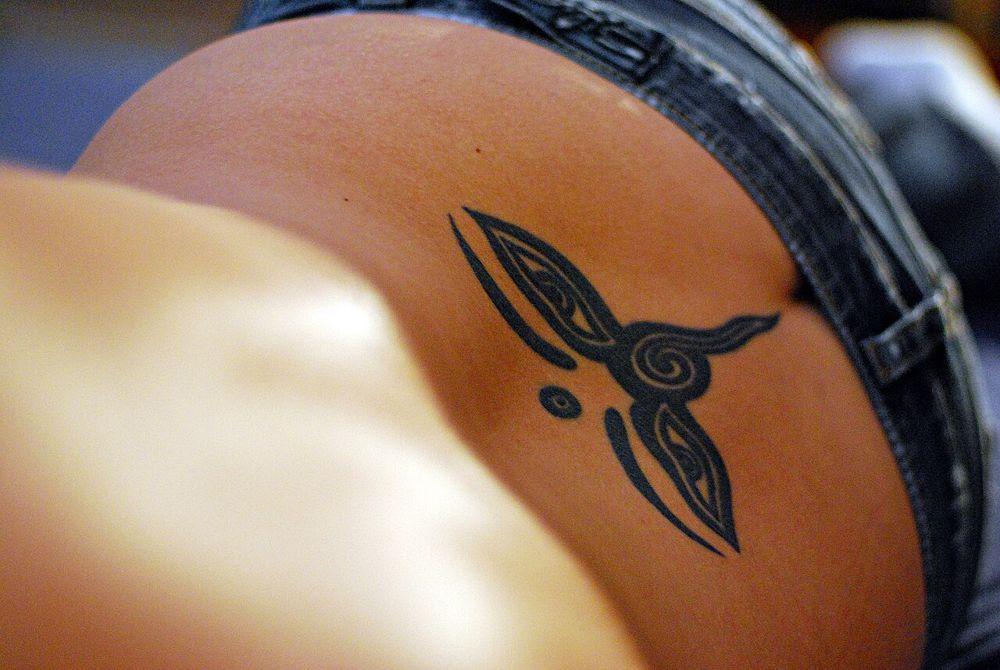
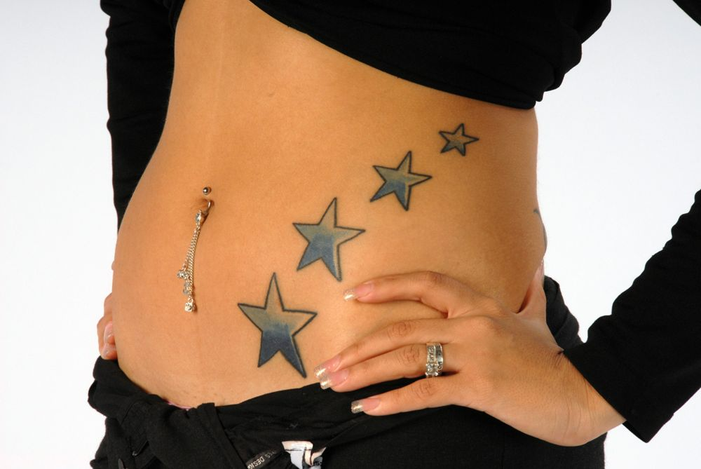
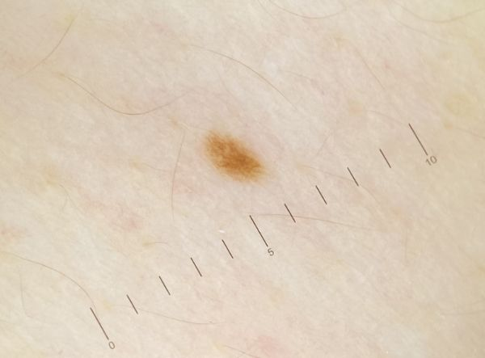
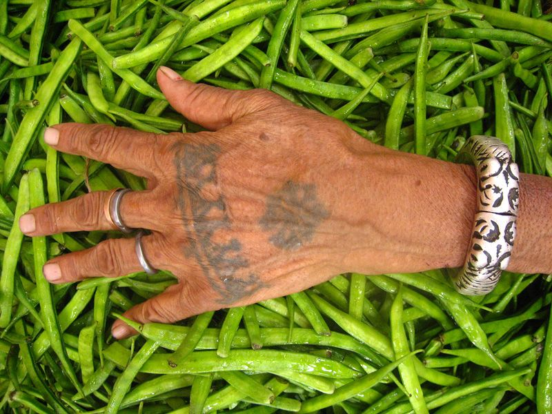

# Первая тату: как выбрать место и размер и что проверить заранее

**Коротко:** место и размер первой тату стоит выбирать не только по эскизу, но и по коже и жизни. Подумайте, нужно ли вам прятать рисунок под одеждой, как меняется тело (вес, беременность), сколько солнца получит эта зона и какая на ней кожа. Mayo Clinic советует выбирать место внимательно, а если вы не уверены в решении, лучше подождать. Тату не стоит делать на родинке: по данным Американской академии дерматологии (AAD), чернила могут скрыть первые признаки рака кожи. Если у вас были келоидные рубцы, много родинок, псориаз, экзема или другое хроническое заболевание кожи, сначала поговорите с дерматологом. И не делайте тату после алкоголя или других веществ.

> Это не медицинский совет. Мы пересказываем рекомендации медицинских организаций. Подходит ли вам конкретное место и размер, решает ваш врач и мастер после осмотра кожи.

*Зону, которую легко открыть и так же легко закрыть одеждой, выбирают, думая о будущем. Иллюстративное фото.* Фото: Lucas Cobb, [Wikimedia Commons](https://commons.wikimedia.org/wiki/File:Back_-_Flickr_-_cobblucas.jpg), лицензия [CC BY 2.0](https://creativecommons.org/licenses/by/2.0).

## С чего начать

Mayo Clinic советует не спешить: тату делается за несколько часов, но остаётся навсегда. Если вы не уверены или боитесь, что пожалеете, можно подождать. Не поддавайтесь на уговоры друзей. Не делайте тату после алкоголя или других веществ. Поговорите со знакомыми, у кого уже есть тату: их подсказки помогут не наступить на очевидные грабли.

## Как выбрать место

Место определяют три вопроса: на виду ли тату, как будет меняться эта зона и что с кожей.

| Что учесть | Что говорят источники | Что с этим делать |
|---|---|---|
| Видимость | Mayo Clinic: подумайте, хотите ли вы иметь возможность прятать тату под одеждой | Представьте рабочий день, спорт, отпуск и семейные встречи |
| Изменения тела | Mayo Clinic: прибавка веса, в том числе при беременности, может изменить вид тату. FDA: тело и мода меняются со временем | Зоны, которые сильно меняются, обсудите с мастером отдельно |
| Солнце | AAD: ультрафиолет может выцвечивать некоторые чернила. Солнцезащита SPF 30 и выше помогает | Учтите, сколько солнца получит зона. Подробнее: [Тату и солнце](/tattoo-spravochnik/tatu-i-solnce/) |
| Родинки и пятна | AAD: избегайте родинок, тату может усложнить раннее обнаружение рака кожи | Выбирайте участок без родинок и пятен |
| Рубцы и келоиды | AAD: если у вас склонность к рубцам или был келоид, пересмотрите идею тату. FDA: келоиды могут появиться при любой травме кожи | Сначала обсудите с дерматологом |
| Кожные болезни | AAD: тату может спровоцировать псориаз или экзему на тату или рядом | Если у вас такая болезнь, поговорите с дерматологом до сеанса |
| Боль и заживление | Ощущения и сроки зависят от зоны | См. [Больно ли делать тату](/tattoo-spravochnik/bolno-li-delat-tatu-karta-boli/) и [Сколько заживает тату](/tattoo-spravochnik/skolko-zazhivaet-tatu/) |

*Живот, по Mayo Clinic, зона, где вид тату может измениться при наборе веса или беременности. Иллюстративное фото.* Фото: Nancy from So Cal, [Wikimedia Commons](https://commons.wikimedia.org/wiki/File:Woman_with_four_star_tattoos_on_her_belly,_and_a_navel_piercing.jpg), лицензия [CC BY 2.0](https://creativecommons.org/licenses/by/2.0).

## Родинки: почему тату не делают поверх

AAD пишет, что нужно больше исследований, связаны ли тату и рак кожи. Но тату может скрыть рак кожи и сделать его труднее обнаружить. Чернила меняют вид родинок и пятен: границы и цвет, два из признаков меланомы по системе ABCDE, могут измениться. Кроме того, краска мешает патологоанатому определить раковые клетки в биопсии. Это может отсрочить диагноз.

Как снизить риск, советует AAD:

- Осмотреть кожу у дерматолога до тату. Особенно важно, если у вас много атипичных родинок, у вас или родственников был рак кожи или ослаблен иммунитет.
- Сказать мастеру, чтобы он обошёл родинки, веснушки и другие пятна.
- Не набивать зоны, которые дерматолог хочет наблюдать.
- Проверять кожу самостоятельно, в том числе татуированную. Особое внимание уделять участкам с красной, синей и чёрной краской: по данным исследователей, они лучше всего маскируют подозрительные пятна.
- Если пятно меняется, зудит или кровоточит, идти к дерматологу.

*Так врач видит родинку через дерматоскоп. Тату поверх такой родинки может скрыть изменения. Иллюстративное фото.* Фото: Philipp Tschandl, [Wikimedia Commons](https://commons.wikimedia.org/wiki/File:Dermatoscopy_Nevus_Reticular.jpg), лицензия [CC BY-SA 4.0](https://creativecommons.org/licenses/by-sa/4.0).

## Как выбрать размер

Строгих правил здесь нет, но есть несколько рабочих соображений.

- **Покажите эскиз на коже.** Мастер может перенести эскиз на кожу, и вы увидите размер и положение до начала работы. Если что-то не нравится, скажите об этом сразу.
- **Мелкие детали и тонкие линии.** FDA пишет, что тату иногда выцветают, а слишком глубоко введённый пигмент может расплыться за границы рисунка. Поэтому мелкие детали стоит обсудить с мастером: насколько они будут читаться со временем.
- **Большие работы заживают дольше.** По Cleveland Clinic, крупные тату заживают месяцы. Об этом подробнее в статье [Сколько заживает тату](/tattoo-spravochnik/skolko-zazhivaet-tatu/).
- **Не обязательно начинать с большого.** Для первой тату достаточно небольшого рисунка в такой зоне, где вас устроит и результат, и ощущения. Решать вам.

*Кисть трудно спрятать под одеждой, и она часто на солнце, поэтому такое место стоит обсуждать особенно внимательно. Иллюстративное фото.* Фото: Meena Kadri, [Wikimedia Commons](https://commons.wikimedia.org/wiki/File:Jaipuri_tribal_hand_tattoo.jpg), лицензия [CC BY 2.0](https://creativecommons.org/licenses/by/2.0).

## Что проверить перед записью

1. Выбрали ли вы место и размер и действительно ли вы готовы жить с этим рисунком.
2. Нет ли родинок и пятен в выбранной зоне. Если есть много родинок, осмотритесь у дерматолога.
3. Нет ли у вас склонности к келоидам и хронических кожных болезней (псориаз, экзема).
4. Не принимаете ли вы лекарства и нет ли заболеваний, о которых нужно сказать врачу и мастеру.
5. Привиты ли вы от гепатита B: Mayo Clinic советует сделать прививку до тату, чтобы снизить риск заражения через кровь. Это обсуждают с врачом.
6. Как работает мастер: одноразовые перчатки, иглы из запечатанных упаковок, одноразовые ёмкости для краски, стерилизация многоразового. Подробнее: [Как выбрать тату-мастера](/tattoo-spravochnik/kak-vybrat-tatu-mastera/).
7. Как подготовиться к сеансу: [Как подготовиться к сеансу тату](/tattoo-spravochnik/kak-podgotovitsya-k-seansu-tatu/).

## Когда обращаться к врачу

До сеанса поговорите с дерматологом, если у вас:

- много родинок или атипичные родинки, был рак кожи у вас или в семье, ослаблен иммунитет;
- были келоидные рубцы;
- есть псориаз, экзема или другая хроническая болезнь кожи.

После сеанса идите к врачу, если краснота расползается, боль нарастает, кожа горячая, появились гной, температура или озноб, а также при реакции на краску. AAD отмечает, что реакция может появиться и через годы. Что нормально при заживлении, смотрите в статье [Тату чешется: что делать](/tattoo-spravochnik/tatu-cheshetsya-chto-delat/).

## Частые вопросы

### Куда лучше всего делать первую тату?

Универсального ответа нет. Ориентируйтесь на то, насколько тату должна быть на виду, как меняется зона, сколько там солнца, нет ли родинок и рубцов и как вы переносите боль в этом месте.

### Можно ли делать тату на родинке?

AAD рекомендует выбирать кожу без родинок: тату затрудняет обнаружение первых признаков рака кожи. Скажите мастеру, чтобы он обошёл родинки и пятна.

### Можно ли делать тату при псориазе или экземе?

Сначала поговорите с дерматологом. AAD пишет, что тату может спровоцировать псориаз или экзему на татуированной коже или рядом.

### Изменится ли тату при наборе веса или беременности?

Mayo Clinic отмечает, что прибавка веса, в том числе при беременности, может изменить вид тату. FDA добавляет, что тело и мода меняются со временем.

### Тату выцветает?

Иногда да, пишет FDA. AAD отмечает, что ультрафиолет может выцвечивать некоторые чернила, поэтому тату защищают от солнца кремом с SPF 30 или выше и одеждой.

### Можно ли сделать первую тату под алкоголем для храбрости?

Нет. Mayo Clinic советует не делать тату после алкоголя или других веществ.

---

## Записаться в ТатуНаХоду

Если вы выбираете эскиз, место и размер для первой тату и хотите обсудить это с мастером, напишите нам в Telegram.

👉 [Записаться в Telegram](https://t.me/tatunahody)

Работы мастеров и новости студии - в нашем Telegram-канале: [t.me/tattoo_na_hodu](https://t.me/tattoo_na_hodu)

## Источники изображений

- `tatu-na-poyasnice.jpg` - Back - Flickr - cobblucas.jpg, автор: Lucas Cobb, источник: [Wikimedia Commons](https://commons.wikimedia.org/wiki/File:Back_-_Flickr_-_cobblucas.jpg), лицензия: [CC BY 2.0](https://creativecommons.org/licenses/by/2.0). Без изменений, кроме уменьшения размера.
- `zvezdy-na-zhivote.jpg` - Woman with four star tattoos on her belly, and a navel piercing.jpg, автор: Nancy from So Cal, источник: [Wikimedia Commons](https://commons.wikimedia.org/wiki/File:Woman_with_four_star_tattoos_on_her_belly,_and_a_navel_piercing.jpg), лицензия: [CC BY 2.0](https://creativecommons.org/licenses/by/2.0). Без изменений, кроме уменьшения размера.
- `rodinka-pod-dermatoskopom.jpg` - Dermatoscopy Nevus Reticular.jpg, автор: Philipp Tschandl, источник: [Wikimedia Commons](https://commons.wikimedia.org/wiki/File:Dermatoscopy_Nevus_Reticular.jpg), лицензия: [CC BY-SA 4.0](https://creativecommons.org/licenses/by-sa/4.0). Без изменений, кроме уменьшения размера.
- `tatu-na-kisti.jpg` - Jaipuri tribal hand tattoo.jpg, автор: Meena Kadri, источник: [Wikimedia Commons](https://commons.wikimedia.org/wiki/File:Jaipuri_tribal_hand_tattoo.jpg), лицензия: [CC BY 2.0](https://creativecommons.org/licenses/by/2.0). Без изменений, кроме уменьшения размера.

## Источники фактов

- Mayo Clinic: [Tattoos: Understand risks and precautions](https://www.mayoclinic.org/healthy-lifestyle/adult-health/in-depth/tattoos-and-piercings/art-20045067).
- Американская академия дерматологии (AAD): [Do tattoos cause skin cancer?](https://www.aad.org/public/diseases/skin-cancer/do-tattoos-cause-skin-cancer); [Caring for tattooed skin](https://www.aad.org/public/everyday-care/skin-care-basics/tattoos/caring-for-tattooed-skin); [Tattoos: 7 unexpected skin reactions](https://www.aad.org/public/everyday-care/skin-care-basics/tattoos/tattoo-skin-reactions).
- FDA: [Tattoos and Permanent Makeup: Fact Sheet](https://www.fda.gov/cosmetics/cosmetic-products/tattoos-permanent-makeup-fact-sheet).
- Cleveland Clinic: [Tattoo Aftercare: Instructions and Healing Tips](https://health.clevelandclinic.org/tattoo-aftercare).
