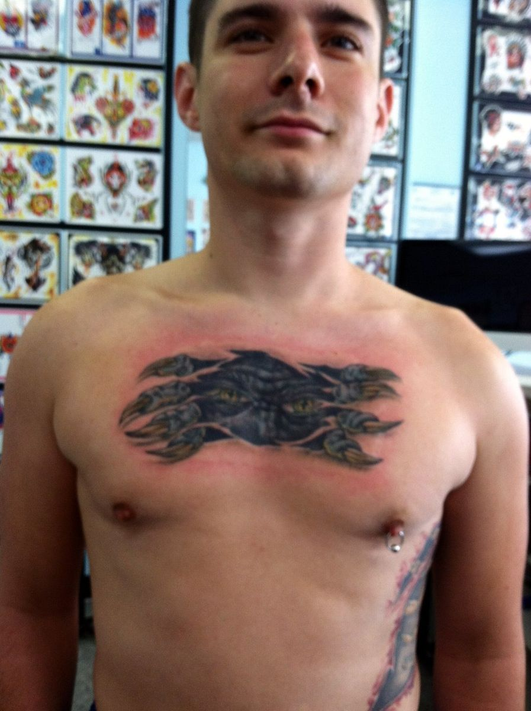
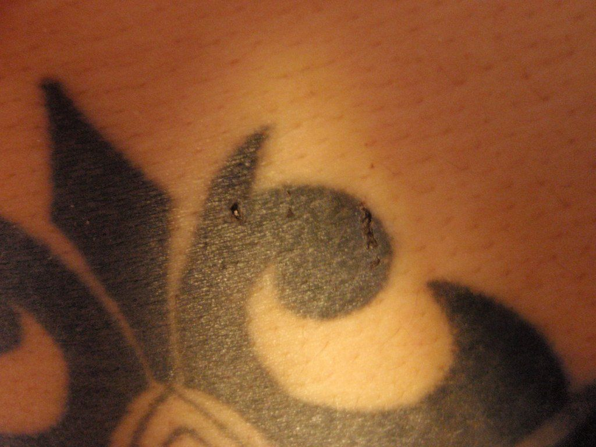
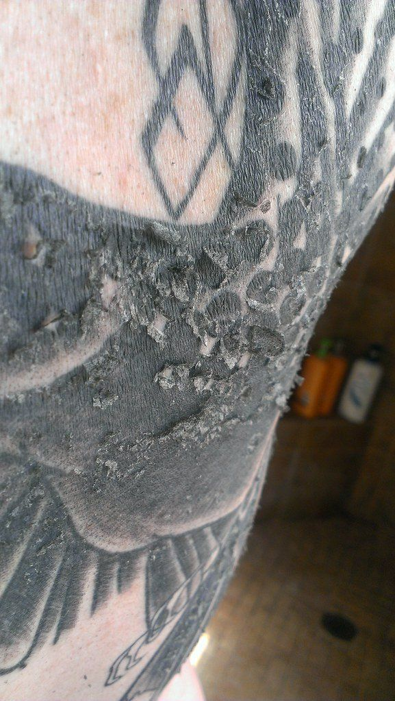
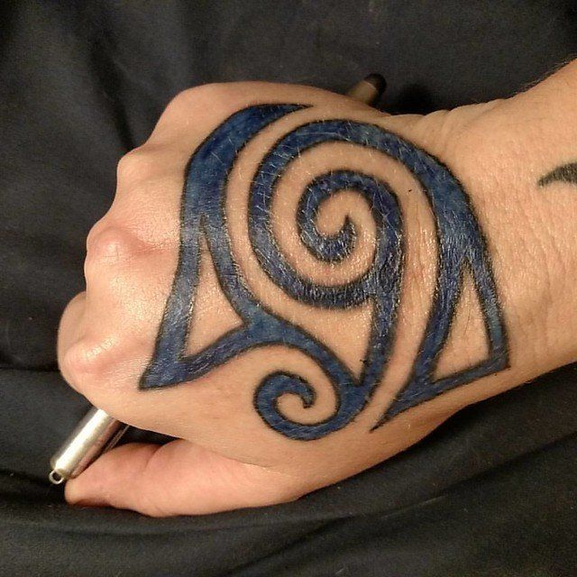
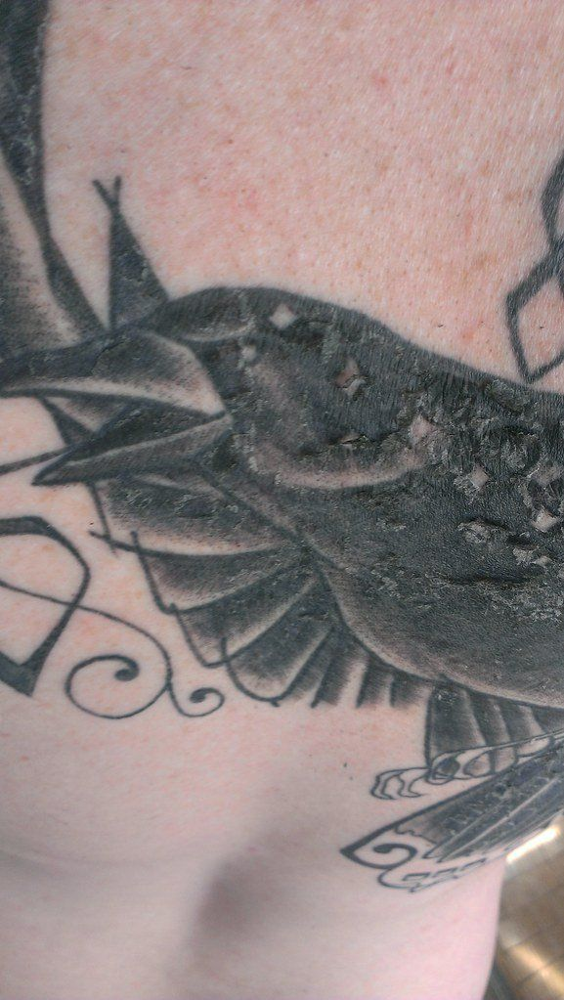

# Шелушение тату по дням: что нормально, а что нет

**Коротко:** шелушение — нормальная часть заживления. Обычно оно начинается примерно на 4–7 день, сильнее всего проявляется на второй неделе и в основном заканчивается к концу третьей. Нормально, если отходят тонкие цветные чешуйки, кожа чешется и рисунок выглядит тусклым. Ненормально, если краснота и отёк нарастают, а не уменьшаются, кожа горячая, появляется гной, неприятный запах или температура. В этих случаях нужен врач.

> Это не медицинский совет. Статья описывает типичное заживление и наш опыт. Сроки у всех разные, и если вас что-то беспокоит, обратитесь к своему мастеру или к врачу-дерматологу.

*Первые часы после сеанса: краснота и лёгкий отёк вокруг рисунка — нормальная реакция кожи.* Фото: Tony Alter from Newport News, USA, [Wikimedia Commons](https://commons.wikimedia.org/wiki/File:Fresh_Tattoo_%2814551096499%29.jpg), лицензия [CC BY 2.0](https://creativecommons.org/licenses/by/2.0).

## Почему тату вообще шелушится

Во время сеанса игла много раз прокалывает кожу, и с точки зрения организма татуировка — это поверхностная рана. Пигмент остаётся в более глубоком слое кожи (дерме), а верхний слой (эпидермис) повреждён и обновляется. Отмершие клетки отходят чешуйками, и часть из них окрашена: в них остаются излишки пигмента, которые не закрепились. Поэтому «цветные хлопья» на простыне или в душе пугают многих, но обычно ничего страшного не означают. Краска, которая ушла в дерму, остаётся на месте.

## Заживление по дням

Сроки ниже ориентировочные. На них влияет размер и плотность работы, зона тела, ваша кожа и то, как вы ухаживаете за тату. Большие плотные заливки обычно заживают дольше тонкой графики.

| Период | Что обычно происходит | Что делать |
|---|---|---|
| 1–3 день | Краснота, небольшой отёк, болезненность, кожа может быть тёплой. Выделяется сукровица с остатками краски | Следовать инструкции мастера по плёнке, мягко промывать, не тереть |
| 4–7 день | Краснота спадает, появляется стянутость, тонкая корочка или «плёнка», начинается шелушение | Не сдирать, тонко увлажнять, если кожа сухая |
| 7–14 день | Пик шелушения и зуда, отходят чешуйки, рисунок выглядит мутным | Не чесать, можно легонько похлопать ладонью рядом, тонко увлажнять |
| 15–30 день | Крупные чешуйки сошли, кожа может быть сухой, блестящей или тусклой | Продолжать увлажнять, защищать от солнца |
| 1–3 месяца и дольше | Внешне зажило, но глубокие слои кожи ещё восстанавливаются, цвет «проявляется» окончательно | Беречь от солнца, оценивать результат и коррекцию не раньше, чем через месяц |

### Дни 1–3: воспаление

Сразу после сеанса тату красное, слегка отёкшее и ноет, как ссадина или солнечный ожог. Может выделяться прозрачная или розоватая жидкость с краской — это нормально. Главный признак правильного заживления: **с каждым днём должно становиться лучше**, а не хуже.

### Дни 4–7: начало шелушения

Кожа стягивается, становится сухой, на рисунке может появиться тонкая корочка. На плотных участках чёрного или цвета корочка иногда толще. Края начинают слегка подниматься. Если у вас заживляющая плёнка «вторая кожа», мастер обычно говорит снимать её как раз в этот период — следуйте его инструкции.

*Начало шелушения: рисунок становится матовым, появляются тонкие корочки. Сдирать их нельзя.* Фото: democlez, [Flickr](https://www.flickr.com/photos/48116201@N08/4518848665), лицензия [CC BY 2.0](https://creativecommons.org/licenses/by/2.0/).

### Дни 7–14: пик шелушения и зуда

Самый неприятный этап. Чешется, чешуйки отходят, тату выглядит неровным, как будто «облезло» или краска ушла. На этом этапе нельзя делать выводы о качестве работы: под чешуйками новая кожа ещё мутная, и рисунок будет казаться бледным.

*Пик шелушения. Тёмные чешуйки — это излишки пигмента из верхнего слоя кожи; краска в дерме остаётся на месте.* Фото: danoxster, [Flickr](https://www.flickr.com/photos/41132143@N00/13451513725), лицензия [CC BY-SA 2.0](https://creativecommons.org/licenses/by-sa/2.0/).

Что помогает при зуде:

- тонкий слой увлажняющего средства без отдушек и спирта;
- лёгкое похлопывание ладонью рядом с тату вместо расчёсывания;
- свободная одежда из натуральной ткани, которая не трёт;
- прохладный, а не горячий душ.

### Дни 15–30: «серебристая» кожа

Крупные чешуйки сошли, но кожа на тату может выглядеть блестящей, суховатой, словно под тонкой плёнкой. Это нормально: верхний слой уже закрылся, а нижние ещё восстанавливаются. Яркость и чёткость обычно возвращаются в течение следующих недель.

*Так выглядит тату, которое заживает правильно: линии чёткие, цвет ровный, без воспаления.* Фото: Slave2TehTink, [Wikimedia Commons](https://commons.wikimedia.org/wiki/File:Hand_tattoo_healing_well.jpg), лицензия [CC BY-SA 4.0](https://creativecommons.org/licenses/by-sa/4.0).

## Что считается нормой

- Тонкие чешуйки, как после солнечного ожога, в том числе цветные.
- Зуд, особенно на второй неделе.
- Тусклый, «мутный» рисунок на этапе шелушения.
- Небольшая неровность цвета, пока не сошли все чешуйки.
- На разных участках одного тату шелушение идёт в разное время: плотные места дольше.

*На плотной чёрной заливке шелушение заметнее, чем на тонких линиях. Выглядит пугающе, но это норма — главное, не сдирать.* Фото: danoxster, [Flickr](https://www.flickr.com/photos/41132143@N00/13451617763), лицензия [CC BY-SA 2.0](https://creativecommons.org/licenses/by-sa/2.0/).

## Что ненормально

- Краснота и отёк не уменьшаются после 3–4 дня или, наоборот, растут.
- Краснота расползается за пределы рисунка, кожа горячая на ощупь.
- Гнойные выделения, неприятный запах, мокнущие участки на второй неделе.
- Толстые, твёрдые, тёмные корки, которые трескаются и кровят. Часто это следствие пересушивания, трения одеждой или слишком толстого слоя мази.
- Мелкие прыщики или сыпь на тату: возможна реакция на средство ухода или закупоренные поры.
- Сильный зуд с пятнистой сыпью, особенно сразу после нового крема — возможна аллергия.
- Температура, озноб, общее недомогание.

## Чего не делать во время шелушения

1. **Не сдирайте чешуйки и корочки.** Вместе с ними можно вытянуть пигмент и получить светлые «проплешины» или рубец.
2. **Не распаривайте тату.** Баня, сауна, ванна, бассейн и открытые водоёмы — только после полного заживления. Обычный душ можно.
3. **Не используйте скрабы, мочалки и спиртовые лосьоны.**
4. **Не загорайте.** Ультрафиолет вредит заживающей коже и со временем выцветает пигмент. Солнцезащитный крем на свежую тату обычно не наносят, поэтому просто прячьте её под одеждой, а после заживления пользуйтесь SPF.
5. **Не мажьте толстым слоем.** Кожа под плотным слоем мази размокает, это может мешать заживлению.

## Когда идти к врачу

Обратитесь к врачу (дерматологу или терапевту), если:

- краснота, отёк и боль нарастают через 2–3 дня после сеанса вместо того, чтобы спадать;
- появился гной, неприятный запах, кожа горячая;
- от тату расходятся красные полосы или краснота быстро увеличивается;
- поднялась температура или есть озноб;
- появилась сыпь, сильный зуд, волдыри, особенно на одном конкретном цвете;
- тату не заживает дольше обычного или на нём образуется плотная бугристая ткань.

При температуре и быстро расползающемся покраснении не откладывайте визит. Мастеру тоже стоит написать: он видел много заживлений и подскажет, похоже ли это на норму. Но мастер не заменяет врача, если есть признаки инфекции.

## Частые вопросы

### Тату шелушится, и краска сходит вместе с кожей. Это брак?

Скорее всего, нет. С чешуйками отходят излишки пигмента из верхнего слоя кожи. Оценивать результат стоит примерно через месяц, когда заживление закончится. Если после этого есть светлые участки, мастер обычно делает коррекцию.

### Тату не шелушится. Это плохо?

Не обязательно. Небольшие и тонкие работы иногда заживают почти незаметно, а под заживляющей плёнкой шелушение бывает слабее. Если нет красноты, отёка и выделений, переживать не о чем.

### Сколько длится шелушение?

Обычно активная фаза длится около недели и в основном заканчивается к концу третьей недели. Большие и плотные работы, а также тату на руках, ногах и местах трения могут шелушиться дольше.

### Можно ли чесать тату, если очень чешется?

Нет. Лучше легко похлопать по коже рядом, нанести тонкий слой увлажняющего средства без отдушек или приложить чистое прохладное полотенце через ткань ненадолго.

### Можно ли мыться во время шелушения?

Да, в обычном душе. Промывайте тату тёплой водой с мягким мылом без отдушек, не трите и промокните чистым бумажным полотенцем. Без ванн, бани и бассейна до полного заживления.

### Когда можно оценивать, нужна ли коррекция?

Не раньше, чем через месяц после сеанса, а лучше когда кожа перестала блестеть и выглядит как обычная.

---

## Записаться в ТатуНаХоду

Хотите тату, за которым мы будем следить и на этапе заживления? В студии «ТатуНаХоду» (Москва) мастер объясняет уход на месте и остаётся на связи, пока тату заживает. Если что-то кажется странным — присылайте фото, подскажем.

👉 [Записаться в Telegram](https://t.me/tatunahody)

Работы мастеров и новости студии — в нашем Telegram-канале: [t.me/tattoo_na_hodu](https://t.me/tattoo_na_hodu)

## Источники изображений

- `svezhaya-tatu-na-grudi-krasnota-posle-seansa.jpg` — «Fresh Tattoo (14551096499).jpg», автор: Tony Alter from Newport News, USA, источник: [Wikimedia Commons](https://commons.wikimedia.org/wiki/File:Fresh_Tattoo_%2814551096499%29.jpg), лицензия: [CC BY 2.0](https://creativecommons.org/licenses/by/2.0). Без изменений, кроме уменьшения размера.
- `tatu-nachalo-shelusheniya-matovaya-korochka.jpg` — «Photo of the day (27/365)», автор: democlez, источник: [Flickr](https://www.flickr.com/photos/48116201@N08/4518848665), лицензия: [CC BY 2.0](https://creativecommons.org/licenses/by/2.0/). Без изменений, кроме уменьшения размера.
- `pik-shelusheniya-tatu-cheshuyki-s-pigmentom.jpg` — «tattoo peel detail», автор: danoxster, источник: [Flickr](https://www.flickr.com/photos/41132143@N00/13451513725), лицензия: [CC BY-SA 2.0](https://creativecommons.org/licenses/by-sa/2.0/). Без изменений, кроме уменьшения размера.
- `zazhivayushchaya-tatu-na-kisti-chetkie-linii.jpg` — «Hand tattoo healing well.jpg», автор: Slave2TehTink, источник: [Wikimedia Commons](https://commons.wikimedia.org/wiki/File:Hand_tattoo_healing_well.jpg), лицензия: [CC BY-SA 4.0](https://creativecommons.org/licenses/by-sa/4.0). Без изменений, кроме уменьшения размера.
- `shelushenie-chernoy-zalivki-tatu-krupnyy-plan.jpg` — «peely crow face», автор: danoxster, источник: [Flickr](https://www.flickr.com/photos/41132143@N00/13451617763), лицензия: [CC BY-SA 2.0](https://creativecommons.org/licenses/by-sa/2.0/). Без изменений, кроме уменьшения размера.
