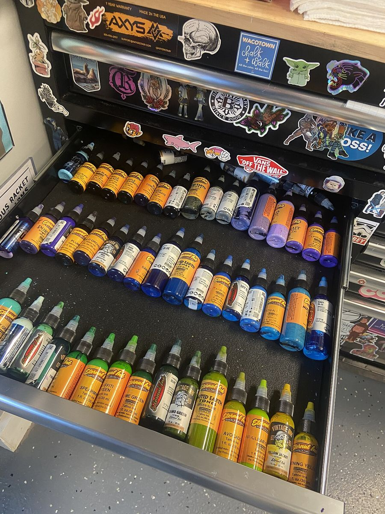
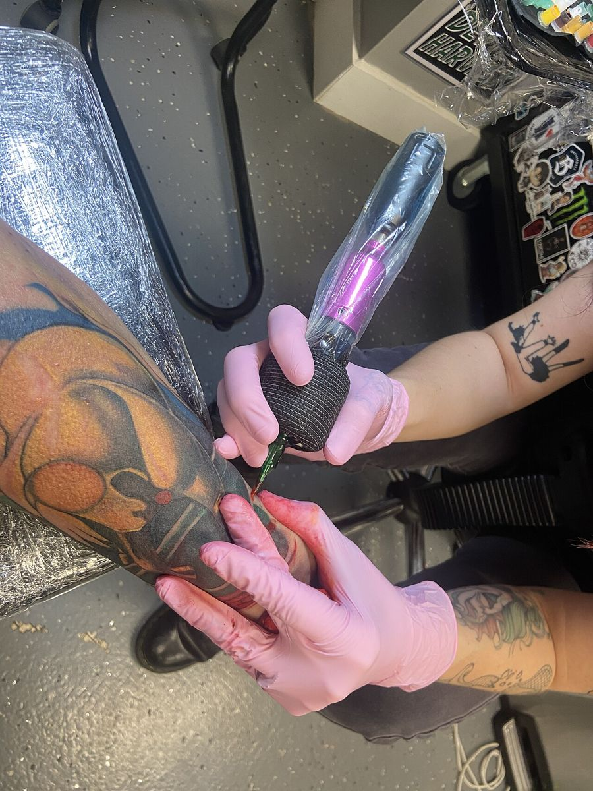
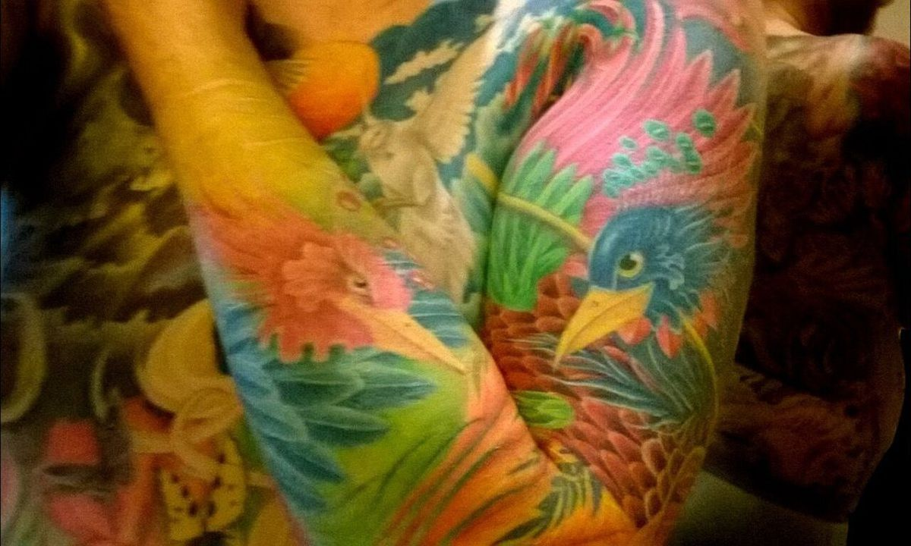
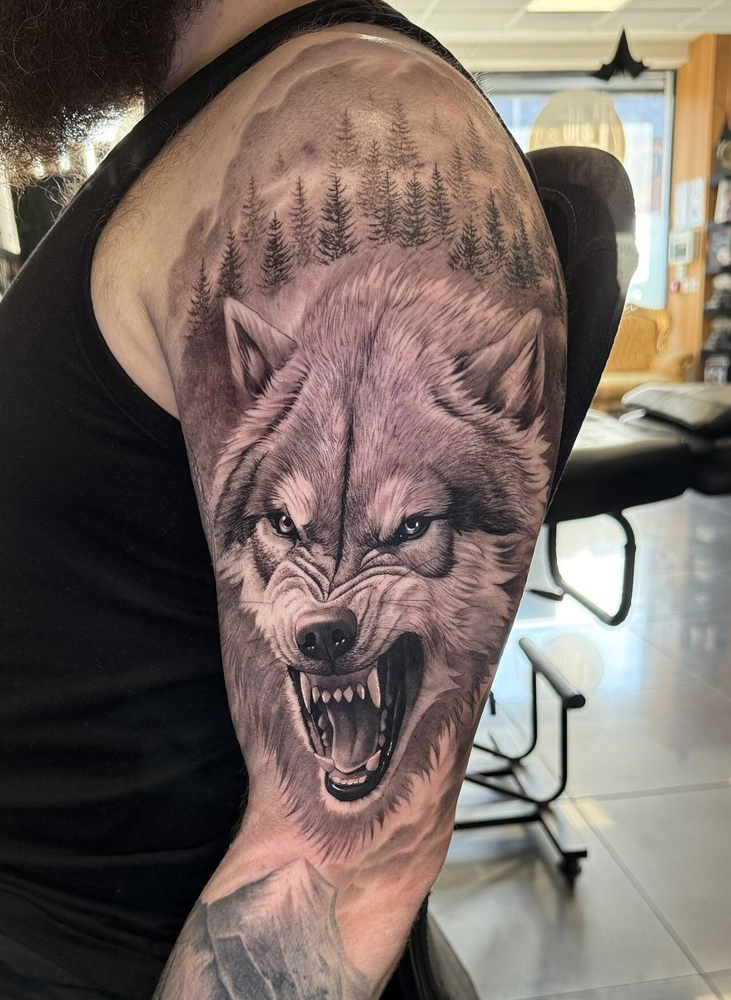

# Сколько стоит тату: из чего складывается цена

**Коротко:** стоимость тату складывается не из одной цифры за сантиметр, а из объёма работы: размера, плотности заливки, цвета, сложности стиля, зоны, числа сеансов и опыта мастера. Перекрытие старой работы и очень детальный реализм обычно занимают больше времени, чем небольшая линия. Готового прайса в этой статье нет: мы не публикуем суммы студии и не выдумываем средние цены по Москве. Точную стоимость мастер может назвать только после эскиза, размера и места на теле. Если хотите оценку своей идеи, напишите в Telegram и пришлите референс и фото зоны.

> Это не медицинский совет. Выбор мастера и студии влияет не только на цену, но и на безопасность сеанса. Если у вас есть вопросы по коже, лекарствам или заболеваниям, обсудите их с врачом до записи.

*Цветная работа требует больше красок, времени и часто отдельных сеансов на заливку. Иллюстративное фото расходников, не витрина студии.* Фото: Myotus (работа тату-мастера Jenna Haas), [Wikimedia Commons](https://commons.wikimedia.org/wiki/File:02-tattoo_inks_specifically_for_tattooing.jpg), лицензия [CC BY-SA 4.0](https://creativecommons.org/licenses/by-sa/4.0).

## Почему в статье нет готовых сумм

Запросы сколько стоит тату на руке, на спину или 20 см звучат как просьба назвать число. Но одна и та же длина контура может быть лёгкой линией на час и плотной цветной работой на несколько сеансов. Без эскиза любое число в статье было бы выдумкой.

Поэтому здесь только факторы, из которых мастер собирает оценку, и вопросы, которые стоит задать до записи. Политику цен, предоплаты и коррекции студии мы тоже не выдумываем: это нужно услышать у мастера. Как выбирать мастера и на что смотреть в студии, кроме цены, написано в статье [Как выбрать тату-мастера](/tattoo-spravochnik/kak-vybrat-tatu-mastera/).

## Из чего обычно складывается цена

| Что влияет | Почему это меняет объём работы | Что уточнить у мастера |
|---|---|---|
| Размер и площадь | Больше кожи - больше времени на контур и заливку | Размер в сантиметрах плюс, насколько рисунок заполняет это пятно |
| Плотность и детализация | Плотная заливка, тени и мелкие детали занимают дольше, чем редкие линии | Будет ли один подход или несколько сеансов |
| Цвет | Цветные слои, смешивание и иногда отдельные сеансы на цвет добавляют время | Чёрно-серый вариант или цвет, сколько оттенков |
| Стиль | Реализм, орнамент, графика и акварель по трудоёмкости не равны | В каком стиле мастер берёт такие работы и есть ли они в портфолио |
| Зона тела | На кисти, стопе, рёбрах и сгибах часто работают медленнее и аккуратнее | Помещается ли идея в выбранное место без лишней плотности |
| Число сеансов | Большую работу редко делают за один день | Сколько сеансов мастер видит заранее и как оплачивается каждый |
| Перекрытие старой тату | Старый рисунок нужно закрыть плотнее, эскиз сложнее | Реально ли перекрытие или лучше другой путь, см. статью про cover-up |
| Опыт и загрузка мастера | Спрос и специализация влияют на ставку, это не оценка качества в рублях | Смотрите портфолио в нужном стиле, а не только цену |

Ни одна строка этой таблицы не превращается в формулу. Мастер смотрит на эскиз целиком.

## Размер, плотность и зона

Фраза тату на руке ничего не говорит о цене: это может быть маленький знак на запястье или рукав от плеча до кисти. Важна не только длина, но и то, насколько плотно рисунок занимает место. Редкая графика на большом поле иногда быстрее плотного медальона меньшего диаметра.

Зона тоже меняет работу. На ровной плоскости спины или бедра мастеру часто проще держать темп. На кистях, пальцах, стопах, рёбрах и сгибах кожа другая, поза неудобнее, иногда нужны паузы. Это не значит, что маленькая тату на пальце автоматически дешёвая: крошечная площадь всё равно требует точности, а заживление на кистях и стопах обычно идёт дольше. Сроки по зонам мы уже разбирали в статье про заживление, к цене это относится косвенно: сложнее зона - чаще аккуратнее и дольше сеанс.

Если идея крупная, сразу спросите, сколько сеансов мастер закладывает. Один длинный день и три коротких - разный график и разная схема оплаты, и её нужно услышать заранее, а не в конце первого сеанса.

*Время на сеансе - один из главных факторов цены: плотная цветная заливка занимает дольше контура. Иллюстративное фото процесса, не работа студии.* Фото: Myotus (работа тату-мастера Jenna Haas), [Wikimedia Commons](https://commons.wikimedia.org/wiki/File:18-work_nearing_completion.jpg), лицензия [CC BY-SA 4.0](https://creativecommons.org/licenses/by-sa/4.0).

## Цвет, стиль и сложность

*Плотная цветная работа на всю руку - это много часов и обычно не один сеанс. Иллюстративное фото, не работа студии.* Фото: InvestigadorDeTodo (тату мастера Maaika), [Wikimedia Commons](https://commons.wikimedia.org/wiki/File:Close-up_Phoenix_full_sleeve_tattoo_by_Maaika.jpg), лицензия [CC BY-SA 4.0](https://creativecommons.org/licenses/by-sa/4.0).

Цвет сам по себе не делает тату лучше или хуже, но чаще увеличивает объём: больше оттенков, аккуратнее переходы, иногда отдельный сеанс, когда чёрный уже лёг. Чёрно-серая работа тоже бывает очень трудоёмкой, если это реализм с тонкой растушёвкой.

*Черно-серый реализм не равен простой линии: детализация занимает сравнимое, а иногда и большее время, чем цвет. Иллюстративное фото, не работа студии.* Фото: Gypates (тату мастера Alan Hindes, Белфаст), [Wikimedia Commons](https://commons.wikimedia.org/wiki/File:Tattoo_Sleeve_Done_In_Belfast_Northern_Ireland.jpg), лицензия [CC BY 4.0](https://creativecommons.org/licenses/by/4.0).

Стиль стоит выбирать по портфолио мастера, а не по самой низкой оценке. Реализм, орнамент, графика, традиция и тонкая линия по-разному едят время. Если мастер не делает ваш стиль, дешевле не станет: либо он откажется, либо вы рискуете получить не то, что хотели. Смотрите зажившие работы, не только свежие фото сразу после сеанса.

## Перекрытие, коррекция и слишком низкая цена

Перекрытие старой тату почти всегда сложнее новой работы на чистой коже: нужно закрыть старый пигмент, подобрать плотность и иногда цвет. Это отдельная тема, её мы разбирали в статье [Перекрытие старой тату](/tattoo-spravochnik/perekrytie-staroy-tatu-cover-up/). На оценку это влияет сильно, поэтому фото старой работы нужно прислать сразу.

Коррекция уже зажившей тату - тоже не обязательная бесплатная опция по умолчанию. Входит ли она в первую работу, в какой срок и на каких условиях, у каждого мастера свои правила. Их спрашивают до первого сеанса, а не после. Подробнее о самой процедуре - в статье [Коррекция тату](/tattoo-spravochnik/korrekciya-tatu/).

Отдельно стоит сказать про подозрительно низкую оценку. Статья не сравнивает студии по деньгам, но безопасность не должна быть тем, на чём экономят в первую очередь: стерильность, одноразовые картриджи, как мастер открывает расходники при вас. Если цена выглядит как акция без адреса, портфолио и понятных условий ухода, это повод не торопиться, а не повод радоваться скидке.

## Как получить точную оценку

Чтобы мастер мог назвать сумму, обычно достаточно:

- нескольких референсов, что нравится по стилю, и пары примеров, что не нравится;
- фото зоны на теле, лучше ровно и при дневном свете, без сильного фильтра;
- понимания размера: можно приложить линейку или предмет известной длины;
- честно сказать, если это перекрытие или на коже есть шрамы и родинки в поле рисунка;
- спросить, сколько сеансов мастер видит, как оплачивается каждый и что с коррекцией после заживления.

Оценка после такого разговора всё равно может чуть сместиться, если на сеансе станет понятно, что нужна другая плотность или другой масштаб. Это лучше сразу проговорить: что входит в названную сумму, а что будет считаться отдельно.

Мы не публикуем здесь прайс студии и не ставим вилку от и до. Если хотите расчёт конкретной идеи, напишите в Telegram: так вы получите цифру по вашей работе, а не усреднённую отписку из статьи.

## Когда идти к врачу

Цена и эскиз не отменяют вопросов к здоровью. До сеанса имеет смысл поговорить с врачом, если у вас есть заболевания кожи, склонность к келоидным рубцам, аллергия, вы принимаете лекарства, которые влияют на заживление, или недавно болели. На воспалённую, загорелую до ожога или покрытую сыпью кожу новый сеанс лучше не ставить.

Если после уже сделанной тату появились признаки инфекции или сильной реакции на краску - температура, гной, расползающаяся краснота, нарастающий отёк - идите к врачу, а не ищите решение в скидке на коррекцию. Лечение назначает врач.

## Частые вопросы

### Сколько стоит тату на руке?

Зависит от размера, плотности, цвета и стиля, а не от слова рука. Маленький знак на запястье и рукав - разный объём работы. Точную сумму мастер называет после эскиза и фото зоны. Цифр в статье нет специально: любая сумма без эскиза была бы выдумкой.

### Есть ли цена за квадратный сантиметр или за час?

У разных мастеров схема разная: кто-то считает от размера, кто-то от времени, кто-то называет сумму за конкретный эскиз. Мы не утверждаем, какой способ правильный, и не публикуем ставки. Спросите выбранного мастера, как он считает работу, и что будет, если сеанс продлится дольше, чем планировали.

### Почему цветная тату часто дороже чёрной?

Чаще всего потому, что цвета добавляют время: больше оттенков, аккуратнее заливка, иногда отдельный сеанс. Но сложный чёрно-серый реализм тоже может быть долгим и стоить сопоставимо. Сравнивать нужно не цвет с чёрным вообще, а два конкретных эскиза.

### Можно ли узнать цену без эскиза, только по фото из интернета?

Грубый порядок величины мастер иногда прикидывает по референсу, но это ещё не договорённость. Без привязки к вашей зоне, размеру и плотности оценка легко поедет. Для нормального расчёта нужны референс, желаемый размер и фото места.

### Входит ли коррекция в стоимость первой работы?

Это решает мастер, общего правила нет. Спросите до сеанса: в какой срок смотрят зажившую работу, что входит в коррекцию и оплачивается ли она отдельно. Мы не подставляем в статью чужую или выдуманную политику студии.

### Стоит ли выбирать мастера только по самой низкой цене?

Нет. Сначала стиль, портфолио заживших работ, чистота студии и то, как мастер отвечает на вопросы про уход и стерильность. Цена важна, но она не первый фильтр. Подробнее, на что смотреть, - в статье про выбор мастера.

## Записаться в ТатуНаХоду

Если у вас есть идея, референс и фото зоны, напишите нам в Telegram: мастер оценит объём работы и назовёт стоимость по вашему эскизу.

👉 [Записаться в Telegram](https://t.me/tatunahody)

Работы мастеров и новости студии - в нашем Telegram-канале: [t.me/tattoo_na_hodu](https://t.me/tattoo_na_hodu)

## Источники изображений

- `kraski-dlya-tatu.jpg` - 02-tattoo inks specifically for tattooing.jpg, автор: Myotus (работа тату-мастера Jenna Haas), источник: [Wikimedia Commons](https://commons.wikimedia.org/wiki/File:02-tattoo_inks_specifically_for_tattooing.jpg), лицензия: [CC BY-SA 4.0](https://creativecommons.org/licenses/by-sa/4.0). Без изменений, кроме уменьшения размера.
- `nanesenie-cvetnoy-tatu.jpg` - 18-work nearing completion.jpg, автор: Myotus (работа тату-мастера Jenna Haas), источник: [Wikimedia Commons](https://commons.wikimedia.org/wiki/File:18-work_nearing_completion.jpg), лицензия: [CC BY-SA 4.0](https://creativecommons.org/licenses/by-sa/4.0). Без изменений, кроме уменьшения размера.
- `tsvetnoy-rukav.jpg` - Close-up Phoenix full sleeve tattoo by Maaika.jpg, автор: InvestigadorDeTodo (тату мастера Maaika, Херенвен), источник: [Wikimedia Commons](https://commons.wikimedia.org/wiki/File:Close-up_Phoenix_full_sleeve_tattoo_by_Maaika.jpg), лицензия: [CC BY-SA 4.0](https://creativecommons.org/licenses/by-sa/4.0). Без изменений, кроме уменьшения размера.
- `rukav-chernoe-seroe.jpg` - Tattoo Sleeve Done In Belfast Northern Ireland.jpg, автор: Gypates (тату мастера Alan Hindes, Белфаст), источник: [Wikimedia Commons](https://commons.wikimedia.org/wiki/File:Tattoo_Sleeve_Done_In_Belfast_Northern_Ireland.jpg), лицензия: [CC BY 4.0](https://creativecommons.org/licenses/by/4.0). Без изменений, кроме уменьшения размера.

## Источники фактов

В этой статье нет медицинских норм с цифрами и нет прайса студии. Факторы цены описаны как устройство работы мастера, без статистических данных и без выдуманных сумм. Вопросы безопасности и выбора мастера опираются на уже вышедшие статьи справочника, где приведены ссылки на Mayo Clinic, FDA и Роспотребнадзор.
