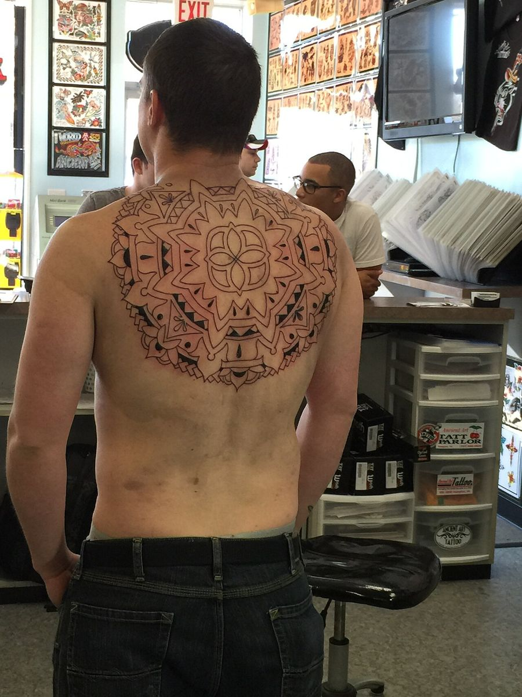
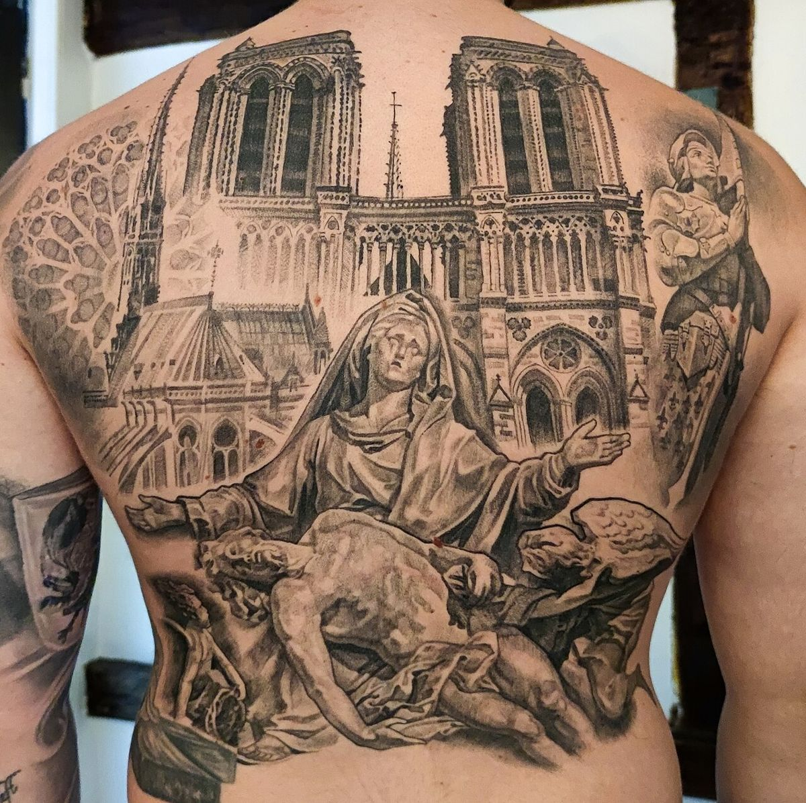
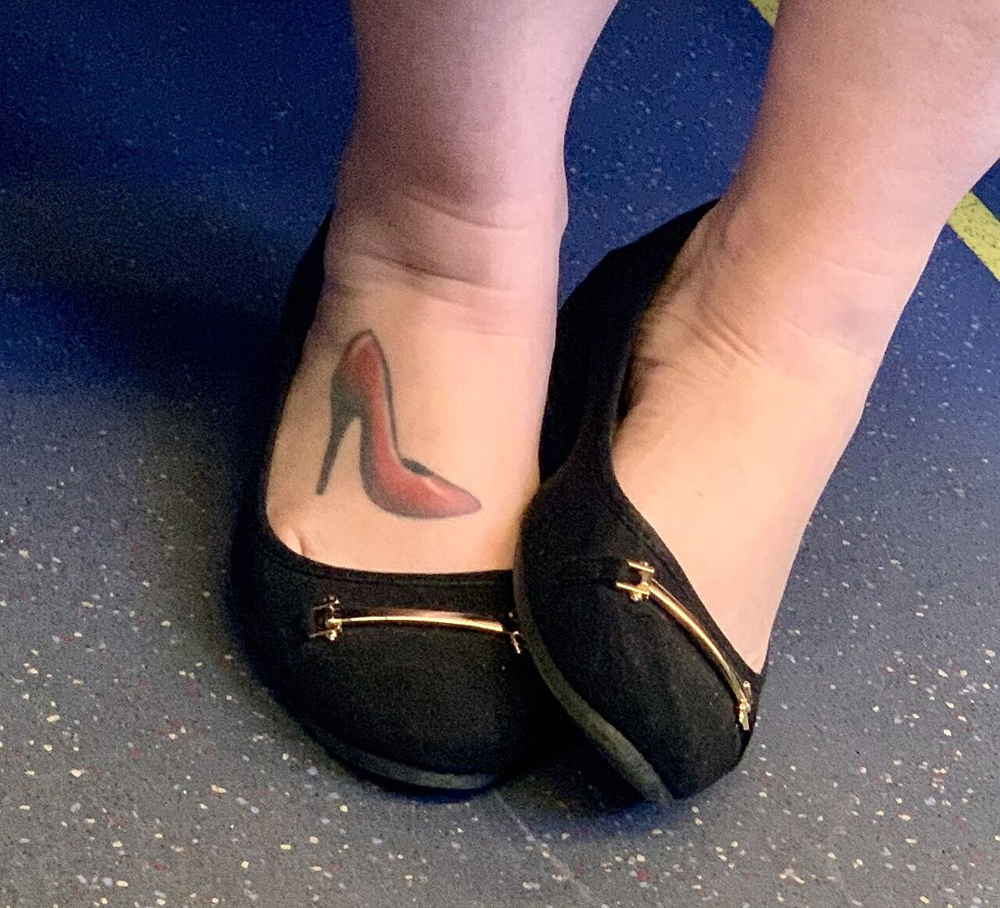
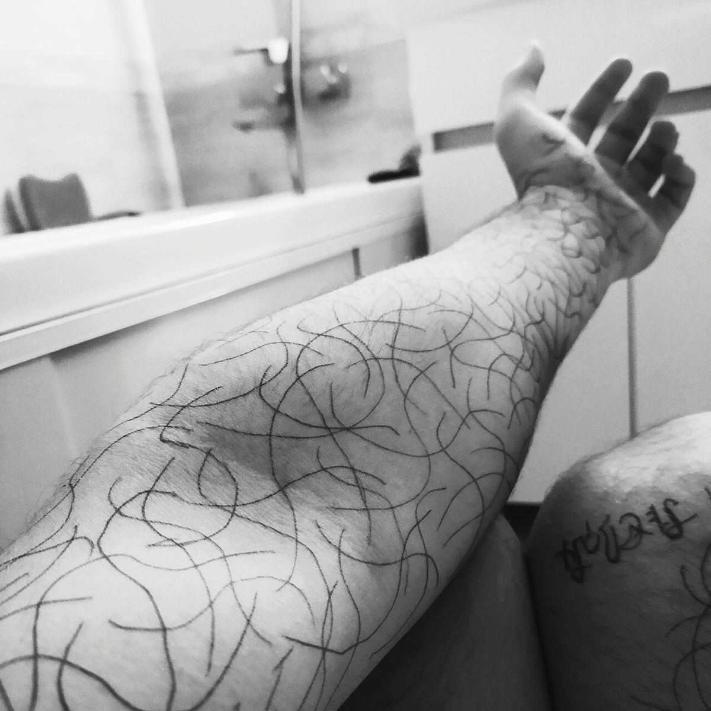

# Сколько заживает тату: сроки по размеру и зоне тела

**Коротко:** поверхность кожи над татуировкой обычно заживает примерно за 2–4 недели: за это время проходят краснота, шелушение и корочки. Более глубокие слои кожи, где находится пигмент, восстанавливаются дольше — по данным дерматологов, около 3–6 месяцев, хотя внешне тату к этому времени давно выглядит зажившей. Большие, плотно забитые и цветные работы, а также тату на кистях, стопах и в местах трения обычно заживают дольше. Сроки индивидуальны и сильно зависят от ухода.

> Это не медицинский совет. Мы описываем общие ориентиры и опыт студии. Если заживление идёт не так, как вы ожидали, или есть признаки воспаления, посоветуйтесь с врачом, лучше с дерматологом.

## Почему у заживления два срока

Во время сеанса иглы много раз прокалывают кожу и оставляют пигмент в дерме — среднем слое кожи. Поэтому свежая тату по сути является заживающей раной, и заживает она в два этапа.

- **Поверхность (эпидермис).** Это то, что вы видите: краснота, сукровица, шелушение, тонкие корочки. Обычно этот этап занимает 2–4 недели. Дерматолог Cleveland Clinic отмечает, что примерно через три недели корочек и шелушения становится заметно меньше.
- **Глубокие слои (дерма).** Снаружи всё уже гладко, а кожа под рисунком продолжает восстанавливаться. По словам дерматологов, которых цитируют Cleveland Clinic, Health.com и SELF, на это уходит ещё несколько месяцев — чаще называют 3–6 месяцев.

Отсюда практический вывод: «тату зажила» и «кожа полностью восстановилась» — не одно и то же. Через пару недель можно вернуться к обычной жизни, но беречь рисунок от солнца, трения и травм стоит дольше.

*Крупная контурная работа на спине в день сеанса. Чем больше площадь, тем больше кожи должно восстановиться и тем дольше обычно идёт заживление.* Фото: Tony Alter, [Wikimedia Commons](https://commons.wikimedia.org/wiki/File:Nice_Back_Piece_%2816227337269%29.jpg), лицензия [CC BY 2.0](https://creativecommons.org/licenses/by/2.0).

## Этапы заживления по времени

Ниже — ориентиры для обычной тату у здорового взрослого человека. Источники называют немного разные цифры, поэтому границы этапов размыты, а у вас всё может идти быстрее или медленнее.

| Период | Что обычно происходит | Что делать |
|---|---|---|
| Первые 1–3 дня | Краснота, отёк, чувствительность, может выделяться сукровица с краской | Следовать инструкции мастера по плёнке, мягко промывать, не тереть |
| Примерно 4–14 дней | Шелушение, тонкие корочки, зуд | Тонко увлажнять, не чесать и не сдирать корочки |
| Примерно 2–4 недели | Корочки и шелушение уходят, рисунок может казаться мутным | Продолжать уход, избегать солнца и долгого пребывания в воде |
| Примерно 1–6 месяцев | Внешне тату зажила, дерма продолжает восстанавливаться | Защищать от солнца, увлажнять сухую кожу, оценивать результат |

Подробно о том, что происходит с кожей в каждый из первых дней, мы писали в статье [«Шелушение тату по дням»](/tattoo-spravochnik/sheluschenie-tatu-po-dnyam/). Про зуд на втором этапе — в материале [«Тату чешется: что делать»](/tattoo-spravochnik/tatu-cheshetsya-chto-delat/).

Мутность после снятия корочек — частая причина беспокойства. По словам дерматолога, которого цитирует Byrdie, рисунок может выглядеть тусклым примерно до месяца и только потом приобретает окончательную яркость.

## Как размер и плотность работы влияют на сроки

### Маленькие и тонкие тату

Небольшая контурная работа повреждает меньше кожи, поэтому обычно проходит видимые этапы быстрее. Но и маленькая тату остаётся раной: сорванная корочка или солнечный ожог на ней так же могут оставить светлое пятно.

### Большие работы: спина, рукав, бедро

В Cleveland Clinic отмечают, что крупные тату могут заживать несколько месяцев, а краснота и отёк держатся дольше. По нашему опыту, большие проекты часто делают в несколько сеансов, и каждый новый участок проходит заживление заново. Перерыв между сеансами определяет мастер, ориентируясь на то, как зажила кожа.

### Плотная заливка и цвет

Чтобы плотно заполнить участок цветом или чёрным, мастеру приходится чаще проходить по коже. По данным Health.com и Byrdie, такие участки могут давать более сильное воспаление и заживать немного дольше, чем тонкий контур.

*Работа на всю спину с плотными тенями. Такие проекты обычно делают в несколько сеансов, и каждый участок заживает по своему графику.* Фото: Soulxiom, [Wikimedia Commons](https://commons.wikimedia.org/wiki/File:Tattoo_back_piece.jpg), лицензия [CC BY-SA 4.0](https://creativecommons.org/licenses/by-sa/4.0).

## Зоны тела: где заживает дольше

Тут источники расходятся. В Cleveland Clinic пишут, что небольшие тату на кистях, запястьях и руках обычно заживают быстрее, чем на груди или спине. Дерматологи в статье SELF, наоборот, отмечают, что быстрее заживают зоны с более толстой кожей, например спина и передняя поверхность бедра. Часть разницы, вероятно, объясняется размером: на спине чаще делают большие работы. Поэтому мы не называем точных сроков по зонам, а говорим о том, что мешает заживлению.

### Кисти и пальцы

Руки постоянно моются, сгибаются, трутся о предметы и бывают на солнце. Свежая тату на кисти чаще травмируется, а со временем такие тату быстрее выцветают и чаще требуют коррекции.

### Стопы и щиколотки

Обувь и швы носков трут края рисунка, к вечеру ноги отекают, а стопа находится ближе всего к пыли и грязи. Ортопед-подиатр в статье для пациентов отмечает, что из-за отёка и трения заживление на стопе может занимать заметно больше времени. По нашему опыту, на первые дни лучше запланировать свободную открытую обувь и меньше ходить.

*Зажившая тату на стопе. Край обуви приходится прямо на кожу рядом с рисунком — на свежей тату такое трение замедляет заживление.* Фото: Kgbo, [Wikimedia Commons](https://commons.wikimedia.org/wiki/File:Tattoo_of_a_shoe_on_foot.jpg), лицензия [CC BY-SA 4.0](https://creativecommons.org/licenses/by-sa/4.0).

### Сгибы, рёбра, линия пояса

Локтевой и подколенный сгибы постоянно двигаются, а на рёбрах и талии кожу трут ремень, пояс и бельё. Корочки на таких зонах чаще трескаются, поэтому свободная мягкая одежда здесь особенно важна.

*Тату на предплечье и кисти. Кисть — одна из самых «рабочих» зон: её часто моют и сгибают, поэтому свежая тату здесь требует особой аккуратности.* Фото: Algeyav, [Wikimedia Commons](https://commons.wikimedia.org/wiki/File:A_hand_with_a_tattoo.jpg), лицензия [CC BY-SA 4.0](https://creativecommons.org/licenses/by-sa/4.0).

## Что ещё ускоряет или замедляет заживление

Ускорить заживление сверх нормы нельзя, но легко его затянуть. Чаще всего сроки растягиваются из-за таких вещей:

- **Сорванные корочки и расчёсывание.** Кожа травмируется заново, а пигмент может выйти вместе с корочкой.
- **Пересушивание или, наоборот, толстый слой крема.** Нужен тонкий слой средства без отдушек. Что подойдёт, мы разобрали в статье [«Чем мазать тату после снятия плёнки»](/tattoo-spravochnik/chem-mazat-tatu-posle-snyatiya-plenki/).
- **Вода.** До заживления дерматологи советуют не погружать тату в воду: ванна, бассейн, горячая ванна-джакузи. Короткий душ обычно можно.
- **Солнце.** Свежая кожа чувствительна к ультрафиолету, а он ещё и ускоряет выцветание.
- **Тесная одежда и трение.** Ремни, лямки, обувь, синтетика по свежей тату.
- **Реакция на краску или инфекция.** В таких случаях заживление закономерно идёт дольше, и нужен врач.

## Когда идти к врачу

Обратитесь за медицинской помощью, если:

- поднялась температура, появились озноб или общее недомогание;
- кожа вокруг тату горячая, краснота расширяется или от рисунка идут красные полосы;
- боль со временем усиливается, а не ослабевает;
- есть гной, неприятный запах, сильное мокнутие, которое не подсыхает.

Запишитесь к дерматологу, если тату через несколько недель всё ещё мокнет, не покрылась гладкой кожей, появилась сыпь, бугорки или отёк в одном цвете, а также если кожа с тату как-либо меняется спустя месяцы. AAD советует показывать дерматологу любые изменения кожи с татуировкой.

## Частые вопросы

### Сколько заживает маленькая тату?

Видимые этапы у небольшой контурной работы обычно проходят примерно за 2–3 недели. Глубокие слои кожи всё равно восстанавливаются дольше, поэтому защищать рисунок от солнца стоит и после.

### Через сколько тату полностью заживёт?

Поверхность обычно заживает за 2–4 недели, а полное восстановление кожи, по оценкам дерматологов, занимает около 3–6 месяцев. Сроки индивидуальны и зависят от размера, зоны и ухода.

### Почему тату после заживления выглядит мутной?

После шелушения поверх рисунка остаётся молодая кожа, и примерно до месяца тату может казаться тусклой. Обычно это проходит само; если пятна остались после полного заживления, их оценивает мастер.

### Когда можно делать коррекцию?

Только после того, как кожа полностью зажила снаружи, иначе мастер не увидит реального результата. Точный срок мастер назовёт после осмотра.

### Можно ли ускорить заживление тату?

Специального способа нет. Лучшее, что можно сделать, — не мешать коже: аккуратно мыть, тонко увлажнять, не чесать, не загорать и не носить тесную одежду поверх тату.

---

## Записаться в ТатуНаХоду

В «ТатуНаХоду» (Москва) мы заранее подсказываем, как зона и размер эскиза повлияют на заживление, и после сеанса остаёмся на связи, пока тату не заживёт. Напишите нам — поможем спланировать работу с учётом ваших дел.

👉 [Записаться в Telegram](https://t.me/tatunahody)

Работы мастеров и новости студии — в нашем Telegram-канале: [t.me/tattoo_na_hodu](https://t.me/tattoo_na_hodu)

## Источники изображений

- `svezhaya-krupnaya-tatu-na-spine.jpg` — «Nice Back Piece (16227337269).jpg», автор: Tony Alter ([Flickr](https://www.flickr.com/photos/78428166@N00/16227337269)), источник: [Wikimedia Commons](https://commons.wikimedia.org/wiki/File:Nice_Back_Piece_%2816227337269%29.jpg), лицензия: [CC BY 2.0](https://creativecommons.org/licenses/by/2.0). Без изменений, кроме уменьшения размера.
- `bolshaya-tatu-na-vsyu-spinu.jpg` — «Tattoo back piece.jpg», автор: Soulxiom, источник: [Wikimedia Commons](https://commons.wikimedia.org/wiki/File:Tattoo_back_piece.jpg), лицензия: [CC BY-SA 4.0](https://creativecommons.org/licenses/by-sa/4.0). Без изменений, кроме уменьшения размера.
- `tatu-na-stope-i-obuv.jpg` — «Tattoo of a shoe on foot.jpg», автор: Kgbo, источник: [Wikimedia Commons](https://commons.wikimedia.org/wiki/File:Tattoo_of_a_shoe_on_foot.jpg), лицензия: [CC BY-SA 4.0](https://creativecommons.org/licenses/by-sa/4.0). Без изменений, кроме уменьшения размера.
- `tatu-na-predplechye-i-kisti.jpg` — «A hand with a tattoo.jpg», автор: Algeyav, источник: [Wikimedia Commons](https://commons.wikimedia.org/wiki/File:A_hand_with_a_tattoo.jpg), лицензия: [CC BY-SA 4.0](https://creativecommons.org/licenses/by-sa/4.0). Без изменений, кроме уменьшения размера.

## Источники фактов

- Cleveland Clinic: [Tattoo Aftercare: Instructions and Healing Tips](https://health.clevelandclinic.org/tattoo-aftercare).
- Health.com: [What the Tattoo Healing Process Is Like](https://www.health.com/tattoo-healing-7563417).
- SELF: [Tattoo Aftercare: Expert Tips to Help the Healing Process](https://www.self.com/story/tattoo-aftercare).
- Byrdie: [Tattoo Healing Process Timeline and Stages](https://www.byrdie.com/tattoo-healing-process-5081464).
- Американская академия дерматологии (AAD): [Caring for tattooed skin](https://www.aad.org/public/everyday-care/skin-care-basics/tattoos/caring-for-tattooed-skin).
- My Chicago Foot Expert (Stavros O. Alexopoulos, DPM): [What to Know Before Getting a Foot or Ankle Tattoo](https://mychicagofootexpert.com/2026/05/19/what-to-know-before-getting-a-foot-or-ankle-tattoo/).
