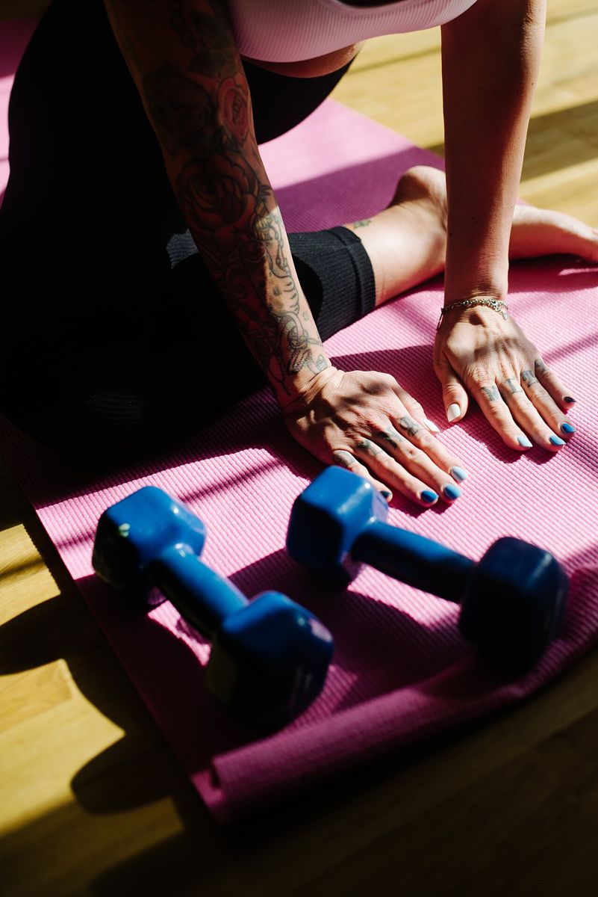
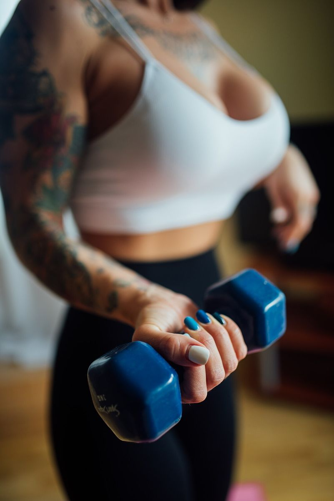
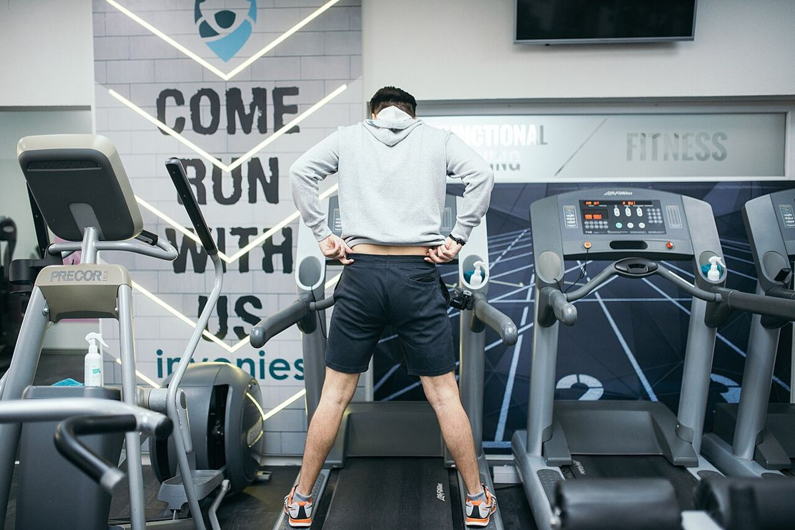
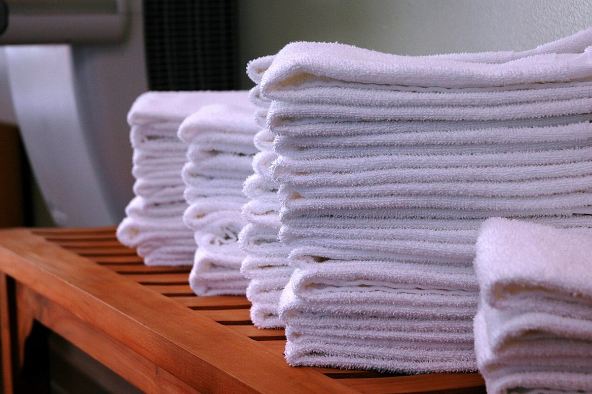

# Спорт после тату: когда можно в зал и что учесть

**Коротко:** в первые несколько дней после сеанса от тяжёлых тренировок и сильного потоотделения лучше отказаться, а лёгкая активность вроде спокойной ходьбы обычно допустима. Возвращаться к обычным нагрузкам стоит постепенно, ориентируясь не на календарь, а на состояние кожи: тату не мокнет, не болит, одежда и движения её не натирают. Бассейн, открытая вода и контактные виды спорта, где тату трётся о соперника и маты, ждут до полного заживления. Единого срока для всех нет: он зависит от размера и места тату, вида спорта и инструкции вашего мастера.

> Это не медицинский совет. Мы пересказываем общедоступные рекомендации врачей и делимся опытом студии. Инструкция вашего мастера важнее общих правил. Если тату болит всё сильнее, краснеет или мокнет, обратитесь к врачу.

*Домашняя тренировка с гантелями. Иллюстративное фото, не показывает свежую тату.* Фото: Nenad Stojkovic, [Wikimedia Commons](https://commons.wikimedia.org/wiki/File:Tattooed_arms_and_weight_on_the_floor_closeup._%2851007852395%29.jpg), лицензия [CC BY 2.0](https://creativecommons.org/licenses/by/2.0).

## Почему спорт мешает заживлению тату

Свежая татуировка — это множество мелких проколов кожи, то есть поверхностная рана. Дерматолог Cleveland Clinic Шилпи Кхетарпал [называет](https://health.clevelandclinic.org/tattoo-aftercare) тату контролируемой травмой кожи, которой нужна поддержка, чтобы зажить правильно. Тренировка влияет на эту рану сразу с нескольких сторон.

- **Пот и влага.** Долго влажная кожа под спортивной одеждой раздражается сильнее. Врач центра лечения ран Университета штата Огайо Ричард Шлангер [советует](https://wexnermedical.osu.edu/our-stories/how-to-care-for-a-new-tattoo) в первые несколько дней избегать сильного потоотделения.
- **Трение.** Лямки, пояс, тесная форма, перчатки и снаряды трут свежую кожу и могут сорвать корочки. Cleveland Clinic советует до заживления не носить тесную одежду на зоне тату.
- **Растяжение кожи.** Если мышца под тату активно работает, кожа над ней постоянно тянется. Особенно это заметно на суставах: локтях, коленях, подмышках.
- **Микробы.** Общие тренажёры, коврики и скамейки касаются кожи многих людей. Шлангер прямо рекомендует держаться подальше от спортзалов, пока тату свежая: там можно подхватить инфекцию, в том числе MRSA (золотистый стафилококк, устойчивый к ряду антибиотиков).

## Сколько ждать: ориентиры по этапам

Точной даты, после которой «можно всё», не существует. Шлангер называет первые 5–7 дней «золотым временем» заживления, а Cleveland Clinic пишет, что корочки и шелушение обычно заметно уменьшаются примерно через три недели, верхний слой кожи заживает примерно к двум месяцам, а глубокие слои — ещё дольше. Подробно о сроках мы писали в статье [«Сколько заживает тату»](/tattoo-spravochnik/skolko-zazhivaet-tatu/).

| Этап | Что обычно можно | Чего лучше избегать |
|---|---|---|
| Первые несколько дней | Спокойная ходьба, лёгкая активность, которая не задействует зону тату | Тяжёлые тренировки, сильный пот, общий спортзал, бассейн, баня |
| Пока есть корочки и шелушение (обычно первые 2–3 недели) | Постепенный возврат к нагрузкам, которые не трут и не растягивают тату | Упражнения с трением о снаряды и одежду, контактные виды спорта, плавание |
| Тату не мокнет, корочки сошли, кожа гладкая | Обычные тренировки, если мастер не дал других указаний | До полного заживления — погружение в воду и загар без защиты одеждой |

Это ориентиры, а не правило. Маленькая тату на плече у человека, который ходит на йогу, и большая спина у того, кто занимается борьбой, заживают в разных условиях. Если сомневаетесь, покажите тату мастеру и опишите, какую тренировку планируете.

## Как понять, что пора возвращаться к тренировкам

Мы советуем проверять не дни, а состояние кожи. Сначала попробуйте спокойную прогулку и посмотрите, тянет ли движение кожу на тату. Если тянет, это упражнение пока убираем.

*Тренировка с гантелей. Иллюстративное фото, не показывает свежую тату.* Фото: Shixart1985, [Wikimedia Commons](https://commons.wikimedia.org/wiki/File:A_woman_is_lifting_a_blue_dumbbell_as_part_of_her_fitness_routine.jpg), лицензия [CC BY 2.0](https://creativecommons.org/licenses/by/2.0).

Признаки, что тату готова к обычной нагрузке:

- она не мокнет и не выделяет сукровицу;
- корочки сошли сами, без помощи;
- кожа не болит при движении и не горит после тренировки;
- одежда и снаряжение не прилипают к рисунку.

Признаки, что нагрузку пора снизить:

- после тренировки тату покраснела сильнее, чем до неё;
- корочки трескаются или отрываются;
- кожа на месте тату опухает или ноет к вечеру.

## Тренажёрный зал, бег, бассейн и единоборства

*В зале к поручням, скамейкам и коврикам прикасается много людей.* Фото: Nenad Stojkovic, [Wikimedia Commons](https://commons.wikimedia.org/wiki/File:Young_man_running_on_treadmill_during_sports_training_in_a_gym.jpg), лицензия [CC BY 2.0](https://creativecommons.org/licenses/by/2.0).

### Тренажёрный зал

Выбирайте упражнения, которые не задействуют зону тату. Если рисунок на ноге, можно поработать над руками и корпусом. Если на руке — подойдут упражнения для ног, где рука не опирается и не трётся. CDC в рекомендациях для спортсменов [советует](https://www.cdc.gov/mrsa/prevention/athletes.html) мыть руки до и после работы на общих тренажёрах, не делить полотенца с другими и закрывать порезы и раны чистой сухой повязкой до заживления.

### Бег и кардио

Бег нагружает в основном ноги, поэтому для тату на ногах и стопах это самый сложный вариант: кожу тянет, а носки, лосины и обувь трут. Тату на спине может натирать лямка рюкзака или спортивного топа. На улице не забывайте про солнце: Cleveland Clinic до заживления советует не наносить на тату солнцезащитный крем, поэтому закрывайте её свободной одеждой. Подробнее — в статье [«Тату и солнце»](/tattoo-spravochnik/tatu-i-solnce/).

### Бассейн и плавание

Плавание откладываем до полного заживления. Cleveland Clinic советует не погружать заживающую тату в воду (бассейн, ванна, джакузи), а Шлангер — не заходить в море и озёра в первые недели. Подробно о воде — в статье [«Можно ли мочить тату»](/tattoo-spravochnik/mozhno-li-mochit-tatu/).

### Единоборства и контактные виды спорта

Борьба, бокс, джиу-джитсу, регби — это постоянное трение о соперника, маты и экипировку. CDC отмечает, что кожные инфекции, включая MRSA, чаще всего фиксируют среди спортсменов в контактных видах спорта и что непокрытые раны могут стать входными воротами для инфекции. Поэтому со свежей тату мы советуем подождать с контактными тренировками до полного заживления.

## Если всё-таки тренируетесь: как защитить тату

*Чистое личное полотенце — простой барьер между кожей и общей скамьёй.* Фото: Brandon.wiggins, [Wikimedia Commons](https://commons.wikimedia.org/wiki/File:Stacks-of-gym-towels-on-wood-bench.jpg), лицензия [CC BY-SA 3.0](https://creativecommons.org/licenses/by-sa/3.0).

- Начинайте с короткой и лёгкой тренировки, а не с привычного объёма.
- Носите свободную дышащую одежду, которая не прилегает к тату.
- Подкладывайте чистое личное полотенце на скамьи и коврики, не делитесь им с другими.
- Мойте руки до и после тренажёров и не трогайте тату в зале.
- После тренировки не оставляйте тату влажной: аккуратно вымойте её тёплой водой с мягким мылом и промокните чистой бумажной салфеткой, не растирая.
- Затем нанесите тонкий слой средства, которое рекомендовал мастер. Что подходит, мы разбирали в статье [«Чем мазать тату после снятия плёнки»](/tattoo-spravochnik/chem-mazat-tatu-posle-snyatiya-plenki/).

Если после тренировки тату начала сильнее чесаться, не расчёсывайте её — об этом мы писали в материале [«Тату чешется: что делать»](/tattoo-spravochnik/tatu-cheshetsya-chto-delat/).

## Когда идти к врачу

Немного покраснения, зуда и шелушения в первые недели — обычная часть заживления. Но Cleveland Clinic советует обратиться к врачу при признаках инфекции:

- температура;
- кожа вокруг тату горячая на ощупь;
- неприятный запах или заметные выделения;
- боль усиливается, а не стихает;
- красные полосы, идущие от тату, или покраснение, которое расползается всё дальше.

Шлангер также называет поводом позвонить врачу нарастающее покраснение, выделения и искажение рисунка. Как отличить норму от воспаления, мы подробно разобрали в статье [«Тату воспалилась: что делать»](/tattoo-spravochnik/tatu-vospalilas-chto-delat/). Антибиотики и любые лекарства — только по назначению врача.

## Частые вопросы

### Можно ли тренироваться в день сеанса?

Лучше не надо. В первые дни врачи советуют избегать сильного пота и общего спортзала, а лёгкая прогулка обычно не мешает.

### Можно ли потеть после тату?

Обычный пот в течение дня не страшен, но в первые несколько дней стоит избегать сильного потоотделения. После тренировки тату нужно аккуратно вымыть и промокнуть, а не оставлять влажной.

### Можно ли заклеить тату плёнкой и пойти в зал?

Заживляющая плёнка защищает от грязи, но при сильном поте может отклеиться по краю, и тогда под неё попадает влага. Решайте это с мастером. Как обращаться с плёнкой, мы писали в статье [«Заживляющая плёнка на тату»](/tattoo-spravochnik/zazhivlyayushchaya-plenka-na-tatu/).

### Когда можно в бассейн после тату?

Только после полного заживления, когда тату не мокнет, корочки сошли сами и кожа гладкая. Погружать заживающую тату в воду врачи не советуют.

### Испортит ли спорт рисунок?

Сама по себе нагрузка рисунок не портит. Риск в трении, сорванных корочках и инфекции: из-за них краска может лечь неровно и понадобится коррекция.

---

## Записаться в ТатуНаХоду

Если вы активно тренируетесь, скажите об этом мастеру ещё до сеанса: в «ТатуНаХоду» (Москва) мы поможем выбрать место и время для тату так, чтобы заживление меньше мешало вашим тренировкам, и подскажем, как ухаживать за ней после зала.

👉 [Записаться в Telegram](https://t.me/tatunahody)

Работы мастеров и новости студии — в нашем Telegram-канале: [t.me/tattoo_na_hodu](https://t.me/tattoo_na_hodu)

## Источники изображений

- `tatu-na-ruke-i-ganteli-na-kovrike.jpg` — «Tattooed arms and weight on the floor closeup. (51007852395).jpg», автор: Nenad Stojkovic, источник: [Wikimedia Commons](https://commons.wikimedia.org/wiki/File:Tattooed_arms_and_weight_on_the_floor_closeup._%2851007852395%29.jpg), лицензия: [CC BY 2.0](https://creativecommons.org/licenses/by/2.0). Без изменений, кроме уменьшения размера.
- `begovaya-dorozhka-v-trenazhernom-zale.jpg` — «Young man running on treadmill during sports training in a gym.jpg», автор: Nenad Stojkovic, источник: [Wikimedia Commons](https://commons.wikimedia.org/wiki/File:Young_man_running_on_treadmill_during_sports_training_in_a_gym.jpg), лицензия: [CC BY 2.0](https://creativecommons.org/licenses/by/2.0). Без изменений, кроме уменьшения размера.
- `chistye-polotenca-v-sportzale.jpg` — «Stacks-of-gym-towels-on-wood-bench.jpg», автор: Brandon.wiggins, источник: [Wikimedia Commons](https://commons.wikimedia.org/wiki/File:Stacks-of-gym-towels-on-wood-bench.jpg), лицензия: [CC BY-SA 3.0](https://creativecommons.org/licenses/by-sa/3.0). Без изменений, кроме уменьшения размера.
- `trenirovka-s-gantelyu-tatu-na-ruke.jpg` — «A woman is lifting a blue dumbbell as part of her fitness routine.jpg», автор: Shixart1985, источник: [Wikimedia Commons](https://commons.wikimedia.org/wiki/File:A_woman_is_lifting_a_blue_dumbbell_as_part_of_her_fitness_routine.jpg), лицензия: [CC BY 2.0](https://creativecommons.org/licenses/by/2.0). Без изменений, кроме уменьшения размера.

## Источники фактов

- Cleveland Clinic: [Tattoo Aftercare: Instructions and Healing Tips](https://health.clevelandclinic.org/tattoo-aftercare).
- The Ohio State University Wexner Medical Center: [How to care for a new tattoo](https://wexnermedical.osu.edu/our-stories/how-to-care-for-a-new-tattoo).
- CDC: [Athletes: MRSA Prevention and Control](https://www.cdc.gov/mrsa/prevention/athletes.html).
