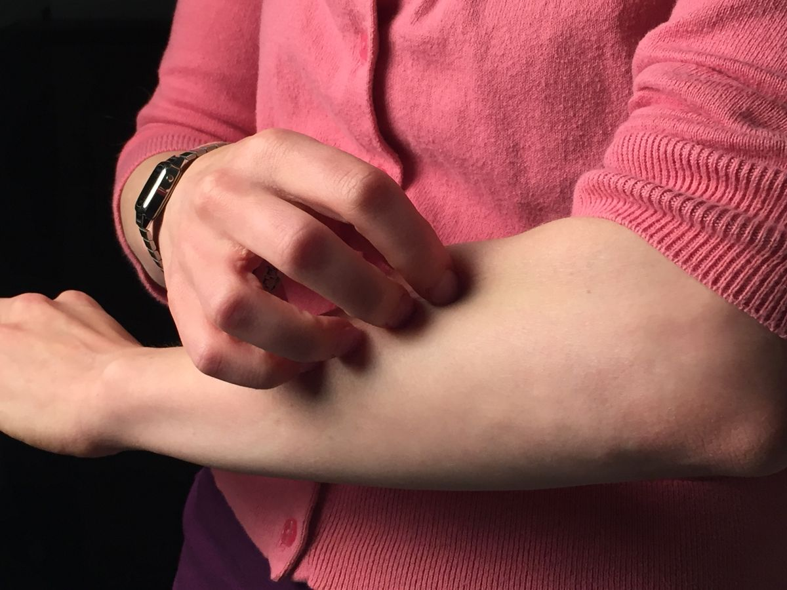
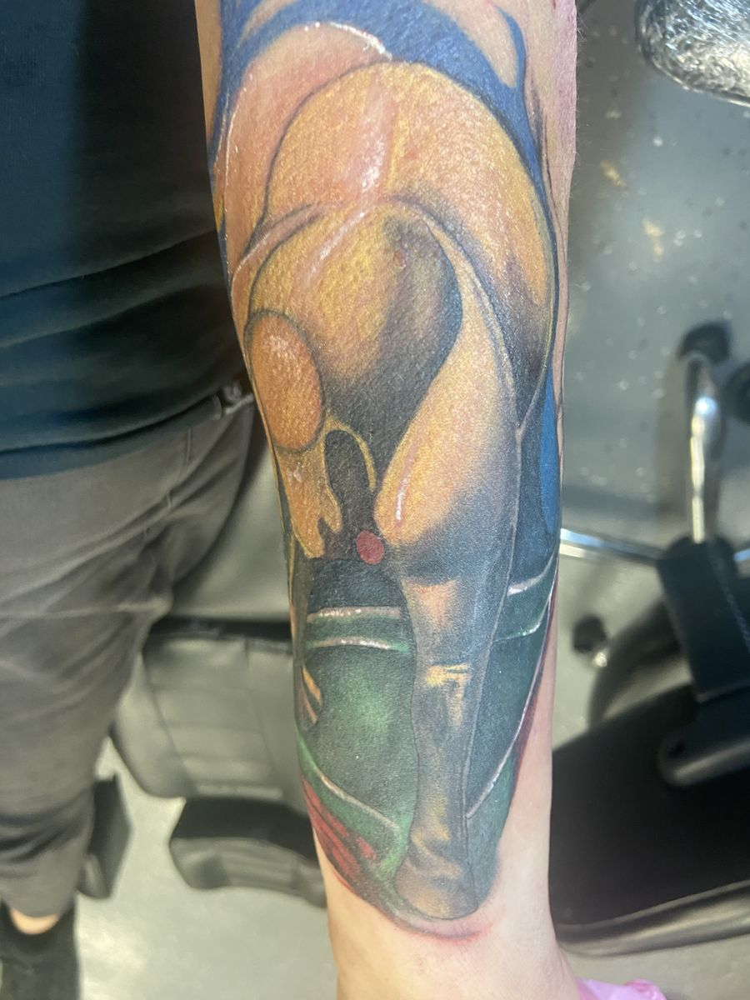
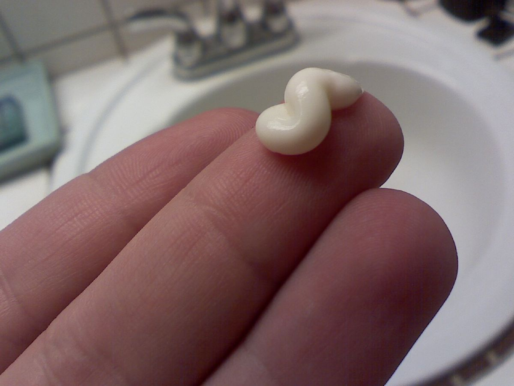
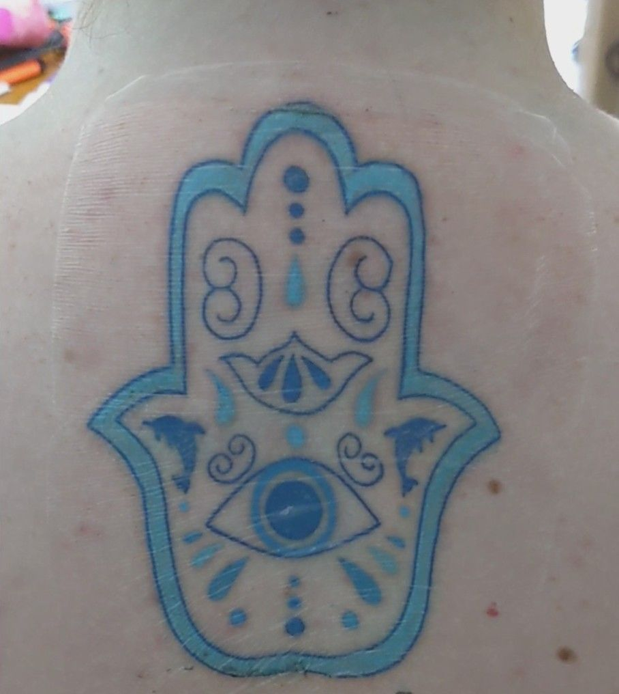

# Тату чешется: почему и что делать, чтобы не испортить рисунок

**Коротко:** зуд свежей тату — обычная часть заживления. Чаще всего он появляется, когда кожа начинает сохнуть и шелушиться, обычно в первые одну-две недели. Чесать, тереть и сдирать корочки нельзя: так можно вытащить пигмент, оставить светлые пятна и занести инфекцию. Помогают тонкий слой увлажняющего средства без отдушек, лёгкое похлопывание чистой рукой рядом с тату и свободная одежда. Если зуд сильный, держится дольше заживления, появился в одном цвете или на старой тату, сопровождается сыпью, отёком, гноем или температурой — это повод показаться врачу.

> Это не медицинский совет. Мы описываем общие принципы ухода и опыт студии. Если вас что-то беспокоит, особенно при аллергии, кожных заболеваниях или признаках воспаления, посоветуйтесь с врачом, лучше с дерматологом.

*Желание почесаться — естественная реакция на зуд. С заживающей тату так делать нельзя. Иллюстративное фото, без тату.* Фото: NIAID, [Wikimedia Commons](https://commons.wikimedia.org/wiki/File:Woman_Scratching_Skin_%2848140273032%29.jpg), лицензия [CC BY 2.0](https://creativecommons.org/licenses/by/2.0).

## Почему чешется свежая тату

Татуировка — это множество мелких проколов кожи, то есть по сути заживающая рана. Пока кожа восстанавливается, в ней идёт воспаление и обновление верхнего слоя. Зуд — частый спутник этого процесса, так же как у обычной заживающей ссадины.

По нашему опыту, сильнее всего тату чешется в нескольких ситуациях:

- **Шелушение.** Когда верхний слой начинает отходить чешуйками, кожа становится сухой и стянутой. В материалах Cleveland Clinic зуд и шелушение в первые две недели прямо названы нормальной частью заживления.
- **Сухость.** Если кожу не увлажнять или промывать слишком горячей водой, она пересыхает и чешется сильнее.
- **Трение и пот.** Тесная одежда, синтетика, ремень или лямка рюкзака по свежей тату раздражают кожу.
- **Плёнка.** Под заживляющей плёнкой кожа может чесаться из-за влаги и самого клея. Если зуд усиливается, появилась сыпь по краям или под плёнкой копится много жидкости — свяжитесь с мастером, возможно, её пора снимать.

Подробнее о том, как меняется кожа по дням, мы писали в статье [«Шелушение тату по дням»](/tattoo-spravochnik/sheluschenie-tatu-po-dnyam/).

*Сразу после сеанса кожа блестит и может быть красной — это свежая рана. Зуд обычно приходит позже, когда она начинает подсыхать.* Фото: Myotus, [Wikimedia Commons](https://commons.wikimedia.org/wiki/File:22-finished_tattoo.jpg), лицензия [CC BY-SA 4.0](https://creativecommons.org/licenses/by-sa/4.0).

## Норма или повод насторожиться

Сроки индивидуальны и зависят от размера работы, зоны и ухода, поэтому таблица — лишь ориентир.

| Что происходит | Похоже на норму | Повод насторожиться |
|---|---|---|
| Первые дни | Кожа красная, чувствительная, может слегка мокнуть; зуда ещё мало | Краснота расползается за пределы рисунка, боль усиливается, кожа горячая |
| Примерно 1–2 недели | Сухость, шелушение, умеренный зуд, тонкие корочки | Гной, неприятный запах, мокнущие участки, которые не подсыхают |
| Конец заживления | Зуд стихает вместе с шелушением | Зуд не проходит или нарастает, появились бугорки и уплотнения |
| Месяцы и годы спустя | Изредка лёгкий зуд при сухой коже | Зуд, отёк, бугорки или шелушение только в одном цвете (часто в красном) или по линиям рисунка |

## Что делать, чтобы не испортить рисунок

Главная задача — снять зуд, не повреждая кожу. Вот что, по нашему опыту, работает лучше всего.

1. **Увлажняйте тонким слоем.** Лёгкий крем или лосьон без отдушек, спирта и красителей снимает сухость, а вместе с ней и зуд. Наносите чистыми руками, совсем немного — кожа должна слегка блестеть, а не быть жирной. Что выбрать, разобрано в статье [«Чем мазать тату после снятия плёнки»](/tattoo-spravochnik/chem-mazat-tatu-posle-snyatiya-plenki/).
2. **Похлопайте, а не чешите.** Лёгкое похлопывание чистой ладонью рядом с тату часто отвлекает от зуда и не травмирует кожу.
3. **Промывайте мягко.** Тёплая, не горячая вода и мягкое мыло без отдушек, без мочалки. Промокните одноразовым полотенцем, не трите.
4. **Носите свободную одежду** из мягкой дышащей ткани, чтобы она не тёрла рисунок.
5. **Не перегревайтесь.** В жаре и после душа зуд часто усиливается. Прохладная комната и отсутствие горячей ванны помогают.
6. **Подумайте о ночи.** Во сне люди чешутся неосознанно. Закройте тату свободной чистой одеждой и держите ногти короткими.

*Такого количества крема обычно хватает на тату среднего размера: его распределяют тонким слоем. Иллюстративное фото.* Фото: Shawn Campbell, [Wikimedia Commons](https://commons.wikimedia.org/wiki/File:Moisturizer.jpg), лицензия [CC BY 2.0](https://creativecommons.org/licenses/by/2.0).

### Чего не делать

- **Не чесать** ногтями, расчёской, через одежду. Даже «аккуратное» почёсывание может сорвать корочку вместе с пигментом.
- **Не сдирать** чешуйки и корочки — они отойдут сами.
- **Не мазать толстым слоем**, чтобы «точно не чесалось»: кожа под плотным слоем может размокать.
- **Не прикладывать лёд** прямо к свежей тату и не распаривать её в ванне.
- **Не пользоваться спиртом, перекисью и средствами с отдушками** — они сушат и раздражают кожу.
- **Не использовать кремы от зуда, гормональные мази и таблетки от аллергии без врача.** На свежую тату безрецептурные кремы без необходимости лучше не наносить, а лекарства — только по согласованию с врачом.

### Что будет, если всё-таки почесать

Один раз случайно почесали — без паники. Промойте тату, промокните, нанесите тонкий слой средства и понаблюдайте. Если сорвали корочку, на её месте может остаться светлое пятно или более бледная линия. Это решается коррекцией после полного заживления, обычно её делают не раньше чем через несколько недель — уточните срок у своего мастера.

*Тату под заживляющей плёнкой. Под ней кожа тоже может чесаться; если зуд сильный или появилась сыпь, свяжитесь с мастером.* Фото: Julera (тату: Cassandra Gatelein), [Wikimedia Commons](https://commons.wikimedia.org/wiki/File:Dolphin_hamsa_under_Tegaderm.jpg), лицензия [CC BY-SA 4.0](https://creativecommons.org/licenses/by-sa/4.0).

## Почему может чесаться старая тату

Если тату давно зажила, а зуд появился вдруг, причина уже не в заживлении. Американская академия дерматологии (AAD) описывает несколько возможных вариантов:

- **Сухая кожа**, особенно зимой при отоплении. AAD советует при сухости наносить на тату крем или лосьон на водной основе.
- **Аллергия на пигмент.** Может появиться сразу или спустя месяцы и даже годы. Как правило, реакция затрагивает только один цвет; по данным AAD, чаще всего это красный, но возможен любой. Признаки: зуд, покраснение, отёк, бугорки, шелушение именно в этом цвете.
- **Обострение кожного заболевания**, например экземы или псориаза: оно может затронуть и кожу с тату.
- **Реакция на солнце.** У некоторых людей на коже с тату развивается аллергия на солнце: через минуты или часы после солнца появляются краснота, отёк, зудящая мелкая сыпь. AAD советует солнцезащитный крем SPF 30+ и одежду поверх тату.
- **Саркоидоз.** По данным AAD, иногда он проявляется бугорками, уплотнением, зудом или отёком в тату или рубце, и порой это первый заметный признак болезни. Это редкая ситуация, но такие изменения нужно показать дерматологу.

AAD советует обращаться к дерматологу, если кожа с тату как-либо меняется: это может быть и реакция на краску, и признак кожного заболевания.

## Когда идти к врачу

Сразу обратитесь за медицинской помощью, если:

- появились признаки серьёзной аллергической реакции: затруднённое дыхание, стеснение в груди, сердцебиение, головокружение, сильный отёк, крапивница по телу;
- поднялась температура, появились озноб, общее недомогание;
- краснота расползается от тату, есть красные полосы, кожа горячая, боль нарастает;
- есть гной, неприятный запах, мокнущие участки, которые не подсыхают.

Запишитесь к дерматологу, если:

- зуд не проходит после заживления или усиливается;
- зуд, отёк, бугорки или шелушение появились только в одном цвете или по линиям рисунка;
- старая тату стала выпуклой, уплотнилась или изменилась;
- лёгкая реакция держится дольше одной-двух недель — такой срок для обращения к дерматологу называет AAD.

Расскажите о реакции и своему мастеру: он может уточнить, какие краски использовались. FDA тоже рекомендует при реакции узнать у мастера марку, цвет и номер партии краски.

## Частые вопросы

### Сколько дней чешется тату после сеанса?

Обычно зуд связан с этапом шелушения и чаще всего приходится на первые одну-две недели. Сроки индивидуальны: большие работы и некоторые зоны заживают дольше. Если зуд не стихает к концу заживления, покажитесь врачу.

### Можно ли чесать тату через одежду или похлопывать?

Чесать нельзя даже через ткань: трение тоже повреждает корочки. Лёгкое похлопывание чистой ладонью рядом с тату — более безопасный способ отвлечься от зуда.

### Можно ли мазать зудящую тату гормональными или противозудными кремами?

На свежую тату без назначения врача — не стоит. Безрецептурные кремы могут мешать заживлению, а гормональные мази и таблетки от аллергии — только по согласованию с врачом.

### Почему тату чешется по ночам?

Ночью меньше отвлекающих факторов, а под одеялом кожа нагревается и потеет. Помогают прохладная комната, свободная хлопковая одежда поверх тату и короткие ногти.

### Почему чешется только один цвет на старой тату?

Это частый признак реакции на конкретный пигмент, по данным AAD — нередко на красный. Такой зуд стоит показать дерматологу, особенно если есть отёк, бугорки или шелушение.

### Испортится ли тату, если я её почесал?

Чаще всего однократное почёсывание без сорванных корочек проходит без следа. Если корочка сорвалась и осталось светлое пятно, его можно поправить коррекцией после полного заживления.

---

## Записаться в ТатуНаХоду

В «ТатуНаХоду» (Москва) мы после сеанса подробно объясняем, как пережить этап зуда и шелушения, и остаёмся на связи, пока тату заживает. Если вас беспокоит заживление или хотите новую работу — напишите нам.

👉 [Записаться в Telegram](https://t.me/tatunahody)

Работы мастеров и новости студии — в нашем Telegram-канале: [t.me/tattoo_na_hodu](https://t.me/tattoo_na_hodu)

## Источники изображений

- `zhenshchina-cheshet-kozhu-ruki.jpg` — «Woman Scratching Skin (48140273032).jpg», автор: NIAID ([Flickr](https://www.flickr.com/photos/niaid/48140273032/)), источник: [Wikimedia Commons](https://commons.wikimedia.org/wiki/File:Woman_Scratching_Skin_%2848140273032%29.jpg), лицензия: [CC BY 2.0](https://creativecommons.org/licenses/by/2.0). Без изменений, кроме уменьшения размера.
- `svezhaya-cvetnaya-tatu-na-predplechye.jpg` — «22-finished tattoo.jpg», автор: Myotus (работа тату-мастера Jenna Haas), источник: [Wikimedia Commons](https://commons.wikimedia.org/wiki/File:22-finished_tattoo.jpg), лицензия: [CC BY-SA 4.0](https://creativecommons.org/licenses/by-sa/4.0). Без изменений, кроме уменьшения размера.
- `nemnogo-krema-na-palcah.jpg` — «Moisturizer.jpg», автор: Shawn Campbell ([Flickr](https://www.flickr.com/photos/thecampbells/3350877893/)), источник: [Wikimedia Commons](https://commons.wikimedia.org/wiki/File:Moisturizer.jpg), лицензия: [CC BY 2.0](https://creativecommons.org/licenses/by/2.0). Без изменений, кроме уменьшения размера.
- `tatu-zazhivaet-pod-plenkoy-na-spine.jpg` — «Dolphin hamsa under Tegaderm.jpg», фото: Julera, тату: Cassandra Gatelein, источник: [Wikimedia Commons](https://commons.wikimedia.org/wiki/File:Dolphin_hamsa_under_Tegaderm.jpg), лицензия: [CC BY-SA 4.0](https://creativecommons.org/licenses/by-sa/4.0). Без изменений, кроме уменьшения размера.

## Источники фактов

- Cleveland Clinic: [Tattoo Aftercare: Instructions and Healing Tips](https://health.clevelandclinic.org/tattoo-aftercare); [Tattoo Infection](https://my.clevelandclinic.org/health/diseases/23295-tattoo-infection).
- Американская академия дерматологии (AAD): [Tattoos: 7 unexpected skin reactions](https://www.aad.org/public/everyday-care/skin-care-basics/tattoos/tattoo-skin-reactions); [Caring for tattooed skin](https://www.aad.org/public/everyday-care/skin-care-basics/tattoos/caring-for-tattooed-skin); [Sarcoidosis and your skin](https://www.aad.org/public/diseases/a-z/sarcoidosis-symptoms).
- FDA: [Think Before You Ink: Tattoo Safety](https://www.fda.gov/consumers/consumer-updates/think-you-ink-tattoo-safety).
