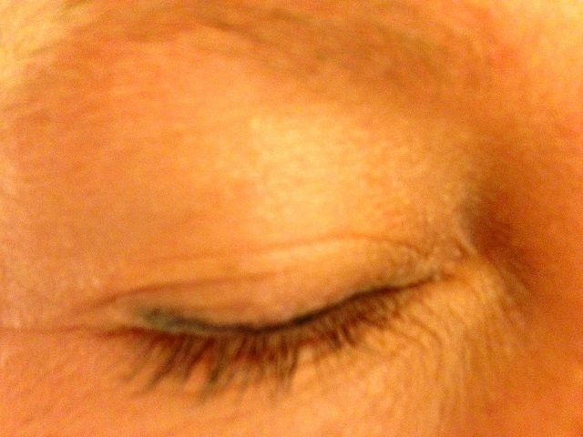
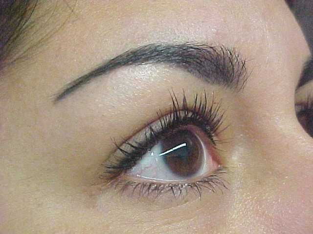
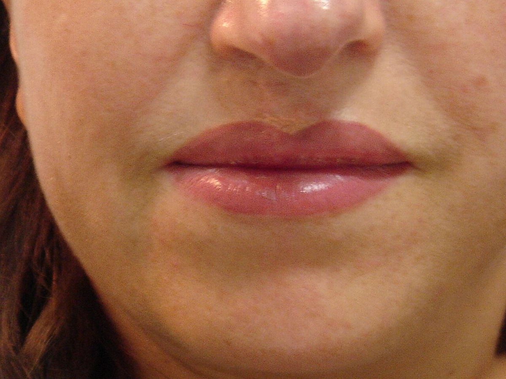
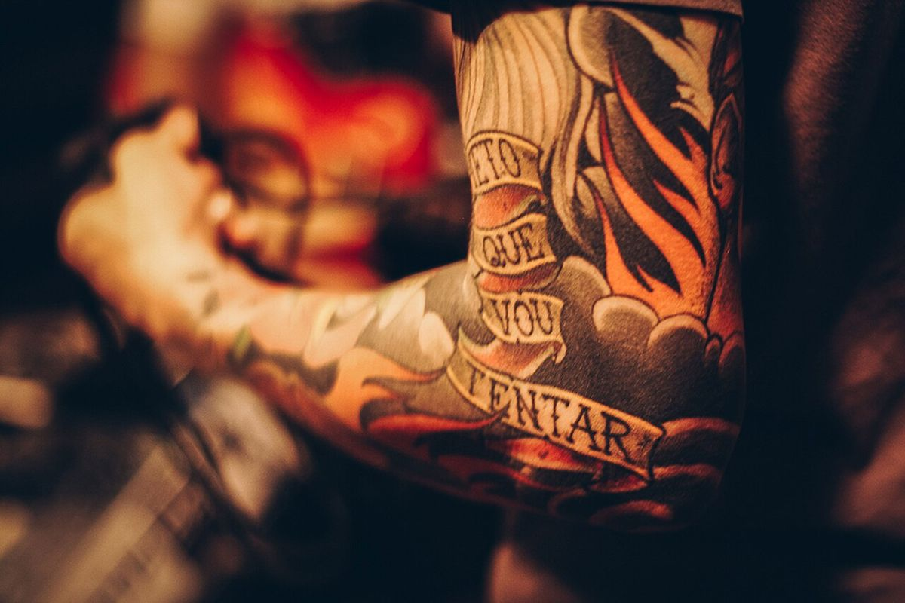

# Тату и перманентный макияж: в чём разница

**Коротко:** FDA прямо пишет, что перманентный макияж - это разновидность тату: цветной пигмент тоже вводят в кожу иглой, чтобы имитировать подводку, контур губ или брови. Роспотребнадзор описывает татуаж как косметологическую процедуру, при которой пигмент вводят в верхние слои кожи, чтобы скорректировать форму бровей, губ, век или имитировать обычный макияж. Художественная тату решает другую задачу: это рисунок на теле, а не замена косметики на лице. Общее у них главное: кожа повреждается, поэтому стерильность, одноразовые иглы и риск инфекции относятся к обеим процедурам. Это не взаимозамена: перманент бровей не равен маленькой тату на руке, и наоборот.

> Это не медицинский совет. Мы описываем общие принципы и ссылаемся на официальные источники. Решение о конкретной процедуре принимают мастер или специалист по перманенту после осмотра, а при вопросах о коже, веках и губах - врач.

*Перманентная подводка века: пигмент вводят в кожу, чтобы имитировать макияж. Крупный план зоны, не портрет.* Фото: Maniac La Inky, [Wikimedia Commons](https://commons.wikimedia.org/wiki/File:Tattooed_Eyeliner.jpg), лицензия [CC BY-SA 3.0](https://creativecommons.org/licenses/by-sa/3.0).

## Как не запутаться в названиях

В разговорной речи слово татуаж часто используют именно для бровей и губ, а тату - для рисунка на теле. В официальных текстах границы чуть другие, и из-за этого возникает путаница.

FDA в справке Tattoos and Permanent Makeup называет перманентный макияж типом татуировки: игла вводит цветной пигмент в кожу, чтобы это выглядело как подводка, контур губ, брови или другой макияж. В соседнем материале ведомство отдельно упоминает и чернила для микроблейдинга как родственную процедуру.

Роспотребнадзор в памятке для потребителей формулирует так: татуаж, перманентный макияж - это косметологическая процедура, при которой пигмент вводится в верхние слои кожи с помощью иглы, чтобы создать стойкий рисунок и скорректировать форму бровей, губ, век, подчеркнуть черты лица или имитировать обычный макияж.

Для читателя достаточно простой схемы:

- художественная татуировка - рисунок на теле или иногда на лице, который заказывают как самостоятельное изображение;
- перманентный макияж - стойкий макияж в зоне бровей, век или губ;
- микроблейдинг - одна из техник перманента бровей, о которой отдельно говорит FDA, когда перечисляет виды процедур с введением пигмента.

Ниже слово тату мы используем для художественной татуировки, слово перманент - для перманентного макияжа, и отдельно помечаем, когда речь идёт про оба варианта сразу.

## Что у них общее

И тату, и перманент повреждают кожу и оставляют пигмент внутри. Отсюда одни и те же базовые риски, которые FDA перечисляет для татуировок в целом, включая перманентный макияж: инфекция, аллергия на краску, рубцы, реакция на солнце, в редких случаях - ощущения во время МРТ, сложности с удалением.

Для клиента это значит одно и то же на входе:

- смотреть, как открывают одноразовые иглы и расходники при вас;
- не делать процедуру в случайном месте без понятного адреса и условий гигиены;
- сообщить специалисту про аллергию, герпес на губах, заболевания кожи и лекарства;
- ухаживать за зоной как за раной, пока она заживает, и при признаках инфекции идти к врачу.

Роспотребнадзор отдельно подчёркивает: все манипуляции, которые повреждают кожу и слизистые, должны выполняться стерильными инструментами, упаковку со стерильным инструментом исполнитель открывает при клиенте, краска берётся в отдельную ёмкость для каждого человека. Эти требования относятся к татуажу и к работе, где повреждается кожа. Как это выглядит на практике при выборе мастера, мы разбирали в статье [Как выбрать тату-мастера](/tattoo-spravochnik/kak-vybrat-tatu-mastera/).

*Брови - одна из самых частых зон перманентного макияжа. Крупный план области после процедуры, иллюстративное фото, не работа студии.* Фото: Marjorie Grimm, [Wikimedia Commons](https://commons.wikimedia.org/wiki/File:Permanent_makeup,_eyebrow_procedure.jpg), лицензия [CC BY 3.0](https://creativecommons.org/licenses/by/3.0).

## Чем они отличаются

| Вопрос | Художественная тату | Перманентный макияж |
|---|---|---|
| Задача | Рисунок, надпись, орнамент как самостоятельное изображение | Имитация макияжа: брови, веки, губы, иногда камуфляж |
| Типичная зона | Тело, иногда кисти, шея, реже лицо | Лицо: брови, веки, губы, по формулировке FDA и Роспотребнадзора |
| Как это описывают источники | FDA: тату как стойкий рисунок в коже | FDA: тип тату, который выглядит как макияж. Роспотребнадзор: введение пигмента в верхние слои кожи с косметической целью |
| Стойкость | Задумывается как долгий рисунок, со временем может выцветать и расплываться | Тоже остаётся в коже, на лице его часто со временем обновляют. Точного срока обновления в указанных источниках нет, его не выдумываем |
| Куда идти | К тату-мастеру со специализацией в нужном стиле | К специалисту по перманентному макияжу, это отдельная квалификация |
| Удаление лазером | Возможно не всегда, цвет влияет на результат | FDA и AAD отмечают, что перманентный макияж иногда темнеет от лазера и потемневший пигмент уже не убрать |

Разница в глубине введения в миллиметрах в этих источниках не расписана, поэтому мы её не называем. Роспотребнадзор говорит про верхние слои кожи именно для татуажа, но это не лабораторное сравнение с художественной тату и не повод считать перманент временной наклейкой: пигмент остаётся в коже и сам по себе не смывается, как обычная косметика.

*Зона губ после повторной процедуры перманентного макияжа или медицинской пигментации, по описанию автора файла. Крупный план, не портрет и не работа нашей студии.* Фото: Irma Hulscher, [Wikimedia Commons](https://commons.wikimedia.org/wiki/File:Diana_na_2de_beh.JPG), лицензия [CC BY-SA 3.0](https://creativecommons.org/licenses/by-sa/3.0).

На губах и веках уход и противопоказания могут отличаться от ухода за тату на руке: слизистая, риск герпеса на губах, близость глаза. Универсальную схему мази и дней в этой статье мы не даём. Инструкцию даёт тот, кто делает процедуру, а при герпесе, заболеваниях век и кожи лица до сеанса лучше поговорить с врачом.

*Художественная тату на руке решает другую задачу, чем перманент бровей или губ: это рисунок, а не имитация макияжа. Иллюстративное фото, не работа студии.* Фото: Matheus Ferrero (Unsplash), [Wikimedia Commons](https://commons.wikimedia.org/wiki/File:Tattooed_arm_%28Unsplash%29.jpg), лицензия [CC0](http://creativecommons.org/publicdomain/zero/1.0/deed.en).

## МРТ, донорство и лазер

Поскольку перманент тоже связан с пигментом в коже, часть правил для тату к нему относится.

На МРТ, по данным Американской академии дерматологии, тату и перманентный макияж не являются запретом. Нужно предупредить техника и сказать, если почувствуете жжение. Подробности и формулировки приказа Минздрава по донорству крови - в статье [Тату, МРТ и донорство крови](/tattoo-spravochnik/tatu-mrt-donorstvo-krovi/). Важно: в приказе перманентный макияж прямо не назван, поэтому для сдачи крови уточните правило в центре крови, а не переносите срок с тату автоматически.

Лазерное удаление перманента - не быстрый и не всегда полный путь. В статье [Лазерное удаление тату](/tattoo-spravochnik/lazernoe-udalenie-tatu/) мы уже приводили данные FDA и AAD: белая и телесная краска и перманентный макияж иногда темнеют, и потемневший пигмент лазером уже не убрать. Если цель - поправить неудачные брови, это обсуждают со специалистом по перманенту и при необходимости с дерматологом, а не закрывают домашними смывками.

## Когда идти к врачу

После и тату, и перманента к врачу стоит обратиться, если:

- краснота и отёк нарастают, появляется гной, повышается температура;
- на губах после перманента вспыхнул герпес или рана мокнет и не затягивается;
- глаз после работы на веках покраснел, гноится, зрение или свет стали беспокоить - это уже повод к офтальмологу, не к самолечению;
- сыпь, сильный зуд или отёк похожи на аллергию, в том числе не сразу, а спустя дни и недели.

Роспотребнадзор отдельно напоминает про риск занести инфекцию, если инструмент и краска нестерильны, и про необходимость сертифицированных материалов. Лечение инфекции или герпеса назначает врач, не мастер.

## Частые вопросы

### Перманентный макияж - это тату или нет?

По формулировке FDA - да, это тип татуировки: пигмент вводят в кожу иглой. При этом задача другая, чем у художественной тату: перманент имитирует макияж на лице, а не делает картинку на теле.

### Чем татуаж отличается от тату в бытовой речи?

Часто татуажем называют как раз перманент бровей, век и губ, а тату - рисунок на теле. В текстах Роспотребнадзора слово татуаж использовано для перманентного макияжа. Если записываетесь, лучше говорить прямо: брови, губы, веки или художественная тату на конкретном месте, чтобы вас не записали не туда.

### Микроблейдинг - это тоже тату?

FDA относит чернила для микроблейдинга к той же группе процедур, что тату и перманентный макияж: пигмент вводят в кожу. Это техника, которой чаще делают брови, а не отдельный безопасный стикер. Риски инфекции и аллергии с неё не снимаются.

### Можно ли перекрыть неудачный перманент обычной тату?

Иногда нет, особенно на лице: зона, цвет и плотность перманента ограничивают варианты. Часть работ правят специалист по перманенту или врач лазером, и даже лазер, по данным FDA и AAD, не всегда даёт чистый результат, а пигмент может потемнеть. Это решает осмотр, а не общая схема из статьи.

### Нужно ли делать перерыв в донорстве крови после перманента?

Для тату в приказе Минздрава есть срок 120 календарных дней. Перманентный макияж в приказе прямо не назван. Не переносите срок сами: спросите в центре крови, как они учитывают вашу процедуру. Подробнее - в статье про МРТ и донорство.

### Можно ли прийти в тату-студию за бровями?

Художественная тату и перманентный макияж - разные специализации. За стойким макияжем бровей, век и губ идут к специалисту по перманенту. За рисунком на теле - к тату-мастеру. Если сомневаетесь, какая услуга вам нужна, напишите и опишите задачу: так проще направить вас правильно.

## Записаться в ТатуНаХоду

Если вы хотите художественную тату и готовы обсудить эскиз, место и уход, напишите нам в Telegram.

👉 [Записаться в Telegram](https://t.me/tatunahody)

Работы мастеров и новости студии - в нашем Telegram-канале: [t.me/tattoo_na_hodu](https://t.me/tattoo_na_hodu)

## Источники изображений

- `podvodka-vek.jpg` - Tattooed Eyeliner.jpg, автор: Maniac La Inky, источник: [Wikimedia Commons](https://commons.wikimedia.org/wiki/File:Tattooed_Eyeliner.jpg), лицензия: [CC BY-SA 3.0](https://creativecommons.org/licenses/by-sa/3.0). Без изменений, кроме уменьшения размера.
- `brov-posle-procedury.jpg` - Permanent makeup, eyebrow procedure.jpg, автор: Marjorie Grimm, источник: [Wikimedia Commons](https://commons.wikimedia.org/wiki/File:Permanent_makeup,_eyebrow_procedure.jpg), лицензия: [CC BY 3.0](https://creativecommons.org/licenses/by/3.0). Без изменений, кроме уменьшения размера.
- `guby-zona-permanenta.jpg` - Diana na 2de beh.JPG, автор: Irma Hulscher, источник: [Wikimedia Commons](https://commons.wikimedia.org/wiki/File:Diana_na_2de_beh.JPG), лицензия: [CC BY-SA 3.0](https://creativecommons.org/licenses/by-sa/3.0). Без изменений, кроме уменьшения размера.
- `hudozhestvennaya-tatu-na-ruke.jpg` - Tattooed arm (Unsplash).jpg, автор: Matheus Ferrero (Unsplash), источник: [Wikimedia Commons](https://commons.wikimedia.org/wiki/File:Tattooed_arm_%28Unsplash%29.jpg), лицензия: [CC0](http://creativecommons.org/publicdomain/zero/1.0/deed.en). Без изменений, кроме уменьшения размера.

## Источники фактов

- FDA: [Tattoos and Permanent Makeup: Fact Sheet](https://www.fda.gov/cosmetics/cosmetic-products/tattoos-permanent-makeup-fact-sheet); [Tattoos, Temporary Tattoos and Permanent Makeup](https://www.fda.gov/cosmetics/cosmetic-products/tattoos-temporary-tattoos-permanent-makeup) (перманентный макияж как тип тату, микроблейдинг, риски, удаление).
- Роспотребнадзор: [материал о татуаже и перманентном макияже](https://zpp.rospotrebnadzor.ru/news/federal/574683) (определение процедуры, стерильные инструменты, отдельная ёмкость краски для каждого клиента).
- Американская академия дерматологии и приказ Минздрава по донорству - в статье справочника про МРТ и донорство; данные FDA и AAD по лазеру и потемнению перманента - в статье про лазерное удаление.
