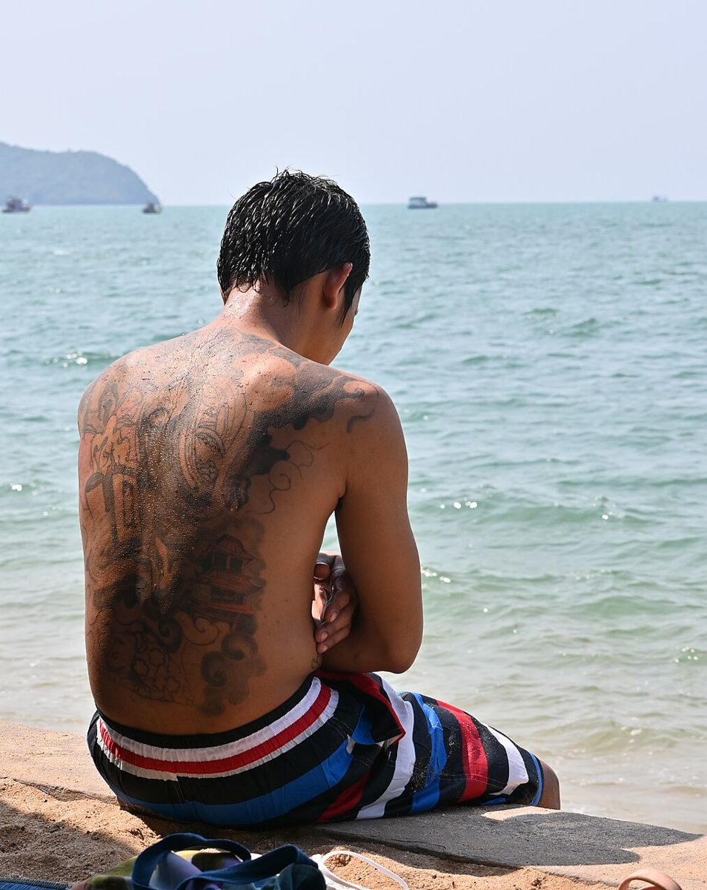
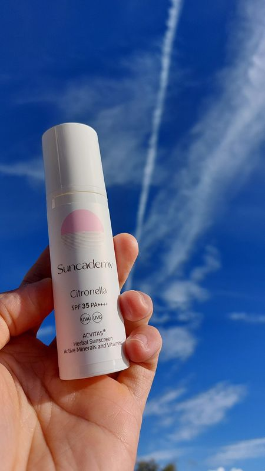
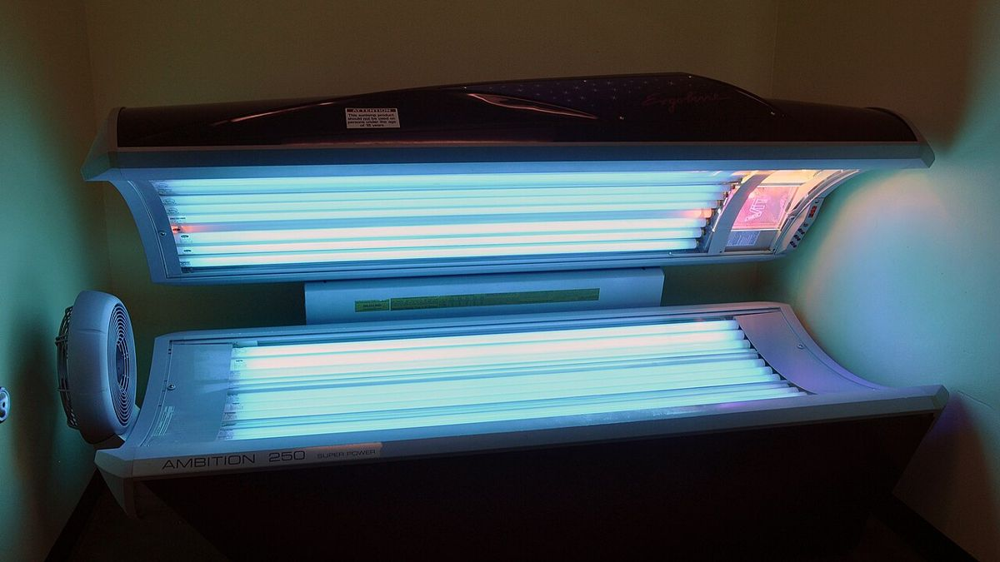

# Тату и солнце: как защитить рисунок от выцветания и ожогов

**Коротко:** пока тату заживает, её нужно беречь от прямого солнца: так советуют Mayo Clinic и Cleveland Clinic. Cleveland Clinic также не рекомендует наносить солнцезащитный крем на заживающую тату, поэтому её лучше закрывать одеждой. Когда тату зажила, American Academy of Dermatology советует защищать её широкополосным водостойким кремом SPF 30 и выше, нанесённым за 15 минут до выхода на солнце и обновляемым минимум раз в два часа. От солярия лучше отказаться совсем. У некоторых людей на тату бывает аллергия на солнце: зуд, сыпь, отёк. Если она появилась, нужен врач.

> Это не медицинский совет. Мы пересказываем рекомендации дерматологов. Если на тату появились сыпь, волдыри, сильная боль или признаки воспаления, обратитесь к врачу.

*Пляж, море и прямое солнце: ситуация, к которой нужно подготовить тату заранее. Иллюстративное фото.* Фото: Pattaya Patrol (кадрировано), [Wikimedia Commons](https://commons.wikimedia.org/wiki/File:Man_with_tattooed_back_sitting_on_the_beach.jpg), лицензия [CC BY-SA 2.0](https://creativecommons.org/licenses/by-sa/2.0).

## Что солнце делает с тату

По словам дерматологов American Academy of Dermatology, ультрафиолет может выцвечивать некоторые чернила. Cleveland Clinic добавляет, что на заживающей тату кожа чувствительнее к солнцу, а ультрафиолет способен ускорять выцветание и делать рисунок блёклым. То есть солнце вредит и самому рисунку, и коже вокруг него.

## Что делать на каждом этапе

| Этап | Что делать | Источник |
|---|---|---|
| Тату свежая, закрыта плёнкой или повязкой | Не выходить под прямое солнце, носить то, что рекомендовал мастер | Mayo Clinic, Cleveland Clinic |
| Тату заживает: корочки, шелушение | Беречь от солнца, закрывать одеждой. Cleveland Clinic советует не наносить солнцезащитный крем на заживающую тату | Mayo Clinic, Cleveland Clinic |
| Тату зажила | Использовать широкополосный водостойкий крем SPF 30 или выше: за 15 минут до выхода, повторять минимум каждые 2 часа | American Academy of Dermatology |
| Пляж, поездка, лето | Тень, закрытая одежда, крем на открытые участки кожи | American Academy of Dermatology |
| Солярий и лампы | Лучше не ходить: свет может выцветить тату, повышает риск рака кожи, а у некоторых вызывает болезненную реакцию | American Academy of Dermatology |

Сколько именно длится заживление, зависит от размера и места. Mayo Clinic пишет про примерно две недели для большинства тату, Cleveland Clinic говорит, что крупные работы заживают несколько месяцев. Поэтому срок, до которого тату нужно беречь от солнца, лучше уточнить у своего мастера.

## Как защитить зажившую тату

- **Крем.** Выбирайте крем, который указан как широкополосный, водостойкий и SPF 30 или выше. Наносите за 15 минут до выхода и обновляйте минимум каждые два часа. Крем нужен на всю открытую кожу, а не только на тату.
- **Одежда.** American Academy of Dermatology рекомендует закрывать тату одеждой, если вы находитесь на улице. Проверить ткань можно так: поднесите её к яркому свету. Если света сквозь ткань не видно, защита хорошая. Но крем на открытые участки всё равно нужен.
- **Тень.** Самый простой способ сократить солнце: переждать самые яркие часы под зонтом, навесом или деревом.
- **Увлажнение.** Если кожа сухая, нанесите крем или лосьон на водной основе. American Academy of Dermatology предупреждает, что средства на основе вазелина могут вызывать выцветание чернил.

*Крем для зажившей тату выбирают по трём признакам: широкополосный, водостойкий и SPF 30 или выше. Иллюстративное фото.* Фото: Alpantex, [Wikimedia Commons](https://commons.wikimedia.org/wiki/File:Sunscreen_Sonnencreme_in_Z%C3%BCrich_Switzerland.jpg), лицензия [CC BY-SA 4.0](https://creativecommons.org/licenses/by-sa/4.0).

## Солярий

American Academy of Dermatology советует держаться подальше от солярия и солнечных ламп. Они могут выцветить чернила и увеличивают риск рака кожи, а у некоторых людей ультрафиолет вступает в реакцию с чернилами и вызывает болезненное воспаление кожи. Для свежей тату это тем более плохая идея.

*Солярий для тату нежелателен и в заживающем, и в зажившем состоянии. Иллюстративное фото, без людей.* Фото: Ktkvtsh, [Wikimedia Commons](https://commons.wikimedia.org/wiki/File:Tanning_bed_01.jpg), лицензия [CC BY-SA 4.0](https://creativecommons.org/licenses/by-sa/4.0).

## Аллергия на солнце на тату

По данным American Academy of Dermatology, у некоторых людей после тату появляется аллергия на солнце именно на татуированной коже. Реакция может возникнуть через несколько минут или через несколько часов после солнца и повторяться каждый раз. Признаки: отёк и покраснение вокруг тату, зудящая сыпь из мелких пузырьков, волдыри или крапивница. Профилактика та же: крем, закрытая одежда, тень.

## Тату на коже с родинками

American Academy of Dermatology советует, если вы только планируете тату, выбирать участок кожи без родинок, потому что тату может затруднить раннее распознавание рака кожи. Если на тату или рядом с ней что-то меняется, покажитесь дерматологу.

## Планируете отпуск

Если сеанс совпал с поездкой на море, заранее обсудите это с мастером. Пока тату заживает, нельзя ни купаться, ни находиться под прямым солнцем, так что пляжный отпуск сразу после сеанса не лучший вариант. Подробнее про воду: [Можно ли мочить тату](/tattoo-spravochnik/mozhno-li-mochit-tatu/).

## Когда идти к врачу

- Зудящая сыпь, отёк, волдыри на тату после солнца.
- Покраснение расползается, боль нарастает, появились температура, гной или неприятный запах (признаки инфекции по Cleveland Clinic и AAD).
- Затруднение дыхания, учащённое сердцебиение, сильный отёк, головокружение вместе с реакцией на тату: сразу вызывайте скорую (American Academy of Dermatology относит это к тяжёлым реакциям).
- Тату или кожа рядом изменились: появилось уплотнение, цвет, форма.

## Частые вопросы

### Можно ли загорать с новой тату?

Нет. Mayo Clinic советует держать тату вне солнца, пока она не заживёт. Когда мастер разрешит, защищайте её кремом SPF 30 и выше.

### Можно ли мазать свежую тату солнцезащитным кремом?

Cleveland Clinic не рекомендует наносить солнцезащитный крем на заживающую тату. Вместо этого закройте её свободной одеждой и держитесь в тени. Крем наносят, когда тату зажила.

### Какой SPF нужен для тату?

American Academy of Dermatology рекомендует широкополосный водостойкий крем SPF 30 или выше. Наносите его за 15 минут до выхода и повторяйте минимум каждые два часа.

### Можно ли ходить в солярий с тату?

Лучше нет. American Academy of Dermatology предупреждает: солярий может выцветить чернила, повышает риск рака кожи, а у некоторых вызывает болезненную реакцию.

### Выцветает ли тату на солнце?

Может. Ультрафиолет способен выцвечивать часть чернил, поэтому защита от солнца после заживления нужна на постоянной основе. Если рисунок уже выцвел, обратитесь к мастеру: при необходимости можно обсудить обновление.

### Что делать, если тату обгорела?

Уберите её от солнца и не трите. Если появились волдыри, сильная боль, температура или сыпь, обратитесь к врачу. После того как кожа успокоится, расскажите мастеру, что произошло.

---

## Записаться в ТатуНаХоду

Хотите обсудить идею или спланировать сеанс перед отпуском? Напишите в Telegram.

👉 [Записаться в Telegram](https://t.me/tatunahody)

Telegram-канал ТатуНаХоду: [t.me/tattoo_na_hodu](https://t.me/tattoo_na_hodu)

## Источники изображений

- `tatu-na-spine-u-morya.jpg` - файл Man with tattooed back sitting on the beach.jpg, автор: Pattaya Patrol, источник: [Wikimedia Commons](https://commons.wikimedia.org/wiki/File:Man_with_tattooed_back_sitting_on_the_beach.jpg), лицензия: [CC BY-SA 2.0](https://creativecommons.org/licenses/by-sa/2.0). Кадрировано, размер уменьшен.
- `solyariy-lampy-vnutri.jpg` - файл Tanning bed 01.jpg, автор: Ktkvtsh, источник: [Wikimedia Commons](https://commons.wikimedia.org/wiki/File:Tanning_bed_01.jpg), лицензия: [CC BY-SA 4.0](https://creativecommons.org/licenses/by-sa/4.0). Без изменений, кроме уменьшения размера.
- `solncezashitnyy-krem-na-fone-neba.jpg` - файл Sunscreen Sonnencreme in Zürich Switzerland.jpg, автор: Alpantex, источник: [Wikimedia Commons](https://commons.wikimedia.org/wiki/File:Sunscreen_Sonnencreme_in_Z%C3%BCrich_Switzerland.jpg), лицензия: [CC BY-SA 4.0](https://creativecommons.org/licenses/by-sa/4.0). Без изменений, кроме уменьшения размера.
