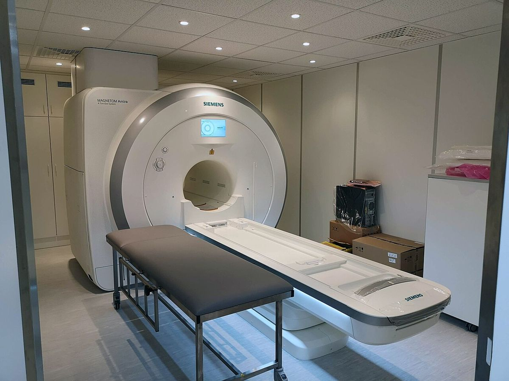
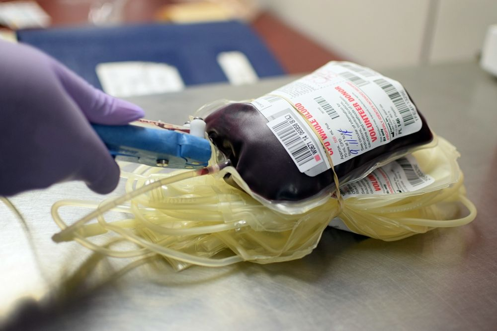
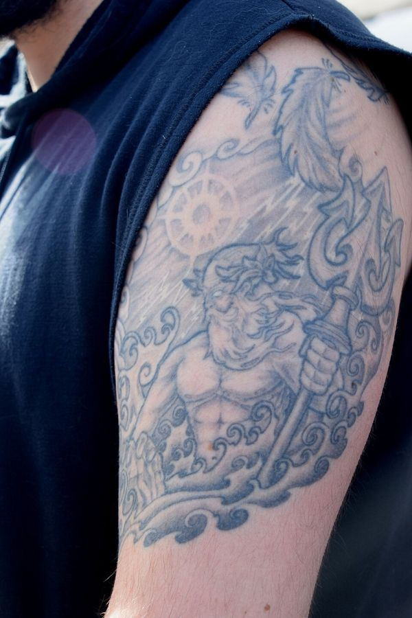

# Тату и МРТ, донорство крови: что нужно знать

**Коротко:** с тату можно делать МРТ: просто скажите технику о тату и перманентном макияже и попросите остановить исследование, если почувствуете жжение. Жжение бывает редко и обычно короткое, но предупредить нужно. Сдавать кровь как донор после тату нельзя 120 календарных дней с момента окончания процедуры: так записано в приказе Минздрава России № 1166н, и тот же срок указан в новом приказе № 215н, который заменит его с 1 января 2027 года. Если планируете сеанс и вы донор, подумайте об этом заранее.

> Это не медицинский совет. Мы пересказываем официальные источники. Любые вопросы по здоровью, МРТ и донорству решайте с врачом и в центре крови.

*Кабинет магнитно-резонансной томографии. Иллюстративное фото, без людей.* Фото: Sergei.Verzilin, [Wikimedia Commons](https://commons.wikimedia.org/wiki/File:MRI_1.5_Tesla.jpg), лицензия [CC BY-SA 4.0](https://creativecommons.org/licenses/by-sa/4.0).

## Тату и МРТ

| Вопрос | Что говорят источники |
|---|---|
| Можно ли делать МРТ с тату | Можно. American Academy of Dermatology: если у вас есть тату или перманентный макияж, вы всё равно можете пройти МРТ |
| Что может случиться | Редко возникает жжение, отёк или боль на тату во время МРТ, обычно кратковременные. Описаны единичные ожоги. Это следует из материалов FDA, Mayo Clinic и American Academy of Dermatology |
| Что делать заранее | Сказать врачу и технику, что у вас есть тату или перманентный макияж |
| Что делать во время исследования | Попросить остановить МРТ, если вы почувствовали жжение или покалывание в области тату |
| Влияет ли тату на снимок | Mayo Clinic отмечает, что тату иногда снижают качество изображения МРТ |

Источники: [FDA](https://www.fda.gov/consumers/consumer-updates/think-you-ink-tattoo-safety), [Mayo Clinic](https://www.mayoclinic.org/healthy-lifestyle/adult-health/in-depth/tattoos-and-piercings/art-20045067), [American Academy of Dermatology](https://www.aad.org/public/everyday-care/skin-care-basics/tattoos/tattoo-skin-reactions).

Такие реакции не повод отказываться от тату или от исследования, но повод помнить о предупреждении. Какие именно тату могут быть проблемой, источники не уточняют, поэтому выводов о цветах или составе пигментов мы делать не будем. Если у вас есть опасения, спросите врача, который назначил исследование.

## Тату и донорство крови

Согласно приказу Минздрава России от 28.10.2020 № 1166н, лечебные и косметические процедуры с нарушением кожного покрова, к которым относятся татуировки, пирсинг, иглоукалывание и иное, дают временный отвод от донорства на **120 календарных дней** с момента окончания процедур. Текст приказа есть на [официальном портале правовой информации](http://publication.pravo.gov.ru/Document/View/0001202011260032). С 1 января 2027 года он утрачивает силу в связи с [приказом Минздрава России от 27.03.2026 № 215н](https://www.consultant.ru/document/cons_doc_LAW_533292/): в его перечне процедуры с нарушением кожного покрова, включая татуировки, дают тот же отвод на 120 календарных дней с момента окончания процедур. Тот же срок приводят [Центр крови ФМБА](https://www.bloodfmba.ru/protivopokazanie/important) и [Центр крови Первого МГМУ имени Сеченова](https://centrkrovi.ru/perechen-protivopokazaniy-k-donorstvu/).

*Донорская кровь в мешке. Иллюстративное фото, не связано с тату.* Фото: Vegasjon, [Wikimedia Commons](https://commons.wikimedia.org/wiki/File:A_unit_of_whole_blood.JPG), лицензия [CC BY-SA 4.0](https://creativecommons.org/licenses/by-sa/4.0).

Что это значит на практике:

- Если вы регулярный донор, планируйте сеанс так, чтобы пропустить плановую сдачу крови.
- Отсчёт идёт от окончания процедуры. Если работа делается в несколько сеансов, уточните в центре крови, от какой даты считать срок.
- Перед визитом уточните условия в своём центре крови: порядок и перечень противопоказаний меняются, как видно по смене приказа в 2027 году.
- Если вы только собираетесь становиться донором, учитывайте этот срок при планировании.

## Что ещё стоит помнить

*Предупреждайте врача о любых тату: так проще планировать исследования. Иллюстративное фото.* Фото: Tony Alter, [Wikimedia Commons](https://commons.wikimedia.org/wiki/File:Arm_tattoo_of_Neptune.jpg), лицензия [CC BY 2.0](https://creativecommons.org/licenses/by/2.0).

- Всегда сообщайте врачу и технику про тату и перманентный макияж перед МРТ.
- American Academy of Dermatology советует показаться врачу, если тату или кожа вокруг неё меняются, а также если рядом с тату долго остаются увеличенными лимфоузлы.
- Если вы только планируете сеанс и точно знаете, что скоро будете делать МРТ или сдавать кровь, обсудите сроки с мастером и врачом.
- Подготовка к сеансу: [Как подготовиться к сеансу тату](/tattoo-spravochnik/kak-podgotovitsya-k-seansu-tatu/).

## Когда идти к врачу

Обратитесь к врачу, если жжение, боль или отёк на тату не проходят после исследования, если на тату появились сыпь, волдыри, уплотнения, или если вы наблюдаете признаки инфекции: нарастающую боль и покраснение, гной, температуру. Если во время МРТ появилось жжение, сразу скажите технику и остановите исследование.

## Частые вопросы

### Можно ли делать МРТ, если у меня тату?

Да. American Academy of Dermatology подчёркивает, что тату и перманентный макияж не запрещают МРТ. Нужно предупредить техника и сообщить, если почувствуете жжение или покалывание в области тату.

### Опасно ли МРТ для тату?

По данным FDA, отёк или жжение на тату во время МРТ бывают редко и не длятся долго. Mayo Clinic добавляет, что иногда тату могут снижать качество изображения. Единичные ожоги описаны. Поэтому важно предупредить техника и сразу сказать, если вы почувствовали жжение.

### Через сколько после тату можно сдавать кровь?

Через 120 календарных дней с момента окончания процедуры, по приказу Минздрава России № 1166н (с 1 января 2027 года по приказу № 215н, срок тот же). Точные условия уточняйте в центре крови.

### Относится ли это к перманентному макияжу?

В приказе перечислены татуировки, пирсинг, иглоукалывание и иное, то есть процедуры с нарушением кожного покрова. Перманентный макияж там прямо не назван, поэтому уточните в центре крови, как они оценивают вашу процедуру.

### Можно ли делать тату перед сдачей крови?

Тату не запрещены, но они дают отвод от донорства на 120 календарных дней. Если вы регулярный донор, учитывайте это в планах.

---

## Записаться в ТатуНаХоду

Планируете тату и хотите заранее учесть МРТ, донорство или другие планы? Напишите в Telegram.

👉 [Записаться в Telegram](https://t.me/tatunahody)

Telegram-канал ТатуНаХоду: [t.me/tattoo_na_hodu](https://t.me/tattoo_na_hodu)

## Источники изображений

- `kabinet-mrt-bez-lyudey.jpg` - файл MRI 1.5 Tesla.jpg, автор: Sergei.Verzilin, источник: [Wikimedia Commons](https://commons.wikimedia.org/wiki/File:MRI_1.5_Tesla.jpg), лицензия: [CC BY-SA 4.0](https://creativecommons.org/licenses/by-sa/4.0). Без изменений, кроме уменьшения размера.
- `doza-krovi-v-meshke.jpg` - файл A unit of whole blood.JPG, автор: Vegasjon, источник: [Wikimedia Commons](https://commons.wikimedia.org/wiki/File:A_unit_of_whole_blood.JPG), лицензия: [CC BY-SA 4.0](https://creativecommons.org/licenses/by-sa/4.0). Без изменений, кроме уменьшения размера.
- `tatu-na-pleche.jpg` - файл Arm tattoo of Neptune.jpg, автор: Tony Alter, источник: [Wikimedia Commons](https://commons.wikimedia.org/wiki/File:Arm_tattoo_of_Neptune.jpg), лицензия: [CC BY 2.0](https://creativecommons.org/licenses/by/2.0). Без изменений, кроме уменьшения размера.
