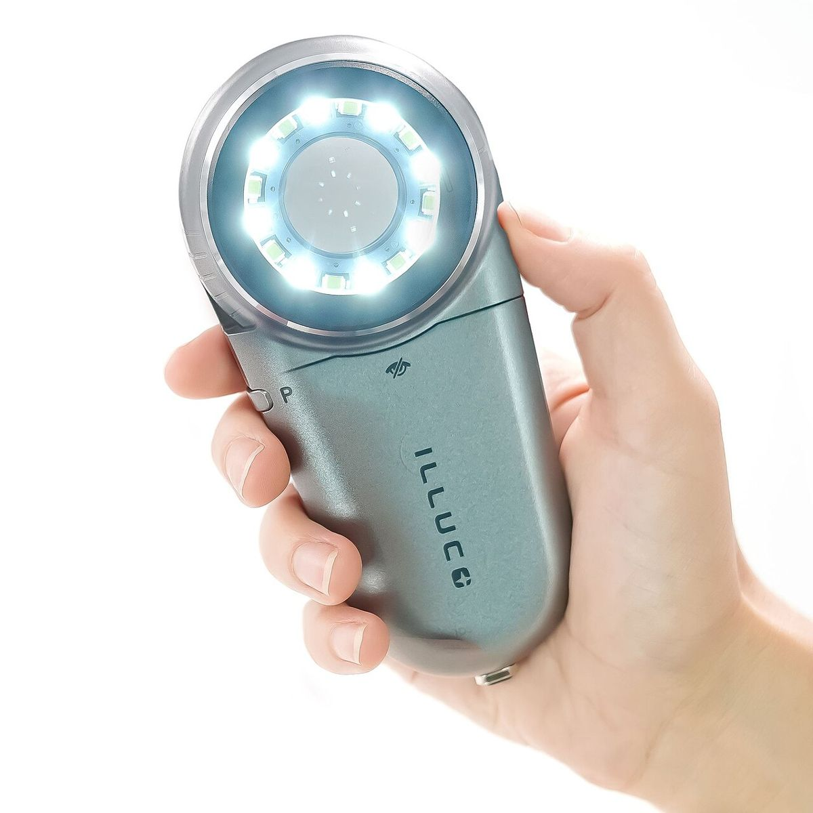
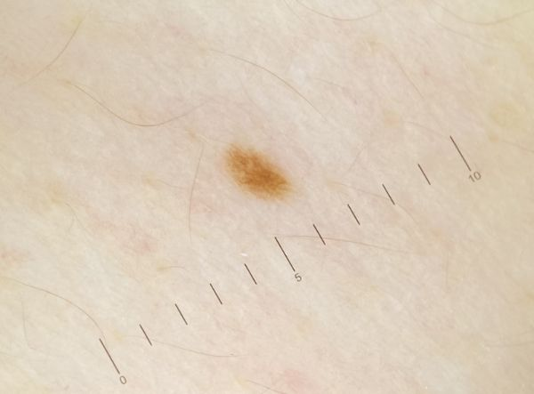
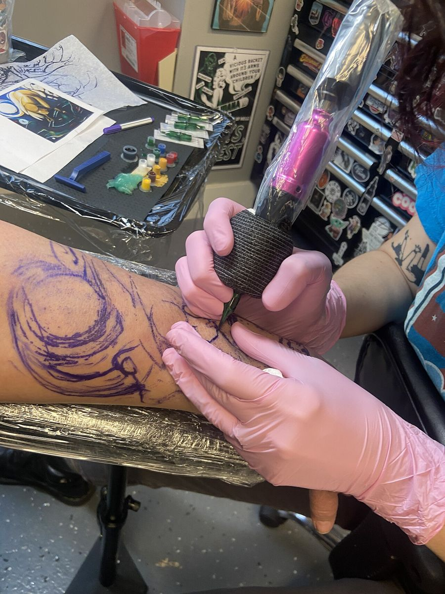

# Можно ли делать тату на родинке и рядом с ней

**Коротко:** дерматологи советуют не делать тату прямо на родинке и выбирать участки кожи без родинок. Главная причина не в самой краске, а в том, что чернила меняют вид родинки, скрывают её границы и цвет и затрудняют раннее обнаружение меланомы. Мастер может обойти родинку при переносе эскиза, но если родинок много, они крупные, неровные или меняются, сначала нужен осмотр дерматолога. Решение про конкретную родинку принимает врач, а не мастер.

> Это не медицинский совет. Мы пересказываем рекомендации дерматологических организаций и не оцениваем конкретные родинки. Если родинка изменилась, зудит или кровоточит, идите к дерматологу.

*Дерматоскоп, прибор для осмотра родинок. Иллюстративное фото медицинского прибора, без тату.* Фото: Abessemans94, [Wikimedia Commons](https://commons.wikimedia.org/wiki/File:IDS-1100C_Dermatoscope_in_hand_with_light_on.jpg), лицензия [CC BY-SA 4.0](https://creativecommons.org/licenses/by-sa/4.0).

## Что советуют дерматологи

Американская академия дерматологии (AAD) в [рекомендациях по уходу за татуированной кожей](https://www.aad.org/public/everyday-care/skin-care-basics/tattoos/caring-for-tattooed-skin) пишет, что при выборе места для нового тату стоит рассмотреть кожу без родинок: татуировка может затруднить заметить самые ранние признаки рака кожи. При раннем выявлении рак кожи, включая меланому, хорошо поддаётся лечению.

В [отдельной статье о раке кожи](https://www.aad.org/public/diseases/skin-cancer/do-tattoos-cause-skin-cancer) AAD объясняет: пока недостаточно данных, чтобы утверждать, что тату повышает риск рака кожи. Основной риск в другом: татуировка может замаскировать рак кожи и затруднить его обнаружение. Чернила меняют вид родинок и пятен: граница и цвет, два признака из правила ABCDE, после тату могут измениться. Кроме того, краска затрудняет патологу распознавание клеток рака в биопсии. Это может задержать диагностику.

Европейская академия дерматологии и венерологии (EADV) выпустила [памятку для пациентов о тату и родинках](https://eadv.org/wp-content/uploads/2024/05/EADV-TATTOO-Tatoos-and-moles.pdf). В ней сказано: тату поверх родинки усложняет отслеживание изменений, при множественных родинках нужно консультироваться с дерматологом и по возможности избегать тату на самих родинках. В памятке есть и практический совет: делайте регулярные фото родинок, чтобы облегчить контроль.

В материале онкологического центра Memorial Sloan Kettering [врач-дерматолог говорит](https://www.mskcc.org/news/can-tattoos-hide-skin-cancer-advice-msk-how-stay-safe), что советует пациентам не делать тату поверх родинок, потому что так труднее заметить изменения.

## Мнения расходятся в одном: опасна ли сама травма родинки

Управление Роспотребнадзора по Псковской области в [памятке о рисках тату](https://60.rospotrebnadzor.ru/content/%D1%87%D0%B5%D0%BC-%D0%BC%D0%BE%D0%B3%D1%83%D1%82-%D0%B1%D1%8B%D1%82%D1%8C-%D0%BE%D0%BF%D0%B0%D1%81%D0%BD%D1%8B-%D1%82%D0%B0%D1%82%D1%83%D0%B8%D1%80%D0%BE%D0%B2%D0%BA%D0%B8-%D1%80%D0%B0%D1%81%D1%81%D0%BA%D0%B0%D0%B7%D0%B0%D0%BB-%D1%80%D0%BE%D1%81%D0%BF%D0%BE%D1%82%D1%80%D0%B5%D0%B1%D0%BD%D0%B0%D0%B4%D0%B7%D0%BE%D1%80) указывает, что травмирование родинок опасно ростом и перерождением невуса. EADV формулирует осторожнее: травма родинки при тату не приводит к меланоме, но может вызвать раздражение или воспаление, а если из-за изменений родинку придётся удалять, на татуированной коже останется рубец.

Общий вывод у всех один: не бить иглой по родинке. Спорят о механизме, а не о совете.

## Таблица: что делать в разных ситуациях

| Ситуация | Что советуют источники | Что делать |
|---|---|---|
| Одна небольшая родинка рядом с будущим рисунком | AAD: сказать мастеру обойти родинки, веснушки и пятна | Мастер обходит родинку при переносе эскиза, оставляет вокруг запас |
| Родинка внутри рисунка | AAD и EADV: избегать тату на родинках | Изменить эскиз или перенести место |
| Много родинок или атипичные родинки | AAD: показаться дерматологу до тату; EADV: консультация дерматолога | Осмотр до сеанса, фото родинок для контроля |
| Были меланома или рак кожи у вас или близких | AAD: группа повышенного риска, особенно важен осмотр | Лучше сначала проконсультироваться с дерматологом |
| Родинка уже под старой тату | AAD: чаще проверять кожу самому; красные, синие и чёрные краски лучше всего маскируют подозрительные пятна | Показать дерматологу, делать самоосмотр |
| Родинка изменилась, кровоточит, зудит | AAD: к дерматологу | Не ждать, идти к врачу |

## ABCDE: на что смотреть в родинках

AAD использует правило ABCDE для самоосмотра. Подробнее на странице [ABCDE меланомы](https://www.aad.org/public/diseases/skin-cancer/find/at-risk/abcdes):

- A - асимметрия: половинки родинки не похожи;
- B - границы: края неровные, размытые;
- C - цвет: разные оттенки в одной родинке;
- D - диаметр: родинка заметно крупная;
- E - эволюция: родинка меняется со временем.

Эти признаки не ставят диагноз. Они повод показаться врачу. Если у вас есть тату, осматривайте кожу под ней так же внимательно, как и остальную.

*Дерматоскопическое изображение небольшой доброкачественной родинки с линейкой. Иллюстративное фото, не диагностический образец.* Фото: Philipp Tschandl, [Wikimedia Commons](https://commons.wikimedia.org/wiki/File:Dermatoscopy_Nevus_Reticular.jpg), лицензия [CC BY-SA 4.0](https://creativecommons.org/licenses/by-sa/4.0).

## Как правильно действовать, если родинки в зоне тату

1. До записи осмотрите кожу на месте будущей работы. Сфотографируйте родинки при хорошем освещении.
2. Если родинок много или они вызывают сомнения, запишитесь к дерматологу. AAD советует осмотр до тату, особенно при множественных атипичных родинках, случаях рака кожи в семье и ослабленном иммунитете.
3. Покажите фото зоны мастеру до эскиза. Попросите обойти родинки и оставить вокруг каждой чистую кожу.
4. Следите за родинками после заживления. EADV советует регулярно фотографировать родинки, чтобы проще замечать изменения. Как часто это делать, подскажет врач.
5. Если мастер настаивает на тату поверх родинки или говорит, что это не проблема, подумайте о другом мастере. Как выбирать мастера, мы разбирали в статье [Как выбрать тату-мастера](/tattoo-spravochnik/kak-vybrat-tatu-mastera/).

## Лазерное удаление тату рядом с родинкой

AAD советует удалять тату только у дерматологов: врач может проверить родинки и пятна, которые лазер делает заметнее. Если пятно нужно биопсировать, следующие сеансы удаления, возможно, придётся отложить. Подробнее: [Лазерное удаление тату](/tattoo-spravochnik/lazernoe-udalenie-tatu/).

*Мастер работает на подготовленной зоне кожи с перенесённым контуром. Иллюстративное фото процесса, не связано с родинками.* Фото: Myotus (работа тату-мастера Jenna Haas), [Wikimedia Commons](https://commons.wikimedia.org/wiki/File:14-stretching_the_skin_to_create_stable_surface_area.jpg), лицензия [CC BY-SA 4.0](https://creativecommons.org/licenses/by-sa/4.0).

## Когда идти к врачу

Идите к дерматологу, если родинка изменила размер, форму или цвет, начала зудеть, шелушиться, кровоточить или болеть, если появилось новое пятно на татуированной коже или если вы собираетесь делать тату и у вас много родинок. Не ждите годового осмотра. После самого сеанса действуют общие правила: при температуре, гное и растущем покраснении см. [Тату воспалилась: что делать](/tattoo-spravochnik/tatu-vospalilas-chto-delat/).

## Частые вопросы

### Можно ли делать тату на родинке?

Дерматологи советуют не делать. AAD рекомендует выбирать кожу без родинок, потому что тату мешает заметить ранние признаки рака кожи. Если родинка внутри эскиза, лучше изменить рисунок или место.

### Можно ли делать тату рядом с родинкой?

Обычно можно, если мастер обходит родинку и оставляет вокруг неё чистую кожу. AAD советует сказать мастеру работать вокруг родинок, веснушек и пятен. Если родинок много, сначала покажитесь дерматологу.

### Может ли тату вызвать меланому?

AAD пишет, что данных о связи тату и рака кожи пока недостаточно. Главный риск в том, что тату может скрыть признаки рака кожи и задержать диагностику. По данным EADV, сама травма родинки иглой не приводит к меланоме, но может вызвать раздражение.

### Что делать, если родинка уже под тату?

Осматривайте её регулярно, фотографируйте и показывайте дерматологу при полном осмотре кожи. AAD напоминает, что красные, синие и чёрные краски лучше всего маскируют подозрительные пятна. Обязательно скажите врачу, как давно сделана тату и какие цвета использованы.

### Нужно ли показываться дерматологу перед первой тату?

Не обязательно всем, но AAD советует осмотр особенно тем, у кого много атипичных родинок, рак кожи у вас или родственников, ослабленный иммунитет. Если сомневаетесь, лучше сходить: это не займёт много времени.

### Что делать, если мастер говорит, что можно набивать прямо на родинке?

Сослаться на рекомендации дерматологов и попросить обойти родинку. Если мастер отказывается, подумайте о другом мастере. Решение про родинку принимает врач, а не мастер.

---

## Записаться в ТатуНаХоду

Если в зоне будущей тату есть родинки, пришлите фото в Telegram. Мастер сможет подобрать расположение эскиза, чтобы обойти родинки.

👉 [Записаться в Telegram](https://t.me/tatunahody)

Telegram-канал ТатуНаХоду: [t.me/tattoo_na_hodu](https://t.me/tattoo_na_hodu)

## Источники изображений

- `dermatoskop-v-ruke.jpg` - файл IDS-1100C Dermatoscope in hand with light on.jpg, автор: Abessemans94, источник: [Wikimedia Commons](https://commons.wikimedia.org/wiki/File:IDS-1100C_Dermatoscope_in_hand_with_light_on.jpg), лицензия: [CC BY-SA 4.0](https://creativecommons.org/licenses/by-sa/4.0). Без изменений, кроме уменьшения размера.
- `nevus-v-dermatoskop-s-lineykoy.jpg` - файл Dermatoscopy Nevus Reticular.jpg, автор: Philipp Tschandl, источник: [Wikimedia Commons](https://commons.wikimedia.org/wiki/File:Dermatoscopy_Nevus_Reticular.jpg), лицензия: [CC BY-SA 4.0](https://creativecommons.org/licenses/by-sa/4.0). Без изменений.
- `master-rastyagivaet-kozhu.jpg` - файл 14-stretching the skin to create stable surface area.jpg, автор: Myotus (работа тату-мастера Jenna Haas), источник: [Wikimedia Commons](https://commons.wikimedia.org/wiki/File:14-stretching_the_skin_to_create_stable_surface_area.jpg), лицензия: [CC BY-SA 4.0](https://creativecommons.org/licenses/by-sa/4.0). Без изменений, кроме уменьшения размера.

## Источники фактов

- [AAD: Caring for tattooed skin](https://www.aad.org/public/everyday-care/skin-care-basics/tattoos/caring-for-tattooed-skin)
- [AAD: Do tattoos cause skin cancer?](https://www.aad.org/public/diseases/skin-cancer/do-tattoos-cause-skin-cancer)
- [AAD: ABCDEs of melanoma](https://www.aad.org/public/diseases/skin-cancer/find/at-risk/abcdes)
- [EADV: Tattoos and moles, information leaflet for patients](https://eadv.org/wp-content/uploads/2024/05/EADV-TATTOO-Tatoos-and-moles.pdf)
- [Memorial Sloan Kettering: Can tattoos hide skin cancer?](https://www.mskcc.org/news/can-tattoos-hide-skin-cancer-advice-msk-how-stay-safe)
- [Роспотребнадзор, управление по Псковской области: чем могут быть опасны татуировки](https://60.rospotrebnadzor.ru/content/%D1%87%D0%B5%D0%BC-%D0%BC%D0%BE%D0%B3%D1%83%D1%82-%D0%B1%D1%8B%D1%82%D1%8C-%D0%BE%D0%BF%D0%B0%D1%81%D0%BD%D1%8B-%D1%82%D0%B0%D1%82%D1%83%D0%B8%D1%80%D0%BE%D0%B2%D0%BA%D0%B8-%D1%80%D0%B0%D1%81%D1%81%D0%BA%D0%B0%D0%B7%D0%B0%D0%BB-%D1%80%D0%BE%D1%81%D0%BF%D0%BE%D1%82%D1%80%D0%B5%D0%B1%D0%BD%D0%B0%D0%B4%D0%B7%D0%BE%D1%80)
