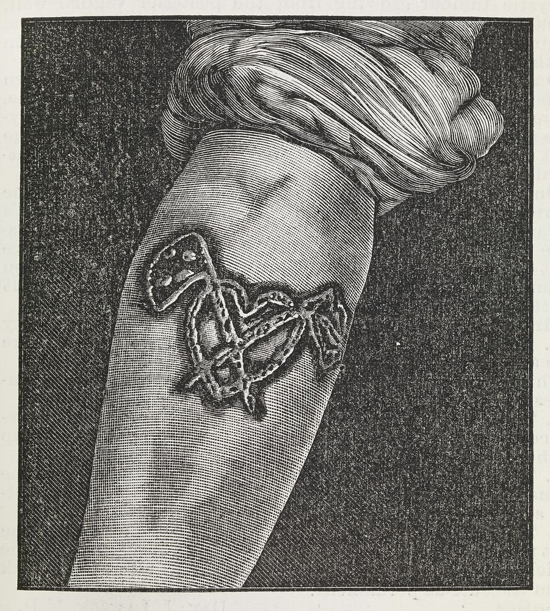
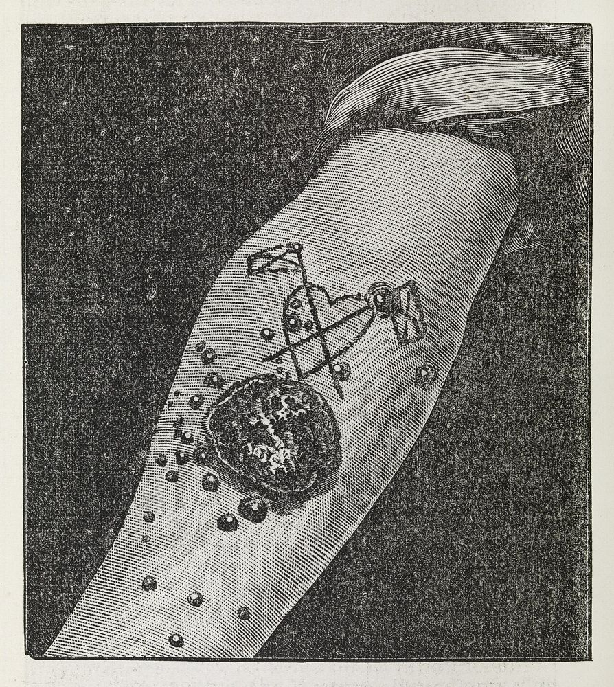
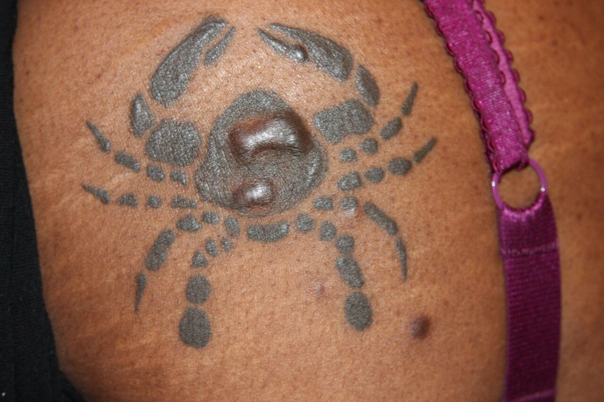
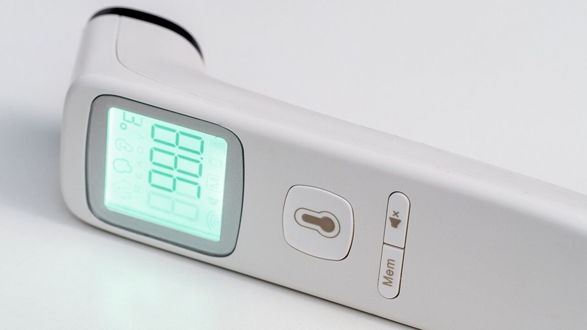

# Тату воспалилась: что делать и когда нужно к врачу

**Коротко:** покраснение, чувствительность, шелушение, корочки и немного мутной жидкости в первые дни - обычная часть заживления. Повод насторожиться: краснота темнеет или расползается за пределы рисунка, боль не стихает, а нарастает, кожа горячая на ощупь, появились гной, запах, красные полосы от тату или температура с ознобом. В этом случае не лечите себя сами и не ждите, что пройдёт: покажитесь врачу, лучше дерматологу, в ближайшие часы или в тот же день. Затруднённое дыхание, сильный отёк, крапивница по телу, сердцебиение или головокружение - повод вызвать скорую. Инфекция бывает даже тогда, когда мастер соблюдает гигиену, а проявиться может и через месяцы после сеанса.

> Это не медицинский совет. Мы пересказываем общие рекомендации медицинских организаций и не ставим диагнозы по описанию или фото. Если вас что-то беспокоит, особенно при температуре, быстро растущей красноте, аллергии или кожных заболеваниях, обратитесь к врачу.

*Воспаление по контуру рисунка на гравюре из старой медицинской статьи. Современная картина может выглядеть иначе, а диагноз по рисунку или фото не ставят - это делает врач.* Фото: Wellcome Collection, [Wikimedia Commons](https://commons.wikimedia.org/wiki/File:Skin_inflamation_on_the_site_of_a_tattoo_Wellcome_L0067876.jpg), лицензия [CC BY 4.0](https://creativecommons.org/licenses/by/4.0).

## Что считается нормой, а что воспалением

Татуировка - это множество мелких проколов кожи, то есть заживающая рана, поэтому какие-то признаки воспаления в первые дни есть всегда. Важно, в какую сторону идёт динамика: должно становиться лучше, а не хуже. Большинство тату заживает примерно за две недели, по данным Mayo Clinic, но крупные работы и глубокие слои кожи восстанавливаются дольше.

| Признак | Похоже на обычное заживление | Повод показаться врачу |
|---|---|---|
| Краснота | Держится в пределах рисунка и постепенно бледнеет | Темнеет, расползается за пределы рисунка, от тату тянутся красные полосы к центру тела |
| Боль | Чувствительность, как после ссадины, со временем слабеет | Не стихает или усиливается |
| Выделения | Немного сукровицы и краски в первые дни, затем подсыхание | Гной, неприятный запах, заметное отделяемое |
| Кожа на ощупь | Чувствительная, без выраженного жара | Горячая на ощупь |
| Общее самочувствие | Без изменений | Температура, озноб, потливость |
| Поверхность | Сухость, шелушение, тонкие корочки | Бугорки, гнойнички, плотные узелки, открытые язвочки |

*Гнойнички вокруг рисунка на другой гравюре из той же старой статьи. Такой вид - повод идти к врачу, а не лечиться самому.* Фото: Wellcome Collection, [Wikimedia Commons](https://commons.wikimedia.org/wiki/File:Pustules_on_the_site_of_a_tattoo_Wellcome_L0067877.jpg), лицензия [CC BY 4.0](https://creativecommons.org/licenses/by/4.0).

Сроки индивидуальны, поэтому таблица - ориентир, а не диагностика. Как меняется кожа по дням, разобрано в статье [Шелушение тату по дням](/tattoo-spravochnik/sheluschenie-tatu-po-dnyam/).

## Три частые причины воспаления

Похожие на вид жалобы могут иметь разные причины, и по картинке их не различить. Это одна из причин, почему при тревожных признаках нужен осмотр врача, а не советы из интернета.

| Причина | Как может проявляться | Что известно из источников |
|---|---|---|
| Инфекция | Краснота, отёк, боль, гнойнички, узелки, гной, иногда температура и озноб | Cleveland Clinic: может появиться вскоре после сеанса или через месяцы; бывает при загрязнённой краске, нестерильной воде или инструментах, а также при попадании микробов на заживающую кожу. FDA: заражения описаны даже при запечатанной краске и соблюдении гигиены мастером |
| Аллергия на краску | Зуд, отёк, бугорки, шелушение, нередко только в одном цвете | AAD: реакция может начаться сразу, через недели, годы и даже десятилетия; чаще всего виноват красный пигмент |
| Другие реакции кожи | Плотные узелки вокруг пигмента, рубец, который растёт за пределы тату | FDA: гранулёмы (узелки вокруг частиц, которые организм воспринимает как чужеродные) и келоиды (разрастающиеся рубцы) |

*Келоид на месте тату - не инфекция, а разросшийся рубец. Он тоже требует осмотра врача. Иллюстративное фото.* Фото: Htirgan, [Wikimedia Commons](https://commons.wikimedia.org/wiki/File:Tattoo_keloid.JPG), лицензия [CC BY-SA 3.0](https://creativecommons.org/licenses/by-sa/3.0).

## Что делать, если подозреваете воспаление

Пока вы не попали к врачу, важно не навредить коже и собрать информацию, которая ему пригодится.

1. **Не трогайте и не сдирайте корочки.** Расчёсывание и сдирание открывают рану и могут занести микробы. Если чешется, смотрите статью [Тату чешется: что делать](/tattoo-spravochnik/tatu-cheshetsya-chto-delat/).
2. **Мойте руки перед любым контактом с тату.** Промывайте кожу тёплой водой и мягким мылом без отдушек, промокайте чистым одноразовым полотенцем.
3. **Не используйте вазелин и не отшелушивайте кожу.** Cleveland Clinic советует избегать и того и другого при уходе за тату.
4. **Не купайтесь и не погружайте тату в воду** (ванна, бассейн, водоём), пока она не заживёт или пока врач не разрешит.
5. **Измерьте температуру.** Повышенная температура и озноб при воспалении тату - признак, при котором нужно идти к врачу без промедления.
6. **Сфотографируйте тату при хорошем свете** и сделайте это ещё раз через несколько часов. Динамика поможет врачу оценить, расползается ли краснота.
7. **Не назначайте себе антибиотики и мази с лекарствами.** Решает врач: подходящий препарат зависит от причины, а самолечение может смазать картину.

*Повышенная температура вместе с воспалением тату - тревожный признак. Иллюстративное фото.* Фото: ajay_suresh, [Wikimedia Commons](https://commons.wikimedia.org/wiki/File:Digital_Thermometer_%2851825721879%29.jpg), лицензия [CC BY 2.0](https://creativecommons.org/licenses/by/2.0).

## Когда идти к врачу

**Вызывайте скорую помощь или обращайтесь за неотложной помощью, если:**

- затруднено дыхание или стеснение в груди, быстро бьётся сердце, кружится голова;
- появились сильный отёк, крапивница, покраснение лица и шеи, боли в животе;
- сильная боль.

Так AAD описывает признаки серьёзной реакции, при которой нельзя ждать, и просит в таких случаях сразу обращаться за медицинской помощью. Cleveland Clinic отдельно предупреждает: тяжёлая инфекция тату может привести к осложнениям вплоть до заражения крови.

**Обратитесь к врачу сразу, в тот же день, если:**

- краснота темнеет или расползается, от тату идут красные полосы;
- боль нарастает, кожа горячая;
- есть гной, неприятный запах, открытые язвочки;
- поднялась температура или появился озноб;
- на тату или рядом появились болезненные красные бугорки или гнойнички.

**Запишитесь к дерматологу, если:**

- лёгкая или умеренная реакция (зуд, покраснение, шелушение, бугорки) держится дольше одной-двух недель - такой срок называет AAD;
- реакция идёт только в одном цвете или по линиям рисунка;
- спустя месяцы или годы старая тату стала выпуклой, зудит или меняется.

## Что сказать врачу и мастеру

Врачу пригодится: когда сделана тату, какого она размера и в какой зоне, что и когда менялось, были ли температура и озноб, чем вы обрабатывали кожу и какие лекарства принимаете.

Мастеру тоже стоит написать. Cleveland Clinic рекомендует сообщить о проблеме в студию, а FDA советует узнать у мастера марку, цвет и номер партии краски: эта информация нужна врачу и поможет предупредить других клиентов, если проблема в краске. FDA просит сообщать о нежелательных реакциях на тату, но это американская система; как обращаться с таким случаем в вашей стране, уточните у врача.

## Как лечат

Лечение зависит от причины и тяжести. Cleveland Clinic описывает такую картину: при бактериальной инфекции обычно назначают антибиотики, курс может занимать недели, при тяжёлых случаях лекарства вводят внутривенно, иногда нужна операция. Лёгкие и умеренные инфекции обычно проходят полностью, но восстановление может растянуться на месяцы. FDA отмечает, что заражения от загрязнённой краски могут потребовать длительного лечения антибиотиками. При аллергии и других реакциях врач выбирает свой подход. Ставить новые рисунки и делать коррекцию на воспалённой коже нельзя, пока врач не оценит ситуацию.

## Как снизить риск

- Выбирайте мастера, который работает одноразовыми иглами и открывает новую краску и расходники при вас, и не стесняйтесь спрашивать про стерилизацию. Подсказки - в статье [Как выбрать тату-мастера](/tattoo-spravochnik/kak-vybrat-tatu-mastera/).
- Подготовьтесь к сеансу: не приходите с воспалённой, обгоревшей или повреждённой кожей. Подробнее: [Как подготовиться к сеансу тату](/tattoo-spravochnik/kak-podgotovitsya-k-seansu-tatu/).
- Соблюдайте рекомендации мастера по уходу и не мочите свежую тату сверх разрешённого, см. [Можно ли мочить тату](/tattoo-spravochnik/mozhno-li-mochit-tatu/).
- Следите за тату и после заживления: реакции на краску иногда появляются спустя годы.

## Частые вопросы

### Нормально ли, что тату красная и болит в первые дни?

Да, умеренная краснота, чувствительность, лёгкий отёк и немного сукровицы с краской - обычная часть заживления. Тревожно, если со временем становится хуже: краснота расползается, боль растёт, кожа горячая, появляются гной или температура.

### Может ли тату воспалиться через месяц или через год?

Да. Cleveland Clinic пишет, что инфекция может проявиться вскоре после сеанса или спустя месяцы, а AAD отмечает, что аллергия на краску может появиться через годы и даже десятилетия. Новый зуд, отёк или бугорки на старой тату покажите дерматологу.

### Как отличить инфекцию от аллергии?

Надёжно это может сделать только врач. Для инфекции характерны гной, горячая кожа, нарастающая боль, температура и озноб. Аллергия часто проявляется зудом, отёком и шелушением в одном цвете. Но признаки пересекаются, поэтому не гадайте, а покажитесь врачу.

### Можно ли мазать воспалённую тату антибактериальной мазью или спиртом?

Не стоит делать это самостоятельно. Подходящее лечение зависит от причины, и самолечение может смазать картину или раздражить кожу. Cleveland Clinic рекомендует избегать вазелина. Любые средства для воспалённой тату согласуйте с врачом.

### Нужно ли сообщать мастеру о воспалении?

Да. Cleveland Clinic рекомендует сообщить о проблеме в студию, а FDA советует узнать марку, цвет и номер партии краски. Эти сведения нужны врачу, а мастеру они помогают проверить, затронуты ли другие клиенты.

### Можно ли делать коррекцию или новый сеанс на воспалённой тату?

Нет. Новый сеанс повторно травмирует кожу. Сначала нужно разобраться с причиной воспаления с врачом и дождаться полного заживления. Вернуться к вопросу о коррекции можно, когда врач подтвердит, что кожа здорова.

---

## Записаться в ТатуНаХоду

Если вы планируете новую работу и хотите заранее обсудить подготовку, уход и вопросы безопасности, напишите нам в Telegram. При признаках воспаления сначала обратитесь к врачу, а запись на сеанс оставьте на потом.

👉 [Записаться в Telegram](https://t.me/tatunahody)

Работы мастеров и новости студии - в нашем Telegram-канале: [t.me/tattoo_na_hodu](https://t.me/tattoo_na_hodu)

## Источники изображений

- `vospalenie-gravyura.jpg` - Skin inflamation on the site of a tattoo Wellcome L0067876.jpg, автор: Wellcome Collection (иллюстрация к статье о заражении через тату), источник: [Wikimedia Commons](https://commons.wikimedia.org/wiki/File:Skin_inflamation_on_the_site_of_a_tattoo_Wellcome_L0067876.jpg), лицензия: [CC BY 4.0](https://creativecommons.org/licenses/by/4.0). Без изменений, кроме уменьшения размера.
- `pustuly-gravyura.jpg` - Pustules on the site of a tattoo Wellcome L0067877.jpg, автор: Wellcome Collection, источник: [Wikimedia Commons](https://commons.wikimedia.org/wiki/File:Pustules_on_the_site_of_a_tattoo_Wellcome_L0067877.jpg), лицензия: [CC BY 4.0](https://creativecommons.org/licenses/by/4.0). Без изменений, кроме уменьшения размера.
- `keloid-na-tatu.jpg` - Tattoo keloid.JPG, автор: Htirgan, источник: [Wikimedia Commons](https://commons.wikimedia.org/wiki/File:Tattoo_keloid.JPG), лицензия: [CC BY-SA 3.0](https://creativecommons.org/licenses/by-sa/3.0). Без изменений, кроме уменьшения размера.
- `termometr.jpg` - Digital Thermometer (51825721879).jpg, автор: ajay_suresh, источник: [Wikimedia Commons](https://commons.wikimedia.org/wiki/File:Digital_Thermometer_%2851825721879%29.jpg), лицензия: [CC BY 2.0](https://creativecommons.org/licenses/by/2.0). Без изменений, кроме уменьшения размера.

## Источники фактов

- Cleveland Clinic: [Tattoo Infection](https://my.clevelandclinic.org/health/diseases/23295-tattoo-infection); [Tattoo Aftercare: Instructions and Healing Tips](https://health.clevelandclinic.org/tattoo-aftercare).
- Американская академия дерматологии (AAD): [Tattoos: 7 unexpected skin reactions](https://www.aad.org/public/everyday-care/skin-care-basics/tattoos/tattoo-skin-reactions); [Caring for tattooed skin](https://www.aad.org/public/everyday-care/skin-care-basics/tattoos/caring-for-tattooed-skin).
- FDA: [Think Before You Ink: Tattoo Safety](https://www.fda.gov/consumers/consumer-updates/think-you-ink-tattoo-safety); [Tattoos and Permanent Makeup: Fact Sheet](https://www.fda.gov/cosmetics/cosmetic-products/tattoos-permanent-makeup-fact-sheet).
- Mayo Clinic: [Tattoos and piercings: What to know before you get inked or pierced](https://www.mayoclinic.org/healthy-lifestyle/adult-health/in-depth/tattoos-and-piercings/art-20045067).
