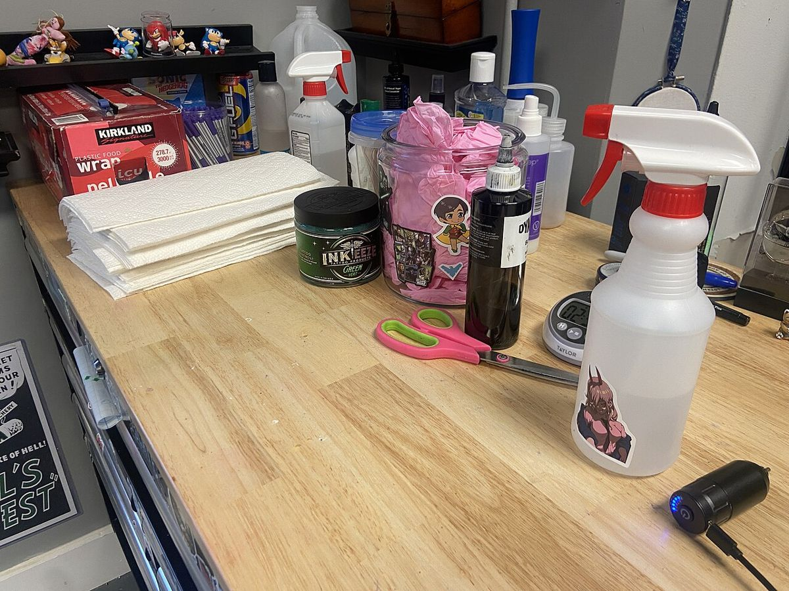
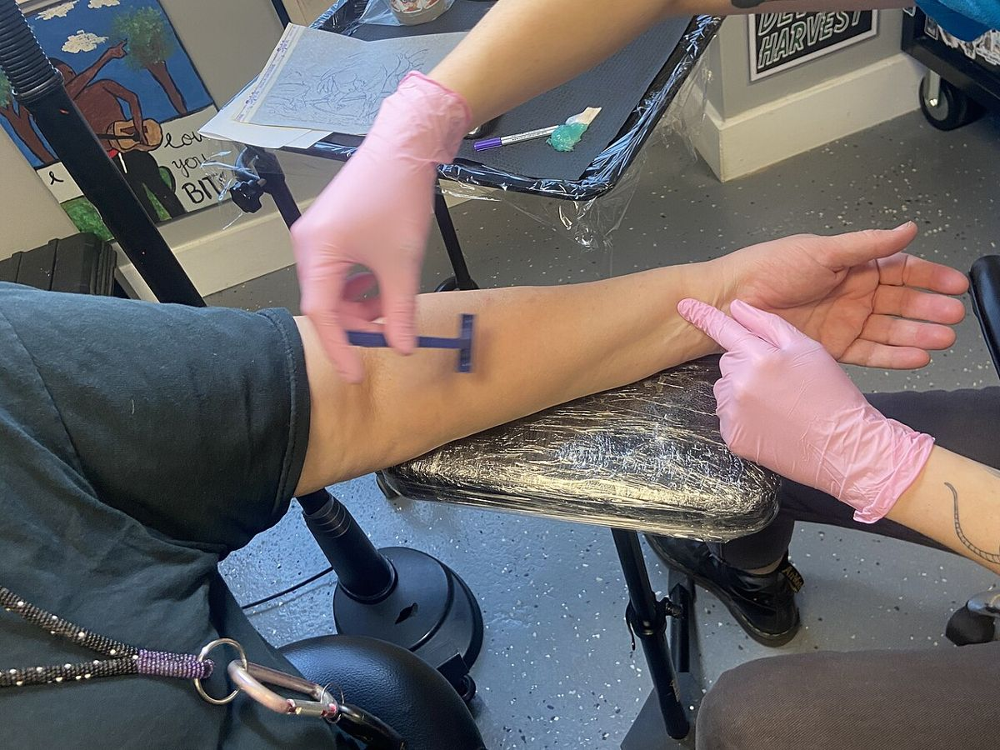
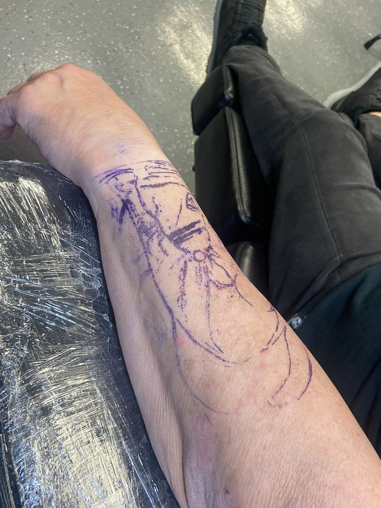
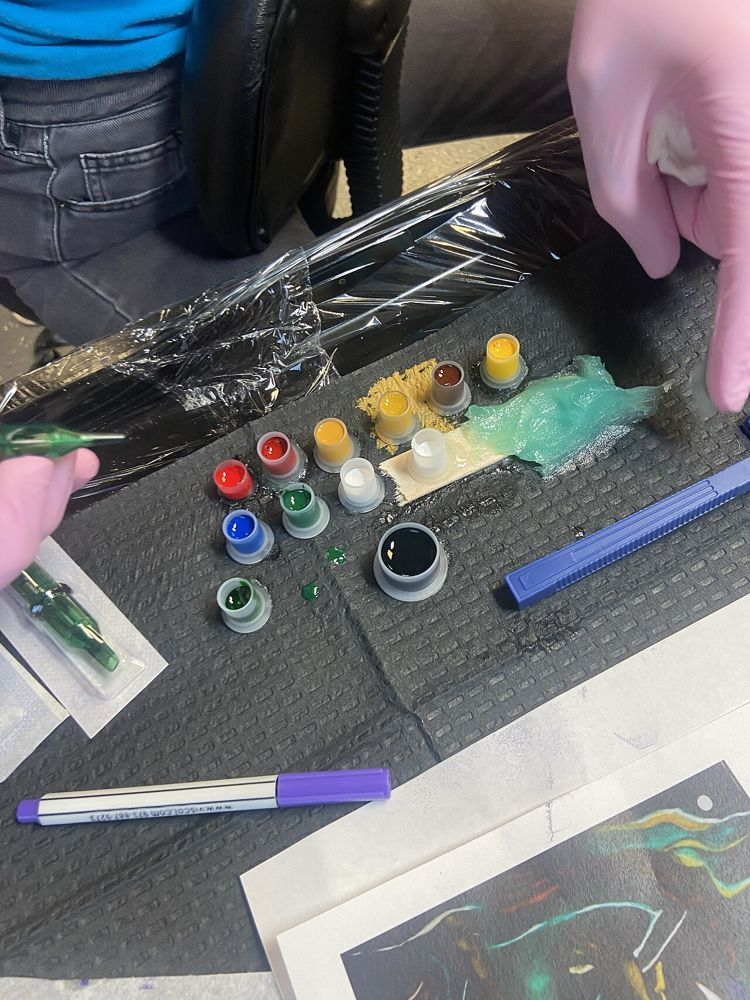

# Выездной тату-мастер в Москве и области: как проходит сеанс и что подготовить

**Коротко:** выездной тату-мастер приезжает по вашему адресу со всем оборудованием и делает сеанс у вас дома, в офисе или в коворкинге. Это удобно, если не хочется ехать, нужна приватность или сеанс будет долгим. Безопасность при этом во многом зависит от того, как организована работа: новые одноразовые иглы, свежие перчатки, поверхности под плёнкой, чистое место и понятный исполнитель. Роспотребнадзор рекомендует не обращаться к мастерам, которые работают на дому в условиях, не отвечающих санитарным нормам, поэтому при выезде проверок нужно больше, а не меньше. Ниже: как проходит выездной сеанс, что подготовить дома, что проверить и когда лучше выбрать студию.

> Это не медицинский совет. Мы описываем общие принципы и ссылаемся на официальные источники. При признаках воспаления или аллергии после сеанса обратитесь к врачу.

*Расходники мастера: бумажные полотенца, пищевая плёнка, одноразовые перчатки, антисептики и краска. Иллюстративное фото рабочего места, без привязки к студии.* Фото: Myotus, [Wikimedia Commons](https://commons.wikimedia.org/wiki/File:03-toolbox_set_up.jpg), лицензия [CC BY-SA 4.0](https://creativecommons.org/licenses/by-sa/4.0).

## Что такое выездной тату-мастер

Это мастер, который работает не в студии, а приезжает к клиенту. Он привозит с собой всё нужное для сеанса: машинку, иглы или картриджи, краски, перчатки, антисептики, плёнку, салфетки и заживляющую повязку. Часто он также привозит кушетку или удобный стул, но это нужно уточнять заранее.

Приезжать можно в квартиру, дом, офис, коворкинг.

## Выезд или студия: сравнение

| Что важно | Выезд | Студия |
|---|---|---|
| Удобство | Не нужно никуда ехать, особенно после долгого сеанса | Нужно добираться, но всё оборудовано заранее |
| Приватность | Вы дома или в привычном месте, посторонних нет | Зависит от студии, бывает общий зал или отдельный кабинет |
| Рабочее место | Мастер организует его у вас: нужны свет, поверхность, розетка, вода рядом | Помещение и мебель уже рассчитаны на тату-сеансы |
| Контроль гигиены | Вы видите всё своими глазами и можете задать любой вопрос | Вы видите кабинет и можете задать вопросы, но часть процессов за кадром |
| Долгие сеансы | Удобно: можно размяться, поесть, отдохнуть в своей обстановке | Удобно, если кресло и свет подходят под вашу зону |
| Если рядом дети или животные | Нужно их изолировать, чтобы мастер мог держать рабочую зону чистой | Не проблема |

Ни один вариант не лучше в целом. Важны условия, которые вы реально можете обеспечить, и то, как мастер подходит к безопасности.

## Что говорит Роспотребнадзор

В [материале о безопасном татуаже (перманентном макияже)](https://zpp.rospotrebnadzor.ru/news/federal/574683) Роспотребнадзор прямо рекомендует не обращаться к мастерам, работающим на дому или в помещениях, не соответствующих санитарным нормам, потому что это создаёт прямую угрозу здоровью. Там же перечислено, что нужно проверить: сведения об исполнителе (название организации или ФИО предпринимателя, адрес, лицензия на медицинскую деятельность), чистоту помещений, стерильные инструменты, которые вскрывают при клиенте, и отдельные ёмкости с краской для каждого клиента.

Практический вывод для выезда: мастер, который приезжает к вам, должен организовать рабочее место так, как оно организовано в студии: чистая поверхность, барьерные плёнки, новые расходники, перчатки, обработка кожи, упаковки, вскрытые при вас. Если этого нет, лучше отказаться от сеанса: вы вправе остановить работу на любом этапе.

## Как проходит выездной сеанс

1. **Заявка.** Вы присылаете идею, референсы, место на теле и размер. Мастер говорит, возможно ли это, и называет время и стоимость.
2. **Эскиз.** Рисунок обсуждается и согласуется до приезда. Вы можете попросить правки.
3. **Договорённости.** Согласуются дата, время, адрес, что нужно подготовить, сколько займёт сеанс.
4. **Приезд и подготовка места.** Мастер моет руки, надевает перчатки, закрывает поверхности плёнкой, раскладывает расходники. Новые иглы или картриджи должны вскрываться при вас.
5. **Подготовка кожи и перенос эскиза.** Кожу при необходимости бреют и обрабатывают антисептиком, эскиз переносят на тело. Вы смотрите положение, размер, и можно подвинуть или поправить до начала.
6. **Сеанс.** Идёт с перерывами. Если вам нужна пауза, вода или стало плохо, говорите сразу.
7. **Обработка и повязка.** Мастер обрабатывает свежую тату, закрывает её плёнкой или повязкой и объясняет уход. Подробнее: [Чем мазать тату после снятия плёнки](/tattoo-spravochnik/chem-mazat-tatu-posle-snyatiya-plenki/).
8. **Уборка.** Мастер убирает рабочее место и забирает использованные иглы и расходники с собой. Спросите про это заранее.
9. **После сеанса.** Заживление идёт как у любой тату, а о том, можно ли написать мастеру при вопросах, лучше договориться заранее: [Шелушение тату по дням](/tattoo-spravochnik/sheluschenie-tatu-po-dnyam/).

*Подготовка кожи: участок бреют одноразовой бритвой, а рабочие поверхности и подлокотник закрыты плёнкой.* Фото: Myotus, [Wikimedia Commons](https://commons.wikimedia.org/wiki/File:07-skin_area_shaved_in_preparation_for_tattoo.jpg), лицензия [CC BY-SA 4.0](https://creativecommons.org/licenses/by-sa/4.0).

*Эскиз перенесён на кожу. Именно на этом этапе стоит проверить, нравится ли вам размер и положение рисунка.* Фото: Myotus, [Wikimedia Commons](https://commons.wikimedia.org/wiki/File:09-stencil_transfered_on_skin_area_to_be_tattooed.jpg), лицензия [CC BY-SA 4.0](https://creativecommons.org/licenses/by-sa/4.0).

## Что подготовить дома

- **Место.** Ровная хорошо освещённая зона, где вам удобно сидеть или лежать, а мастеру удобно работать. Рядом нужны розетка и возможность помыть руки. Поверхности лучше освободить и протереть. Точные требования называет мастер, поэтому спросите, что нужно именно ему.
- **Чистота и тишина.** Уберите посторонние предметы со стола, который будет рабочим. Животных и маленьких детей лучше увести в другую комнату.
- **Одежда.** Удобная, свободная, с лёгким доступом к месту тату. Если тату на ноге, шорты или юбка, на плече футболка без рукавов.
- **Еда и вода.** Хорошо поешьте заранее и приготовьте воду. Сеанс может быть долгим. Подробнее о подготовке: [Как подготовиться к сеансу тату](/tattoo-spravochnik/kak-podgotovitsya-k-seansu-tatu/).
- **Самочувствие.** Не пейте алкоголь до сеанса. Если вы заболели или плохо себя чувствуете, лучше перенести. Mayo Clinic прямо советует не делать тату, если вы пили алкоголь или употребляли наркотики.
- **Время.** Освободите время с запасом: кроме самой работы нужны подготовка, перенос эскиза, перерывы и уборка.

*Краска налита в отдельные колпачки, игла-картридж лежит в запечатанной упаковке, поднос накрыт барьерной плёнкой. Такие детали стоит видеть при приезде мастера.* Фото: Myotus, [Wikimedia Commons](https://commons.wikimedia.org/wiki/File:11-tattoo_inks_and_needle_cartridge_are_set_up_on_tray.jpg), лицензия [CC BY-SA 4.0](https://creativecommons.org/licenses/by-sa/4.0).

## Что проверить до и во время сеанса

Общий чек-лист выбора мастера мы разобрали в статье [Как выбрать тату-мастера](/tattoo-spravochnik/kak-vybrat-tatu-mastera/). Для выездной работы особенно важно следующее.

| Когда | Что проверить |
|---|---|
| До приезда | Кто именно приедет, есть ли у него портфолио с зажившими работами, какие документы есть у исполнителя. Лицензию можно проверить в [реестре Росздравнадзора](https://roszdravnadzor.gov.ru/services/licenses) |
| До приезда | Что мастер привезёт сам и что нужно от вас: поверхность, свет, вода |
| Сразу после приезда | Мастер моет руки и надевает новые перчатки, закрывает поверхности плёнкой |
| Перед началом | Иглы или картриджи в закрытой упаковке вскрывают при вас, краска налита в новые отдельные колпачки |
| Во время сеанса | Мастер меняет перчатки, если коснулся не рабочих предметов, и не использует остатки краски от прошлых клиентов |
| После сеанса | Использованные иглы и расходники мастер забирает с собой, поверхности обработаны, вы получили инструкцию по уходу |

Если вам спокойнее, пригласите на время сеанса близкого человека. Хороший мастер против этого не возражает.

## Когда лучше выбрать студию

- Вам нужен особый свет, специальное кресло или длинная и сложная работа в неудобной зоне, и дома этого не обеспечить.
- Дома нет подходящего места, воды или освещения, либо вы не можете изолировать детей и животных.
- Вам спокойнее наблюдать за подготовкой в специально оборудованном кабинете.
- Вас беспокоит риск, что станет плохо во время сеанса. Тогда обсудите это с мастером и врачом заранее.

## Когда идти к врачу

После сеанса за тату нужно следить так же, как после студии. Обратитесь к врачу, если краснота и боль нарастают, кожа горячая, появился гной, неприятный запах или температура, а также если после контакта с краской появились сыпь и сильный зуд. Перед сеансом, если вы страдаете заболеванием кожи, диабетом или аллергией, лучше предварительно проконсультироваться с врачом. Mayo Clinic и FDA отмечают, что аллергия на пигмент и инфекции возможны и после соблюдения всех правил.

## Частые вопросы

### Безопасно ли делать тату на дому?

Безопасность определяют не стены, а условия работы. Роспотребнадзор рекомендует не обращаться к мастерам на дому в условиях, не отвечающих санитарным нормам. Поэтому проверьте мастера и его документы, а во время сеанса следите за перчатками, упаковками игл и закрытыми поверхностями. Если что-то не так, остановите сеанс.

### Что должен привезти выездной мастер?

Машинку в защитном чехле, иглы или картриджи в запечатанных упаковках, краски в отдельных одноразовых колпачках, перчатки, антисептики, плёнку для поверхностей, салфетки и повязку для тату. Некоторые мастера привозят и кушетку. Что именно будет у вашего мастера, уточните до приезда.

### Сколько времени займёт сеанс?

Зависит от размера, сложности и зоны тела. Мастер называет оценку после обсуждения эскиза, и к самой работе нужно добавить подготовку и перерывы.

### Кто может присутствовать на сеансе?

Лучше, чтобы в комнате были вы, мастер и максимум один близкий человек. Дети и животные мешают поддерживать чистоту рабочей зоны, а посторонние отвлекают мастера.

### Что делать, если мне стало плохо во время сеанса?

Сразу скажите мастеру: он сделает паузу, вы выпьете воды и присядете или прилегните. Перед сеансом лучше поесть и выспаться. Если есть потеря сознания, затруднение дыхания или сильная слабость, которая не проходит, вызывайте скорую помощь по номеру 103 или 112.

---

## Записаться в ТатуНаХоду

Есть вопросы по выездному сеансу? Напишите в Telegram.

👉 [Записаться в Telegram](https://t.me/tatunahody)

Telegram-канал ТатуНаХоду: [t.me/tattoo_na_hodu](https://t.me/tattoo_na_hodu)

## Источники изображений

- `nabor-rashodnikov-i-instrumentov-mastera.jpg` - файл 03-toolbox set up.jpg, автор: Myotus, источник: [Wikimedia Commons](https://commons.wikimedia.org/wiki/File:03-toolbox_set_up.jpg), лицензия: [CC BY-SA 4.0](https://creativecommons.org/licenses/by-sa/4.0). Без изменений, кроме уменьшения размера.
- `kozha-podgotovlena-brita-pered-tatu.jpg` - файл 07-skin area shaved in preparation for tattoo.jpg, автор: Myotus, источник: [Wikimedia Commons](https://commons.wikimedia.org/wiki/File:07-skin_area_shaved_in_preparation_for_tattoo.jpg), лицензия: [CC BY-SA 4.0](https://creativecommons.org/licenses/by-sa/4.0). Без изменений, кроме уменьшения размера.
- `eskiz-perenesen-na-kozhu.jpg` - файл 09-stencil transfered on skin area to be tattooed.jpg, автор: Myotus, источник: [Wikimedia Commons](https://commons.wikimedia.org/wiki/File:09-stencil_transfered_on_skin_area_to_be_tattooed.jpg), лицензия: [CC BY-SA 4.0](https://creativecommons.org/licenses/by-sa/4.0). Без изменений, кроме уменьшения размера.
- `kraska-i-igla-kartridzh-na-podnose.jpg` - файл 11-tattoo inks and needle cartridge are set up on tray.jpg, автор: Myotus, источник: [Wikimedia Commons](https://commons.wikimedia.org/wiki/File:11-tattoo_inks_and_needle_cartridge_are_set_up_on_tray.jpg), лицензия: [CC BY-SA 4.0](https://creativecommons.org/licenses/by-sa/4.0). Без изменений, кроме уменьшения размера.
