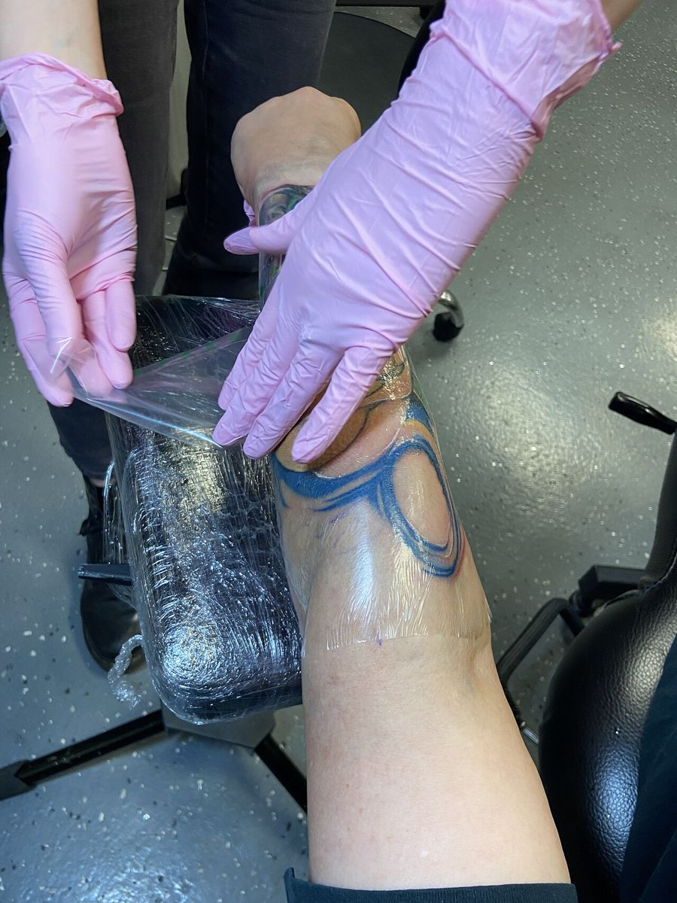
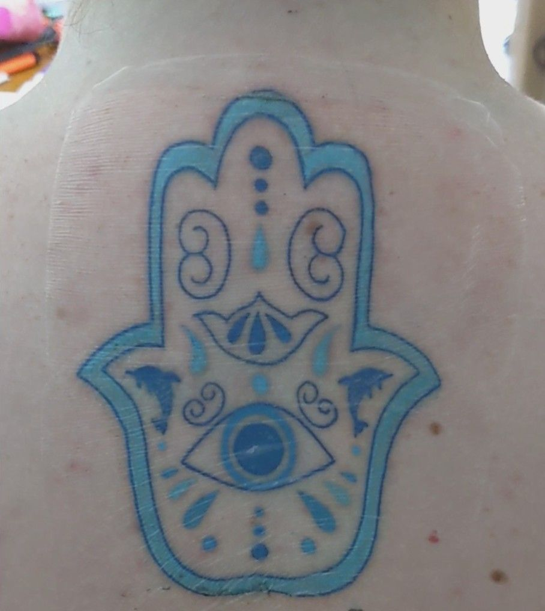
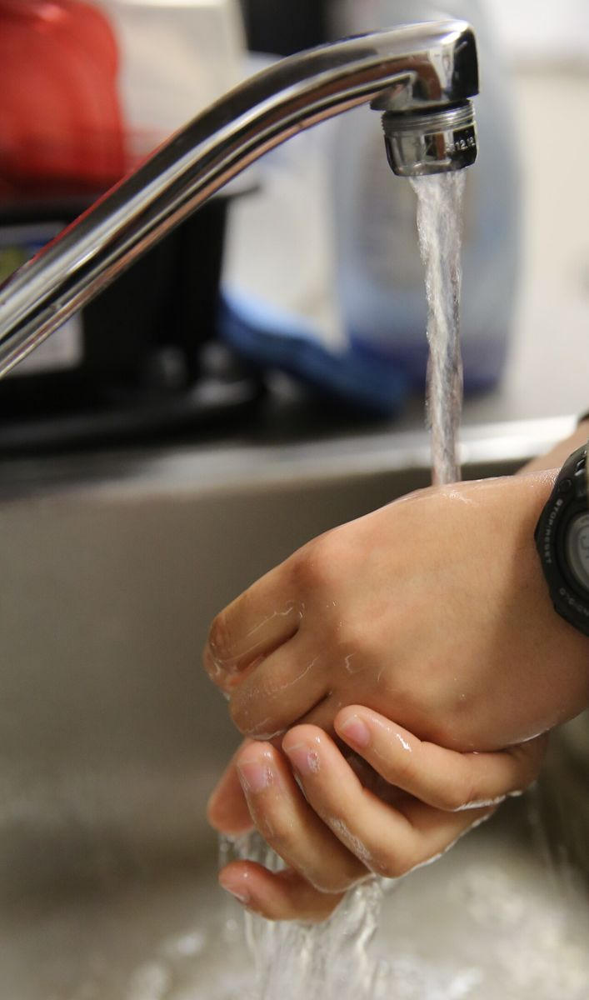
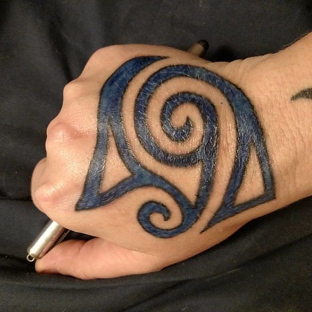

# Заживляющая плёнка на тату («вторая кожа»): когда снимать и как правильно

**Коротко:** заживляющая плёнка — это тонкая прозрачная клейкая повязка, которую мастер наклеивает на свежую тату, чтобы защитить её от грязи и трения. Сколько её носить, решает мастер и инструкция к конкретной плёнке: схемы у разных производителей отличаются, но первую плёнку обычно меняют в течение первых суток, а общий срок ношения не растягивают дольше, чем разрешает производитель. Жидкость с краской под плёнкой в первые часы — частая норма. Снимать плёнку нужно раньше срока, если она протекла, отклеилась по краю, под неё попала вода или кожа вокруг краснеет, горит и зудит всё сильнее. Снимают медленно, чистыми руками, лучше под тёплой водой, оттягивая плёнку вдоль кожи, а не вверх.

> Это не медицинский совет. Мы описываем общие принципы ухода и опыт студии. Инструкция вашего мастера и производителя плёнки важнее любых общих правил. Если вас что-то беспокоит, особенно при аллергии, кожных заболеваниях или признаках воспаления, посоветуйтесь с врачом.

*Мастер в перчатках накрывает свежую тату прозрачной плёнкой сразу после сеанса.* Фото: Myotus (работа тату-мастера Jenna Haas), [Wikimedia Commons](https://commons.wikimedia.org/wiki/File:23B--applying_transparent_dressing_to_protect_tattoo_during_early_stages_of_healing_process.jpg), лицензия [CC BY-SA 4.0](https://creativecommons.org/licenses/by-sa/4.0).

## Что такое заживляющая плёнка и зачем она нужна

Свежая татуировка — это заживающая рана. В первые часы и дни она особенно уязвима: может мокнуть, тереться об одежду, собирать пыль и бактерии. Заживляющая плёнка, которую часто называют «второй кожей», — это тонкая прозрачная полиуретановая повязка с клеевым слоем. Такие плёнки давно используют в медицине для поверхностных ран.

По нашему опыту, у плёнки несколько практических плюсов:

- **Защита.** Одежда не липнет к тату и не натирает её, грязь и бактерии не попадают на рану, пока плёнка цела.
- **Меньше прикосновений.** Пока тату под плёнкой, её не нужно мазать, и меньше соблазна трогать рисунок руками.
- **Видно, что происходит.** Плёнка прозрачная, поэтому можно следить за кожей, не снимая повязку.

Важно понимать и ограничения. Мы не нашли крупных клинических исследований, которые доказывали бы, что под плёнкой тату заживает быстрее или держит цвет лучше, чем при классическом уходе с промыванием и тонким слоем крема. Это удобный и разумный способ, но не обязательный. Если мастер использует обычную плёнку или повязку, это тоже нормально.

## Сколько носить плёнку на тату

Единого срока нет. В исследовании Liszewski и соавторов (журнал Dermatology, 2023) проанализировали 700 инструкций по уходу за тату из американских студий и пришли к выводу, что рекомендации в них очень сильно различаются. Поэтому главный ориентир — то, что сказал ваш мастер, и инструкция к той плёнке, которую он наклеил.

Cleveland Clinic пишет, что после сеанса мастер обычно наносит тонкий слой мази и закрывает тату прозрачной повязкой, а держать её нужно столько, сколько сказал мастер, — в зависимости от размера работы это может быть от нескольких часов и дольше.

На практике часто встречается такая схема:

| Этап | Что обычно происходит | На что смотреть |
|---|---|---|
| Первые часы после сеанса | Под плёнкой собирается сукровица, кровь и лишняя краска | Плёнка должна оставаться герметичной по краям |
| Первая смена (чаще в течение первых суток) | Плёнку снимают, тату мягко промывают, сушат | Если жидкости много, мастер может попросить сменить плёнку раньше |
| Вторая плёнка (если её дали) | Носят несколько дней по инструкции производителя | Жидкости становится меньше, кожа под плёнкой спокойная |
| После снятия | Переход на обычный уход: промывание и тонкий слой средства | Шелушение и зуд — частая норма заживления |

Сроки здесь — ориентиры, а не правило. Производители медицинских прозрачных плёночных повязок указывают, что целую, чистую и хорошо приклеенную повязку можно носить до 7 дней, но это общая медицинская норма, а не инструкция для тату. Не держите плёнку дольше, чем разрешает производитель или мастер, даже если она выглядит целой.

## Что нормально под плёнкой, а что нет

Многих пугает «мешок» с тёмной жидкостью под плёнкой в первый день. Обычно это смесь сукровицы, небольшого количества крови и лишнего пигмента. Она может быть желтоватой, красноватой, серой или почти чёрной в цвет рисунка. Само по себе это не признак инфекции.

*Тату заживает под прозрачной плёнкой: края приклеены, рисунок хорошо виден.* Фото: Julera, тату: Cassandra Gatelein, [Wikimedia Commons](https://commons.wikimedia.org/wiki/File:Dolphin_hamsa_under_Tegaderm.jpg), лицензия [CC BY-SA 4.0](https://creativecommons.org/licenses/by-sa/4.0).

**Похоже на норму:**

- немного жидкости с краской под плёнкой в первые часы и первые сутки;
- лёгкая краснота и чувствительность вокруг рисунка;
- плёнка слегка сморщилась на сгибе, но края держатся.

**Повод снять плёнку раньше и связаться с мастером:**

- жидкость вытекает из-под края или край отклеился так, что тату открыта;
- под плёнку попала вода или грязь;
- жидкости так много, что плёнка надулась и вот-вот протечёт;
- по краям клеевого слоя появилась сыпь, пузырьки, сильный зуд или жжение;
- краснота, отёк, жар или боль нарастают, а не стихают.

Не пытайтесь «спасти» протёкшую плёнку пластырем или скотчем сверху: так можно запереть под ней загрязнение. Если плёнка уже не герметична, её лучше снять и перейти к обычному уходу или наклеить новую, если так сказал мастер.

## Как правильно снять плёнку с тату

Снимать плёнку резким рывком нельзя: так легко травмировать свежую кожу. Мы советуем такой порядок:

*Первым делом — тщательно вымыть руки с мылом. Иллюстративное фото.* Фото: Sgt. Grace L. Waladkewics (армия США), [Wikimedia Commons](https://commons.wikimedia.org/wiki/File:Washing_hands_%28cropped%29.jpg), общественное достояние.

1. **Вымойте руки** с мылом. Cleveland Clinic называет это первым шагом перед снятием повязки.
2. **Размочите плёнку тёплой (не горячей) водой.** Удобнее всего в душе: тёплая вода размягчает клей.
3. **Подцепите уголок** и тяните плёнку медленно, низко, почти параллельно коже — «на себя» вдоль поверхности, а не вверх. Свободной рукой придерживайте кожу рядом.
4. **Если плёнка держится крепко,** не дёргайте: добавьте воды и продолжайте понемногу. На волосистых участках обычно легче тянуть по направлению роста волос.
5. **Промойте тату** мягким средством без отдушек и тёплой водой, не растирая. Промокните чистым бумажным полотенцем.
6. **Дайте коже немного подсохнуть** и дальше действуйте по инструкции мастера: новая плёнка или тонкий слой средства.

Что наносить после снятия и как не переборщить с кремом, мы подробно разобрали в статье [«Чем мазать тату после снятия плёнки»](/tattoo-spravochnik/chem-mazat-tatu-posle-snyatiya-plenki/). А о том, как мыться в первые дни, — в материале [«Можно ли мочить тату»](/tattoo-spravochnik/mozhno-li-mochit-tatu/).

## Чего не делать, пока тату под плёнкой

- **Не мажьте ничего поверх или под плёнку** без указания мастера: крем мешает клею держаться.
- **Не прокалывайте плёнку и не «сливайте» жидкость** через дырочку в плёнке — так нарушается защита.
- **Не лежите в ванне, не ходите в бассейн и баню.** Даже целая плёнка не рассчитана на долгое погружение и нагрев.
- **Не носите плёнку «до последнего»,** если она уже отклеилась или протекла.
- **Не сдирайте плёнку сухой** одним движением.

## Когда идти к врачу

Обратитесь к врачу, лучше к дерматологу, если после снятия плёнки или во время её ношения появились признаки, которые Cleveland Clinic относит к возможной инфекции:

- температура, озноб, общее недомогание;
- кожа вокруг тату горячая на ощупь, краснота расползается всё шире;
- от тату идёт неприятный запах, появились гной или обильные выделения;
- боль усиливается, а не уменьшается;
- красные полосы тянутся от тату в сторону туловища.

Также стоит показаться врачу, если по краям клеевого слоя появились пузыри, мокнущая сыпь или сильный зуд — это может быть реакция на клей. О том, как отличить нормальное заживление от воспаления, мы писали в статье [«Тату воспалилась: что делать»](/tattoo-spravochnik/tatu-vospalilas-chto-delat/). Антибиотики и любые лекарства — только по назначению врача.

*Так выглядит спокойное заживление: линии чёткие, нет отёка и мокнущих участков.* Фото: Slave2TehTink, [Wikimedia Commons](https://commons.wikimedia.org/wiki/File:Hand_tattoo_healing_well.jpg), лицензия [CC BY-SA 4.0](https://creativecommons.org/licenses/by-sa/4.0).

## Частые вопросы

### Можно ли мыться с заживляющей плёнкой на тату?

Целая, хорошо приклеенная плёнка обычно выдерживает короткий душ, но правила зависят от конкретной плёнки и мастера. Не направляйте на неё сильную струю и не лежите в ванне. Если вода попала под плёнку, её лучше снять.

### Под плёнкой собралась чёрная жидкость — это плохо?

В первые часы и сутки это частая норма: сукровица смешивается с лишней краской. Повод снять плёнку — если жидкость вытекает, плёнка надулась или отклеилась.

### Что делать, если плёнка отклеилась на краю?

Если отклеился маленький уголок далеко от рисунка, а тату по-прежнему закрыта, обычно ничего делать не нужно. Если появился «канал» до самой тату, плёнку лучше снять и перейти к обычному уходу или наклеить новую по указанию мастера.

### Можно ли наклеить заживляющую плёнку самостоятельно?

Если мастер дал вам плёнку и объяснил, как её менять, — да, на чистую и сухую кожу, без растяжения. Без указаний мастера лучше не экспериментировать и спросить его.

### Тату под плёнкой чешется — это нормально?

Лёгкий зуд бывает из-за влаги и клея. Если зуд сильный, появилась сыпь по краям или жжение, плёнку стоит снять и связаться с мастером. Подробнее — в статье [«Тату чешется: что делать»](/tattoo-spravochnik/tatu-cheshetsya-chto-delat/).

---

## Записаться в ТатуНаХоду

В «ТатуНаХоду» (Москва) мы после сеанса объясняем, как обращаться с плёнкой именно на вашей тату, сколько её носить и когда менять, и остаёмся на связи, пока работа заживает. Хотите новую тату или есть вопрос по заживлению — напишите нам.

👉 [Записаться в Telegram](https://t.me/tatunahody)

Работы мастеров и новости студии — в нашем Telegram-канале: [t.me/tattoo_na_hodu](https://t.me/tattoo_na_hodu)

## Источники изображений

- `master-nakleivaet-plenku-na-svezhuyu-tatu.jpg` — «23B--applying transparent dressing to protect tattoo during early stages of healing process.jpg», автор: Myotus (работа тату-мастера Jenna Haas), источник: [Wikimedia Commons](https://commons.wikimedia.org/wiki/File:23B--applying_transparent_dressing_to_protect_tattoo_during_early_stages_of_healing_process.jpg), лицензия: [CC BY-SA 4.0](https://creativecommons.org/licenses/by-sa/4.0). Без изменений, кроме уменьшения размера.
- `tatu-na-spine-pod-prozrachnoy-plenkoy.jpg` — «Dolphin hamsa under Tegaderm.jpg», фото: Julera, тату: Cassandra Gatelein, источник: [Wikimedia Commons](https://commons.wikimedia.org/wiki/File:Dolphin_hamsa_under_Tegaderm.jpg), лицензия: [CC BY-SA 4.0](https://creativecommons.org/licenses/by-sa/4.0). Без изменений.
- `myte-ruk-pered-snyatiem-plenki.jpg` — «Washing hands (cropped).jpg», автор: Sgt. Grace L. Waladkewics, армия США ([DVIDS](https://www.dvidshub.net/image/2386090)), источник: [Wikimedia Commons](https://commons.wikimedia.org/wiki/File:Washing_hands_%28cropped%29.jpg), общественное достояние (работа федерального правительства США). Без изменений, кроме уменьшения размера.
- `zazhivayushchaya-tatu-na-kisti-posle-plenki.jpg` — «Hand tattoo healing well.jpg», автор: Slave2TehTink, источник: [Wikimedia Commons](https://commons.wikimedia.org/wiki/File:Hand_tattoo_healing_well.jpg), лицензия: [CC BY-SA 4.0](https://creativecommons.org/licenses/by-sa/4.0). Без изменений.

## Источники фактов

- Cleveland Clinic: [Tattoo Aftercare: Instructions and Healing Tips](https://health.clevelandclinic.org/tattoo-aftercare).
- Liszewski W, Newcomer J, Laumann AE, Leger MC, Farah RS. An Analysis of the Content and Recommendations of 700 American Tattoo Aftercare Instructions. *Dermatology*, 2023;239(6):988–995. [PubMed](https://pubmed.ncbi.nlm.nih.gov/37604151/).
- 3M: описание прозрачных плёночных повязок Tegaderm (срок ношения до 7 дней для медицинского применения): [брошюра](https://media.supplychain.nhs.uk/media/documents/ELW217/Document/18673_3M%20Tegaderm%20Film%20Dressing%20Range%20-%20Literature.pdf).
